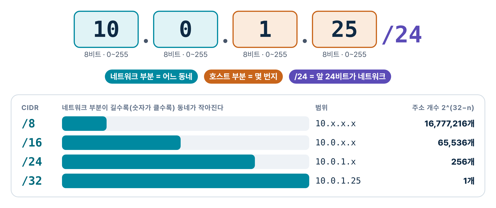
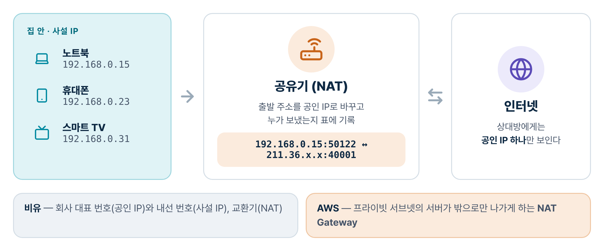
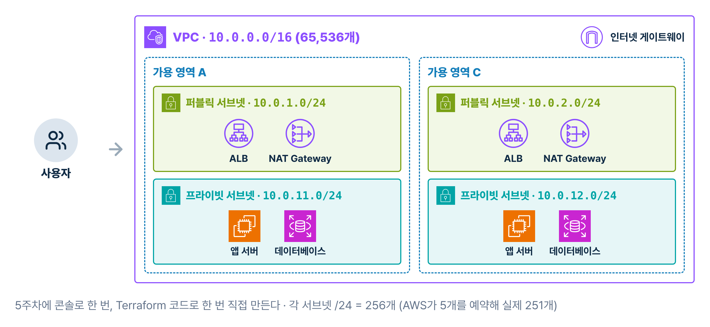

<sub>[🏠 과정 목차](../../README.md) › [1주차](../README.md) › [3일차](README.md) › 2/7교시</sub>

# 2교시 · IP 주소와 서브넷

> [!NOTE]
> **이번 시간에 할 일**
>
> - IPv4 주소의 구조를 읽습니다.
> - 공인 IP와 사설 IP를 구분하고, NAT가 왜 필요한지 이해합니다.
> - CIDR 표기(`10.0.0.0/16`)를 읽고 주소가 몇 개인지 계산합니다.
> - 5주차 AWS VPC 설계를 미리 그려 봅니다.

## IP 주소 — 인터넷의 집 주소

**IP 주소**는 네트워크에서 컴퓨터를 찾아가기 위한 주소입니다. 지금 가장 많이 쓰는 **IPv4** 주소는 0~255 사이의 숫자 네 개를 점으로 구분해 씁니다.



```text
192 . 168 . 0 . 15
 │     │    │   │
 각 칸은 8비트(옥텟), 0~255  → 전체 32비트
```

32비트이므로 만들 수 있는 주소는 2³² = 약 **43억 개**입니다. 1980년대에는 넉넉해 보였지만, 지금 지구에는 스마트폰만 수십억 대가 있습니다.

## 공인 IP와 사설 IP

43억 개로는 모든 기기에 주소를 하나씩 줄 수 없습니다. 그래서 **집이나 회사 안에서만 쓰는 주소**를 따로 정해 두었습니다. 이것이 **사설 IP**입니다(RFC 1918, 1996년).

| 구분 | 범위 | 특징 | 예시 |
|---|---|---|---|
| 공인 IP | 사설 범위를 뺀 나머지 | 인터넷 전체에서 유일, 돈이 든다 | 웹 서버, 로드밸런서 |
| 사설 IP | `10.0.0.0/8` | 약 1,677만 개 | **AWS VPC에서 가장 많이 씀** |
| 사설 IP | `172.16.0.0/12` | 약 104만 개 | Docker 기본 네트워크 |
| 사설 IP | `192.168.0.0/16` | 약 6.5만 개 | 가정용 공유기 |
| 루프백 | `127.0.0.1` | **나 자신** | 3교시 localhost |

사설 IP는 여러 곳에서 **똑같은 주소를 겹쳐 써도 됩니다.** 우리 집 노트북이 `192.168.0.15`이고 옆집 노트북도 `192.168.0.15`일 수 있습니다. 대신 사설 IP로는 인터넷에 직접 나갈 수 없습니다.

## NAT — 사설 IP가 인터넷에 나가는 방법



**NAT(Network Address Translation)**는 사설 IP를 공인 IP로 **바꿔 주는** 기술입니다. 집 공유기가 바로 NAT 장비입니다.

1. 노트북(`192.168.0.15`)이 네이버에 요청을 보냅니다.
2. 공유기가 출발 주소를 **공유기의 공인 IP**로 바꾸고, "누가 보낸 것인지"를 표에 적어 둡니다.
3. 네이버의 응답이 공유기로 돌아오면, 표를 보고 노트북에 전달합니다.

> **🧩 비유 — 회사 대표 번호**
>
> 회사 직원 100명에게 각각 외부 전화번호를 주는 대신, **대표 번호 하나**와 내선 번호를 씁니다. 직원이 밖으로 전화를 걸면 상대방에게는 대표 번호가 표시됩니다. 대표 번호 = 공인 IP, 내선 번호 = 사설 IP, 교환기 = NAT입니다. 그리고 바깥에서 대표 번호로 전화를 걸면, 교환기가 따로 연결해 주지 않는 한 특정 직원에게 바로 갈 수 없습니다. **NAT 뒤의 컴퓨터는 바깥에서 먼저 접근하기 어렵습니다** — 이것이 보안상의 장점이기도 합니다.

5주차 AWS에서 **NAT Gateway**를 만나게 됩니다. 외부에 노출하면 안 되는 서버(사설 서브넷)가 소프트웨어 업데이트처럼 **밖으로 나가는 통신만** 할 수 있게 해 주는 장비입니다. 1일차 비용 함정에서 본 것처럼, **켜져 있는 시간과 지나간 데이터 양만큼 요금이 나오는** 대표적인 리소스이기도 합니다.

## CIDR — 주소 묶음을 표현하는 법

IP 주소는 **네트워크 부분**(어느 동네)과 **호스트 부분**(그 동네의 몇 번지)으로 나뉩니다. 어디까지가 네트워크 부분인지를 `/` 뒤의 숫자로 표시하는 방식이 **CIDR(Classless Inter-Domain Routing)** 표기입니다.

| CIDR | 네트워크 부분 | 주소 개수 | 쉬운 해석 |
|---|---|---|---|
| `10.0.0.0/8` | 앞 8비트 | 2²⁴ = 16,777,216 | `10.x.x.x` 전부 |
| `10.0.0.0/16` | 앞 16비트 | 2¹⁶ = 65,536 | `10.0.x.x` 전부 |
| `10.0.1.0/24` | 앞 24비트 | 2⁸ = 256 | `10.0.1.x` 전부 |
| `10.0.1.10/32` | 32비트 전부 | 1 | 딱 이 주소 하나 |
| `0.0.0.0/0` | 0비트 | 약 43억 | **인터넷 전체** |

> [!IMPORTANT]
> **외워 둘 공식은 하나**
>
> **주소 개수 = 2^(32 − 슬래시 뒤 숫자)**. 슬래시 숫자가 **작을수록 큰 동네**, 클수록 작은 동네입니다. 그리고 `0.0.0.0/0`은 "세상 모든 주소"입니다. 1일차 3교시의 "보안 그룹에 `0.0.0.0/0` 허용 = 전 세계에서 접근 가능"이 바로 이 뜻이었습니다.

### 서브넷 — 큰 동네를 작은 구역으로 나누기

**서브넷(subnet)**은 큰 네트워크를 작은 네트워크로 나눈 것입니다. 큰 아파트 단지를 동별로 나누듯, 용도에 따라 구역을 나눠서 관리하고 보안 규칙을 다르게 적용합니다.



| 서브넷 | CIDR | 위치 | 용도 |
|---|---|---|---|
| 퍼블릭 서브넷 A | `10.0.1.0/24` | 가용 영역 A | 로드밸런서, NAT Gateway |
| 퍼블릭 서브넷 C | `10.0.2.0/24` | 가용 영역 C | 로드밸런서 (이중화) |
| 프라이빗 서브넷 A | `10.0.11.0/24` | 가용 영역 A | 앱 서버, 데이터베이스 |
| 프라이빗 서브넷 C | `10.0.12.0/24` | 가용 영역 C | 앱 서버, 데이터베이스 (이중화) |

1일차에 배운 **가용 영역**과 오늘 배운 **서브넷**이 만나는 지점입니다. 바깥과 직접 통하는 것은 퍼블릭 서브넷에, 숨겨야 할 것은 프라이빗 서브넷에 두고, 같은 구성을 두 가용 영역에 나눠 놓아 하나가 멈춰도 서비스가 이어지게 합니다. 5주차에는 이 그림을 콘솔로 한 번, Terraform 코드로 한 번 직접 만듭니다.

> [!WARNING]
> **주소 범위를 처음에 넉넉하게**
>
> VPC의 주소 범위는 만든 뒤에 바꾸기가 어렵습니다. 또 회사의 다른 네트워크(사무실, 다른 VPC)와 **주소가 겹치면** 나중에 서로 연결할 수 없습니다. 현업에서 "처음 VPC 설계 때 CIDR을 잘못 잡아서 1년 뒤에 전부 다시 만들었다"는 이야기는 드물지 않습니다.

> **🎓 학술 노트 — CIDR와 주소 고갈의 역사**
>
> 초기 인터넷은 IP 주소를 A·B·C 세 가지 **고정 크기 등급(class)**으로만 나눠 줬습니다. 그런데 B등급(6.5만 개)은 대부분의 기관에 너무 크고, C등급(256개)은 너무 작아서 주소가 크게 낭비됐습니다. 1993년 IETF는 RFC 1519에서 **등급 없이 필요한 크기만큼 나눠 주는 CIDR**를 도입해 낭비를 줄였고, 1996년 RFC 1918로 **사설 주소** 범위를 정했습니다. NAT와 사설 IP, CIDR 세 가지 덕분에 IPv4는 예상보다 수십 년을 더 버텼습니다.
>
> 그래도 결국 2011년 2월, 전 세계 IP 주소를 관리하는 IANA는 지역 기관들에 나눠 줄 **마지막 IPv4 주소 블록을 소진**했습니다. 근본적인 해결책은 128비트 주소를 쓰는 **IPv6**입니다. 주소가 약 3.4×10³⁸개로, 사실상 무한합니다.
>
> - Fuller, V. et al. (1993). *RFC 1519: Classless Inter-Domain Routing (CIDR)*. (현재 RFC 4632)
> - Rekhter, Y. et al. (1996). *RFC 1918: Address Allocation for Private Internets*.
> - Deering, S., & Hinden, R. (1998/2017). *RFC 2460 / RFC 8200: Internet Protocol, Version 6 (IPv6)*.

> **📈 트렌드 — IPv4는 이제 '돈'이고, IPv6는 절반을 넘보는 중**
>
> IPv4 주소가 귀해지면서 클라우드에서도 **공인 IPv4 주소에 요금**이 붙기 시작했습니다. AWS는 2024년 2월부터 사용 중이든 아니든 모든 공인 IPv4 주소에 **개당 시간당 $0.005**를 받습니다. 1일차 비용 함정 표에 있던 바로 그 항목입니다.
>
> 한편 IPv6는 꾸준히 늘고 있습니다. 구글의 측정에 따르면 구글 서비스에 IPv6로 접속하는 사용자 비율은 2025년 초 약 47%였고, **2026년 3월 28일에는 하루 동안 50.1%로 처음 절반을 넘었습니다**. 다만 국가별 편차가 커서, 프랑스·독일·인도는 70%를 넘는 반면 일부 국가는 훨씬 낮습니다. 이 과정의 실습은 IPv4 중심이지만, 현업 클라우드 설계에서는 IPv6 지원 여부를 점점 더 자주 묻게 될 것입니다.

## 정리

- IPv4는 32비트, 약 43억 개의 주소입니다.
- **사설 IP**(`10.x`, `172.16~31.x`, `192.168.x`)는 내부용이고, 인터넷에 나가려면 **NAT**가 필요합니다.
- **CIDR**의 슬래시 숫자가 작을수록 큰 범위입니다. 주소 개수 = 2^(32−n), `0.0.0.0/0`은 인터넷 전체입니다.
- VPC는 큰 CIDR을 **가용 영역 × 용도(퍼블릭/프라이빗)**로 서브넷을 나눠 설계합니다.

> **✅ 확인 문제**
>
> 1. `192.168.0.15`는 공인 IP인가요, 사설 IP인가요?
> 2. `10.0.0.0/24`에는 주소가 몇 개 있나요?
> 3. 보안 그룹 규칙의 출발지가 `0.0.0.0/0`이면 무슨 뜻인가요?
> 4. 사설 서브넷의 서버가 밖으로 나가는 통신만 할 수 있게 해 주는 AWS 장비는?
> 5. AWS가 2024년부터 공인 IPv4 주소에 매기는 요금은?
>
> <details><summary>정답</summary>
>
> 1. 사설 IP (192.168.0.0/16 범위)
> 2. 256개 (2^(32−24) = 2⁸)
> 3. 전 세계 모든 IP 주소에서 접근을 허용한다
> 4. NAT Gateway
> 5. 개당 시간당 $0.005
>
> </details>

## 참고 문헌

- Rekhter, Y. et al. (1996). *RFC 1918: Address Allocation for Private Internets*. IETF.
- Fuller, V., & Li, T. (2006). *RFC 4632: Classless Inter-domain Routing (CIDR)*. IETF.
- Deering, S., & Hinden, R. (2017). *RFC 8200: Internet Protocol, Version 6 (IPv6) Specification*. IETF.
- Google. *IPv6 Statistics*. google.com/ipv6/statistics.html
- APNIC Blog (2026). *Google hits 50% IPv6*.
- AWS. *Amazon VPC pricing — Public IPv4 addresses*. aws.amazon.com/vpc/pricing

---

| 이전 | 목차 | 다음 |
|:--|:--:|--:|
| ⬅️ [1교시 · 네트워크 큰 그림](lesson-01.md) | [⬆️ 3일차 목차](README.md) | [3교시 · 포트와 프로토콜](lesson-03.md) ➡️ |
