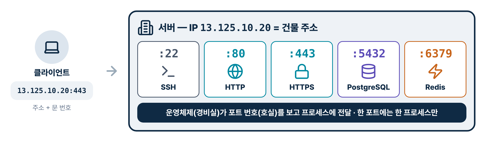
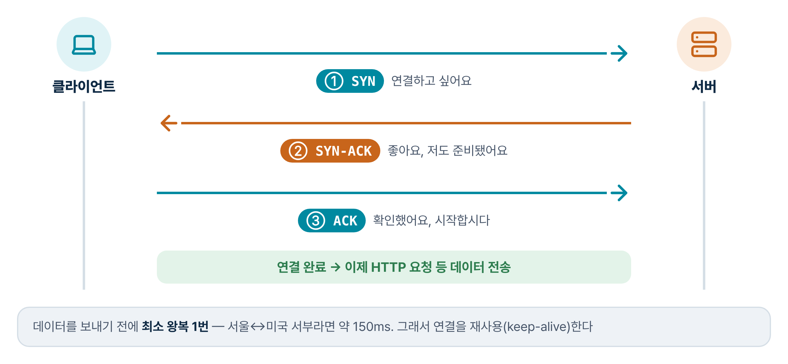

<sub>[🏠 과정 목차](../../README.md) › [1주차](../README.md) › [3일차](README.md) › 3/8교시</sub>

# 3교시 · 포트와 프로토콜

> [!NOTE]
> **이번 시간에 할 일**
>
> - 포트가 무엇이고 왜 필요한지 설명합니다.
> - TCP와 UDP의 차이, 그리고 TCP 3-way handshake를 이해합니다.
> - 자주 쓰는 포트 번호를 압니다.
> - `localhost`, `127.0.0.1`, `0.0.0.0`의 차이를 구분합니다.

## 포트 — 한 컴퓨터 안의 여러 문

IP 주소가 **어느 컴퓨터**인지를 알려 준다면, **포트(port)**는 그 컴퓨터 안에서 **어느 프로그램**에게 가야 하는지를 알려 줍니다. 한 서버에서 웹 서버, 데이터베이스, SSH가 동시에 돌아가도 데이터가 섞이지 않는 이유입니다.



> **🧩 비유 — 건물 주소와 호실**
>
> IP 주소는 **건물 주소**, 포트는 **호실 번호**입니다. 택배 기사(네트워크)는 건물(서버)까지 찾아가고, 경비실(운영체제)이 호실 번호(포트)를 보고 해당 사무실(프로세스)에 전달합니다. 한 호실에는 한 회사만 입주할 수 있듯이, **한 포트에는 한 프로세스만** 귀를 기울일(listen) 수 있습니다.

포트 번호는 0~65535까지 있으며, 용도에 따라 범위가 나뉩니다.

| 범위 | 이름 | 설명 |
|---|---|---|
| 0~1023 | 잘 알려진 포트 (well-known) | 표준 서비스용. Linux에서 쓰려면 관리자 권한 필요 |
| 1024~49151 | 등록된 포트 | 데이터베이스, 개발 서버 등 |
| 49152~65535 | 임시 포트 (ephemeral) | 클라이언트가 연결할 때 운영체제가 잠깐 배정 |

### 꼭 알아 둘 포트 번호

| 포트 | 서비스 | 이 과정에서 |
|---|---|---|
| 22 | SSH (원격 접속) | 5주차 EC2 접속 |
| 53 | DNS | 4교시 |
| 80 | HTTP | 웹 서버 기본 |
| 443 | HTTPS | 암호화된 웹 |
| 3306 | MySQL | 데이터베이스 |
| 5432 | PostgreSQL | 2주차 DB 컨테이너 |
| 6379 | Redis | 캐시 |
| 8080 | 개발용 웹 서버 (관례) | 2주차 Docker 실습 |
| 6443 | Kubernetes API 서버 | 3주차 |

> [!WARNING]
> **포트 충돌 — 2주차에 반드시 만나는 에러**
>
> 이미 다른 프로세스가 쓰고 있는 포트에 새 프로그램을 띄우면 이런 에러가 납니다.
>
> ```text
> Error: bind: address already in use
> Error: port is already allocated
> ```
>
> 1일차 1교시의 "좋은 질문" 예시가 바로 이 에러였습니다. 해결 순서는 항상 같습니다. ① 어떤 프로세스가 그 포트를 쓰고 있는지 확인한다(`ss -tlnp`, `docker ps`). ② 그 프로세스를 멈출지, 내 프로그램의 포트를 바꿀지 결정한다.

## TCP와 UDP — 확실하게 vs 빠르게

전송 계층에는 성격이 다른 두 프로토콜이 있습니다.

| 비교 | TCP | UDP |
|---|---|---|
| 연결 | 먼저 연결을 맺는다 | 연결 없이 바로 보낸다 |
| 신뢰성 | 순서 보장, 빠진 패킷 재전송 | 보장 없음 |
| 속도 | 상대적으로 느림 | 빠름 |
| 비유 | **등기 우편** (수령 확인) | **전단지 뿌리기** |
| 쓰임 | 웹(HTTP/1.1·2), DB, SSH, 파일 전송 | DNS 조회, 영상 통화, 게임, HTTP/3 |

웹 페이지는 한 글자라도 빠지면 안 되므로 TCP를, 영상 통화는 0.1초 전 화면을 다시 받는 것보다 지금 화면을 빨리 받는 게 중요하므로 UDP를 씁니다.

### TCP 3-way handshake — 연결의 시작

TCP는 데이터를 보내기 전에 세 번 신호를 주고받아 연결을 맺습니다.



1. **SYN** — 클라이언트: "연결하고 싶어요."
2. **SYN-ACK** — 서버: "좋아요, 저도 준비됐어요."
3. **ACK** — 클라이언트: "확인했어요, 시작합시다."

이 과정 때문에 TCP 연결에는 데이터를 보내기 전에 최소 **왕복 한 번**의 시간이 듭니다. 서울에서 미국 서버에 연결하면 handshake만으로 약 150ms가 걸리는 셈입니다. 그래서 웹 브라우저와 서버는 연결을 한 번 맺으면 재사용(keep-alive)하려고 합니다.

> **📘 연결이 안 될 때 에러 메시지로 원인 구분하기**
>
> | 에러 메시지 | 무슨 일이 일어났나 | 먼저 의심할 것 |
> |---|---|---|
> | `Connection refused` | 서버에는 닿았지만 그 포트에서 기다리는 프로그램이 없다 | 프로그램이 꺼져 있다, 포트 번호가 틀렸다 |
> | `Connection timed out` | 아무 응답이 없다 — 중간에서 막혔다 | **방화벽·보안 그룹**이 막고 있다, IP가 틀렸다 |
> | `No route to host` | 그 주소로 가는 길이 없다 | 네트워크 설정, 라우팅 |
> | `Name or service not known` | 이름을 IP로 바꾸지 못했다 | **DNS** (4교시) |
>
> 이 네 줄을 구분할 수 있으면 "연결이 안 돼요"를 "보안 그룹이 막는 것 같아요"로 바꿀 수 있습니다. 5주차 AWS 실습에서 가장 많이 쓰게 될 표입니다.

## localhost, 127.0.0.1, 0.0.0.0

| 주소 | 뜻 | 쓰임 |
|---|---|---|
| `localhost` = `127.0.0.1` | **나 자신**. 이 주소로 보낸 데이터는 컴퓨터 밖으로 나가지 않는다 | 내 컴퓨터에서 띄운 서버에 내가 접속 |
| 서버가 `127.0.0.1`에서 listen | **나만** 접속할 수 있다 | 외부 노출이 위험한 관리 도구 |
| 서버가 `0.0.0.0`에서 listen | **모든 네트워크 카드**에서 접속을 받는다 | 외부에서 접속해야 하는 서버, 컨테이너 안의 앱 |

> [!IMPORTANT]
> **2주차에 꼭 다시 볼 함정**
>
> 컨테이너 안에서 앱이 `127.0.0.1:8080`으로 떠 있으면, **컨테이너 바깥(내 노트북)에서는 접속할 수 없습니다.** 컨테이너 안의 `127.0.0.1`은 그 컨테이너 자신만을 뜻하기 때문입니다(어제 배운 네트워크 네임스페이스). 그래서 컨테이너 안의 앱은 보통 `0.0.0.0`으로 띄웁니다. "컨테이너는 Up인데 브라우저로 안 열려요"라는 질문의 단골 원인입니다.

> **🎓 학술 노트 — 인터넷이 무너질 뻔한 날 (1986)과 혼잡 제어**
>
> 1986년 10월, 버클리와 로렌스 버클리 연구소 사이의 통신 속도가 초당 32,000비트에서 **40비트로 1,000배 가까이 떨어지는** 일이 벌어졌습니다. 패킷이 손실되면 모든 컴퓨터가 동시에 재전송을 쏟아 내고, 그 때문에 네트워크가 더 막히는 악순환이었습니다. 이것을 **혼잡 붕괴(congestion collapse)**라고 합니다.
>
> 반 제이컵슨(Van Jacobson)은 1988년 논문 「혼잡 회피와 제어(Congestion Avoidance and Control)」에서, 네트워크가 막히는 신호(패킷 손실)를 느끼면 **보내는 속도를 스스로 줄이고**, 괜찮으면 조금씩 늘리는 알고리즘을 TCP에 넣었습니다. 지금도 모든 TCP 연결이 이 원리로 서로 양보하며 인터넷을 나눠 씁니다. 3주차에 MSA의 **재시도(retry)**를 배울 때, "실패하면 바로 다시 보내지 말고 점점 간격을 늘리며(exponential backoff) 재시도하라"는 원칙이 바로 이 교훈에서 나왔다는 것을 다시 떠올리게 됩니다.
>
> - Jacobson, V. (1988). Congestion avoidance and control. *ACM SIGCOMM '88*.

> **📈 트렌드 — HTTP/3와 QUIC: 웹이 UDP 위로 옮겨 가다**
>
> "웹은 TCP를 쓴다"는 말은 이제 절반만 맞습니다. 구글이 개발해 2021년 IETF 표준(RFC 9000)이 된 **QUIC**은 **UDP 위에서** 신뢰성과 암호화를 직접 구현해, TCP handshake와 TLS handshake를 합쳐 연결을 더 빨리 맺습니다. QUIC 위에서 동작하는 **HTTP/3**는 웹 기술 조사 기관 W3Techs 기준으로 2026년 들어 **전체 웹사이트의 약 38~40%**가 사용하며 꾸준히 늘고 있습니다. 1984년 종단 간 원칙이 말한 대로, 인터넷 중간을 바꾸지 않고 **양 끝의 소프트웨어만 바꿔서** 새 프로토콜이 퍼진 사례입니다.

## 정리

- **포트**는 한 컴퓨터 안의 어느 프로그램에게 갈지 정하는 번호이고, 한 포트에는 한 프로세스만 listen할 수 있습니다.
- **TCP**는 확실하게(연결·순서·재전송), **UDP**는 빠르게. TCP는 **3-way handshake**로 연결을 맺습니다.
- `Connection refused`는 "닿았는데 받을 프로그램이 없음", `timed out`은 "중간에서 막힘(방화벽)"입니다.
- `127.0.0.1`은 나만, `0.0.0.0`은 모두에게서 접속을 받습니다. 컨테이너 앱은 `0.0.0.0`으로 띄웁니다.

> **✅ 확인 문제**
>
> 1. HTTPS와 PostgreSQL의 기본 포트 번호는?
> 2. 영상 통화에 TCP보다 UDP가 더 어울리는 이유는?
> 3. TCP 3-way handshake의 세 단계를 순서대로 말해 보세요.
> 4. 서버에 접속했더니 `Connection timed out`이 뜹니다. 가장 먼저 무엇을 의심해야 하나요?
> 5. 컨테이너 안의 앱이 `127.0.0.1:8080`으로 떠 있으면 바깥에서 접속할 수 있나요?
>
> <details><summary>정답</summary>
>
> 1. 443, 5432
> 2. 지난 화면을 다시 받는 것보다 지금 화면을 빨리 받는 것이 중요하므로, 재전송 없이 빠른 UDP가 낫다
> 3. SYN → SYN-ACK → ACK
> 4. 방화벽이나 보안 그룹이 막고 있는지 (또는 IP가 틀렸는지)
> 5. 없습니다. 컨테이너 안의 127.0.0.1은 컨테이너 자신만을 뜻하므로 0.0.0.0으로 띄워야 합니다.
>
> </details>

## 참고 문헌

- Postel, J. (1981). *RFC 793: Transmission Control Protocol*. (현재 RFC 9293, 2022)
- Postel, J. (1980). *RFC 768: User Datagram Protocol*.
- Jacobson, V. (1988). Congestion avoidance and control. *ACM SIGCOMM '88*.
- Iyengar, J., & Thomson, M. (2021). *RFC 9000: QUIC: A UDP-Based Multiplexed and Secure Transport*.
- Bishop, M. (2022). *RFC 9114: HTTP/3*.
- W3Techs. *Usage statistics of HTTP/3 for websites*. w3techs.com
- IANA. *Service Name and Transport Protocol Port Number Registry*.

---

| 이전 | 목차 | 다음 |
|:--|:--:|--:|
| ⬅️ [2교시 · IP 주소와 서브넷](lesson-02.md) | [⬆️ 3일차 목차](README.md) | [4교시 · DNS](lesson-04.md) ➡️ |
