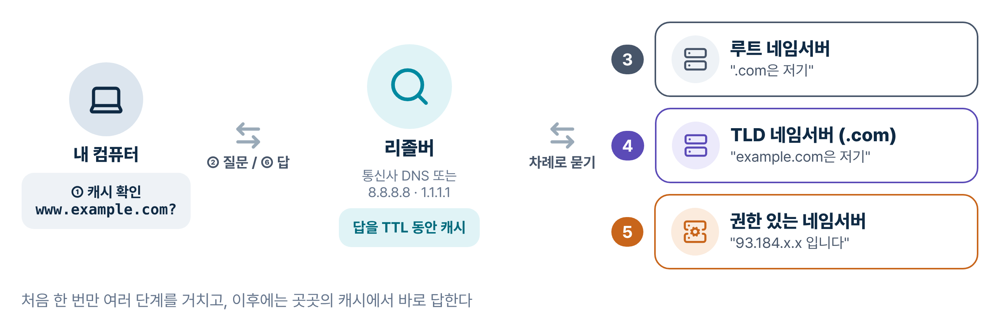
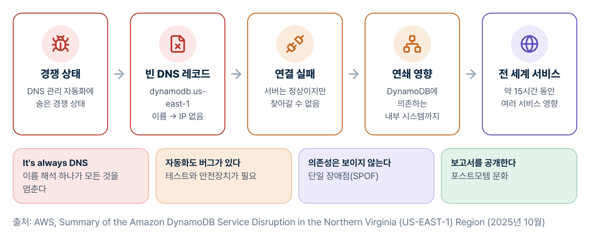

<sub>[🏠 과정 목차](../../README.md) › [1주차](../README.md) › [3일차](README.md) › 4/8교시</sub>

# 4교시 · DNS

> [!NOTE]
> **이번 시간에 할 일**
>
> - DNS가 도메인 이름을 IP 주소로 바꾸는 과정을 단계별로 설명합니다.
> - 자주 쓰는 DNS 레코드(A, AAAA, CNAME, MX, TXT, NS)를 압니다.
> - TTL과 캐시 때문에 "바꿨는데 반영이 안 되는" 현상을 이해합니다.
> - 2025년 AWS 대형 장애를 DNS 관점에서 분석합니다.

## DNS — 인터넷의 전화번호부

사람은 `www.naver.com` 같은 **이름**을 기억하고, 컴퓨터는 `223.130.x.x` 같은 **숫자(IP)**로 통신합니다. 이름을 숫자로 바꿔 주는 시스템이 **DNS(Domain Name System)**입니다.

> **🧩 비유 — 휴대폰 연락처**
>
> 친구 전화번호를 외우지 않고 이름으로 찾는 것처럼, 우리는 IP를 외우지 않고 도메인으로 접속합니다. 친구가 번호를 바꿔도 연락처만 고치면 계속 이름으로 찾을 수 있듯이, 서버의 IP가 바뀌어도 **DNS 레코드만 고치면** 사용자는 같은 주소로 접속합니다. 클라우드에서 서버를 자유롭게 교체할 수 있는 숨은 비결입니다.

## 도메인 이름의 구조

도메인 이름은 **오른쪽에서 왼쪽으로** 읽습니다. 오른쪽일수록 상위 단계입니다.

```text
   www   .  example  .  co  .  kr  .
   │        │          │      │    └─ 루트 (보통 생략된 점)
   │        │          │      └────── 국가 최상위 도메인 (TLD)
   │        │          └───────────── 2단계 도메인
   │        └──────────────────────── 등록한 이름
   └───────────────────────────────── 서브도메인 (호스트)
```

## 이름이 IP가 되기까지 — DNS 조회 과정



브라우저에 `www.example.com`을 입력하면 이런 일이 일어납니다.

1. **내 컴퓨터의 캐시 확인** — 최근에 찾아본 적이 있으면 바로 사용합니다.
2. **리졸버(resolver)에 질문** — 보통 인터넷 회사나 공용 DNS(8.8.8.8, 1.1.1.1)가 리졸버 역할을 합니다.
3. 리졸버가 **루트 네임서버**에 묻습니다 — "`.com`은 누가 관리하나요?" → "`.com` 서버는 저기예요."
4. 리졸버가 **TLD 네임서버(.com)**에 묻습니다 — "`example.com`은 누가 관리하나요?" → "그 회사 네임서버는 저기예요."
5. 리졸버가 **권한 있는(authoritative) 네임서버**에 묻습니다 — "`www.example.com`의 IP는?" → "`93.184.x.x`입니다."
6. 리졸버가 답을 **캐시에 저장**하고 내 컴퓨터에 알려 줍니다.

처음에는 여러 단계를 거치지만, 한 번 알아낸 답은 곳곳에 **캐시**되므로 대부분의 조회는 1~2단계에서 끝납니다.

## 자주 쓰는 DNS 레코드

| 레코드 | 뜻 | 예시 | 언제 쓰나 |
|---|---|---|---|
| **A** | 이름 → IPv4 주소 | `www → 13.125.10.20` | 가장 기본 |
| **AAAA** | 이름 → IPv6 주소 | `www → 2406:da12::1` | IPv6 지원 |
| **CNAME** | 이름 → **다른 이름** (별칭) | `www → myapp.cloudfront.net` | 클라우드 서비스에 연결 |
| **MX** | 이 도메인의 메일 서버 | `mail.example.com` | 이메일 |
| **TXT** | 아무 텍스트 | 도메인 소유 증명, 메일 보안 설정 | 인증서 발급, 서비스 인증 |
| **NS** | 이 도메인을 관리하는 네임서버 | `ns-123.awsdns-45.com` | 도메인을 Route 53으로 옮길 때 |

> [!TIP]
> **클라우드에서 CNAME이 많은 이유**
>
> AWS 로드밸런서(ALB)는 고정 IP 대신 `my-alb-1234.ap-northeast-2.elb.amazonaws.com` 같은 **이름**을 줍니다. 로드밸런서 뒤의 실제 IP는 트래픽에 따라 바뀌기 때문입니다. 그래서 내 도메인을 로드밸런서에 연결할 때는 IP를 적는 A 레코드 대신, 이름을 가리키는 **CNAME**(또는 AWS의 Alias 레코드)을 씁니다. 5주차에 직접 확인합니다.

## TTL과 캐시 — "바꿨는데 왜 안 바뀌죠?"

모든 DNS 레코드에는 **TTL(Time To Live)**이 붙어 있습니다. "이 답을 몇 초 동안 캐시해도 된다"는 뜻입니다.

| TTL | 장점 | 단점 |
|---|---|---|
| 길게 (예: 86400초 = 1일) | 조회가 적어 빠르고 DNS 서버 부담이 적다 | IP를 바꿔도 **최대 하루** 동안 옛 주소로 접속하는 사용자가 있다 |
| 짧게 (예: 60초) | 바꾸면 금방 반영된다 | 조회가 많아진다 |

> **📘 서버 이전 작전의 정석**
>
> 서버를 새 IP로 옮길 예정이라면, **며칠 전에 TTL을 60초로 줄여 둡니다.** 그러면 이전 당일 레코드를 바꿨을 때 1분 안에 대부분의 사용자가 새 서버로 갑니다. 이전이 끝나고 안정되면 TTL을 다시 늘립니다. "DNS를 바꿨는데 어떤 사람은 되고 어떤 사람은 안 돼요"라는 현상의 원인은 거의 항상 **캐시와 TTL**입니다.

> **🎓 학술 노트 — 하나의 파일에서 분산 데이터베이스로 (Mockapetris, 1983)**
>
> 초기 ARPANET에서는 모든 컴퓨터의 이름과 주소를 **`HOSTS.TXT`라는 파일 하나**에 적어 두고, 스탠퍼드 연구소(SRI)가 관리하는 이 파일을 모두가 주기적으로 내려받았습니다. 컴퓨터가 수백 대일 때는 괜찮았지만, 수천 대로 늘자 파일 관리와 배포가 감당할 수 없게 됐습니다.
>
> 1983년 폴 모카페트리스(Paul Mockapetris)는 RFC 882, 883에서 **DNS**를 제안했습니다. 핵심 아이디어는 세 가지였습니다. ① 이름을 **계층**으로 나눈다(`.com` → `example.com` → `www`). ② 각 계층의 관리를 **위임**한다(각 회사가 자기 도메인을 직접 관리). ③ 답을 **캐시**해 부담을 나눈다. 1987년 RFC 1034·1035로 정리된 이 설계는 40년 가까이 지난 지금도 그대로 인터넷의 이름을 관리합니다. 수십억 개의 이름을 다루는 **세계에서 가장 성공한 분산 데이터베이스** 중 하나입니다.
>
> 여러분 컴퓨터에는 아직도 그 흔적이 남아 있습니다. Linux의 `/etc/hosts`(Windows는 `C:\Windows\System32\drivers\etc\hosts`) 파일이 바로 HOSTS.TXT의 후손이고, DNS보다 먼저 확인됩니다.
>
> - Mockapetris, P. (1987). *RFC 1034: Domain Names — Concepts and Facilities*; *RFC 1035: Implementation and Specification*.
> - Mockapetris, P., & Dunlap, K. J. (1988). Development of the domain name system. *ACM SIGCOMM '88*.

## 사례 분석 — 2025년 10월 AWS us-east-1 장애



2025년 10월 19~20일(미국 태평양 시간), AWS 버지니아 북부 리전에서 약 15시간 동안 대형 장애가 일어났습니다. AWS가 공개한 사후 보고서를 바탕으로 정리하면 이렇습니다.

| 단계 | 무슨 일이 있었나 |
|---|---|
| 시작 | DynamoDB의 **DNS 관리 자동화 시스템**에 숨어 있던 **경쟁 상태(race condition)** 때문에, 리전 엔드포인트 `dynamodb.us-east-1.amazonaws.com`의 **DNS 레코드가 비어 버림** |
| 1차 영향 | DynamoDB 서버는 정상이었지만 **이름을 IP로 바꿀 수 없어** 고객과 AWS 내부 서비스 모두 DynamoDB에 연결 실패 |
| 연쇄 | DynamoDB에 의존하는 AWS 내부 시스템(EC2 관리 기능 등)과 네트워크 로드밸런서 상태 확인 기능까지 영향이 번짐 |
| 결과 | 초기 DNS 문제는 몇 시간 안에 복구됐지만, 밀린 작업과 연쇄 영향을 정상화하는 데 오후까지 걸림. Slack, Snapchat 등 수많은 서비스가 영향을 받음 |

> [!IMPORTANT]
> **이 사건에서 배울 것**
>
> 1. **"It's always DNS"** — 엔지니어들 사이의 오래된 농담처럼, 서버가 멀쩡해도 이름 해석 하나가 실패하면 모든 것이 멈춥니다. 3교시의 에러 표에서 `Name or service not known`을 따로 구분한 이유입니다.
> 2. **자동화도 버그가 있다** — 사람의 실수를 줄이려고 만든 자동화가, 숨은 경쟁 상태(어제 3교시) 때문에 장애를 일으켰습니다. 자동화에도 테스트와 안전장치가 필요합니다.
> 3. **의존성은 보이지 않는다** — 많은 서비스가 자기도 모르게 같은 리전, 같은 핵심 서비스에 의존하고 있었습니다. 4일차에 배울 **단일 장애점(SPOF)**의 실제 사례입니다.
> 4. **사후 보고서를 공개한다** — AWS는 원인과 재발 방지책을 공개했습니다. 5일차에 배울 **포스트모템 문화**의 좋은 예입니다.

> **📈 트렌드 — DNS도 암호화한다**
>
> 전통적인 DNS 질문은 **암호화되지 않은 채** 오갑니다. 그래서 같은 네트워크의 누군가가 "이 사람이 어떤 사이트를 찾는지" 볼 수 있습니다. 이를 막기 위해 DNS 질문을 HTTPS로 감싸는 **DoH(DNS over HTTPS)**와 TLS로 감싸는 **DoT(DNS over TLS)**가 표준화되었고, 주요 브라우저와 운영체제가 지원하고 있습니다. 프라이버시가 인터넷 기본 프로토콜까지 바꾸는 흐름입니다.

## 정리

- **DNS**는 도메인 이름을 IP로 바꿔 주는 계층적·분산 데이터베이스입니다.
- 조회는 리졸버 → 루트 → TLD → 권한 있는 네임서버 순서로 진행되고, 답은 곳곳에 **캐시**됩니다.
- **A**는 IP로, **CNAME**은 다른 이름으로 연결합니다. 클라우드 리소스는 CNAME/Alias를 많이 씁니다.
- **TTL**이 길면 변경이 늦게 반영됩니다. 이전 작업 전에는 TTL을 줄여 둡니다.
- 2025년 AWS 장애는 **빈 DNS 레코드 하나**가 세계적인 연쇄 장애로 번질 수 있음을 보여 줬습니다.

> **✅ 확인 문제**
>
> 1. 도메인을 IPv4 주소로 연결하는 레코드 종류는?
> 2. `www.myshop.com`을 AWS 로드밸런서 이름에 연결할 때 주로 쓰는 레코드는?
> 3. DNS 레코드를 바꿨는데 어떤 사용자는 여전히 옛 서버로 갑니다. 이유는?
> 4. DNS가 생기기 전에 이름과 주소를 관리하던 파일의 이름은? 지금 컴퓨터에 남아 있는 후손은?
> 5. 2025년 10월 AWS 장애의 시작점은 무엇이었나요?
>
> <details><summary>정답</summary>
>
> 1. A 레코드
> 2. CNAME (또는 AWS Route 53의 Alias 레코드)
> 3. 옛 답이 캐시되어 있고, TTL이 끝나기 전까지 캐시된 답을 쓰기 때문
> 4. HOSTS.TXT — 지금의 `/etc/hosts` 파일
> 5. DynamoDB DNS 관리 자동화의 경쟁 상태로 인해 리전 엔드포인트의 DNS 레코드가 비어 버린 것
>
> </details>

## 참고 문헌

- Mockapetris, P. (1987). *RFC 1034, RFC 1035: Domain Names*. IETF.
- Mockapetris, P., & Dunlap, K. J. (1988). Development of the domain name system. *ACM SIGCOMM '88*.
- Hoffman, P., & McManus, P. (2018). *RFC 8484: DNS Queries over HTTPS (DoH)*.
- AWS (2025). *Summary of the Amazon DynamoDB Service Disruption in the Northern Virginia (US-EAST-1) Region*. aws.amazon.com/message/101925
- InfoQ (2025.11). *Race Condition in DynamoDB DNS System: Analyzing the AWS US-EAST-1 Outage*.

---

| 이전 | 목차 | 다음 |
|:--|:--:|--:|
| ⬅️ [3교시 · 포트와 프로토콜](lesson-03.md) | [⬆️ 3일차 목차](README.md) | [5교시 · HTTP와 HTTPS](lesson-05.md) ➡️ |
