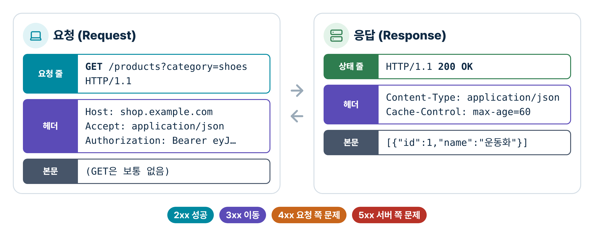
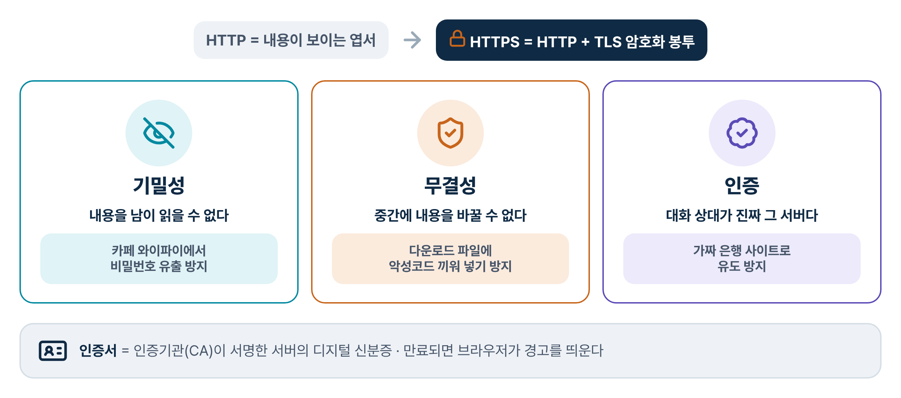
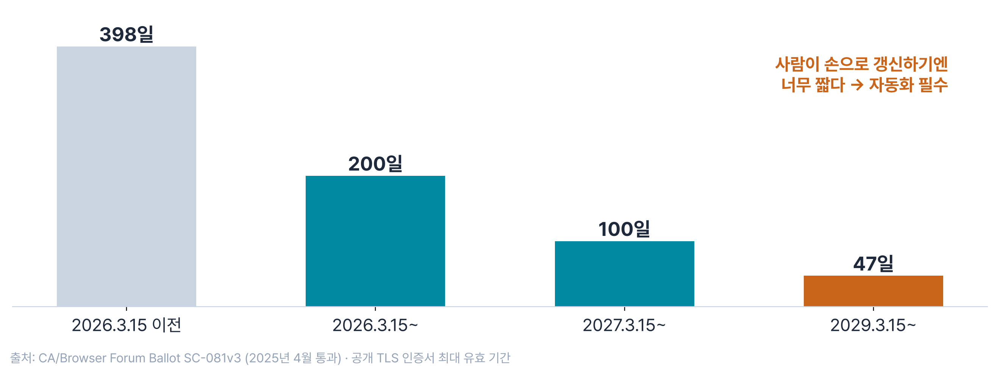

<sub>[🏠 과정 목차](../../README.md) › [1주차](../README.md) › [3일차](README.md) › 5/8교시</sub>

# 5교시 · HTTP와 HTTPS

> [!NOTE]
> **이번 시간에 할 일**
>
> - HTTP 요청과 응답의 구조를 읽습니다.
> - 메서드(GET, POST, PUT, DELETE)와 상태 코드(2xx~5xx)의 의미를 압니다.
> - HTTPS가 무엇을 보호하는지, 인증서가 왜 필요한지 이해합니다.
> - REST API의 기본 생각을 맛봅니다.

## HTTP — 웹의 대화 규칙

**HTTP(HyperText Transfer Protocol)**는 웹 브라우저와 서버가 대화하는 규칙입니다. 대화는 항상 **클라이언트가 요청(request)**하고 **서버가 응답(response)**하는 한 쌍으로 이루어집니다. 오늘날에는 웹 페이지뿐 아니라 **앱과 서버, 서버와 서버** 사이의 통신(API)도 대부분 HTTP를 씁니다. 3주차 MSA의 서비스들도 서로 HTTP로 이야기합니다.

## 요청과 응답 들여다보기



### 요청 (Request)

```http
GET /products?category=shoes HTTP/1.1     ← 요청 줄: 메서드, 경로, 버전
Host: shop.example.com                    ← 헤더: 부가 정보
User-Agent: Mozilla/5.0
Accept: application/json
Authorization: Bearer eyJhbGciOi...       ← 로그인 토큰 (비밀값!)
                                          ← 빈 줄
                                          ← 본문 (GET은 보통 없음)
```

### 응답 (Response)

```http
HTTP/1.1 200 OK                           ← 상태 줄: 버전, 상태 코드, 설명
Content-Type: application/json            ← 헤더
Content-Length: 128
Cache-Control: max-age=60
                                          ← 빈 줄
[{"id": 1, "name": "운동화", "price": 59000}]   ← 본문
```

## 메서드 — 무엇을 하고 싶은가

| 메서드 | 뜻 | 예시 | 성질 |
|---|---|---|---|
| **GET** | 조회 | 상품 목록 보기 | 서버 상태를 바꾸지 않는다 |
| **POST** | 생성 | 주문하기, 회원가입 | 여러 번 보내면 여러 개 생길 수 있다 |
| **PUT** | 전체 교체 | 프로필 전체 수정 | 여러 번 보내도 결과가 같다 |
| **PATCH** | 일부 수정 | 닉네임만 수정 | |
| **DELETE** | 삭제 | 장바구니 상품 삭제 | 여러 번 보내도 결과가 같다 |

> [!IMPORTANT]
> **여러 번 보내도 안전한가? — 멱등성**
>
> 같은 요청을 여러 번 보내도 결과가 한 번 보낸 것과 같은 성질을 **멱등성(idempotency)**이라고 합니다. GET, PUT, DELETE는 멱등이고, POST는 보통 멱등이 아닙니다. 네트워크가 불안해서 응답을 못 받았을 때 **재시도해도 되는지**가 여기에 달려 있습니다. "주문하기" 버튼을 두 번 눌러 **주문이 두 번 들어가는** 사고가 바로 멱등하지 않은 POST를 재시도해서 생깁니다. 3주차 MSA 장애 실습에서 "중복 요청" 문제로 직접 다룹니다.

## 상태 코드 — 서버의 대답 한 줄 요약

| 범위 | 뜻 | 대표 코드 | 먼저 볼 곳 |
|---|---|---|---|
| **2xx** 성공 | 요청이 잘 처리됨 | `200 OK`, `201 Created`, `204 No Content` | — |
| **3xx** 리다이렉트 | 다른 곳으로 가세요 | `301` 영구 이동, `302` 임시 이동, `304` 바뀐 것 없음(캐시 사용) | URL, HTTP→HTTPS 이동 |
| **4xx** 클라이언트 잘못 | 요청이 이상함 | `400` 잘못된 요청, `401` 로그인 필요, `403` 권한 없음, `404` 없음, `429` 요청 너무 많음 | **요청을 보낸 쪽** |
| **5xx** 서버 잘못 | 서버가 처리하다 실패 | `500` 서버 내부 오류, `502` 뒤쪽 서버 응답 이상, `503` 일시적으로 못 받음, `504` 뒤쪽 서버 시간 초과 | **서버와 그 뒤** |

> **📘 502와 504는 '중간자'가 보내는 신호**
>
> `502 Bad Gateway`와 `504 Gateway Timeout`은 보통 **로드밸런서나 리버스 프록시**(7교시)가 보냅니다. "나는 살아 있는데, 내 뒤에 있는 앱 서버가 이상한 응답을 줬다(502) / 응답을 안 줬다(504)"라는 뜻입니다. 그래서 502·504를 보면 로드밸런서가 아니라 **그 뒤의 앱 서버**를 먼저 봐야 합니다. 4주차 Gateway API 장애 분석과 5주차 ALB 실습에서 계속 만나는 코드입니다.

## HTTPS — 같은 대화를 봉투에 넣어서

HTTP는 내용이 **그대로 보이는 엽서**와 같습니다. 같은 와이파이를 쓰는 누군가가 비밀번호와 로그인 토큰을 엿볼 수 있습니다. **HTTPS**는 HTTP 대화를 **TLS(Transport Layer Security)**로 암호화한 것입니다.



| HTTPS가 지키는 것 | 뜻 | 없으면 생기는 일 |
|---|---|---|
| **기밀성** | 내용을 남이 읽을 수 없다 | 카페 와이파이에서 비밀번호 유출 |
| **무결성** | 중간에 내용을 바꿀 수 없다 | 다운로드 파일에 악성코드 끼워 넣기 |
| **인증** | 지금 대화하는 서버가 진짜 그 회사다 | 가짜 은행 사이트로 유도 |

### 인증서 — 서버의 신분증

세 번째 "인증"을 위해 서버는 **TLS 인증서**를 보여 줍니다. 인증서는 신뢰할 수 있는 **인증기관(CA, Certificate Authority)**이 "이 서버는 정말 `shop.example.com`의 주인이 맞다"라고 서명해 준 디지털 신분증입니다. 브라우저에는 신뢰하는 CA 목록이 미리 들어 있어서, 서명을 확인하고 자물쇠 아이콘을 보여 줍니다.

| 인증서 문제 | 브라우저 경고 | 흔한 원인 |
|---|---|---|
| 만료됨 | "연결이 비공개로 설정되어 있지 않습니다" | **갱신을 잊음** — 현업 장애의 단골 원인 |
| 이름 불일치 | 인증서 이름과 주소가 다름 | `www` 없는 주소용 인증서를 따로 안 만듦 |
| 자체 서명 | 신뢰할 수 없는 발급자 | 테스트용 인증서를 운영에 씀 |

> **🎓 학술 노트 — 웹의 탄생과 REST (1989, 2000)**
>
> 1989년 3월, 유럽입자물리연구소(CERN)의 팀 버너스리(Tim Berners-Lee)는 연구자들이 문서를 쉽게 공유하기 위한 「정보 관리: 제안(Information Management: A Proposal)」을 상사에게 제출했습니다. 상사의 메모는 "모호하지만 흥미롭다(Vague but exciting)"였습니다. 그는 1990~1991년에 **HTTP, HTML, URL**과 첫 웹 서버·브라우저를 만들었고, 1993년 CERN은 웹 기술을 **누구나 무료로 쓸 수 있게** 공개했습니다. 이 결정이 웹을 전 세계 표준으로 만들었습니다. 버너스리는 2016년 튜링상을 받았습니다.
>
> 2000년 HTTP 표준 작성자 중 한 명인 로이 필딩(Roy Fielding)은 UC 어바인 박사 논문에서 웹이 왜 이렇게 크게 확장될 수 있었는지를 분석하고 그 설계 원칙을 **REST(Representational State Transfer)**라고 이름 붙였습니다. 핵심은 **모든 것을 자원(URL)으로 표현**하고, 정해진 몇 가지 **메서드(GET, POST…)**로 다루며, 서버가 클라이언트의 상태를 기억하지 않는(**stateless**) 것입니다. 오늘날 대부분의 웹 API가 이 원칙을 따르는 "REST API"입니다. 특히 **stateless** 원칙은 4일차에 배울 "서버를 여러 대로 늘리기(scale out)"를 가능하게 하는 핵심 조건입니다.
>
> - Berners-Lee, T. (1989). *Information Management: A Proposal*. CERN.
> - Fielding, R. T. (2000). *Architectural Styles and the Design of Network-based Software Architectures*. PhD Dissertation, UC Irvine.

> **📈 트렌드 — 인증서 수명이 47일로 줄어든다**
>
> 인증서 유효 기간은 보안을 위해 계속 짧아지고 있습니다. 브라우저 회사와 인증기관들의 협의체인 **CA/Browser Forum**은 2025년 4월, 애플이 제안한 안을 반대 없이 통과시켜 공개 TLS 인증서의 최대 수명을 단계적으로 줄이기로 했습니다.
>
> | 적용 시점 | 최대 유효 기간 |
> |---|---|
> | 2026년 3월 15일 이전 | 398일 |
> | 2026년 3월 15일부터 | **200일** |
> | 2027년 3월 15일부터 | **100일** |
> | 2029년 3월 15일부터 | **47일** |
>
> 1년에 한 번 사람이 손으로 갱신하던 방식으로는 47일 주기를 감당할 수 없습니다. 결국 **인증서 발급과 갱신의 완전 자동화**가 필수가 됩니다. 무료 인증서를 자동으로 발급하는 **Let's Encrypt**와 ACME 프로토콜, Kubernetes에서 인증서를 자동 관리하는 **cert-manager**(4주차 소개), AWS의 **ACM**(5주차)이 바로 이 문제를 푸는 도구입니다. "사람이 기억해서 하는 일은 언젠가 잊힌다 → 자동화한다"는 DevOps의 원칙이 그대로 드러나는 사례입니다.



## 정리

- HTTP는 **요청과 응답**의 대화이고, 요청은 메서드·경로·헤더·본문, 응답은 상태 코드·헤더·본문으로 이루어집니다.
- GET은 조회, POST는 생성. **멱등성**이 재시도 안전성을 결정합니다.
- 4xx는 요청 쪽 문제, 5xx는 서버 쪽 문제. **502·504는 로드밸런서 뒤의 앱**을 의심합니다.
- HTTPS는 **기밀성·무결성·인증**을 지키고, 인증서는 서버의 신분증입니다.
- 인증서 수명이 2029년 47일로 줄어들어 **갱신 자동화**가 필수가 됩니다.

> **✅ 확인 문제**
>
> 1. 상품 목록을 조회할 때와 새 주문을 만들 때 쓰는 메서드는 각각?
> 2. 같은 요청을 여러 번 보내도 결과가 같은 성질을 무엇이라고 하나요?
> 3. 로그인하지 않고 마이페이지에 접근했을 때 서버가 돌려주는 상태 코드는?
> 4. 로드밸런서에서 `504 Gateway Timeout`이 나왔습니다. 무엇을 먼저 확인해야 하나요?
> 5. 2029년부터 공개 TLS 인증서의 최대 유효 기간은 며칠이 되나요?
>
> <details><summary>정답</summary>
>
> 1. GET, POST
> 2. 멱등성(idempotency)
> 3. 401 Unauthorized
> 4. 로드밸런서 뒤의 앱 서버가 제시간에 응답하는지 (앱 서버 상태, 처리 시간)
> 5. 47일
>
> </details>

## 참고 문헌

- Berners-Lee, T. (1989). *Information Management: A Proposal*. CERN.
- Fielding, R. T. (2000). *Architectural Styles and the Design of Network-based Software Architectures*. UC Irvine.
- Fielding, R., Nottingham, M., & Reschke, J. (2022). *RFC 9110: HTTP Semantics*. IETF.
- Rescorla, E. (2018). *RFC 8446: The Transport Layer Security (TLS) Protocol Version 1.3*.
- CA/Browser Forum (2025). *Ballot SC-081v3: Introduce Schedule of Reducing Validity and Data Reuse Periods*.
- DigiCert (2025). *TLS Certificate Lifetimes Will Officially Reduce to 47 Days*.

---

| 이전 | 목차 | 다음 |
|:--|:--:|--:|
| ⬅️ [4교시 · DNS](lesson-04.md) | [⬆️ 3일차 목차](README.md) | [6교시 · 서비스로 가는 길 — 요청의 여정](lesson-06.md) ➡️ |
