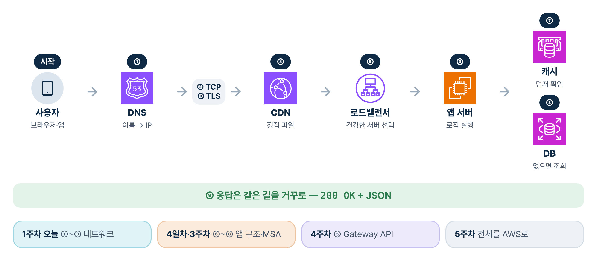

[🏠 과정 목차](../../README.md) › [1주차](../README.md) › [3일차](README.md) › 6/8교시

# 6교시 · 서비스로 가는 길 — 요청의 여정

> [!NOTE]
> **이번 시간에 할 일**
>
> - 브라우저에서 데이터베이스까지 요청 하나가 거치는 길을 처음부터 끝까지 따라갑니다.
> - 단계마다 걸리는 시간을 나눠 보고, 어디가 느려질 수 있는지 압니다.
> - "연결이 안 될 때" 어느 단계에서 끊겼는지 찾는 순서를 만듭니다.
> - 분산 시스템에 대한 여덟 가지 착각을 알아봅니다.

## 주소창에 엔터를 누르면 일어나는 일

오늘 1~5교시에서 배운 조각들을 하나로 이어 봅니다. 쇼핑몰 앱에서 상품 목록을 여는 순간, 요청은 이런 길을 지나갑니다.

| 순서 | 단계 | 일어나는 일 | 오늘 배운 곳 |
|---|---|---|---|
| ① | DNS 조회 | `shop.example.com` → 로드밸런서 IP | 4교시 |
| ② | TCP 연결 | 3-way handshake | 3교시 |
| ③ | TLS 연결 | 인증서 확인, 암호화 키 합의 | 5교시 |
| ④ | CDN | 이미지·CSS·JS 같은 정적 파일은 가까운 CDN에서 바로 응답 | 1교시 (거리) |
| ⑤ | 로드밸런서 | 여러 앱 서버 중 건강한 하나를 골라 전달 | 7교시 |
| ⑥ | 앱 서버 | 요청을 해석하고 비즈니스 로직 실행 | 어제 (프로세스) |
| ⑦ | 캐시 | 자주 찾는 데이터는 Redis 같은 메모리 캐시에서 | 어제 (메모리 계층) |
| ⑧ | 데이터베이스 | 캐시에 없으면 DB에서 조회 | 내일 |
| ⑨ | 응답 | 같은 길을 거꾸로 돌아와 `200 OK` + JSON | 5교시 |

이 표는 이 과정 전체의 지도이기도 합니다. ④~⑧이 4일차(애플리케이션 구조)와 3주차(MSA), ⑤가 4주차(Gateway API)와 5주차(ALB), 전체 인프라가 5주차(AWS)의 주제입니다.

## 시간은 어디서 쓰이나 — 지연 시간 예산

사용자는 페이지가 **1초**만 늦어도 불편을 느낍니다. 그 1초를 각 단계가 나눠 씁니다. 서울 사용자가 서울 리전의 서비스에 접속하는 경우를 예로 들어 보겠습니다.

| 단계 | 대략의 시간 (예시) | 줄이는 방법 |
|---|---|---|
| DNS 조회 | 0~50ms (캐시되면 0) | 적절한 TTL |
| TCP + TLS 연결 | 10~40ms | 연결 재사용, TLS 1.3, HTTP/3 |
| 로드밸런서 | 1~5ms | — |
| 앱 서버 처리 | 10~200ms | 코드 최적화, 서버 증설 |
| 캐시 조회 | 1ms 미만 | 자주 쓰는 데이터 캐시 |
| DB 조회 | 1~100ms+ | 인덱스, 쿼리 최적화, 캐시 |
| 응답 전송 | 데이터 크기에 따라 | 압축, CDN |

※ 이해를 돕기 위한 예시 값입니다. 실제 값은 서비스마다 크게 다릅니다.

> [!IMPORTANT]
> **느려질 때 '평균'만 보면 안 된다**
>
> 100명 중 99명은 0.2초 만에 페이지를 받고 1명만 5초가 걸려도 **평균**은 0.25초로 괜찮아 보입니다. 하지만 그 1명에게는 서비스가 고장 난 것과 같습니다. 그래서 현업에서는 평균 대신 **p99(상위 1% 사용자가 겪는 지연 시간)** 같은 **백분위 지표**를 봅니다. 4주차 Prometheus/Grafana에서 직접 만들어 봅니다.

## 어디서 끊겼나 — 단계별로 좁혀 가기

"사이트가 안 열려요"라는 신고를 받으면, 요청의 여정을 **앞에서부터 하나씩** 확인하면 됩니다.

| 확인 | 질문 | 실패하면 보이는 것 |
|---|---|---|
| 1. DNS | 이름이 IP로 바뀌는가? | `Name or service not known`, `NXDOMAIN` |
| 2. 네트워크 | 그 IP의 그 포트까지 닿는가? | `Connection timed out` (방화벽), `refused` (프로그램 없음) |
| 3. TLS | 인증서가 유효한가? | 브라우저 인증서 경고 |
| 4. 로드밸런서 | 뒤에 건강한 서버가 있는가? | `502`, `503`, `504` |
| 5. 앱 | 앱이 정상 처리하는가? | `500`, 앱 로그의 에러 |
| 6. 의존 서비스 | DB·캐시·외부 API가 응답하는가? | 앱 로그의 연결 에러, 타임아웃 |

이 순서를 기억해 두면, 2주차 Docker부터 5주차 AWS까지 어떤 "연결 안 됨" 문제든 같은 방법으로 좁혀 갈 수 있습니다. 1일차에 배운 **다섯 줄 질문**의 "보인 결과" 칸에 무엇을 적어야 하는지도 이 표가 알려 줍니다.

> **🎓 학술 노트 — 분산 컴퓨팅에 대한 여덟 가지 착각**
>
> 1990년대 썬 마이크로시스템즈의 피터 도이치(Peter Deutsch)와 동료들(제임스 고슬링 등)은 네트워크로 연결된 시스템을 처음 만드는 개발자들이 흔히 빠지는 착각을 정리했습니다. 이 목록은 **"분산 컴퓨팅의 오류(Fallacies of Distributed Computing)"**라는 이름으로 지금까지 널리 인용됩니다.
>
> | 착각 | 현실 | 이 과정에서 |
> |---|---|---|
> | 1. 네트워크는 믿을 만하다 | 패킷은 사라지고 연결은 끊긴다 | 3주차 재시도·타임아웃 |
> | 2. 지연 시간은 0이다 | 빛도 시간이 걸린다 | 1교시, 리전 선택 |
> | 3. 대역폭은 무한하다 | 데이터 전송에는 한계와 비용이 있다 | AWS 데이터 전송 요금 |
> | 4. 네트워크는 안전하다 | 누군가 엿볼 수 있다 | 5교시 HTTPS |
> | 5. 구성은 바뀌지 않는다 | 서버와 IP는 계속 바뀐다 | 4교시 DNS, K8s 서비스 |
> | 6. 관리자는 한 명이다 | 여러 팀, 여러 회사가 얽혀 있다 | 5일차 협업 |
> | 7. 전송 비용은 0이다 | 직렬화·암호화·요금이 든다 | MSA 비용 |
> | 8. 네트워크는 균일하다 | 장비와 경로가 제각각이다 | 멀티 리전 |
>
> 3주차 MSA를 배울 때, 함수 호출 하나가 네트워크 호출로 바뀌면 이 여덟 가지가 모두 문제가 된다는 것을 직접 겪게 됩니다. 2025년 AWS 장애는 1번, 5번, 6번 착각이 한꺼번에 깨진 사례였습니다.
>
> - Deutsch, P. (1994). *The Eight Fallacies of Distributed Computing*. (Sun Microsystems 내부 정리, 이후 Rotem-Gal-Oz 2006 해설로 널리 알려짐)

> **📈 트렌드 — 사용자 가까이로: CDN과 엣지 컴퓨팅**
>
> 빛의 속도를 이길 수 없다면 **서버를 사용자 가까이 가져가면** 됩니다. CDN은 원래 이미지·동영상 같은 정적 파일을 전 세계 수백 곳의 거점(엣지)에 복사해 두는 서비스였지만, 최근에는 엣지에서 **간단한 코드까지 실행**하는 **엣지 컴퓨팅**으로 넓어지고 있습니다(AWS CloudFront Functions, Cloudflare Workers 등). 로그인 확인, A/B 테스트, 이미지 크기 조정처럼 빠른 응답이 중요한 일은 사용자 가까운 엣지에서 처리하고, 무거운 일만 리전의 서버로 보내는 구조입니다.

## 정리

- 요청 하나는 **DNS → TCP → TLS → CDN → 로드밸런서 → 앱 → 캐시 → DB**를 거쳐 돌아옵니다.
- 1초의 시간을 각 단계가 나눠 쓰며, 평균보다 **p99 같은 백분위**가 사용자 경험을 더 잘 보여 줍니다.
- 장애는 요청의 여정을 **앞에서부터 하나씩** 확인하며 좁혀 갑니다.
- **분산 컴퓨팅의 여덟 가지 착각** — 네트워크는 믿을 수 없고, 느리고, 바뀌고, 안전하지 않습니다.

> **✅ 확인 문제**
>
> 1. 요청의 여정에서 TCP 연결과 TLS 연결 중 무엇이 먼저 일어나나요?
> 2. 이미지와 CSS 파일을 사용자 가까운 곳에서 빠르게 내려 주는 것은?
> 3. 평균 응답 시간 대신 p99를 보는 이유는?
> 4. 사이트가 안 열린다는 신고를 받았습니다. 가장 먼저 확인할 단계는?
> 5. 분산 컴퓨팅의 착각 중 "네트워크는 믿을 만하다"가 틀린 이유를 한 문장으로 말해 보세요.
>
> 

정답

>
> 1. TCP 연결 (TLS는 TCP 연결 위에서 맺어집니다. 단, HTTP/3는 QUIC이 둘을 합칩니다)
> 2. CDN
> 3. 평균은 소수 사용자가 겪는 심한 지연을 가려 버리기 때문
> 4. DNS — 이름이 IP로 바뀌는지
> 5. 패킷은 사라지고 연결은 끊길 수 있으므로, 재시도와 타임아웃을 설계해야 한다
>
> 

## 참고 문헌

- Kurose, J. F., & Ross, K. W. (2021). *Computer Networking: A Top-Down Approach* (8th ed.).
- Rotem-Gal-Oz, A. (2006). *Fallacies of Distributed Computing Explained*.
- Dean, J., & Barroso, L. A. (2013). The tail at scale. *Communications of the ACM*, 56(2). (p99 지연 시간의 중요성)
- AWS. *Amazon CloudFront Developer Guide — CloudFront Functions*.

---

| 이전 | 목차 | 다음 |
|:--|:--:|--:|
| ⬅️ [5교시 · HTTP와 HTTPS](lesson-05.md) | [⬆️ 3일차 목차](README.md) | [7교시 · 네트워크 장비의 역할](lesson-07.md) ➡️ |
