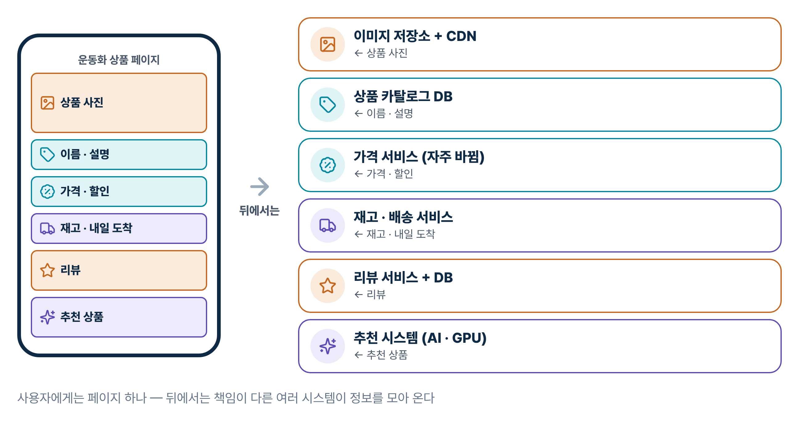
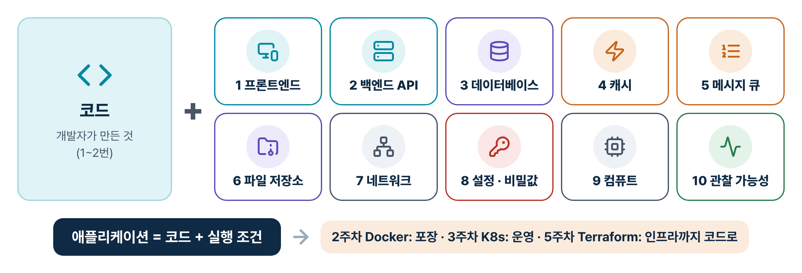
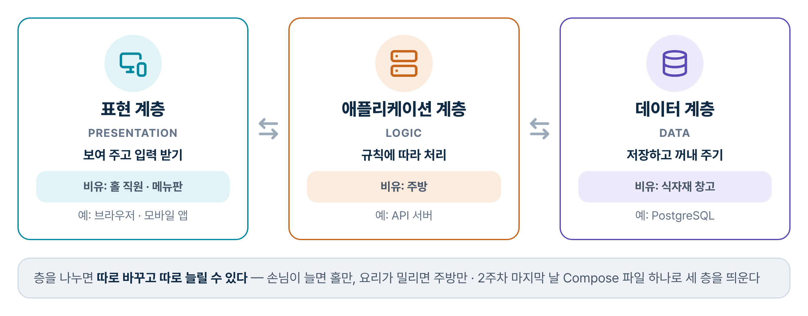

[🏠 과정 목차](../../README.md) › [1주차](../README.md) › [4일차](README.md) › 1/8교시

# 1교시 · 현대 앱의 지도

> [!NOTE]
> **이번 시간에 할 일**
>
> - 어제 배운 네트워크를 10분 동안 되짚습니다.
> - 쇼핑몰 상품 페이지 하나를 구성요소로 분해합니다.
> - 현대 애플리케이션의 구성요소 10가지와 3-tier 구조를 압니다.
> - 비즈니스가 커질 때 함께 커지는 시스템 부담을 표로 정리합니다.

## 어제 10분 요약

| 어제 배운 것 | 한 문장 |
|---|---|
| 계층과 패킷 | 데이터는 패킷으로, 층마다 포장(캡슐화) |
| IP와 서브넷 | 사설 IP + NAT, `0.0.0.0/0` = 인터넷 전체 |
| 포트 | `refused`는 받을 프로그램 없음, `timed out`은 방화벽 |
| DNS와 HTTP | 이름 → IP, 4xx는 요청 쪽, 5xx는 서버 쪽 |
| 요청의 여정 | DNS → TCP → TLS → CDN → LB → **앱 → 캐시 → DB** |

어제 6교시 지도에서 굵게 표시한 마지막 세 칸 — **앱, 캐시, DB** — 를 오늘 확대해서 봅니다.

## 상품 페이지 하나를 분해하면

쇼핑몰 앱에서 운동화 상품 페이지를 연다고 해 봅시다. 화면에는 사진, 이름, 가격, "내일 도착" 표시, 리뷰, "이 상품과 함께 본 상품"이 보입니다. 사용자에게는 **페이지 하나**지만, 뒤에서는 각각 다른 책임을 가진 시스템이 정보를 모아 옵니다.

| 화면에 보이는 것 | 뒤에서 책임지는 것 | 늘어나면 생기는 부담 |
|---|---|---|
| 상품 사진 | 이미지 저장소 + CDN | 저장 비용, 전송 속도 |
| 이름·설명 | 상품 카탈로그 DB | 데이터 정합성, 검색 색인 |
| 가격·할인 | 가격 서비스 | 자주 바뀌는 값, 캐시 갱신 |
| 재고·"내일 도착" | 재고·배송 서비스 | 동시 주문 시 정확성 |
| 리뷰 | 리뷰 서비스 + DB | 쓰기 폭주, 스팸 필터 |
| 추천 상품 | 추천 시스템(AI) | 계산 자원(GPU), 데이터 파이프라인 |

> **📘 사례 — 커머스: 쿠팡**
>
> 쿠팡 엔지니어링 블로그는 서비스 초기의 하나로 된 구조에서 출발해, 회사가 커지며 여러 서비스로 나눠 가는 과정과 그 과정의 어려움을 공개해 왔습니다. 또 전 세계로 확장하면서 데이터 플랫폼이 페타바이트 규모로 커진 경험도 소개했습니다. 이 과정에서 볼 것은 회사 이름이 아니라 패턴입니다. **상품 수, 판매자 수, 사용자 수, 배송 지역이 늘어나면** 데이터 소유권(누가 이 데이터를 고칠 수 있나), 읽기 속도, 피크 트래픽, 배포 조율(누가 언제 배포하나) 부담이 함께 커집니다.

## 현대 애플리케이션의 구성요소 10가지

| 구성요소 | 질문 | 대표 기술 | 이 과정에서 |
|---|---|---|---|
| 1. 프론트엔드 | 사용자는 무엇을 보는가? | React, Vue, 모바일 앱 | 2교시 |
| 2. 백엔드 (API) | 요청은 누가 처리하는가? | Spring, Node.js, FastAPI | 2교시, 2주차 |
| 3. 데이터베이스 | 상태는 어디에 남는가? | PostgreSQL, MySQL, DynamoDB | 4교시, 2주차 볼륨 |
| 4. 캐시 | 무엇을 빠르게 보여 줘야 하나? | Redis, Valkey | 5교시 |
| 5. 메시지 큐 | 나중에 처리해도 되는 일은? | Kafka, RabbitMQ, SQS | 5교시, 3주차 |
| 6. 파일 저장소 | 큰 파일은 어디에? | S3, 오브젝트 스토리지 | 5주차 |
| 7. 네트워크 | 어떤 포트와 URL이 필요한가? | 로드밸런서, DNS, Gateway | 어제, 4주차 |
| 8. 설정·비밀값 | 환경마다 달라지는 값은? | 환경 변수, Secret | 2주차, 3주차 |
| 9. 컴퓨트 | CPU·메모리·GPU 중 무엇이 중요한가? | EC2, 컨테이너, GPU | 그제, 6교시 |
| 10. 관찰 가능성 | 로그·지표·오류는 어디서 보나? | Prometheus, Grafana, OpenTelemetry | 4주차 |

> [!IMPORTANT]
> **애플리케이션 = 코드 + 실행 조건**
>
> 개발자가 만든 것은 1~2번의 **코드**지만, 그 코드가 실제로 돌아가려면 3~10번의 **실행 조건**이 모두 맞아야 합니다. 실행할 언어 버전, 열어야 할 포트, 연결할 DB 주소, 넣어야 할 비밀번호, 쓸 수 있는 메모리 양, 로그를 남길 곳. 이 과정 전체는 결국 **"실행 조건을 어떻게 정확하고 반복 가능하게 맞추는가"**에 대한 이야기입니다. 2주차 Docker는 이것을 **이미지 하나로 포장**하고, 3주차 Kubernetes는 **수백 개를 자동으로 운영**하고, 5주차 Terraform은 **인프라까지 코드로** 만듭니다.

## 3-tier 구조 — 가장 기본이 되는 모양

수많은 웹 서비스가 공통으로 따르는 가장 기본적인 구조는 **세 층(3-tier)**입니다.

| 계층 | 역할 | 비유 (식당) | 예 |
|---|---|---|---|
| 표현 계층 (Presentation) | 사용자에게 보여 주고 입력을 받는다 | 홀 직원과 메뉴판 | 웹 브라우저, 모바일 앱 |
| 애플리케이션 계층 (Logic) | 규칙에 따라 요청을 처리한다 | 주방 | API 서버 |
| 데이터 계층 (Data) | 데이터를 저장하고 꺼내 준다 | 식자재 창고 | 데이터베이스 |

층을 나누면 각 층을 **따로 바꾸고, 따로 늘릴 수 있습니다.** 손님이 늘면 홀 직원만 늘리고(프론트엔드 서버 증설), 요리가 밀리면 주방만 늘립니다(API 서버 증설). 3교시에 배울 **스케일 아웃**의 출발점입니다. 그리고 2주차 마지막 날에는 이 세 층을 **Docker Compose 파일 하나**로 띄우게 됩니다.

> **🎓 학술 노트 — 모듈화의 기준 (Parnas, 1972)**
>
> "프로그램을 어떻게 나눠야 하는가?"는 소프트웨어 공학의 가장 오래된 질문 중 하나입니다. 데이비드 파나스(David Parnas)는 1972년 논문 「시스템을 모듈로 분해하는 기준에 대하여(On the Criteria To Be Used in Decomposing Systems into Modules)」에서, 처리 **순서**대로 나누지 말고 **바뀔 가능성이 있는 결정을 하나씩 숨기도록** 나누라고 주장했습니다. 이것을 **정보 은닉(information hiding)**이라고 합니다.
>
> 예를 들어 "가격 계산 방식"이 자주 바뀐다면, 그 방식은 가격 모듈 안에만 숨겨 두고 다른 모듈은 "가격을 알려 줘"라고만 묻게 합니다. 그러면 가격 정책이 바뀌어도 다른 모듈은 고칠 필요가 없습니다. 50년이 지난 지금 3-tier의 층 나누기, 2교시의 **API**, 7교시의 **마이크로서비스 경계**가 모두 이 원리의 후손입니다.
>
> - Parnas, D. L. (1972). On the criteria to be used in decomposing systems into modules. *Communications of the ACM*, 15(12).

## 비즈니스가 커지면 시스템 부담도 커진다

| 비즈니스에서 늘어나는 것 | 함께 늘어나는 시스템 부담 |
|---|---|
| 상품 수 | 카탈로그 저장, 이미지 저장, 검색 색인 |
| 사용자 수 | API 처리량, 캐시 적중률, 모니터링 |
| 판매자 수 | 데이터 소유권, 검증, 권한 규칙 |
| 주문 수 | 재고 정확성, 큐 처리, 재시도 |
| 서비스 지역 | 네트워크 지연, 배송 로직, 트래픽 분배 |
| 개발자 수 | 배포 조율, 코드 충돌, 환경 차이 |

마지막 줄을 눈여겨보세요. **개발자가 늘어나는 것도 시스템 부담**입니다. 개발자 10명이 각자 노트북에 DB를 다른 버전으로 설치하면 "제 컴퓨터에선 되는데요"가 매일 일어납니다. 5일차의 협업, 2주차의 Docker가 이 문제를 다룹니다.

> **📈 트렌드 — AI가 '구성요소 하나'로 들어온다**
>
> 최근의 애플리케이션에는 AI 기능이 **새로운 구성요소**로 추가되고 있습니다. 상품 추천, 검색어 자동 완성, 고객 상담 챗봇, 리뷰 요약 같은 기능입니다. 중요한 점은 AI가 기존 구조를 대체하는 마법이 아니라, 기존 지도 위에 **새 실행 조건을 추가**한다는 것입니다.
>
> | 구성요소 | AI가 붙는 방식 | 새로 생기는 운영 조건 |
> |---|---|---|
> | 백엔드 | LLM API 호출 | 모델 엔드포인트, **토큰 비용**, 호출 횟수 제한 |
> | 데이터 | 검색 증강 생성(RAG) | 문서 조각내기, 임베딩, **벡터 DB** |
> | 컴퓨트 | 모델 학습·추론 | **GPU**, 대용량 메모리, 스케줄링 |
> | 관찰 | AI 응답 품질 감시 | 비용·지연·정확도 지표 |
>
> 1일차에 본 DORA 2025 보고서의 결론 — "AI는 증폭기" — 이 여기에도 적용됩니다. 구성요소 지도를 이해하는 팀은 AI를 잘 붙이고, 이해하지 못하는 팀은 AI가 복잡도만 키웁니다.

## 정리

- 상품 페이지 하나 뒤에는 **각자 책임이 다른 여러 시스템**이 있습니다.
- 현대 애플리케이션 = **코드 + 실행 조건** (DB, 캐시, 큐, 설정, 네트워크, 컴퓨트, 관찰).
- 가장 기본 구조는 **3-tier**(표현·애플리케이션·데이터)이고, 층을 나누면 따로 바꾸고 따로 늘릴 수 있습니다.
- 모듈은 **바뀔 결정을 숨기도록** 나눕니다(Parnas, 1972).
- 비즈니스가 커지면 데이터·트래픽·의존성·**사람**의 부담이 함께 커집니다.

> **✅ 확인 문제**
>
> 1. 상품 페이지의 "추천 상품" 영역 뒤에 있는 시스템이 특히 많이 쓰는 자원은?
> 2. 3-tier 구조의 세 계층 이름을 말해 보세요.
> 3. "애플리케이션 = 코드 + ○○ ○○"에서 빈칸은?
> 4. 파나스가 제안한 모듈 분해 기준을 한 단어로 하면?
> 5. 개발자 수가 늘어날 때 생기는 시스템 부담의 예를 하나 들어 보세요.
>
> 

정답

>
> 1. 계산 자원(GPU)과 데이터 파이프라인
> 2. 표현 계층, 애플리케이션(로직) 계층, 데이터 계층
> 3. 실행 조건
> 4. 정보 은닉(information hiding)
> 5. 배포 조율, 코드 충돌, 개발 환경 차이("제 컴퓨터에선 되는데요")
>
> 

## 참고 문헌

- Parnas, D. L. (1972). On the criteria to be used in decomposing systems into modules. *CACM*, 15(12).
- Coupang Engineering Blog. medium.com/coupang-engineering — 마이크로서비스 전환 여정, 데이터 플랫폼 글로벌 확장.
- DORA (2025). *State of AI-assisted Software Development*. Google Cloud.
- Fowler, M. (2002). *Patterns of Enterprise Application Architecture*. Addison-Wesley.

---

| 이전 | 목차 | 다음 |
|:--|:--:|--:|
| ⬅️ [1주차 4일차 목차](README.md) | [⬆️ 4일차 목차](README.md) | [2교시 · 프론트엔드와 백엔드](lesson-02.md) ➡️ |
