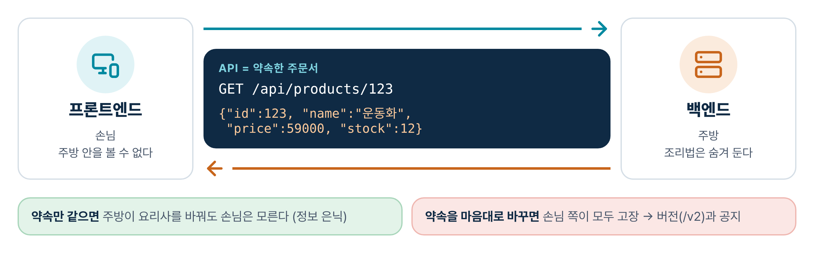

<sub>[🏠 과정 목차](../../README.md) › [1주차](../README.md) › [4일차](README.md) › 2/8교시</sub>

# 2교시 · 프론트엔드와 백엔드

> [!NOTE]
> **이번 시간에 할 일**
>
> - 프론트엔드가 "화면"만이 아니라는 것을 압니다.
> - 백엔드가 하는 일과 API의 의미를 이해합니다.
> - 상태 없는(stateless) 서버가 왜 중요한지 압니다.
> - 서비스 경계를 정할 때 던질 질문 다섯 가지를 익힙니다.

## 프론트엔드 — 화면 뒤의 공장

**프론트엔드(frontend)**는 사용자가 직접 보고 만지는 부분입니다. 웹 브라우저에 보이는 화면, 모바일 앱의 버튼과 목록이 모두 프론트엔드입니다. 그런데 현대 프론트엔드는 HTML과 CSS 몇 장이 아니라 **작은 공장**에 가깝습니다.

| 구성요소 | 역할 | 고장 나면 |
|---|---|---|
| UI 컴포넌트 | 버튼·카드 같은 화면 요소를 재사용 | 레이아웃이 깨지고 화면마다 모양이 다름 |
| 라우터 | 어떤 주소에서 어떤 화면을 열지 결정 | 엉뚱한 화면, 빈 화면 |
| 상태 관리 | 지금 화면의 데이터를 보관 | 오래된 데이터, 데이터 누락 |
| 빌드 도구 | 소스 코드를 브라우저가 읽을 파일로 변환 | 빌드 실패 |
| 패키지 관리자 | 외부 라이브러리 설치 (npm 등) | **버전 충돌** |
| 환경 설정 | 연결할 API 주소, 기능 켜고 끄기 | **엉뚱한 백엔드에 연결** |

> **📘 사례 — 금융 앱: 토스**
>
> 토스 기술 블로그는 하나의 거대한 프론트엔드를 여러 팀이 나눠 개발할 수 있도록 **마이크로 프론트엔드** 구조를 도입한 경험과, 수많은 프로젝트를 한 저장소에서 관리하는 **모노레포**의 빌드 파이프라인을 최적화한 경험을 공개했습니다. 금융 앱은 새 상품과 실험이 계속 늘어나는데, 동시에 화면의 **일관성과 신뢰**도 지켜야 합니다. 그래서 프론트엔드 자체가 **개발 생산성을 위한 플랫폼**이 됩니다. 여기서 볼 패턴은 **"화면이 늘어나면 빌드 시간, 패키지 버전, 미리보기 환경 관리 부담이 함께 늘어난다"**는 것입니다.

> [!WARNING]
> **프론트엔드도 '실행 조건'이 있다**
>
> 같은 코드라도 Node.js 버전이 다르거나, 패키지 버전이 다르거나, API 주소 설정이 다르면 **같은 화면이 다르게 동작**합니다. 신입 개발자가 첫 주를 개발 환경 설치에만 쓰는 회사가 적지 않은 이유입니다. 2주차 Docker에서는 프론트엔드 빌드도 컨테이너로 포장합니다.

## 백엔드 — 보이지 않는 곳의 처리

**백엔드(backend)**는 사용자에게 보이지 않는 곳에서 요청을 처리합니다.

1. 요청을 **받고**
2. 규칙에 맞는지 **검사하고** (로그인했나? 입력값이 올바른가? 권한이 있나?)
3. 데이터를 **읽거나 쓰고**
4. 필요하면 **다른 시스템을 호출하고** (결제사, 알림 서비스)
5. 결과를 **돌려줍니다**

## API — 서로 약속한 주문서

프론트엔드와 백엔드, 또는 서비스와 서비스는 **API(Application Programming Interface)**로 대화합니다. API는 "이 주소로, 이런 형식으로 요청하면, 이런 형식으로 답하겠다"는 **약속**입니다.



```http
GET /api/products/123          ← 이렇게 물으면
```

```json
{"id": 123, "name": "운동화", "price": 59000, "stock": 12}   ← 이렇게 답한다
```

> **🧩 비유 — 식당의 주문서**
>
> 손님(프론트엔드)은 주방(백엔드) 안을 볼 수 없습니다. 대신 정해진 **주문서 양식**(API)에 따라 "김치찌개 1인분"이라고 적어 내면, 주방은 정해진 그릇에 담아 내줍니다. 주방이 요리사를 바꾸든, 조리법을 개선하든, 주문서 양식만 같으면 손님은 신경 쓸 필요가 없습니다. 1교시의 **정보 은닉**이 바로 이것입니다. 거꾸로 **주문서 양식을 마음대로 바꾸면** 손님 쪽이 모두 고장 납니다. 그래서 API를 바꿀 때는 버전을 올리고(`/api/v2/…`) 미리 알리는 것이 협업의 기본입니다.

## 상태 없는(stateless) 서버

어제 5교시에서 REST의 원칙 중 **stateless**를 봤습니다. 서버가 사용자별 상태(로그인 정보, 장바구니)를 **자기 메모리에 들고 있지 않는다**는 뜻입니다.

| 상태 있는(stateful) 서버 | 상태 없는(stateless) 서버 |
|---|---|
| 로그인 정보를 서버 A의 메모리에 저장 | 로그인 정보를 요청마다 토큰으로 보내거나, 공용 저장소(Redis, DB)에 둔다 |
| 다음 요청도 **반드시 서버 A**로 가야 한다 | 다음 요청이 **아무 서버**로 가도 된다 |
| 서버 A가 죽으면 그 사용자들은 로그아웃 | 서버 하나가 죽어도 다른 서버가 이어받는다 |
| 서버를 늘리기 어렵다 | 서버를 **자유롭게 늘리고 줄일 수 있다** |

> [!IMPORTANT]
> **stateless가 클라우드 네이티브의 입장권**
>
> 상태를 서버 밖(DB, 캐시)으로 빼야 서버를 **가축처럼** 다룰 수 있습니다. 클라우드 업계에는 "서버를 **애완동물(pets)**이 아니라 **가축(cattle)**처럼 다루라"는 유명한 비유가 있습니다. 이름을 붙여 아프면 정성껏 고치는 애완동물이 아니라, 번호로 관리하고 아프면 새로 교체하는 가축처럼 다루라는 뜻입니다. 아무 서버나 죽여도 되고, 아무 서버나 새로 띄워도 되는 것은 서버가 stateless일 때만 가능합니다. 3주차 Kubernetes가 Pod를 마음대로 죽이고 다시 띄울 수 있는 것도, 앱이 이 원칙을 지킨다는 전제 위에 있습니다.

## 서비스 경계 — 어디서 나눌까

서비스가 커지면 백엔드를 여러 조각으로 나누게 됩니다. 어디서 나눌지 정할 때 던지는 질문들입니다.

| 질문 | 왜 중요한가 |
|---|---|
| 이 데이터는 **누가 소유**하는가? | 아무 서비스나 중요한 데이터를 고치지 못하게 |
| 누가 이 API를 **호출할 수 있는가**? | 권한과 신뢰 경계 보호 |
| 이것이 실패하면 **무엇이 함께 멈추는가**? | 장애 영향 범위(blast radius) 파악 |
| **혼자 배포**할 수 있는가? | 다른 팀을 기다리지 않고 출시 |
| 정상인지 **어떻게 확인**하는가? | 헬스 체크(어제 7교시) |

> **📘 사례 — 지역 서비스: 당근**
>
> 당근 기술 블로그의 「당근페이 백엔드 아키텍처가 걸어온 여정」은 결제라는 기능이 성장하면서 백엔드 구조가 어떻게 바뀌어 왔는지 소개합니다. **인증, 결제, 알림** 같은 공통 기능은 여러 서비스가 함께 쓰기 때문에, 하나가 흔들리면 많은 서비스가 함께 흔들립니다. 그래서 공통 기능일수록 경계를 분명히 하고, 장애가 번지지 않게 설계해야 합니다. 핵심 교훈은 **"MSA가 항상 정답"이 아니라, 비즈니스 책임과 운영 위험에 맞게 경계를 잡아야 한다**는 것입니다. 7교시에서 다시 다룹니다.

> **🎓 학술 노트 — 조직이 구조를 닮는다 (Conway, 1968)**
>
> 멜빈 콘웨이(Melvin Conway)는 1968년 「위원회는 어떻게 발명하는가(How Do Committees Invent?)」에서 이렇게 썼습니다. **"시스템을 설계하는 조직은 그 조직의 의사소통 구조를 닮은 설계를 만들어 낼 수밖에 없다."** 이것을 **콘웨이의 법칙**이라고 합니다. 프론트엔드 팀과 백엔드 팀이 따로 있으면 그 사이에 API 경계가 생기고, 결제팀이 따로 있으면 결제 서비스가 따로 생깁니다.
>
> 현업에서는 이를 거꾸로 이용하기도 합니다. 원하는 시스템 구조가 있으면 **팀 구조를 먼저 그렇게 짠다**는 "역콘웨이 전략(inverse Conway maneuver)"입니다. 5일차 협업 시간에 Team Topologies와 함께 다시 봅니다. 서비스 경계는 기술 결정인 동시에 **조직 결정**입니다.
>
> - Conway, M. E. (1968). How do committees invent? *Datamation*, 14(4).

> **📈 트렌드 — BFF와 API 우선 설계**
>
> 웹, iOS, 안드로이드, 스마트워치처럼 화면 종류가 많아지면, 하나의 API가 모든 화면을 만족시키기 어렵습니다. 그래서 화면 종류별로 백엔드 앞에 얇은 전용 API 층을 두는 **BFF(Backend for Frontend)** 패턴이 널리 쓰입니다. 또 코드를 짜기 전에 API 명세(OpenAPI 등)부터 합의하는 **API 우선(API-first)** 설계도 표준이 되어 가고 있습니다. 프론트엔드와 백엔드가 명세만 보고 동시에 개발할 수 있기 때문입니다. AI 코딩 도구도 명세가 분명할수록 정확한 코드를 만듭니다.

## 정리

- 현대 프론트엔드는 컴포넌트·라우터·상태·빌드·패키지·설정이 있는 **작은 공장**입니다.
- 백엔드는 요청을 **받고 → 검사하고 → 데이터를 다루고 → 다른 시스템을 부르고 → 답합니다.**
- **API**는 서로 약속한 주문서이고, 바꿀 때는 버전과 공지가 필요합니다.
- **stateless** 서버여야 자유롭게 늘리고 줄일 수 있습니다.
- 서비스 경계는 **데이터 소유, 권한, 장애 범위, 독립 배포, 헬스 체크**로 정하며, 조직 구조를 닮습니다(콘웨이의 법칙).

> **✅ 확인 문제**
>
> 1. 같은 프론트엔드 코드가 개발자마다 다르게 동작하는 흔한 원인 두 가지는?
> 2. API를 식당에 비유하면 무엇인가요?
> 3. 로그인 정보를 서버 메모리에 두면 서버를 늘릴 때 어떤 문제가 생기나요?
> 4. "시스템은 조직의 의사소통 구조를 닮는다"는 법칙의 이름은?
> 5. 인증·결제 같은 공통 기능에 장애가 나면 왜 특히 위험한가요?
>
> <details><summary>정답</summary>
>
> 1. Node.js·패키지 버전 차이, API 주소 같은 환경 설정 차이
> 2. 주문서 양식 (손님과 주방 사이의 약속)
> 3. 다음 요청이 반드시 같은 서버로 가야 하고, 그 서버가 죽으면 사용자가 로그아웃된다
> 4. 콘웨이의 법칙(Conway's law)
> 5. 여러 서비스가 함께 쓰기 때문에, 하나가 멈추면 많은 서비스가 함께 멈춘다
>
> </details>

## 참고 문헌

- Conway, M. E. (1968). How do committees invent? *Datamation*, 14(4).
- Toss Tech. *마이크로 프론트엔드* (toss.tech/article/27436), *모노레포 파이프라인 최적화* (toss.tech/article/monorepo-pipeline).
- 당근 Tech Blog. *당근페이 백엔드 아키텍처가 걸어온 여정*. medium.com/daangn
- Newman, S. (2021). *Building Microservices* (2nd ed.). O'Reilly. (BFF 패턴)
- OpenAPI Initiative. *OpenAPI Specification*. openapis.org

---

| 이전 | 목차 | 다음 |
|:--|:--:|--:|
| ⬅️ [1교시 · 현대 앱의 지도](lesson-01.md) | [⬆️ 4일차 목차](README.md) | [3교시 · 확장성과 가용성](lesson-03.md) ➡️ |
