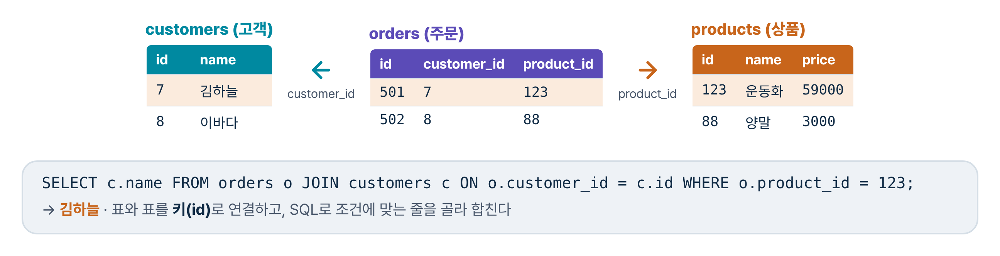

<sub>[🏠 과정 목차](../../README.md) › [1주차](../README.md) › [4일차](README.md) › 4/8교시</sub>

# 4교시 · 데이터베이스와 저장소

> [!NOTE]
> **이번 시간에 할 일**
>
> - 데이터가 왜 애플리케이션에서 가장 소중한 부분인지 이해합니다.
> - 관계형 DB(RDB)와 SQL, 트랜잭션(ACID)의 의미를 압니다.
> - NoSQL의 종류와 언제 쓰는지 압니다.
> - 데이터 책임(백업, 마이그레이션, 최신성)을 정리합니다.

## 데이터는 사라지면 안 된다

프론트엔드는 다시 빌드하면 되고, 백엔드 프로세스는 다시 시작하면 됩니다. 하지만 **사용자 데이터, 주문 기록, 결제 내역**은 한 번 사라지면 되돌릴 수 없습니다. 2교시의 stateless 원칙은 결국 "상태를 서버에서 빼서 **데이터 계층에 맡긴다**"는 뜻이었습니다. 그래서 데이터 계층은 애플리케이션에서 가장 조심스럽게 다뤄야 하는 부분입니다.

| 데이터 책임 | 뜻 | 소홀하면 |
|---|---|---|
| 영속성 (Persistence) | 재시작해도 남는다 | 컨테이너를 지웠더니 데이터도 사라짐 (2주차 볼륨) |
| 스키마 (Schema) | 데이터의 구조 | 앱과 DB 구조가 안 맞아 에러 |
| 인덱스 (Index) | 빠른 조회 경로 | 데이터가 늘수록 점점 느려짐 |
| 백업 (Backup) | 잃었을 때 복구 | 실수 한 번에 모든 데이터 손실 |
| 마이그레이션 (Migration) | 구조를 안전하게 바꾸는 절차 | 배포하다 서비스 중단 |
| 최신성 (Freshness) | 얼마나 최신 데이터를 보여 주나 | 품절 상품이 계속 "재고 있음" |

## 관계형 데이터베이스(RDB)

**관계형 데이터베이스**는 데이터를 **표(테이블)**로 저장하고, 표끼리 **관계**로 연결합니다. 엑셀 시트 여러 장이 서로 연결된 모습을 떠올리면 됩니다.



```sql
-- 운동화를 주문한 고객의 이름 찾기
SELECT c.name, o.ordered_at
FROM   orders o
JOIN   customers c ON o.customer_id = c.id
WHERE  o.product_id = 123;
```

이렇게 데이터를 묻고 다루는 언어가 **SQL(Structured Query Language)**입니다. 문법을 지금 외울 필요는 없습니다. "표에서 조건에 맞는 줄을 골라 합친다"는 느낌만 기억하세요.

### 트랜잭션과 ACID — 돈이 오갈 때 꼭 필요한 성질

계좌 이체를 생각해 봅시다. A 계좌에서 1만 원을 빼고, B 계좌에 1만 원을 넣어야 합니다. 그런데 빼는 데는 성공하고 넣다가 서버가 꺼지면? 1만 원이 사라집니다. 이를 막기 위해 여러 작업을 **하나의 묶음(트랜잭션)**으로 처리하고, 네 가지 성질을 보장합니다.

| 성질 | 뜻 | 계좌 이체에서 |
|---|---|---|
| **A**tomicity 원자성 | 전부 되거나, 전부 안 되거나 | 빼기와 넣기가 함께 성공하거나 함께 취소 |
| **C**onsistency 일관성 | 규칙을 항상 지킨다 | 잔액이 마이너스가 되지 않는다 |
| **I**solation 격리성 | 동시에 해도 섞이지 않는다 | 두 이체가 동시에 일어나도 잔액이 정확 |
| **D**urability 지속성 | 완료되면 사라지지 않는다 | 성공 메시지 후 정전이 나도 기록 유지 |

어제 3교시의 **경쟁 상태**를 데이터베이스가 대신 막아 주는 장치가 바로 격리성입니다.

> **📘 사례 — 검색과 대규모 데이터: 네이버**
>
> 네이버 기술 블로그 D2는 검색과 데이터 분석을 위해 대규모 분산 저장소를 직접 설계·운영한 경험과, 자주 쓰는 데이터와 거의 안 쓰는 데이터를 서로 다른 저장장치에 나눠 **비용을 줄인** 경험 등을 공개해 왔습니다. 검색 결과는 즉시 보이지만, 그 뒤에는 문서를 모으고(수집), 저장하고, **색인(index)**을 만들고, 빠르게 내주는(서빙) 단계가 있습니다. 여기서 볼 패턴은 **"데이터가 늘어나면 저장 비용, 조회 속도, 데이터 최신성, 장애 복구 부담이 함께 늘어난다"**는 것과, 그래서 **한 가지 DB로 모든 일을 하지 않는다**는 것입니다.

## NoSQL — 표가 아닌 다른 모양들

모든 데이터가 표에 잘 맞는 것은 아닙니다. 2000년대 후반 인터넷 서비스가 폭발적으로 커지면서, 관계형 DB 대신 **다른 방식으로 저장하는** 데이터베이스들이 등장했고, 이를 묶어 **NoSQL(Not only SQL)**이라고 부릅니다.

| 종류 | 저장 방식 | 잘하는 일 | 예 |
|---|---|---|---|
| 키-값 | 이름표(키)와 값 | 매우 빠른 단순 조회 | Redis, DynamoDB |
| 문서 | JSON 같은 문서 | 구조가 자주 바뀌는 데이터 | MongoDB |
| 와이드 컬럼 | 거대한 희소 표 | 엄청난 양의 쓰기 | Cassandra |
| 그래프 | 점과 선 | 관계 탐색 (친구의 친구) | Neo4j |
| 검색 엔진 | 역색인 | 글자 검색 | Elasticsearch, OpenSearch |
| 벡터 | 숫자 배열(임베딩) | **의미가 비슷한 것 찾기** | pgvector, OpenSearch |

| 비교 | RDB | NoSQL (대체로) |
|---|---|---|
| 구조 | 미리 정한 스키마 | 유연한 구조 |
| 강점 | 정확성(ACID), 복잡한 조인 | 수평 확장, 단순 조회 속도 |
| CAP | CP 쪽에 가까움 | AP 쪽을 택하는 경우 많음 |
| 어울리는 곳 | 주문, 결제, 회원 | 세션, 로그, 장바구니, 피드 |

> [!IMPORTANT]
> **'무엇이 더 좋은가'가 아니라 '어디에 맞는가'**
>
> 현업 서비스는 대부분 **여러 DB를 함께** 씁니다. 주문과 결제는 PostgreSQL, 세션과 캐시는 Redis, 상품 검색은 OpenSearch, 이미지는 S3처럼 **데이터의 성격에 맞는 저장소**를 고릅니다. 이것을 **다중 저장소(polyglot persistence)**라고 합니다. 대신 저장소가 늘어날수록 백업·모니터링·보안 부담도 늘어납니다. 1교시의 "비즈니스가 커지면 시스템 부담도 커진다"가 여기에도 적용됩니다.

> **🎓 학술 노트 — 관계형 모델(1970)과 Dynamo(2007)**
>
> **1970년, 관계형 모델의 탄생.** IBM 연구소의 에드거 코드(Edgar F. Codd)는 「대규모 공유 데이터 뱅크를 위한 관계형 데이터 모델(A Relational Model of Data for Large Shared Data Banks)」에서, 데이터를 **수학의 집합과 관계**로 표현하자고 제안했습니다. 핵심은 데이터가 디스크에 **어떻게 저장되는지**와 사용자가 **무엇을 묻는지**를 분리하는 것이었습니다. 그 전에는 데이터를 찾으려면 저장 구조를 따라 포인터를 직접 따라가야 했습니다. 이 아이디어에서 SQL과 오늘날의 Oracle, MySQL, PostgreSQL이 나왔고, 코드는 1981년 튜링상을 받았습니다.
>
> **2007년, Dynamo.** 아마존은 SOSP 2007에서 「Dynamo: 아마존의 고가용성 키-값 저장소」 논문을 발표했습니다. 장바구니처럼 **"언제나 쓸 수 있어야 하는"** 데이터를 위해, 일관성을 조금 양보하고 가용성을 택한(**AP**) 설계였습니다. 네트워크가 끊겨도 장바구니에 담기는 되고, 나중에 충돌을 정리합니다. 이 논문은 Cassandra 같은 NoSQL 데이터베이스들에 큰 영향을 주었고, 오늘날 AWS **DynamoDB**의 이름도 여기서 왔습니다(다만 DynamoDB는 논문 속 시스템과 내부 구조가 다른 별도 서비스입니다). 어제 본 2025년 AWS 장애의 주인공이 바로 이 DynamoDB였습니다.
>
> - Codd, E. F. (1970). A relational model of data for large shared data banks. *CACM*, 13(6).
> - DeCandia, G. et al. (2007). Dynamo: Amazon's highly available key-value store. *SOSP '07*.

> **📈 트렌드 — PostgreSQL의 시대와 벡터 검색**
>
> **Stack Overflow 개발자 설문 2026**에서 PostgreSQL은 응답자의 **58%**가 지난 1년간 사용했다고 답해 가장 많이 쓰이는 데이터베이스였습니다(SQLite 42%, MySQL 35%). 2025년 55.6%에서 더 올라, 여러 해 연속 1위를 지키고 있습니다. 오픈소스이면서 기능이 풍부하고, 확장 기능(extension)으로 거의 모든 일을 할 수 있기 때문입니다. 대표적인 확장이 **pgvector**로, PostgreSQL 안에서 **벡터 검색**을 할 수 있게 해 줍니다.
>
> 벡터 검색은 1교시 트렌드에서 본 **RAG**의 핵심입니다. 문서를 숫자 배열(임베딩)로 바꿔 저장해 두고, 질문과 **의미가 가까운** 문서를 찾아 AI에게 함께 건네줍니다. "새로운 AI 전용 DB"를 따로 도입하기보다, 이미 쓰던 PostgreSQL이나 OpenSearch에 벡터 기능을 더하는 경우가 많아지고 있습니다. 2주차 실습의 DB도 PostgreSQL입니다.

## 정리

- 데이터는 사라지면 되돌릴 수 없으며, **영속성·백업·마이그레이션**이 핵심 책임입니다.
- **RDB**는 표와 관계, **SQL**로 묻고, **ACID 트랜잭션**으로 정확성을 지킵니다.
- **NoSQL**은 키-값, 문서, 와이드 컬럼, 그래프, 검색, 벡터 등 다양한 모양이 있습니다.
- 현업은 데이터 성격에 맞게 **여러 저장소를 함께** 씁니다(다중 저장소).
- 관계형 모델(Codd, 1970)과 Dynamo(2007)가 오늘날 DB의 두 뿌리입니다.

> **✅ 확인 문제**
>
> 1. 계좌 이체에서 "빼기와 넣기가 함께 성공하거나 함께 취소"되는 성질은?
> 2. 로그인 세션을 저장하기에 잘 맞는 NoSQL 종류는?
> 3. 데이터 성격에 맞게 여러 저장소를 함께 쓰는 것을 무엇이라고 하나요?
> 4. 관계형 모델을 제안한 사람과 연도는?
> 5. Stack Overflow 2026 설문에서 가장 많이 쓰인 데이터베이스는?
>
> <details><summary>정답</summary>
>
> 1. 원자성(Atomicity)
> 2. 키-값 저장소 (Redis 등)
> 3. 다중 저장소(polyglot persistence)
> 4. 에드거 코드(Edgar F. Codd), 1970년
> 5. PostgreSQL (58%)
>
> </details>

## 참고 문헌

- Codd, E. F. (1970). A relational model of data for large shared data banks. *CACM*, 13(6).
- Gray, J., & Reuter, A. (1992). *Transaction Processing: Concepts and Techniques*. Morgan Kaufmann.
- DeCandia, G. et al. (2007). Dynamo: Amazon's highly available key-value store. *SOSP '07*.
- Kleppmann, M. (2017). *Designing Data-Intensive Applications*. O'Reilly.
- NAVER D2. *HDFS 이종 저장장치 도입과 비용 효율화*, *분산 고속 저장소 nStore*. d2.naver.com
- Stack Overflow (2026). *2026 Developer Survey — Technology: Databases*. survey.stackoverflow.co/2026

---

| 이전 | 목차 | 다음 |
|:--|:--:|--:|
| ⬅️ [3교시 · 확장성과 가용성](lesson-03.md) | [⬆️ 4일차 목차](README.md) | [5교시 · 캐시와 메시지 큐](lesson-05.md) ➡️ |
