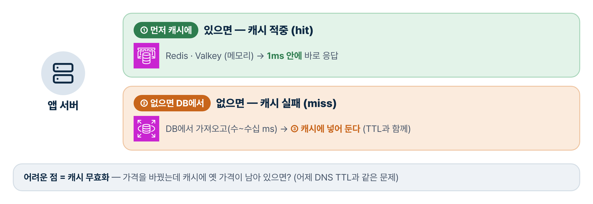
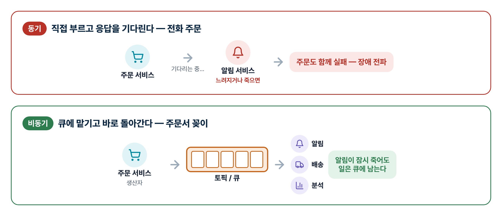

[🏠 과정 목차](../../README.md) › [1주차](../README.md) › [4일차](README.md) › 5/8교시

# 5교시 · 캐시와 메시지 큐

> [!NOTE]
> **이번 시간에 할 일**
>
> - 캐시가 왜 필요하고, 언제 문제가 되는지 압니다.
> - 동기 호출과 비동기 처리의 차이를 설명합니다.
> - 메시지 큐와 이벤트 스트리밍(Kafka)의 기본 구조를 이해합니다.
> - 재시도, 중복 처리, 실패 메시지 보관(DLQ)의 필요성을 압니다.

## 캐시 — 자주 쓰는 것은 가까이

그제 2교시에서 "데이터가 어디 있느냐에 따라 수천~수백만 배 속도 차이"를 봤습니다. **캐시(cache)**는 자주 쓰는 데이터를 **더 빠른 곳에 복사해 두는** 기법입니다. CPU 캐시, 브라우저 캐시, 어제 본 DNS 캐시와 CDN도 모두 같은 생각입니다. 애플리케이션에서는 DB 앞에 **Redis** 같은 메모리 저장소를 두는 것이 대표적입니다.

1. 앱이 먼저 **캐시**에 묻습니다. 있으면(**캐시 적중, hit**) 1ms 안에 바로 응답합니다.
2. 없으면(**캐시 실패, miss**) **DB**에서 가져옵니다(수~수십 ms).
3. 가져온 값을 **캐시에 넣어 두고**(유효 시간 TTL과 함께) 응답합니다.

| 캐시가 잘 맞는 데이터 | 캐시가 위험한 데이터 |
|---|---|
| 자주 읽고 가끔 바뀐다 (상품 정보, 인기 순위) | 항상 정확해야 한다 (잔액, 재고 차감 순간) |
| 조금 오래돼도 괜찮다 (조회수, 추천 목록) | 사용자마다 다르고 민감하다 (권한) |

> [!WARNING]
> **컴퓨터 과학에서 어려운 두 가지**
>
> 개발자들 사이에 유명한 농담이 있습니다. "컴퓨터 과학에서 어려운 일은 딱 두 가지다. **캐시 무효화**와 이름 짓기." 가격을 바꿨는데 캐시에 옛 가격이 남아 있으면 사용자는 틀린 가격을 봅니다. 캐시를 언제 지울지(무효화) 정하는 것은 생각보다 어렵고, 어제 DNS TTL에서 본 "바꿨는데 왜 안 바뀌죠?"와 같은 문제입니다.

## 동기 vs 비동기 — 기다릴까, 맡겨 둘까

| 방식 | 모양 | 좋은 점 | 위험 |
|---|---|---|---|
| **동기 (Synchronous)** | A가 B를 부르고 **응답을 기다린다** | 결과를 바로 안다, 단순하다 | B가 느리면 A도 느려지고, B가 죽으면 A도 실패 (**장애 전파**) |
| **비동기 큐 (Queue)** | A가 할 일을 **큐에 넣고** 바로 돌아간다. 작업자가 나중에 꺼내 처리 | B가 잠시 죽어도 일이 큐에 남는다, 몰려도 순서대로 | 결과가 늦게 나온다, 재시도·중복 처리 설계 필요 |
| **이벤트 스트림 (Stream)** | A가 "주문이 생겼다"는 **이벤트를 발행**하면 여러 서비스가 각자 구독 | 새 서비스를 붙이기 쉽다 | 순서 보장, 처리 지연(lag) 감시 필요 |

> **🧩 비유 — 전화 주문과 주문서 꽂이**
>
> **동기**는 전화로 주문하고 요리가 나올 때까지 끊지 않고 기다리는 것입니다. 주방이 바쁘면 전화선이 모두 막힙니다. **비동기 큐**는 주문서를 **꽂이에 꽂아 두고** 자리로 돌아가는 것입니다. 요리사는 꽂이에서 하나씩 꺼내 만듭니다. 손님이 몰려도 주문서는 쌓일 뿐 사라지지 않고, 요리사가 잠깐 자리를 비워도 주문은 남아 있습니다. **이벤트 스트림**은 주문서를 **복사해서 게시판에 붙여 두는** 것입니다. 주방도, 계산대도, 배달 담당도 각자 게시판을 보고 자기 일을 합니다.

## 메시지 큐와 이벤트 스트리밍

| 용어 | 뜻 |
|---|---|
| 생산자 (Producer) | 메시지(이벤트)를 보내는 쪽 — 주문 서비스 |
| 토픽 / 큐 (Topic / Queue) | 메시지가 쌓이는 곳 — 주문서 꽂이 |
| 소비자 (Consumer) | 메시지를 꺼내 처리하는 쪽 — 알림 서비스, 배송 서비스 |
| 브로커 (Broker) | 큐를 관리하는 서버 — Kafka, RabbitMQ, AWS SQS |
| 지연 (Lag) | 쌓였지만 아직 처리 안 된 메시지 양 — 감시 대상 |
| DLQ (Dead Letter Queue) | 여러 번 재시도해도 실패한 메시지를 따로 모아 두는 곳 |

> **📘 사례 — 메시징 플랫폼: 카카오 / 실시간 주문: 우아한형제들**
>
> 카카오 기술 블로그는 사내 여러 서비스가 함께 쓰는 **공용 메시지 스트리밍 플랫폼**을 만든 경험을 공개했습니다. 서비스마다 Kafka를 따로 설치하고 운영하면 같은 설정과 장애 대응을 수십 번 반복하게 되므로, 공용 플랫폼으로 반복을 줄인 것입니다.
>
> 우아한형제들 기술 블로그는 배달 서비스에서 Kafka를 어떻게 쓰는지 소개합니다. 배달 주문은 상태 변화가 눈에 보이기 때문에 이해하기 좋은 예입니다.
>
> | 이벤트 | 사용자에게 필요한 것 | 뒤에서 할 일 |
> |---|---|---|
> | 주문 생성 | "주문 접수" 표시 | 주문 저장 |
> | 결제 확인 | "결제 완료" 표시 | 가게에 알림 |
> | 가게 수락 | "조리 중" 표시 | 예상 시간 계산 |
> | 라이더 배정 | "배달 중" 표시 | 배차 상태 갱신 |
> | 배달 완료 | "완료" 표시 | 주문 종료, 정산, 분석 |
>
> 핵심은 **사용자에게 빨리 알려 줄 일**과 **뒤에서 확실하게 처리할 일**을 나누는 것입니다. 주문 버튼을 누르면 "접수됨"은 즉시 보여 주고, 가게 알림·정산·분석은 이벤트로 뒤에서 처리합니다.

## 비동기의 대가 — 재시도와 중복

비동기 처리는 강력하지만, 대신 새로운 문제가 생깁니다.

| 문제 | 상황 | 해결 방법 |
|---|---|---|
| 실패 | 알림 서비스가 잠깐 죽어 메시지 처리 실패 | **재시도** (어제 배운 exponential backoff) |
| 중복 | 처리는 됐는데 "완료" 신호가 유실되어 같은 메시지를 또 받음 | **멱등성** — 같은 메시지를 두 번 처리해도 결과가 같게 |
| 독 메시지 | 데이터가 잘못되어 몇 번을 해도 실패 | **DLQ**로 옮겨 사람이 확인 |
| 순서 | "배달 완료"가 "배달 중"보다 먼저 도착 | 같은 주문은 같은 파티션으로, 상태 검사 |

> [!IMPORTANT]
> **'정확히 한 번'은 공짜가 아니다**
>
> 분산 시스템에서 메시지는 기본적으로 **"최소 한 번"(at-least-once)** 전달됩니다. 유실을 막으려고 재전송하다 보면 중복이 생기기 때문입니다. 그래서 받는 쪽이 **멱등하게** 만들어야 합니다. 예를 들어 "주문 #123 알림 보내기" 메시지를 처리할 때 "이미 #123 알림을 보냈나?"를 먼저 확인하는 식입니다. 어제 5교시 HTTP 메서드의 멱등성이 여기서 다시 등장합니다. 3주차 MSA 장애 실습의 핵심 주제입니다.

> **🎓 학술 노트 — Kafka: 로그라는 단순한 아이디어 (2011)**
>
> 링크드인(LinkedIn)의 제이 크렙스(Jay Kreps), 네하 나크헤데(Neha Narkhede), 쥔 라오(Jun Rao)는 2011년 NetDB 워크숍에서 「Kafka: 로그 처리를 위한 분산 메시징 시스템」을 발표했고, 같은 해 Kafka를 오픈소스로 공개했습니다(이후 Apache 최상위 프로젝트).
>
> Kafka의 핵심 아이디어는 놀랍도록 단순합니다. 메시지를 **끝에 덧붙이기만 하는 로그(append-only log)**에 순서대로 기록하고, 소비자는 각자 "어디까지 읽었는지(offset)"만 기억합니다. 메시지를 읽어도 지우지 않으므로 **여러 소비자가 같은 데이터를 각자 속도로** 읽을 수 있고, 문제가 생기면 **과거 지점부터 다시 읽을** 수도 있습니다. 크렙스는 2013년 글 「로그: 모든 소프트웨어 엔지니어가 알아야 할 실시간 데이터 통합의 추상화」에서 이 로그가 데이터베이스와 분산 시스템의 공통 뼈대라고 설명했습니다.
>
> - Kreps, J., Narkhede, N., & Rao, J. (2011). Kafka: A distributed messaging system for log processing. *NetDB '11*.
> - Kreps, J. (2013). The Log: What every software engineer should know about real-time data's unifying abstraction. LinkedIn Engineering.

> **📈 트렌드 — Kafka 4.0과 Redis 라이선스 이야기**
>
> **Kafka 4.0 (2025년 3월).** Kafka는 오랫동안 클러스터 정보를 관리하기 위해 **ZooKeeper**라는 별도 시스템이 필요했습니다. 2025년 3월 18일 출시된 Kafka 4.0은 ZooKeeper를 완전히 제거하고 Kafka 자체의 합의 방식(**KRaft**)만으로 동작합니다. 운영해야 할 구성요소가 하나 줄어든 것입니다.
>
> **Redis와 Valkey (2024~2025).** 캐시의 대명사 Redis는 2024년 3월 라이선스를 오픈소스가 아닌 방식으로 바꿨습니다. 이에 리눅스 재단의 지원 아래 AWS, 구글, 오라클 등이 원래 코드를 이어받은 **Valkey**를 만들었습니다. 그러자 Redis는 2025년 5월 Redis 8부터 OSI가 승인한 오픈소스 라이선스인 **AGPLv3**를 다시 선택지로 추가했습니다. 지금 AWS ElastiCache는 Valkey도 지원합니다. 오픈소스 라이선스가 **기술 선택과 비용에 직접 영향을 주는** 사례로, 내일 볼 Docker Desktop 라이선스, 5주차의 Terraform/OpenTofu 이야기와 같은 흐름입니다.

## 정리

- **캐시**는 자주 쓰는 데이터를 가까이 두는 기법이며, 어려운 부분은 **무효화**입니다.
- **동기**는 기다리고, **비동기**는 맡겨 둡니다. 동기는 장애가 전파되고, 비동기는 늦게 처리됩니다.
- 큐는 **생산자 → 토픽 → 소비자** 구조이며, **지연(lag)**을 감시합니다.
- 비동기의 대가는 **재시도·중복·DLQ·순서** 설계이며, 해법의 중심은 **멱등성**입니다.
- Kafka는 **덧붙이기만 하는 로그**라는 단순한 아이디어 위에 서 있습니다.

> **✅ 확인 문제**
>
> 1. 캐시에 원하는 데이터가 있는 경우와 없는 경우를 각각 무엇이라고 하나요?
> 2. 잔액처럼 항상 정확해야 하는 데이터를 캐시할 때의 위험은?
> 3. 동기 호출에서 받는 쪽 서비스가 죽으면 어떤 일이 생기나요?
> 4. 여러 번 재시도해도 실패한 메시지를 따로 모아 두는 곳은?
> 5. 2025년 3월 Kafka 4.0에서 완전히 제거된 구성요소는?
>
> 

정답

>
> 1. 캐시 적중(hit), 캐시 실패(miss)
> 2. 오래된 값을 보여 주어 틀린 잔액이 표시될 수 있다
> 3. 부르는 쪽도 기다리다 실패한다 (장애 전파)
> 4. DLQ (Dead Letter Queue)
> 5. ZooKeeper (KRaft로 대체)
>
> 

## 참고 문헌

- Kreps, J., Narkhede, N., & Rao, J. (2011). Kafka: A distributed messaging system for log processing. *NetDB '11*.
- Kreps, J. (2013). *The Log*. LinkedIn Engineering Blog.
- Hohpe, G., & Woolf, B. (2003). *Enterprise Integration Patterns*. Addison-Wesley.
- Kakao Tech. *카카오 개발자를 위한 공용 Message Streaming Platform*. tech.kakao.com/posts/485
- 우아한형제들 기술블로그. *우리 팀은 카프카를 어떻게 사용하고 있을까*. techblog.woowahan.com/17386
- Apache Kafka (2025). *Apache Kafka 4.0.0 Release Announcement*.
- Redis (2025). *Redis 8 is now GA* / InfoQ (2025.5). *Redis Returns to Open Source under AGPL License*.

---

| 이전 | 목차 | 다음 |
|:--|:--:|--:|
| ⬅️ [4교시 · 데이터베이스와 저장소](lesson-04.md) | [⬆️ 4일차 목차](README.md) | [6교시 · 폭주 트래픽과 AI 플랫폼](lesson-06.md) ➡️ |
