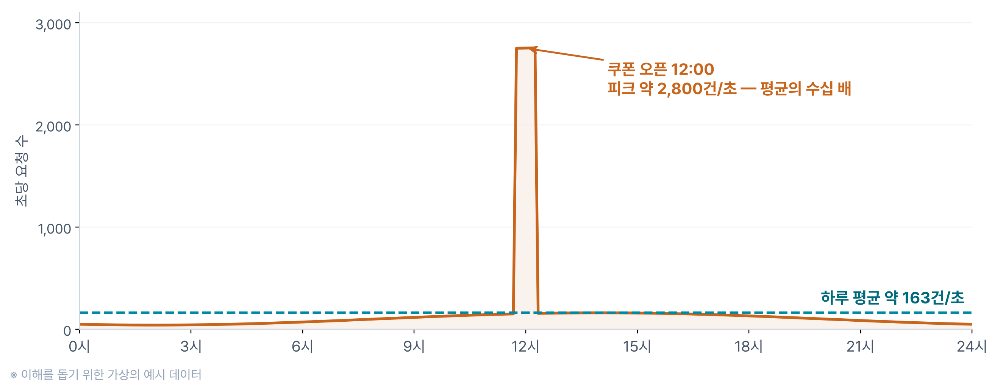
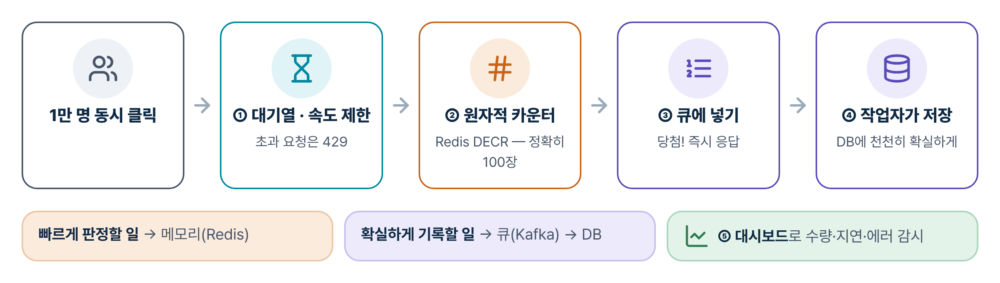

[🏠 과정 목차](../../README.md) › [1주차](../README.md) › [4일차](README.md) › 6/7교시

# 6교시 · 폭주 트래픽과 AI 플랫폼

> [!NOTE]
> **이번 시간에 할 일**
>
> - 평균 트래픽과 폭주(burst) 트래픽의 차이를 압니다.
> - 선착순 이벤트를 버티는 설계 요소(속도 제한, 원자적 카운터, 큐)를 이해합니다.
> - AI·고성능 컴퓨팅이 웹 서비스와 어떻게 같고 다른지 압니다.
> - 12-Factor App으로 오늘 배운 실행 조건을 정리합니다.

## 평균은 거짓말을 한다

하루 종일 안정적인 서비스도 **쿠폰 오픈 1분** 동안 무너질 수 있습니다. 하루 평균 초당 100건인 서비스에 선착순 이벤트가 열리면, 그 1분 동안 초당 수만 건이 몰릴 수 있습니다. 어제 6교시의 "평균 대신 p99"처럼, 트래픽도 **평균이 아니라 피크**를 봐야 합니다.

| 트래픽 유형 | 주요 위험 | 시스템 대응 |
|---|---|---|
| 평시 | 완만한 증가 | 점진적 스케일 아웃 |
| 캠페인 | 짧은 급증 | 속도 제한, 큐로 완충 |
| 선착순 | **공정성, 초과 발급** | 원자적 카운터, 대기열 |
| 예약 | 같은 요청 중복 | 멱등성, 검증 |
| 결제 | 데이터 손실 | 트랜잭션, 재시도 |

## 선착순 쿠폰을 버티는 설계

쿠폰 100장을 선착순으로 나눠 준다고 합시다. 1만 명이 동시에 버튼을 누르면 무슨 일이 생길까요?

> [!WARNING]
> **가장 흔한 실수 — 101번째 쿠폰**
>
> 서버 여러 대가 동시에 "남은 쿠폰 수"를 DB에서 읽고(`99장 남음`), 각자 1을 빼서 저장하면, 실제로는 100장보다 **더 많이 발급**됩니다. 그제 3교시의 **경쟁 상태**가 그대로 일어나는 것입니다. 이것을 **초과 발급(oversell)**이라고 하며, 쿠폰이면 손해, 공연 좌석이면 사고입니다.

| 단계 | 하는 일 | 도구 |
|---|---|---|
| ① 대기열·속도 제한 | 한꺼번에 들어오지 못하게 줄을 세우고, 초과 요청은 정중히 거절(`429`) | 대기실(waiting room), API 게이트웨이 |
| ② 원자적 카운터 | "남은 수 확인 + 1 빼기"를 **쪼갤 수 없는 한 동작**으로 | Redis `DECR` 같은 원자적 명령 |
| ③ 큐에 넣기 | 당첨자만 "발급 요청"을 큐에 넣고 즉시 "당첨!" 응답 | Kafka, SQS |
| ④ 작업자가 저장 | 큐에서 꺼내 DB에 천천히, 확실하게 기록 | 소비자(worker) |
| ⑤ 대시보드 | 남은 수량, 큐 지연, 에러율을 실시간 감시 | Grafana (4주차) |

> **📘 사례 — 선착순 쿠폰: 여기어때**
>
> 여기어때 기술 블로그의 「Redis & Kafka를 활용한 선착순 쿠폰 이벤트 개발기」는 바로 이 문제를 다룹니다. 요청이 몰리는 순간에는 빠른 메모리 저장소(Redis)로 수량을 정확히 세고, 실제 발급 기록은 메시지 큐(Kafka)를 거쳐 뒤에서 처리하는 구조입니다. 볼 패턴은 **"빠르게 판정할 일(Redis)"과 "확실하게 기록할 일(Kafka → DB)"을 나눈다**는 것입니다. 5교시의 "사용자에게 빨리 알려 줄 일과 뒤에서 확실히 처리할 일을 나눈다"와 같은 원리입니다.

> [!TIP]
> **테스트도 실행 조건이다**
>
> 이런 시스템은 출시 전에 **같은 상황을 여러 번 재현**해 봐야 합니다. 그런데 테스트할 때마다 Redis, Kafka, DB를 손으로 설치하고 지우는 것은 끔찍합니다. "쉽게 만들고 쉽게 지울 수 있는 환경" — 이것이 2주차 Docker Compose가 필요한 이유입니다.

## AI와 고성능 컴퓨팅 — 다르지만 같다

AI 시스템은 웹 서비스와 달라 보이지만, 운영 관점에서는 같은 구성요소에 **더 비싸고 특수한 자원**이 붙은 것입니다.

| 구성요소 | 웹 앱 | AI · 고성능 컴퓨팅 |
|---|---|---|
| 런타임 | Node.js, Python 서버 | Python + 머신러닝 프레임워크 |
| 의존성 | 웹 프레임워크 | ML 라이브러리 + **GPU 드라이버(CUDA)** — 버전 궁합이 까다롭다 |
| 데이터 | DB, JSON | 대용량 데이터셋, 모델 파일(수 GB~수백 GB) |
| 컴퓨트 | CPU, 메모리 | **GPU**, 대용량 메모리, 빠른 디스크 |
| 설정 | API 주소, 비밀값 | 실험 설정, **자원 할당량** |
| 관찰 | 로그, 상태 | 학습 로그, 지표, **GPU 사용률** |

> **📘 사례 — AI 플랫폼: 카카오페이**
>
> 카카오페이 기술 블로그는 GPU 서버를 도입하고 그 위에 머신러닝 플랫폼(**Kubeflow**)을 구축한 경험을 공개했습니다. Kubeflow는 Kubernetes 위에서 동작하는 머신러닝 플랫폼입니다. 여기서 볼 패턴은 **"GPU는 비싸고 귀한 공유 자원이므로, 누가 얼마나 쓸지 나누고(할당량), 모두가 같은 표준 환경에서 실험하게 해야 한다"**는 것입니다. 그리고 그 표준 환경을 만드는 도구가 바로 **컨테이너 이미지**와 **Kubernetes**입니다. AI 엔지니어링도 결국 2~3주차에 배울 기술 위에 서 있습니다.

> **🎓 학술 노트 — 12-Factor App (Wiggins, 2011)**
>
> Heroku의 공동 창업자 애덤 위긴스(Adam Wiggins)는 2011년 수많은 웹 앱을 운영한 경험을 바탕으로, **클라우드에서 잘 돌아가는 앱의 12가지 원칙**을 「The Twelve-Factor App」으로 정리했습니다. 오늘 배운 내용과 2주차 이후 내용이 이 원칙들에 고스란히 담겨 있습니다.
>
> | 원칙 (일부) | 뜻 | 오늘·앞으로 |
> |---|---|---|
> | III. 설정 | 설정은 코드가 아니라 **환경 변수**에 | 2주차 `-e`, 3주차 ConfigMap |
> | IV. 백엔드 서비스 | DB·캐시·큐는 **주소만 바꾸면 갈아 끼울 수 있는** 부속으로 | 오늘 4~5교시 |
> | VI. 프로세스 | 앱은 **상태 없는** 프로세스로 실행 | 2교시 stateless |
> | VIII. 동시성 | 프로세스를 **여러 개 띄워** 확장 | 3교시 스케일 아웃 |
> | IX. 폐기 가능성 | 빠르게 시작하고 **우아하게 종료** | 그제 SIGTERM, 3주차 Pod |
> | X. 개발/운영 일치 | 개발 환경과 운영 환경을 **최대한 같게** | 2주차 Docker |
> | XI. 로그 | 로그는 파일이 아니라 **표준 출력 스트림**으로 | 2주차 `docker logs` |
>
> 15년 가까이 지났지만, 이 원칙은 여전히 "클라우드 네이티브 앱"의 사실상 기준으로 쓰입니다. 2~3주차 실습 앱도 이 원칙을 따르도록 만들어져 있습니다.
>
> - Wiggins, A. (2011). *The Twelve-Factor App*. 12factor.net

> **📈 트렌드 — GPU는 새로운 '희소 자원'**
>
> 생성형 AI 붐 이후 GPU는 클라우드에서 가장 비싸고 구하기 어려운 자원이 되었습니다. 그래서 GPU를 **잘게 나눠 여러 작업이 함께 쓰는** 기술(GPU 공유, 분할), 필요할 때만 켜고 바로 끄는 **오토스케일링**, 작업 우선순위에 따라 GPU를 배분하는 **스케줄러**가 플랫폼 팀의 핵심 과제가 되었습니다. 1일차에 본 FinOps 조사에서 AI 비용 관리가 거의 모든 조직의 관심사가 된 것도 같은 흐름입니다. Kubernetes도 GPU 같은 특수 장치를 더 유연하게 나눠 쓰는 기능(Dynamic Resource Allocation)을 계속 발전시키고 있습니다.

## 정리

- 트래픽은 **평균이 아니라 피크**를 봐야 합니다.
- 선착순 이벤트는 **대기열·속도 제한 → 원자적 카운터 → 큐 → 작업자 → 대시보드**로 버팁니다.
- **빠르게 판정할 일**과 **확실하게 기록할 일**을 나눕니다.
- AI도 같은 구성요소에 **GPU·대용량 데이터·까다로운 의존성**이 붙은 것입니다.
- **12-Factor App**은 클라우드에서 잘 돌아가는 앱의 12가지 원칙입니다.

> **✅ 확인 문제**
>
> 1. 쿠폰 100장을 선착순으로 주는데 101장이 발급되는 문제의 이름과 원인은?
> 2. "남은 수 확인 + 1 빼기"를 쪼갤 수 없는 한 동작으로 처리하는 것을 무엇이라고 하나요?
> 3. 너무 많은 요청을 거절할 때 쓰는 HTTP 상태 코드는?
> 4. AI 시스템의 의존성이 웹 앱보다 까다로운 이유는?
> 5. 12-Factor App에서 설정은 어디에 두라고 하나요?
>
> 

정답

>
> 1. 초과 발급(oversell) — 여러 서버가 동시에 읽고 쓰는 경쟁 상태
> 2. 원자적 연산(원자적 카운터)
> 3. 429 Too Many Requests
> 4. ML 라이브러리와 GPU 드라이버(CUDA) 버전의 궁합을 맞춰야 하기 때문
> 5. 환경 변수
>
> 

## 참고 문헌

- Wiggins, A. (2011). *The Twelve-Factor App*. 12factor.net
- 여기어때 기술블로그. *Redis & Kafka를 활용한 선착순 쿠폰 이벤트 개발기*. techblog.gccompany.co.kr
- 카카오페이 기술블로그. *AI 플랫폼 GPU 도입부터 Kubeflow까지 도입기*. tech.kakaopay.com/post/ai-platform
- Kubeflow. *Kubeflow Documentation*. kubeflow.org
- Kubernetes. *Dynamic Resource Allocation*. kubernetes.io/docs
- FinOps Foundation (2026). *State of FinOps 2026*.

---

| 이전 | 목차 | 다음 |
|:--|:--:|--:|
| ⬅️ [5교시 · 캐시와 메시지 큐](lesson-05.md) | [⬆️ 4일차 목차](README.md) | [7교시 · 모놀리식과 MSA, 그리고 왜 Docker인가](lesson-07.md) ➡️ |
