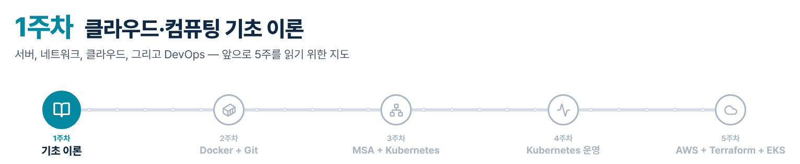

[🏠 과정 목차](../../README.md) › [1주차](../README.md) › [5일차](README.md)

# 1주차 5일차 — DevOps 문화와 협업

📕 1주차 이북 PDF: [보기](../../downloads/pdf/week1.pdf) · [내려받기](https://github.com/niceguy61/kdt_devops_lecture_2026_rev2/raw/main/downloads/pdf/week1.pdf) &nbsp;|&nbsp; 📊 5일차 슬라이드: [PPTX 내려받기](https://github.com/niceguy61/kdt_devops_lecture_2026_rev2/raw/main/downloads/pptx/week1-day5.pptx)

## 오늘의 목표

1주차의 마지막 날입니다. 지금까지는 기술을 봤습니다. 클라우드, 컴퓨터와 운영체제, 네트워크, 애플리케이션 구조. 오늘은 그 기술을 다루는 **사람과 팀**을 봅니다. DevOps는 도구 이름이 아니라 **일하는 방식**에서 시작했고, 현업에서 신입 DevOps 엔지니어가 가장 먼저 부딪히는 벽도 기술보다는 **소통**인 경우가 많습니다. 개발자, 기획자, QA, 보안 담당자와 같은 언어로 이야기하는 법을 배웁니다.

그리고 오후에는 강사 시연으로 **로컬 실행 환경을 손으로 맞추는 고통**을 직접 보고, 다음 주 Docker를 위한 설치 체크리스트를 정리합니다.

- DevOps가 왜 생겼는지, 무엇을 바꾸려 하는지 설명할 수 있습니다.
- 소프트웨어가 만들어지는 흐름과 CI/CD의 의미를 압니다.
- Git과 GitHub의 기본 개념(커밋, 브랜치, Pull Request)을 압니다.
- 다른 부서에 요청하고 답할 때 쓰는 구조를 익힙니다.
- 장애 상황에서 어떻게 소통하고, 어떻게 비난 없는 회고를 하는지 압니다.
- README, 런북, ADR 같은 문서가 왜 필요한지 압니다.
- 2주차 실습을 위한 설치 준비를 마칩니다.

## 시간표

| 교시 | 주제 |
|---|---|
| 1교시 | 어제 10분 요약 + DevOps는 왜 생겼나 |
| 2교시 | 소프트웨어가 만들어지는 흐름 — SDLC와 CI/CD |
| 3교시 | Git과 GitHub 맛보기 (강사 시연) |
| 4교시 | 타 부서와 협업하기 |
| 5교시 | 장애 커뮤니케이션과 포스트모템 |
| 6교시 | 문서로 일하기 |
| 7교시 | 처음부터 보안 — DevSecOps와 비밀값 |
| 8교시 | 손으로 맞추는 실행 환경 (강사 시연) + 2주차 준비 · 1주차 돌아보기 |

배움일기는 수업이 끝난 뒤 각자 씁니다(마지막 교시 끝의 질문).

## 오늘의 키워드

`DevOps` `CALMS` `Westrum 조직 문화` `SDLC` `애자일` `CI` `CD` `파이프라인` `Git` `커밋` `브랜치` `Pull Request` `코드 리뷰` `Team Topologies` `심리적 안전감` `인시던트` `포스트모템` `비난 없는 회고` `README` `런북` `ADR` `WSL2`

## 교시별 자료

1. [DevOps는 왜 생겼나](lesson-01.md)
2. [소프트웨어가 만들어지는 흐름](lesson-02.md)
3. [Git과 GitHub 맛보기](lesson-03.md)
4. [타 부서와 협업하기](lesson-04.md)
5. [장애 커뮤니케이션과 포스트모템](lesson-05.md)
6. [문서로 일하기](lesson-06.md)
7. [처음부터 보안 — DevSecOps와 비밀값](lesson-07.md)
8. [손으로 맞추는 실행 환경과 2주차 준비](lesson-08.md)

---

| 이전 | 목차 | 다음 |
|:--|:--:|--:|
| ⬅️ [8교시 · API와 인증 — 누구인가, 무엇을 해도 되나](../day4/lesson-08.md) | [⬆️ 1주차 목차](../README.md) | [1교시 · DevOps는 왜 생겼나](lesson-01.md) ➡️ |
