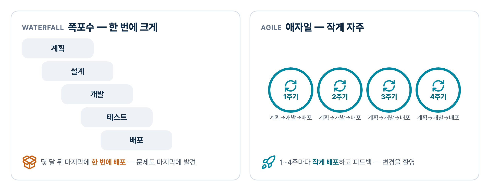
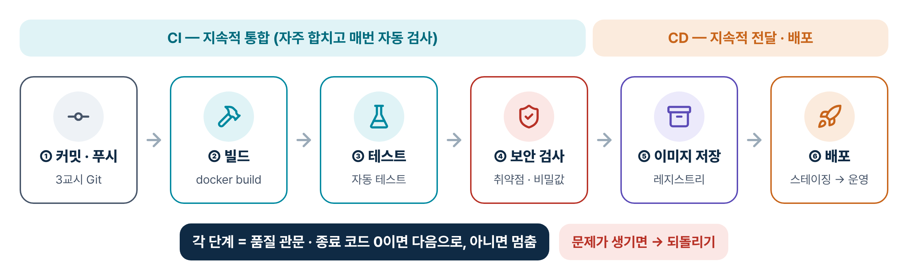

[🏠 과정 목차](../../README.md) › [1주차](../README.md) › [5일차](README.md) › 2/7교시

# 2교시 · 소프트웨어가 만들어지는 흐름 — SDLC와 CI/CD

> [!NOTE]
> **이번 시간에 할 일**
>
> - 소프트웨어 개발 생명주기(SDLC)의 단계를 압니다.
> - 폭포수 방식과 애자일의 차이를 설명합니다.
> - CI(지속적 통합)와 CD(지속적 전달·배포)가 무엇인지 이해합니다.
> - CI/CD 파이프라인이 각 단계에서 하는 일을 압니다.

## 소프트웨어 개발 생명주기(SDLC)

**SDLC(Software Development Life Cycle)**는 소프트웨어가 만들어지고 운영되는 전체 과정입니다. 회사마다 이름은 달라도 대체로 이런 단계를 거칩니다.

| 단계 | 하는 일 | 주로 누가 | DevOps 엔지니어의 관심사 |
|---|---|---|---|
| 계획 | 무엇을 만들지 정한다 | 기획, PM | 일정, 필요한 인프라 |
| 설계 | 어떻게 만들지 정한다 | 개발, 아키텍트 | 구조, 확장성, 비용 |
| 개발 | 코드를 짠다 | 개발 | 개발 환경, 브랜치 전략 |
| 테스트 | 제대로 동작하는지 확인 | QA, 개발 | **자동 테스트** |
| 배포 | 사용자에게 내놓는다 | 운영, DevOps | **배포 자동화**, 되돌리기 |
| 운영 | 잘 돌아가게 지킨다 | 운영, SRE | **모니터링**, 장애 대응 |
| 피드백 | 사용자 반응을 보고 개선 | 모두 | 지표, 로그 |

## 폭포수에서 애자일로

| 비교 | 폭포수 (Waterfall) | 애자일 (Agile) |
|---|---|---|
| 흐름 | 단계를 **한 번씩 순서대로** | 짧은 주기(1~4주)를 **반복** |
| 배포 | 마지막에 **한 번에 크게** | 주기마다 **작게** |
| 변경 | 중간에 바꾸기 어렵다 | 변경을 **환영**한다 |
| 위험 | 마지막에야 문제를 발견 | 일찍, 자주 발견 |
| 비유 | 완성된 요리를 한 번에 내놓기 | 한 숟가락씩 맛보며 간 맞추기 |

> **🎓 학술 노트 — 폭포수의 오해와 애자일 선언 (1970, 2001)**
>
> **폭포수는 원래 '하지 말라'는 그림이었다?** 폭포수 모델의 출처로 자주 인용되는 윈스턴 로이스(Winston Royce)의 1970년 논문 「대규모 소프트웨어 시스템 개발 관리」에는 단계가 아래로 흐르는 그림이 나옵니다. 그런데 로이스는 바로 그 그림 아래에 이 방식이 **"위험하고 실패를 부른다"**고 쓰고, 단계 사이에 되돌아가는 피드백과 반복을 넣어야 한다고 주장했습니다. 역사상 가장 유명한 개발 방법론이 사실은 **비판 대상의 그림**에서 이름을 얻은 셈입니다.
>
> **애자일 선언 (2001).** 2001년 2월, 미국 유타주 스노버드에 17명의 개발자가 모여 「애자일 소프트웨어 개발 선언」을 발표했습니다. 네 가지 가치는 이렇습니다.
>
> - 공정과 도구보다 **개인과 상호작용**을
> - 포괄적인 문서보다 **작동하는 소프트웨어**를
> - 계약 협상보다 **고객과의 협력**을
> - 계획을 따르기보다 **변화에 대응하기**를
>
> (왼쪽에 있는 것도 가치가 있지만, 오른쪽을 더 높게 가치 있게 여긴다고 덧붙였습니다.) DevOps는 이 애자일의 정신을 **개발팀 바깥, 운영과 배포까지** 넓힌 것이라고 볼 수 있습니다.
>
> - Royce, W. W. (1970). Managing the development of large software systems. *Proceedings of IEEE WESCON*.
> - Beck, K. et al. (2001). *Manifesto for Agile Software Development*. agilemanifesto.org

## CI — 지속적 통합 (Continuous Integration)

여러 개발자가 같은 코드를 고치다가 몇 주 만에 합치면, 서로 충돌해서 합치는 데만 며칠이 걸리곤 했습니다. 이것을 **통합 지옥(integration hell)**이라고 불렀습니다.

**CI(지속적 통합)**는 개발자가 코드를 **하루에도 여러 번 자주** 공용 저장소에 합치고, 합칠 때마다 **자동으로 빌드하고 테스트**하는 방식입니다. 문제가 생기면 몇 분 안에 알 수 있고, 방금 바꾼 작은 부분만 보면 되므로 고치기도 쉽습니다.

## CD — 지속적 전달과 지속적 배포

| 용어 | 뜻 | 사람의 역할 |
|---|---|---|
| **지속적 전달** (Continuous Delivery) | 테스트를 통과한 코드는 **언제든 배포할 수 있는 상태**로 준비 | 운영 배포 버튼은 **사람이 누른다** |
| **지속적 배포** (Continuous Deployment) | 테스트를 통과하면 **운영까지 자동으로** 배포 | 사람이 개입하지 않는다 |

둘 다 줄여서 CD라고 부르므로, 대화할 때는 어느 쪽인지 확인하는 것이 좋습니다.

## CI/CD 파이프라인

| 단계 | 하는 일 | 실패하면 | 이 과정에서 |
|---|---|---|---|
| ① 커밋·푸시 | 개발자가 코드를 저장소에 올린다 | — | 3교시 Git |
| ② 빌드 | 코드를 실행 가능한 형태로 만든다 | 컴파일 에러 | 2주차 `docker build` |
| ③ 테스트 | 자동 테스트를 돌린다 | 기능 버그 | 3주차 GitHub Actions |
| ④ 보안 검사 | 취약점, 비밀값 유출 검사 | 보안 위험 | 3주차 이미지 스캔 |
| ⑤ 이미지 저장 | 결과물을 저장소에 보관 | — | 2주차 레지스트리 |
| ⑥ 배포 | 테스트 → 스테이징 → 운영 | 장애 → **되돌리기** | 4주차 Argo CD |

> [!IMPORTANT]
> **파이프라인은 '품질 관문'의 연속**
>
> 파이프라인의 각 단계는 **관문(gate)**입니다. 앞 단계를 통과하지 못하면 다음으로 갈 수 없습니다. 사람이 매번 "테스트 돌렸어?" "보안 검사 했어?"를 확인하는 대신, 기계가 **매번, 똑같이, 빠짐없이** 확인합니다. 그제 배운 **종료 코드**를 기억하세요. 파이프라인은 각 단계 명령의 종료 코드가 0이면 다음으로, 0이 아니면 멈춥니다. "자동화는 이 숫자만 본다"는 말의 실제 모습입니다.

> **🎓 학술 노트 — CI와 CD의 정리 (Fowler 2000/2006, Humble & Farley 2010)**
>
> CI는 1990년대 후반 켄트 벡(Kent Beck)의 **익스트림 프로그래밍(XP)**에서 실천법으로 등장했고, 마틴 파울러(Martin Fowler)가 2000년 처음 쓰고 2006년 개정한 글 「Continuous Integration」으로 널리 정리되었습니다. 파울러는 "모든 사람이 매일 메인 라인에 커밋한다", "모든 커밋은 빌드되어야 한다", "깨진 빌드는 즉시 고친다" 같은 실천법을 제시했습니다.
>
> 제즈 험블(Jez Humble)과 데이비드 팔리(David Farley)는 2010년 책 『Continuous Delivery』에서 이를 배포까지 확장하고 **배포 파이프라인**이라는 개념을 체계화했습니다. 핵심 주장은 **"배포가 고통스럽다면, 더 자주 하라"**입니다. 자주 하면 한 번에 바뀌는 양이 작아지고, 자동화하지 않을 수 없게 되며, 결국 배포가 지루할 만큼 평범한 일이 됩니다.
>
> - Fowler, M. (2006). *Continuous Integration*. martinfowler.com
> - Humble, J., & Farley, D. (2010). *Continuous Delivery*. Addison-Wesley.

> **📈 트렌드 — 공급망 보안이 파이프라인에 들어온다**
>
> 최근 파이프라인에서 가장 빠르게 커지는 단계는 **보안**입니다. 1일차에 본 연구처럼 AI가 존재하지 않는 패키지 이름을 지어내기도 하고(패키지 환각), 유명 오픈소스 패키지에 악성 코드가 숨어 들어가는 **공급망 공격**도 늘고 있습니다. 그래서 "이 결과물이 어떤 재료로, 어떤 과정을 거쳐 만들어졌는지"를 기록하는 **SBOM(소프트웨어 자재 명세서)**, 결과물에 **서명**해 위변조를 막는 기술, 빌드 과정의 신뢰 수준을 정의한 **SLSA** 같은 표준이 파이프라인의 기본 단계로 자리 잡고 있습니다. 보안을 마지막에 따로 하지 않고 파이프라인 안에 일찍 넣는 것을 **"시프트 레프트(shift left)"**라고 부릅니다.

## 정리

- **SDLC**는 계획 → 설계 → 개발 → 테스트 → 배포 → 운영 → 피드백의 반복입니다.
- **폭포수**는 한 번에 크게, **애자일**은 작게 자주. 애자일 선언은 2001년입니다.
- **CI**는 자주 합치고 매번 자동으로 빌드·테스트하는 것입니다.
- **CD**는 언제든 배포할 수 있는 상태(전달) 또는 자동 운영 배포(배포)입니다.
- 파이프라인은 **종료 코드로 움직이는 품질 관문**의 연속이며, 보안이 점점 앞으로 들어오고 있습니다.

> **✅ 확인 문제**
>
> 1. 폭포수와 애자일의 가장 큰 차이를 한 문장으로 말해 보세요.
> 2. 여러 사람이 몇 주 만에 코드를 합칠 때 생기던 문제를 무엇이라고 불렀나요?
> 3. 지속적 전달과 지속적 배포의 차이는?
> 4. 파이프라인은 각 단계의 성공과 실패를 무엇으로 판단하나요?
> 5. "배포가 고통스럽다면 ○○ ○○ 하라" — 빈칸은?
>
> 

정답

>
> 1. 폭포수는 단계를 한 번씩 순서대로 거쳐 마지막에 크게 배포하고, 애자일은 짧은 주기를 반복하며 작게 자주 배포한다
> 2. 통합 지옥(integration hell)
> 3. 전달은 운영 배포를 사람이 결정하고, 배포는 운영까지 자동으로 나간다
> 4. 각 단계 명령의 종료 코드(0이면 성공)
> 5. 더 자주
>
> 

## 참고 문헌

- Royce, W. W. (1970). Managing the development of large software systems. *IEEE WESCON*.
- Beck, K. et al. (2001). *Manifesto for Agile Software Development*.
- Fowler, M. (2006). *Continuous Integration*. martinfowler.com/articles/continuousIntegration.html
- Humble, J., & Farley, D. (2010). *Continuous Delivery*. Addison-Wesley.
- OpenSSF. *SLSA — Supply-chain Levels for Software Artifacts*. slsa.dev

---

| 이전 | 목차 | 다음 |
|:--|:--:|--:|
| ⬅️ [1교시 · DevOps는 왜 생겼나](lesson-01.md) | [⬆️ 5일차 목차](README.md) | [3교시 · Git과 GitHub 맛보기 (강사 시연)](lesson-03.md) ➡️ |
