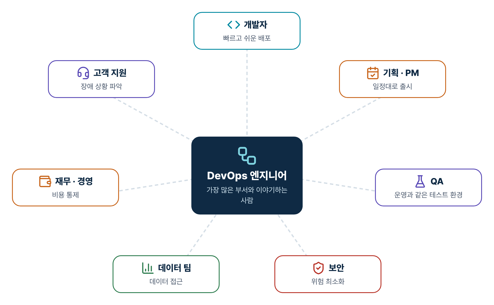
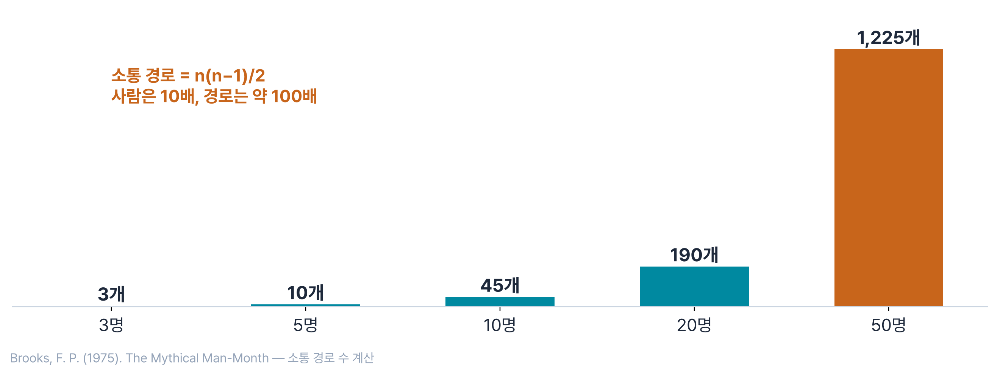

[🏠 과정 목차](../../README.md) › [1주차](../README.md) › [5일차](README.md) › 4/8교시

# 4교시 · 타 부서와 협업하기

> [!NOTE]
> **이번 시간에 할 일**
>
> - DevOps 엔지니어가 함께 일하는 사람들과 그들의 관심사를 압니다.
> - 다른 부서에 요청할 때 쓰는 구조를 익힙니다.
> - 기술을 모르는 사람에게 기술을 설명하는 법을 연습합니다.
> - 팀 구조와 심리적 안전감에 대한 연구를 봅니다.

## DevOps 엔지니어는 누구와 일하나

DevOps 엔지니어는 회사에서 **가장 많은 부서와 이야기하는 사람** 중 하나입니다. 개발과 운영 사이, 기술과 비즈니스 사이에 서 있기 때문입니다.

| 함께 일하는 사람 | 그들이 원하는 것 | 그들이 DevOps에게 자주 하는 말 | 좋은 대응 |
|---|---|---|---|
| 백엔드·프론트엔드 개발자 | 빠르고 쉬운 배포 | "배포가 왜 이렇게 오래 걸려요?" | 파이프라인 개선, 셀프서비스 |
| 기획자·PM | 일정대로 출시 | "이거 다음 주에 나갈 수 있죠?" | 위험과 선택지를 숫자로 |
| QA | 운영과 같은 테스트 환경 | "테스트 서버에선 됐는데요" | 환경 일치 (Docker) |
| 보안 담당자 | 위험 최소화 | "이 포트 왜 열려 있어요?" | 최소 권한, 근거 기록 |
| 데이터 팀 | 데이터 접근, 파이프라인 | "DB 읽기 권한 주세요" | 권한 절차, 읽기 전용 복제본 |
| 재무·경영 | 비용 통제 | "클라우드 요금이 왜 두 배예요?" | 비용 태그, FinOps (1일차) |
| 고객 지원(CS) | 장애 상황 파악 | "고객이 결제가 안 된대요" | 상태 페이지, 공지 템플릿 |

> [!IMPORTANT]
> **모두가 옳다, 다만 원하는 것이 다를 뿐**
>
> 1교시의 혼란의 벽처럼, 부서마다 평가 기준이 다르면 원하는 것도 다릅니다. 보안 담당자가 "안 됩니다"라고 하는 것은 일을 방해하려는 게 아니라 **자기 책임을 다하는 것**입니다. 좋은 협업은 상대방의 목표를 먼저 이해하고, **양쪽 목표를 모두 만족하는 선택지**를 찾는 것에서 시작합니다.

## 요청을 잘 쓰는 법

1일차 1교시에 "좋은 질문의 다섯 줄"을 배웠습니다. 다른 부서에 요청할 때도 같은 원리입니다.

> **📘 나쁜 요청과 좋은 요청**
>
> **나쁜 요청:** "보안팀님, 포트 좀 열어 주세요. 급해요."
>
> **좋은 요청:**
>
> | 항목 | 내용 |
> |---|---|
> | 무엇을 | 운영 VPC의 결제 API 서버(보안 그룹 `sg-pay-api`)에 인바운드 TCP 443 허용 |
> | 어디에서 | 출발지는 결제 대행사의 IP 대역 `203.0.113.0/24`만 |
> | 왜 | 결제 대행사가 결제 결과를 알려 주는 웹훅(callback)을 받아야 함 |
> | 언제까지 | 12월 5일 출시 일정, 12월 3일까지 테스트 필요 |
> | 위험과 대안 | 전체 공개(`0.0.0.0/0`) 대신 대행사 IP로 제한. 대행사 IP 목록 문서 첨부 |
> | 되돌리기 | 출시가 취소되면 규칙 삭제. 담당자: 홍길동 |
>
> 좋은 요청은 **상대방이 판단하는 데 필요한 정보**를 먼저 줍니다. 보안 담당자가 물어볼 질문(왜? 어디서? 범위는?)에 미리 답해 두면, 몇 번 오갈 대화가 한 번에 끝납니다. 어제 3교시의 `/32`, 어제 7교시의 보안 그룹 표가 바로 여기서 쓰입니다.

## 기술을 모르는 사람에게 설명하기

| 하지 말 것 | 할 것 |
|---|---|
| 약어를 그대로 쓴다 ("ALB 타깃 그룹 헬스 체크가 실패해서…") | 결과부터 쉬운 말로 ("결제 서버 일부가 응답하지 않아…") |
| 원인부터 길게 설명한다 | **영향 → 원인 → 대응 → 예상 시간** 순서로 |
| "곧 됩니다" | "30분 안에 다시 알려 드리겠습니다" (구체적인 다음 연락 시점) |
| 확실하지 않은 것을 단정한다 | "현재까지 확인된 것은…"으로 구분 |
| 비유 없이 숫자만 | 비유를 곁들인다 ("주방 한 곳이 멈춰 다른 주방으로 주문을 돌리는 중") |

이번 주 내내 써 온 **비유**가 바로 이 능력을 위한 연습이었습니다. 기술을 아는 사람만 알아듣게 말하는 것은 쉽습니다. **모르는 사람도 결정을 내릴 수 있게** 말하는 것이 실력입니다.

> **🎓 학술 노트 — 사람을 더 넣으면 더 늦어진다 (Brooks, 1975)와 Team Topologies (2019)**
>
> **브룩스의 법칙.** IBM에서 대형 운영체제 개발을 이끈 프레더릭 브룩스(Frederick Brooks)는 1975년 책 『맨먼스 미신(The Mythical Man-Month)』에서 **"늦어진 소프트웨어 프로젝트에 사람을 더 투입하면 더 늦어진다"**고 썼습니다. 새 사람을 가르치는 시간이 들고, 무엇보다 **소통해야 할 경로가 사람 수의 제곱에 비례해** 늘어나기 때문입니다. n명이면 소통 경로는 n(n−1)/2개입니다. 5명이면 10개, 50명이면 1,225개입니다.
>
> **Team Topologies.** 매슈 스켈턴(Matthew Skelton)과 마누엘 파이스(Manuel Pais)는 2019년 책 『팀 토폴로지』에서 이 소통 부담을 줄이도록 팀을 네 가지 유형으로 설계하라고 제안했습니다.
>
> | 팀 유형 | 하는 일 | 예 |
> |---|---|---|
> | 스트림 정렬 팀 | 사용자에게 가치를 직접 전달 | 결제팀, 검색팀 |
> | **플랫폼 팀** | 다른 팀이 셀프서비스로 쓸 기반 제공 | **DevOps·플랫폼 엔지니어링** |
> | 활성화 팀 | 다른 팀이 새 역량을 익히도록 도움 | 보안·테스트 코치 |
> | 복잡한 하위 시스템 팀 | 고도의 전문 지식이 필요한 영역 | 검색 엔진, 결제 엔진 |
>
> 어제 2교시의 **콘웨이의 법칙**과 7교시의 **플랫폼 엔지니어링**이 여기서 만납니다. 좋은 플랫폼 팀은 다른 팀이 **물어보지 않고도** 일할 수 있게 만들어, 소통 경로 자체를 줄입니다.
>
> - Brooks, F. P. (1975/1995). *The Mythical Man-Month*. Addison-Wesley.
> - Skelton, M., & Pais, M. (2019). *Team Topologies*. IT Revolution.

> **🎓 학술 노트 — 심리적 안전감 (Edmondson 1999, Google Project Aristotle)**
>
> 하버드 경영대학원의 에이미 에드먼드슨(Amy Edmondson)은 1999년 병원 팀 연구에서 의외의 결과를 발견했습니다. **성과가 좋은 팀일수록 실수 보고가 더 많았습니다.** 실수를 더 많이 해서가 아니라, 실수를 **말해도 안전하다고 느껴서** 더 많이 보고했던 것입니다. 그녀는 이것을 **심리적 안전감(psychological safety)** — "이 팀에서는 질문하거나 실수를 인정해도 창피당하거나 벌받지 않는다"는 공유된 믿음 — 이라고 불렀습니다.
>
> 구글은 2012년부터 사내 수백 개 팀을 분석한 **프로젝트 아리스토텔레스**에서, 좋은 팀을 만드는 요인 중 **심리적 안전감이 가장 중요하다**는 결론을 2015~2016년에 공개했습니다. 누가 팀에 있느냐보다 **팀이 어떻게 함께 일하느냐**가 더 중요했습니다.
>
> DevOps에서 이것이 중요한 이유는 간단합니다. 장애를 일으킨 사람이 숨기면, 팀은 아무것도 배우지 못하고 같은 장애가 반복됩니다. 1교시의 **생성적 문화**, 다음 시간의 **비난 없는 회고**가 모두 이 믿음 위에 서 있습니다. 여러분이 이 과정에서 "이거 모르겠어요"라고 편하게 질문하는 것도 같은 원리입니다.
>
> - Edmondson, A. (1999). Psychological safety and learning behavior in work teams. *Administrative Science Quarterly*, 44(2).
> - Google re:Work. *Guide: Understand team effectiveness* (Project Aristotle).

> **📈 트렌드 — 비동기 협업과 '글로 일하기'**
>
> 원격·하이브리드 근무가 자리 잡으면서, 회의 대신 **글로 의사소통하는 비동기 협업**이 중요해졌습니다. 슬랙 메시지 하나, PR 설명 하나, 이슈 하나가 회의를 대신합니다. 그래서 신입 엔지니어에게 기대하는 역량 중 **"맥락을 담아 간결하게 쓰는 능력"**의 비중이 커지고 있습니다. 위의 "좋은 요청" 표가 바로 그 형식입니다. 6교시에서 문서로 일하는 법을 더 자세히 봅니다.

## 정리

- DevOps 엔지니어는 개발, 기획, QA, 보안, 데이터, 재무, CS와 함께 일하며, **각자 원하는 것이 다릅니다.**
- 좋은 요청은 **무엇을·어디서·왜·언제까지·위험과 대안·되돌리기**를 먼저 줍니다.
- 비기술자에게는 **영향 → 원인 → 대응 → 다음 연락 시점** 순서로, 비유를 곁들여 말합니다.
- 사람이 늘면 소통 경로는 **제곱으로** 늘고(브룩스), 팀 구조로 이를 줄입니다(Team Topologies).
- 좋은 팀의 가장 중요한 조건은 **심리적 안전감**입니다.

> **✅ 확인 문제**
>
> 1. 보안 담당자에게 포트 개방을 요청할 때 꼭 포함해야 할 항목 세 가지는?
> 2. 비기술자에게 장애를 설명할 때 좋은 순서는?
> 3. 10명 팀의 소통 경로는 몇 개인가요?
> 4. Team Topologies에서 DevOps·플랫폼 엔지니어가 속하는 팀 유형은?
> 5. 성과가 좋은 병원 팀에서 실수 보고가 더 많았던 이유는?
>
> 

정답

>
> 1. 무엇을(대상·포트), 어디에서(출발지 범위), 왜(이유) — 언제까지, 위험과 대안, 되돌리기도 함께
> 2. 영향 → 원인 → 대응 → 예상 시간(다음 연락 시점)
> 3. 45개 (10 × 9 ÷ 2)
> 4. 플랫폼 팀
> 5. 실수를 말해도 안전하다고 느끼는 심리적 안전감이 높았기 때문
>
> 

## 참고 문헌

- Brooks, F. P. (1995). *The Mythical Man-Month* (Anniversary ed.). Addison-Wesley.
- Skelton, M., & Pais, M. (2019). *Team Topologies*. IT Revolution.
- Edmondson, A. (1999). Psychological safety and learning behavior in work teams. *ASQ*, 44(2).
- Google re:Work. *Understand team effectiveness*. rework.withgoogle.com
- Fournier, C. (2017). *The Manager's Path*. O'Reilly.

---

| 이전 | 목차 | 다음 |
|:--|:--:|--:|
| ⬅️ [3교시 · Git과 GitHub 맛보기 (강사 시연)](lesson-03.md) | [⬆️ 5일차 목차](README.md) | [5교시 · 장애 커뮤니케이션과 포스트모템](lesson-05.md) ➡️ |
