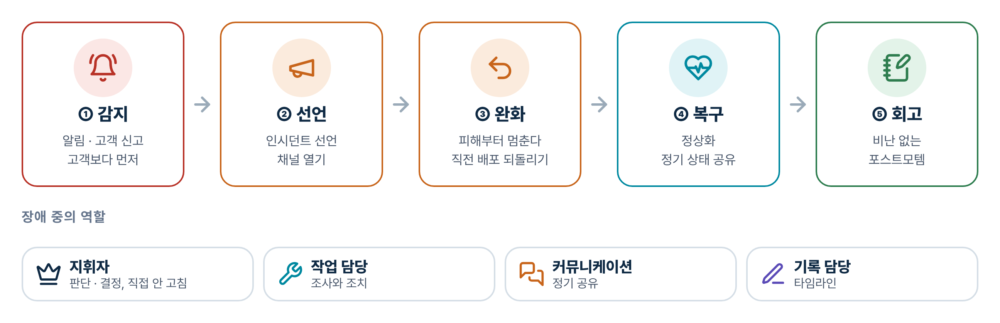
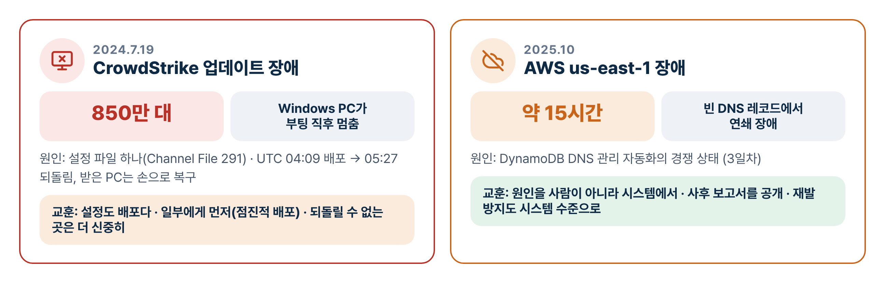

[🏠 과정 목차](../../README.md) › [1주차](../README.md) › [5일차](README.md)

# 5교시 · 장애 커뮤니케이션과 포스트모템

> [!NOTE]
> **이번 시간에 할 일**
>
> - 장애(인시던트)가 났을 때의 흐름과 역할을 압니다.
> - 장애 상황에서 공유하는 메시지의 구조를 익힙니다.
> - 비난 없는 포스트모템(blameless postmortem)이 무엇이고 왜 필요한지 압니다.
> - 실제 대형 장애 사례에서 배울 점을 정리합니다.

## 장애는 반드시 일어난다

어제 배운 것처럼 가용성 100%는 불가능합니다. 그러니 질문은 "장애가 일어날까?"가 아니라 **"일어났을 때 얼마나 빨리, 얼마나 침착하게 대응하는가?"**입니다. 현업에서는 서비스에 문제가 생긴 상황을 **인시던트(incident)**라고 부릅니다.

## 인시던트 대응의 흐름

| 단계 | 하는 일 | 핵심 |
|---|---|---|
| ① 감지 | 모니터링 알림이나 고객 신고로 문제를 안다 | 고객보다 **먼저** 알아야 한다 (4주차) |
| ② 선언 | "인시던트입니다"라고 공식 선언하고 채널을 연다 | 혼자 끙끙대지 않는다 |
| ③ 완화 | **일단 피해를 멈춘다** — 원인을 몰라도 | 직전 배포 되돌리기, 트래픽 우회 |
| ④ 복구 | 서비스를 정상으로 돌린다 | 상태를 주기적으로 공유 |
| ⑤ 회고 | 무엇이 왜 일어났고, 어떻게 재발을 막을지 | **비난 없는 포스트모템** |

> [!IMPORTANT]
> **원인 찾기보다 피해 멈추기가 먼저**
>
> 초보자가 가장 많이 하는 실수는 장애가 났을 때 **원인부터 파고드는 것**입니다. 그동안 사용자들은 계속 결제에 실패합니다. 경험 많은 엔지니어는 먼저 "**방금 무엇이 바뀌었나?**"를 묻고, 직전 배포를 되돌려 **피해부터 멈춥니다.** 원인 분석은 서비스가 살아난 뒤 차분히 해도 됩니다. 2교시의 "언제든 되돌릴 수 있는 배포"가 이때 빛을 발합니다.

## 장애 중의 역할

큰 장애에서는 모두가 한꺼번에 서버에 접속해 이것저것 시도하면 오히려 상황이 꼬입니다. 그래서 역할을 나눕니다.

| 역할 | 하는 일 |
|---|---|
| **인시던트 지휘자** (Incident Commander) | 전체 상황 판단, 결정, 역할 배분. **직접 고치지 않는다** |
| 작업 담당 | 실제 조사와 조치 |
| **커뮤니케이션 담당** | 내부 관계자·고객에게 정기적으로 상황 공유 |
| 기록 담당 | 시간순으로 무엇을 했는지 기록 (나중의 회고 자료) |

## 장애 공유 메시지의 구조

4교시의 "영향 → 원인 → 대응 → 다음 연락" 순서를 장애 공지에 적용하면 이렇습니다.

> **📘 장애 공유 메시지 예시**
>
> > **[진행 중] 결제 실패 증가 — 14:20 업데이트**
> >
> > - **영향:** 14:05부터 카드 결제의 약 30%가 실패하고 있습니다. 계좌 이체와 조회는 정상입니다.
> > - **현재까지 확인된 것:** 14:00 배포된 결제 API 새 버전 이후 발생했습니다.
> > - **조치:** 14:15 이전 버전으로 되돌리는 중입니다.
> > - **다음 업데이트:** 14:40 또는 상황이 바뀌는 즉시.
> > - **문의:** #inc-20261127-payment 채널
>
> 확실한 것과 추정을 구분하고, **다음에 언제 다시 알려 줄지**를 반드시 적습니다. 소식이 없는 30분이 가장 불안합니다.

## 비난 없는 포스트모템

장애가 끝나면 **포스트모템(postmortem)**을 씁니다. 무엇이 일어났고, 왜 일어났고, 어떻게 재발을 막을지 정리하는 문서입니다. 핵심은 **비난 없음(blameless)**입니다.

| 비난하는 회고 | 비난 없는 회고 |
|---|---|
| "누가 그 명령을 쳤어?" | "그 명령이 **왜 그 상황에서 합리적으로 보였을까?**" |
| 결론: 그 사람이 조심했어야 했다 | 결론: **시스템이** 실수를 막지 못했다 |
| 재발 방지: "앞으로 조심하겠습니다" | 재발 방지: 확인 단계 자동화, 권한 축소, 경고 추가 |
| 결과: 다음엔 실수를 숨긴다 | 결과: 다음엔 더 빨리 말한다 |

> **🧩 비유 — 항공 사고 조사**
>
> 항공 사고 조사의 목적은 조종사를 처벌하는 것이 아니라 **같은 사고가 다시 일어나지 않게** 하는 것입니다. 그래서 조종사들이 자기 실수를 솔직하게 보고할 수 있도록 보호합니다. 항공이 가장 안전한 교통수단이 된 비결 중 하나입니다. 1교시 웨스트럼의 연구가 항공·의료에서 시작된 것도 우연이 아닙니다.

| 포스트모템 항목 | 내용 |
|---|---|
| 요약 | 한 문단으로 무슨 일이 있었나 |
| 영향 | 누가, 얼마나, 얼마 동안 |
| 타임라인 | 감지 → 선언 → 완화 → 복구의 시각별 기록 |
| 근본 원인 | "왜?"를 여러 번 물어 시스템 수준의 원인까지 |
| 잘된 점 / 아쉬운 점 | 다음에도 할 것, 바꿀 것 |
| 재발 방지 조치 | **담당자와 기한이 있는** 구체적 작업 |

> **🎓 학술 노트 — 비난 없는 문화의 근거 (Allspaw 2012, Google SRE 2016)**
>
> 1교시에 나온 존 올스포는 2012년 Etsy 엔지니어링 블로그에 「비난 없는 포스트모템과 정의로운 문화(Blameless PostMortems and a Just Culture)」를 썼습니다. 그는 실수한 엔지니어를 처벌하면 **정보가 사라진다**고 주장했습니다. 처벌받을까 두려운 사람은 자세히 말하지 않고, 조직은 사고가 왜 일어났는지 영영 모르게 됩니다. 반대로 실수를 자세히 설명할 수 있게 보호하면, 그 엔지니어가 **같은 실수를 막는 전문가**가 됩니다.
>
> 구글은 2016년 공개한 『Site Reliability Engineering』 책에서 포스트모템 문화를 한 장으로 정리했습니다. 포스트모템은 **처벌이 아니라 학습의 기회**이며, 원인을 사람이 아니라 **시스템과 절차**에서 찾고, 재발 방지 조치에는 반드시 담당자와 추적이 있어야 한다는 원칙입니다.
>
> - Allspaw, J. (2012). *Blameless PostMortems and a Just Culture*. Code as Craft (Etsy).
> - Beyer, B. et al. (2016). *Site Reliability Engineering*, Ch. 15 Postmortem Culture. O'Reilly.

## 사례로 배우기

> **📘 사례 1 — CrowdStrike 업데이트 장애 (2024년 7월 19일)**
>
> 보안 회사 CrowdStrike가 배포한 보안 소프트웨어의 **설정 파일 업데이트(Channel File 291)**에 문제가 있어, 이를 받은 Windows 컴퓨터 약 **850만 대**가 부팅 직후 멈췄습니다. 업데이트는 UTC 04:09에 배포되어 05:27에 되돌려졌지만, 그 사이 받은 컴퓨터들은 사람이 하나하나 손으로 복구해야 했습니다. 항공사, 병원, 방송사, 은행이 영향을 받았습니다.
>
> **교훈:** ① "설정 파일 하나"도 배포이며 테스트가 필요하다. ② 한꺼번에 전체에 배포하지 말고 **일부에게 먼저(점진적 배포)** 내보내야 한다. ③ 자동으로 되돌릴 수 없는 곳(부팅이 안 되는 PC)에 배포할 때는 더 신중해야 한다. 4주차 Argo CD와 Istio에서 배울 **카나리 배포**가 바로 이 문제를 다룹니다.

> **📘 사례 2 — AWS us-east-1 장애 (2025년 10월)**
>
> 3일차에 자세히 본 사례입니다. DynamoDB의 DNS 관리 자동화에 숨어 있던 경쟁 상태로 DNS 레코드가 비어 버렸고, 연쇄 영향으로 약 15시간 동안 많은 서비스가 영향을 받았습니다. AWS는 원인과 재발 방지책을 담은 **사후 보고서를 공개**했습니다.
>
> **교훈:** 원인을 개인의 실수가 아니라 **자동화 시스템의 설계**에서 찾았고, 재발 방지도 시스템 수준(자동화 수정, 안전장치 추가)으로 정했습니다. 큰 회사도 장애를 겪으며, 중요한 것은 **투명하게 공유하고 배우는 것**입니다.

> **📈 트렌드 — 인시던트 대응에 들어오는 AI**
>
> 최근에는 장애 대응 도구들이 AI를 활용해 **알림을 묶어 요약하고**, 관련 로그와 최근 배포를 찾아 주고, 장애 채널의 대화를 정리해 **포스트모템 초안**을 써 주는 기능을 내놓고 있습니다. 반복적인 정리 작업을 줄여 주는 것은 분명한 도움입니다. 하지만 1일차에 본 것처럼 AI의 답은 "거의 맞지만 틀린" 경우가 있으므로, **판단과 결정은 사람이**, 그리고 AI가 제시한 원인은 **반드시 증거로 확인**하는 원칙은 장애 상황에서 더욱 중요합니다.

## 정리

- 인시던트는 **감지 → 선언 → 완화 → 복구 → 회고**로 진행되며, **피해 멈추기가 원인 찾기보다 먼저**입니다.
- 큰 장애에서는 **지휘자, 작업, 커뮤니케이션, 기록** 역할을 나눕니다.
- 장애 공지에는 **영향, 확인된 것, 조치, 다음 업데이트 시각**을 적습니다.
- **비난 없는 포스트모템**은 원인을 사람이 아니라 시스템에서 찾고, 담당자와 기한이 있는 재발 방지 조치를 정합니다.
- CrowdStrike와 AWS 사례는 **점진적 배포**와 **투명한 공유**의 중요성을 보여 줍니다.

> **✅ 확인 문제**
>
> 1. 장애가 났을 때 원인 분석보다 먼저 해야 할 일은?
> 2. 인시던트 지휘자가 직접 서버를 고치지 않는 이유는?
> 3. 장애 공지에 꼭 들어가야 하는 "다음 ○○○○ 시각"은?
> 4. 비난하는 회고의 재발 방지책 "앞으로 조심하겠습니다"가 나쁜 이유는?
> 5. CrowdStrike 사례에서 4주차에 배울 어떤 배포 방식이 도움이 되었을까요?
>
> 

정답

>
> 1. 피해를 멈추는 것(완화) — 예: 직전 배포 되돌리기
> 2. 전체 상황을 판단하고 결정하는 역할에 집중해야 하기 때문
> 3. 다음 업데이트 시각
> 4. 사람의 주의력에 기대는 것이라 시스템이 바뀌지 않고, 같은 실수가 반복될 수 있기 때문
> 5. 카나리 배포(점진적 배포) — 일부에게 먼저 내보내고 문제가 없으면 넓힌다
>
> 

## 참고 문헌

- Allspaw, J. (2012). *Blameless PostMortems and a Just Culture*. Etsy Code as Craft.
- Beyer, B. et al. (2016). *Site Reliability Engineering*, Ch. 14–15. O'Reilly.
- CrowdStrike (2024). *Channel File 291 Incident: Root Cause Analysis*.
- Microsoft (2024). *Helping our customers through the CrowdStrike outage*. (약 850만 대 영향)
- AWS (2025). *Summary of the Amazon DynamoDB Service Disruption in the Northern Virginia (US-EAST-1) Region*.
- PagerDuty. *Incident Response Documentation*. response.pagerduty.com

---

⬅️ 이전: [4교시 · 타 부서와 협업하기](lesson-04.md) &nbsp;|&nbsp; [⬆️ 5일차 목차](README.md) &nbsp;|&nbsp; 다음: [6교시 · 문서로 일하기](lesson-06.md) ➡️
