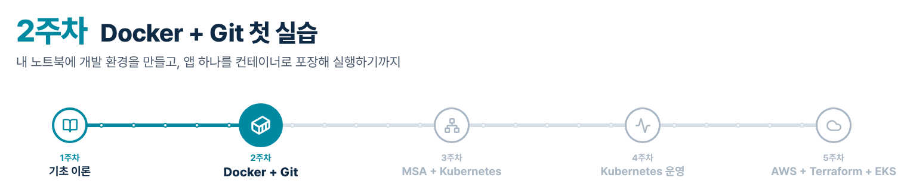

[🏠 과정 목차](../README.md)

# 2주차 · Docker + Git 첫 실습

📕 2주차 이북 PDF: [보기](../downloads/pdf/week2.pdf) · [내려받기](https://github.com/niceguy61/kdt_devops_lecture_2026_rev2/raw/main/downloads/pdf/week2.pdf)

        

| 일차 | 주제 | 교시 | 슬라이드 |
|:--|:--|:--|:--|
| [**1일차**](day1/README.md) | 개발 환경 세팅과 Git 첫걸음 WSL2 · 터미널 · VS Code · Git 설치와 설정 · GitHub 인증 · 첫 저장소와 push · Docker Desktop · 설치 점검 | [1](day1/lesson-01.md) [2](day1/lesson-02.md) [3](day1/lesson-03.md) [4](day1/lesson-04.md) [5](day1/lesson-05.md) [6](day1/lesson-06.md) [7](day1/lesson-07.md) | [📊 PPTX](https://github.com/niceguy61/kdt_devops_lecture_2026_rev2/raw/main/downloads/pptx/week2-day1.pptx) |
| [**2일차**](day2/README.md) | Docker 기본 이미지와 컨테이너 · 컨테이너 안에 들어가 보기 · nginx 실행 · 포트 연결 · logs와 exec · 생명주기와 정리 · 실패 사례 | [1](day2/lesson-01.md) [2](day2/lesson-02.md) [3](day2/lesson-03.md) [4](day2/lesson-04.md) [5](day2/lesson-05.md) [6](day2/lesson-06.md) [7](day2/lesson-07.md) | [📊 PPTX](https://github.com/niceguy61/kdt_devops_lecture_2026_rev2/raw/main/downloads/pptx/week2-day2.pptx) |
| [**3일차**](day3/README.md) | 이미지와 Dockerfile 이미지 레이어 · Dockerfile 문법 · DevMart 상품 API 첫 빌드 · 빌드 컨텍스트와 .dockerignore · 캐시 · 태그와 Docker Hub · 멀티 스테이지 | [1](day3/lesson-01.md) [2](day3/lesson-02.md) [3](day3/lesson-03.md) [4](day3/lesson-04.md) [5](day3/lesson-05.md) [6](day3/lesson-06.md) [7](day3/lesson-07.md) | [📊 PPTX](https://github.com/niceguy61/kdt_devops_lecture_2026_rev2/raw/main/downloads/pptx/week2-day3.pptx) |
| [**4일차**](day4/README.md) | 볼륨 · 네트워크 · 환경 변수 컨테이너의 데이터는 어디에 · 이름 있는 볼륨 · 바인드 마운트 · Docker 네트워크와 이름 찾기 · API와 DB 연결 · 환경 변수와 비밀값 · 세 컨테이너 손으로 조립하기 | [1](day4/lesson-01.md) [2](day4/lesson-02.md) [3](day4/lesson-03.md) [4](day4/lesson-04.md) [5](day4/lesson-05.md) [6](day4/lesson-06.md) [7](day4/lesson-07.md) | [📊 PPTX](https://github.com/niceguy61/kdt_devops_lecture_2026_rev2/raw/main/downloads/pptx/week2-day4.pptx) |
| [**5일차**](day5/README.md) | Docker Compose와 GitHub 협업 compose.yaml 읽고 쓰기 · up/ps/logs/down · 헬스 체크와 의존 순서 · 일상 작업과 확장 · 브랜치 · Pull Request와 코드 리뷰 · 충돌 해결 · 2주차 회고 | [1](day5/lesson-01.md) [2](day5/lesson-02.md) [3](day5/lesson-03.md) [4](day5/lesson-04.md) [5](day5/lesson-05.md) [6](day5/lesson-06.md) [7](day5/lesson-07.md) | [📊 PPTX](https://github.com/niceguy61/kdt_devops_lecture_2026_rev2/raw/main/downloads/pptx/week2-day5.pptx) |

교시 칸의 숫자는 교시 번호입니다. 처음이라면 1일차 목차부터 열고, 각 페이지 맨 아래의 <b>다음 ➡️</b>를 따라가세요.
