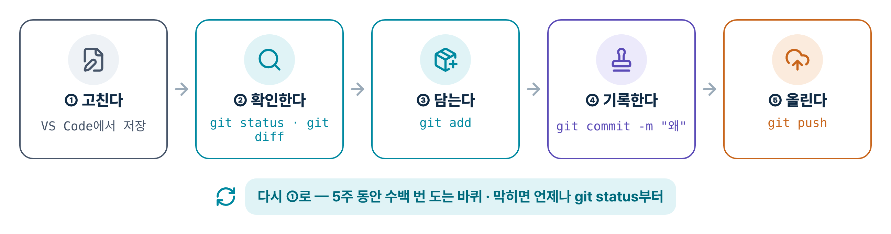

<sub>[🏠 과정 목차](../../README.md) › [2주차](../README.md) › [1일차](README.md) › 5/7교시</sub>

# 5교시 · 첫 저장소 — commit과 push

> [!NOTE]
> **이번 시간에 할 일**
>
> - `~/devops-lab`을 Git 저장소로 만듭니다.
> - README를 쓰고 첫 커밋을 만듭니다.
> - GitHub에 저장소를 만들고 push합니다.
> - "고치고 → 확인하고 → 담고 → 기록하고 → 올리는" 한 바퀴를 두 번 돌아 봅니다.

## 오늘의 한 바퀴

1주차 5일차 3교시에 강사가 시연한 흐름을 이제 직접 합니다. 앞으로 5주 동안 수백 번 돌게 될 바퀴입니다.



## 실습 8 · 첫 커밋

> **🧪 실습: 실습 목표**
>
> `~/devops-lab`을 저장소로 만들고, README와 `.gitignore`를 담은 첫 커밋을 만듭니다.

### 단계 1 — 저장소 시작

```bash
cd ~/devops-lab
git init
```

> **🟢 확인: 이렇게 나오면 성공**
>
> ```text
> Initialized empty Git repository in /home/devops/devops-lab/.git/
> ```
> 숨김 폴더 `.git`이 생겼습니다. **이 폴더가 저장소의 모든 기록**입니다. 지우면 기록이 사라지니 건드리지 않습니다.

### 단계 2 — 상태 보기

```bash
git status
```

> **🟢 확인: 이렇게 나오면 성공**
>
> ```text
> On branch main
>
> No commits yet
>
> Untracked files:
>   (use "git add <file>..." to include in what will be committed)
>         hello.txt
>
> nothing added to commit but untracked files present (use "git add" to track)
> ```
> `Untracked`는 "Git이 아직 지켜보지 않는 파일"이라는 뜻입니다. Git은 친절하게 **다음에 할 명령**(`git add`)까지 알려 줍니다. 막히면 `git status`부터 보는 습관을 들이세요.

### 단계 3 — README 만들기

VS Code에서 **새 파일**(`README.md`)을 만들고 아래 내용을 붙여 넣은 뒤, 이름 부분을 바꾸고 저장(`Ctrl` + `S`)합니다.

```markdown
# devops-lab

Cloud Native DevOps 과정 실습 저장소입니다.

- 이름: 홍길동
- 시작한 날: 2주차 1일차

## 실습 기록

| 일차 | 한 것 |
|---|---|
| 2주차 1일차 | 개발 환경 설치, 첫 커밋 |
```

### 단계 4 — `.gitignore` 만들기

새 파일 `.gitignore`(점으로 시작)를 만들고:

```text
# 비밀값과 개인 설정은 절대 올리지 않는다
.env
*.pem
*.key

# 운영체제와 편집기가 만드는 파일
.DS_Store
Thumbs.db
.vscode/
```

1주차 5일차의 "비밀값은 절대 커밋하지 않는다 — `.env`는 `.gitignore`에"를 지금 첫 커밋부터 지킵니다.

### 단계 5 — 담고 기록하기

```bash
git add README.md .gitignore hello.txt
git status
git commit -m "실습 저장소 시작: README와 .gitignore 추가"
```

> **🟢 확인: 이렇게 나오면 성공**
>
> ```text
> [main (root-commit) 3f2a1c9] 실습 저장소 시작: README와 .gitignore 추가
>  3 files changed, 22 insertions(+)
>  create mode 100644 .gitignore
>  create mode 100644 README.md
>  create mode 100644 hello.txt
> ```
> `3f2a1c9`처럼 보이는 값이 이 커밋의 **해시(지문)**입니다. 3교시 학술 노트의 그 값입니다. 사람마다 다르게 나옵니다.

### 단계 6 — 기록 보기

```bash
git log --oneline
```

> **🟢 확인: 이렇게 나오면 성공**
>
> ```text
> 3f2a1c9 (HEAD -> main) 실습 저장소 시작: README와 .gitignore 추가
> ```

## 실습 9 · GitHub에 올리기

> **🧪 실습: 실습 목표**
>
> GitHub에 `devops-lab` 저장소를 만들고 첫 커밋을 push합니다.

### 단계 1 — 원격 저장소 만들고 바로 올리기

```bash
gh repo create devops-lab --public --source=. --remote=origin --push
```

| 옵션 | 뜻 |
|---|---|
| `devops-lab` | GitHub에 만들 저장소 이름 |
| `--public` | 공개 저장소 (포트폴리오용). 비공개로 하려면 `--private` |
| `--source=.` | 지금 폴더를 이 저장소의 내용으로 |
| `--remote=origin` | 원격 저장소의 별명을 `origin`으로 (관례) |
| `--push` | 만들자마자 push까지 |

> **🟢 확인: 이렇게 나오면 성공**
>
> ```text
> ✓ Created repository 내아이디/devops-lab on github.com
>   https://github.com/내아이디/devops-lab
> ✓ Added remote https://github.com/내아이디/devops-lab.git
> ✓ Pushed commits to https://github.com/내아이디/devops-lab.git
> ```

### 단계 2 — 원격 연결 확인

```bash
git remote -v
```

> **🟢 확인: 이렇게 나오면 성공**
>
> ```text
> origin  https://github.com/내아이디/devops-lab.git (fetch)
> origin  https://github.com/내아이디/devops-lab.git (push)
> ```

### 단계 3 — 브라우저로 확인

```bash
gh repo view --web
```

브라우저에 저장소가 열리고, README 내용이 첫 화면에 표 형태로 보이면 성공입니다. 브라우저가 안 열리면 위 주소를 직접 엽니다.

> [!WARNING]
> **공개 저장소에 올리기 전 30초 점검**
>
> `--public`은 전 세계 누구나 볼 수 있다는 뜻입니다. push 전에 `git status`와 `git diff --staged`로 **무엇이 올라가는지** 한 번 보는 습관을 들이세요. 비밀번호, 토큰, 개인 정보가 섞여 있지 않은지 확인합니다.

## 실습 10 · 한 바퀴 더

> **🧪 실습: 실습 목표**
>
> README를 고쳐서 수정 → 확인 → 담기 → 기록 → 올리기를 혼자 한 바퀴 돌아 봅니다.

### 단계 1 — README 고치기

VS Code에서 README 표에 한 줄을 추가하고 저장합니다.

```markdown
| 2주차 1일차 | GitHub 로그인(gh), 첫 push |
```

### 단계 2 — 무엇이 바뀌었는지 보기

```bash
git status
git diff
```

> **🟢 확인: 이렇게 나오면 성공**
>
> ```text
> modified:   README.md
> ...
> +| 2주차 1일차 | GitHub 로그인(gh), 첫 push |
> ```
> `git diff`에서 `+`는 추가된 줄, `-`는 지워진 줄입니다. 1주차 5일차 코드 리뷰에서 동료가 보는 화면이 바로 이것입니다. 끝까지 보려면 `q`를 눌러 빠져나옵니다.

### 단계 3 — 담고, 기록하고, 올리기

```bash
git add README.md
git commit -m "README에 실습 기록 추가"
git push
```

> **🟢 확인: 이렇게 나오면 성공**
>
> ```text
> To https://github.com/내아이디/devops-lab.git
>    3f2a1c9..8b7e4d2  main -> main
> ```
> 브라우저를 새로고침하면 README가 바뀌어 있고, 저장소 화면 위쪽에 **2 commits**가 보입니다.

> **🛠️ 막혔다면: 막혔다면**
>
> | 증상 | 원인 | 해결 |
> |---|---|---|
> | `Author identity unknown` | 3교시 설정을 안 함 | `git config --global user.name/email` 설정 후 다시 커밋 |
> | `nothing to commit` | 파일을 저장하지 않았거나 add를 안 함 | VS Code 탭에 저장 안 된 표시(●)가 있는지 확인 → 저장 → `git add` |
> | `gh: Name already exists on this account` | 같은 이름 저장소가 이미 있음 | 다른 이름(`devops-lab-2`)을 쓰거나 기존 저장소를 연결 |
> | `Authentication failed` / 비밀번호를 물어봄 | 4교시 인증이 Git에 연결 안 됨 | `gh auth status` 확인 → `gh auth setup-git` |
> | `rejected … (fetch first)` | GitHub 쪽에 내가 없는 커밋이 있음 (웹에서 직접 고친 경우 등) | `git pull` 후 다시 `git push` (5일차에 자세히) |
> | 커밋 메시지 오타 | — | 아직 push 전이면 `git commit --amend -m "새 메시지"` |

> **🎓 학술 노트 — 작은 커밋이 좋은 이유**
>
> 좋은 커밋은 **한 가지 변경**만 담습니다. 이것은 취향이 아니라 연구로 뒷받침되는 실천입니다. 마이크로소프트 연구진(Bacchelli & Bird, 2013)은 코드 리뷰를 분석해, 리뷰어가 가장 어려워하는 것이 **변경의 맥락을 이해하는 일**이라는 것을 발견했습니다. 여러 변경이 한 커밋에 섞여 있으면 리뷰어는 무엇이 왜 바뀌었는지 파악하는 데 대부분의 시간을 씁니다.
>
> 또 작은 커밋은 문제가 생겼을 때 **어느 커밋이 원인인지** 찾기 쉽게 해 줍니다. Git에는 커밋 이력을 반씩 나눠 가며 버그가 처음 생긴 커밋을 찾아 주는 `git bisect`라는 명령이 있는데, 커밋이 작을수록 원인을 더 정확히 짚어 냅니다. 1주차 5일차 장애 대응의 "방금 무엇이 바뀌었나?"라는 질문에 빨리 답할 수 있는 것도 작은 커밋 덕분입니다.
>
> - Bacchelli, A., & Bird, C. (2013). Expectations, outcomes, and challenges of modern code review. *ICSE 2013*.
> - Git. *git-bisect Documentation*. git-scm.com/docs/git-bisect

> **📈 트렌드 — 커밋 메시지에도 규칙을**
>
> 많은 팀이 커밋 메시지를 **정해진 형식**으로 씁니다. 대표적인 것이 **Conventional Commits** 규칙으로, `feat: 상품 목록 API 추가`, `fix: 가격 표시 오류 수정`, `docs: README 실행 방법 보강`처럼 앞에 변경의 **종류**를 붙입니다. 형식이 정해져 있으면 사람이 읽기 쉬울 뿐 아니라, 도구가 커밋을 읽고 **변경 기록(CHANGELOG)을 자동으로 만들거나 버전 번호를 자동으로 올릴** 수 있습니다. 최근 AI 코딩 도구도 변경 내용을 읽고 이런 형식의 메시지를 제안해 줍니다. 다만 **"왜"는 사람만 압니다.** AI가 쓴 메시지라도 "왜 바꿨는지"가 들어 있는지 확인하세요.

## 정리

- `git init` → `git status` → `git add` → `git commit` → `git push`가 기본 한 바퀴입니다.
- 막히면 언제나 **`git status`**부터 봅니다. Git이 다음 할 일을 알려 줍니다.
- `.gitignore`로 비밀값과 잡동사니 파일을 **첫 커밋부터** 막습니다.
- `gh repo create … --push`로 GitHub 저장소를 만들고 바로 올립니다.
- 커밋은 **작게, 한 가지씩**, 메시지에는 **무엇을 왜**를 적습니다.

> **✅ 확인 문제**
>
> 1. Git이 아직 지켜보지 않는 파일을 뭐라고 표시하나요?
> 2. 저장소의 모든 기록이 담긴 숨김 폴더의 이름은?
> 3. `git diff`에서 `+`로 시작하는 줄의 의미는?
> 4. 원격 저장소의 관례적인 별명은?
> 5. 아직 push하지 않은 마지막 커밋의 메시지를 고치는 명령은?
>
> <details><summary>정답</summary>
>
> 1. Untracked
> 2. `.git`
> 3. 추가된 줄
> 4. `origin`
> 5. `git commit --amend -m "새 메시지"`
>
> </details>

## 참고 문헌

- Chacon, S., & Straub, B. (2014). *Pro Git* (2nd ed.), Ch. 2 Git Basics. git-scm.com/book/ko/v2
- GitHub CLI Manual. *gh repo create*. cli.github.com/manual/gh_repo_create
- Bacchelli, A., & Bird, C. (2013). Expectations, outcomes, and challenges of modern code review. *ICSE 2013*.
- Conventional Commits. *Conventional Commits 1.0.0*. conventionalcommits.org

---

| 이전 | 목차 | 다음 |
|:--|:--:|--:|
| ⬅️ [4교시 · GitHub 계정과 인증](lesson-04.md) | [⬆️ 1일차 목차](README.md) | [6교시 · Docker Desktop 설치](lesson-06.md) ➡️ |
