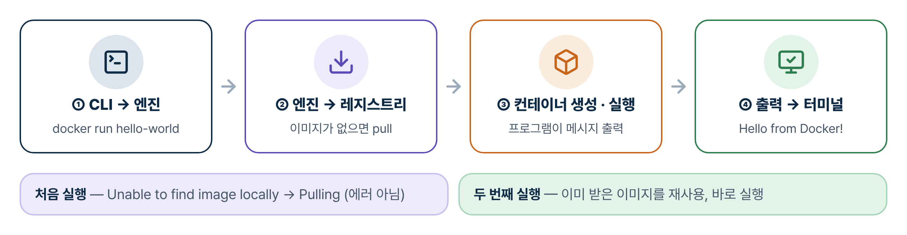

[🏠 과정 목차](../../README.md) › [2주차](../README.md) › [1일차](README.md)

# 7교시 · 설치 점검과 문제 해결

> [!NOTE]
> **이번 시간에 할 일**
>
> - `hello-world` 컨테이너로 Docker가 끝까지 동작하는지 확인합니다.
> - 점검 스크립트로 오늘 설치한 도구를 한 번에 확인합니다.
> - 점검 결과를 저장소에 커밋하고 push합니다.
> - 일부러 실패를 만들어 에러 메시지를 읽는 연습을 합니다.

## 실습 13 · 첫 컨테이너 — hello-world

> **🧪 실습: 실습 목표**
>
> Docker의 모든 부품(CLI → Engine → 레지스트리 → 컨테이너)이 끝까지 연결되어 있는지 가장 작은 컨테이너로 확인합니다.

### 단계 1 — 실행

```bash
docker run hello-world
```

> **🟢 확인: 이렇게 나오면 성공**
>
> ```text
> Unable to find image 'hello-world:latest' locally
> latest: Pulling from library/hello-world
> ...
> Status: Downloaded newer image for hello-world:latest
>
> Hello from Docker!
> This message shows that your installation appears to be working correctly.
>
> To generate this message, Docker took the following steps:
>  1. The Docker client contacted the Docker daemon.
>  2. The Docker daemon pulled the "hello-world" image from the Docker Hub.
>     (amd64)
>  3. The Docker daemon created a new container from that image which runs the
>     executable that produces the output you are currently reading.
>  4. The Docker daemon streamed that output to the Docker client, which sent it
>     to your terminal.
> ...
> ```

### 단계 2 — 출력 읽기

hello-world는 스스로 **무슨 일이 일어났는지** 설명해 줍니다. 6교시의 구조 그림과 맞춰 읽어 봅시다.



| 출력의 단계 | 우리말로 | 6교시 그림에서 |
|---|---|---|
| 1. client contacted the daemon | 주문서가 주방에 전달됐다 | CLI → Engine |
| 2. daemon pulled the image from Docker Hub | 주방이 창고에서 재료를 가져왔다 | Engine → 레지스트리 |
| 3. created a new container … which runs the executable | 재료로 요리를 시작했다 | Engine → 컨테이너 |
| 4. streamed that output to the client | 완성된 요리를 손님에게 내왔다 | 컨테이너 → 터미널 |

첫 줄의 `Unable to find image … locally`는 에러가 아닙니다. "내 컴퓨터에 없어서 받아 오겠다"는 뜻입니다. 한 번 더 실행해 보세요.

```bash
docker run hello-world
```

이번에는 `Pulling` 줄이 없이 바로 `Hello from Docker!`가 나옵니다. **이미지는 한 번 받으면 내 컴퓨터에 남아 있기 때문**입니다. 내일 이 차이를 자세히 봅니다.

## 실습 14 · 설치 점검표 만들고 올리기

> **🧪 실습: 실습 목표**
>
> 점검 스크립트를 만들어 실행하고, 결과를 저장소에 기록합니다. 나중에 "그때 무슨 버전이었지?"를 확인할 수 있는 나만의 기록입니다.

### 단계 1 — 스크립트 파일 만들기

VS Code에서 `devops-lab` 안에 `tools` 폴더를 만들고, 그 안에 `check-env.sh` 파일을 만들어 아래를 붙여 넣고 저장합니다.

```bash
#!/usr/bin/env bash
# 2주차 설치 점검 스크립트 — 각 도구가 설치되어 있는지 확인한다.
# 사용법: bash check-env.sh

check() {
  local name="$1"; shift
  if out=$("$@" 2>/dev/null | head -n 1) && [ -n "$out" ]; then
    printf "  [ OK ] %-16s %s\n" "$name" "$out"
  else
    printf "  [FAIL] %-16s 설치 또는 실행 상태를 확인하세요\n" "$name"
    FAILED=$((FAILED + 1))
  fi
}

FAILED=0
echo "== 2주차 설치 점검 ($(date '+%Y-%m-%d %H:%M')) =="
check "OS"             uname -sr
check "git"            git --version
check "git user.name"  git config --global user.name
check "gh"             gh --version
check "gh login"       bash -c 'gh auth status >/dev/null 2>&1 && echo "logged in"'
check "docker client"  docker version --format 'client {{.Client.Version}}'
check "docker server"  docker version --format 'server {{.Server.Version}}'
check "docker compose" docker compose version
echo "== 결과: 실패 ${FAILED}개 =="
exit "$FAILED"
```

1주차에 배운 것이 곳곳에 있습니다. `exit "$FAILED"`는 실패가 없으면 **종료 코드 0**을 돌려줍니다. 나중에 자동화가 이 숫자만 보고 성공·실패를 판단할 수 있습니다.

### 단계 2 — 실행

```bash
cd ~/devops-lab
bash tools/check-env.sh
```

> **🟢 확인: 이렇게 나오면 성공**
>
> ```text
> == 2주차 설치 점검 (2026-11-30 16:40) ==
>   [ OK ] OS               Linux 6.6.87.2-microsoft-standard-WSL2
>   [ OK ] git              git version 2.43.0
>   [ OK ] git user.name    홍길동
>   [ OK ] gh               gh version 2.45.0 (…)
>   [ OK ] gh login         logged in
>   [ OK ] docker client    client 29.x.x
>   [ OK ] docker server    server 29.x.x
>   [ OK ] docker compose   Docker Compose version v5.x.x
> == 결과: 실패 0개 ==
> ```
> **실패 0개**가 목표입니다. `[FAIL]`이 있으면 해당 교시의 "막혔다면" 표로 돌아갑니다.

### 단계 3 — 결과를 파일로 남기기

```bash
bash tools/check-env.sh > tools/check-env-result.txt
echo "종료 코드: $?"
cat tools/check-env-result.txt
```

- `>` : 화면 대신 파일로 (2교시)
- `$?` : **방금 실행한 명령의 종료 코드** (1주차 2일차 3교시). 0이면 모두 통과입니다.

### 단계 4 — 커밋하고 올리기

```bash
git add tools/
git status
git commit -m "설치 점검 스크립트와 결과 추가"
git push
```

> **🟢 확인: 이렇게 나오면 성공**
>
> GitHub 저장소에 `tools` 폴더와 두 파일이 보이고, 커밋이 **3개**가 되었습니다.

## 실습 15 · 일부러 실패해 보기

> **🧪 실습: 실습 목표**
>
> 자주 만나는 에러를 일부러 만들어 보고, 메시지를 읽고 원인을 말해 봅니다. 1교시 학술 노트의 **생산적 실패**입니다.

### 실패 1 — 엔진이 꺼져 있을 때

1. Docker Desktop을 **종료**합니다 (Windows: 작업 표시줄 고래 아이콘 오른쪽 클릭 → Quit, Mac: 메뉴 막대 고래 → Quit).
2. 터미널에서:

```bash
docker ps
```

> **🟢 확인: 예상되는 에러**
>
> Mac(또는 Linux):
>
> ```text
> failed to connect to the docker API at unix:///Users/내이름/.docker/run/docker.sock;
> check if the path is correct and if the daemon is running: … no such file or directory
> ```
>
> Windows WSL:
>
> ```text
> The command 'docker' could not be found in this WSL 2 distro.
> We recommend to activate the WSL integration in Docker Desktop settings.
> ```
>
> 표현은 달라도 뜻은 같습니다. **주문서(CLI)는 있는데 주방(Engine)이 문을 닫은 상태**입니다. (Docker 버전에 따라 `Cannot connect to the Docker daemon … Is the docker daemon running?`이라고 나오기도 합니다.) Docker Desktop을 다시 켜고, Engine running이 된 뒤 `docker ps`가 표 머리줄만 출력하면 해결입니다.

### 실패 2 — 없는 이미지 이름

```bash
docker run hello-wrold
```

> **🟢 확인: 예상되는 에러**
>
> ```text
> Unable to find image 'hello-wrold:latest' locally
> docker: Error response from daemon: … pull access denied, repository does not exist or may require authorization …
> ```
> Docker 버전에 따라 앞뒤 문구는 조금 다르지만 **`pull access denied`**와 **`repository does not exist`**가 핵심입니다.
> 오타(`wrold`)입니다. 레지스트리에 그런 이름이 없다는 뜻입니다. "access denied"라는 말에 겁먹지 말고 **이름부터** 확인합니다. 1주차 3일차 DNS의 "이름이 틀리면 아무것도 안 된다"와 같습니다.

### 실패 3 — 명령 오타

```bash
docker rnu hello-world
```

> **🟢 확인: 예상되는 에러**
>
> ```text
> docker: unknown command: docker rnu
>
> Run 'docker --help' for more information
> ```
> `docker --help`나 `docker run --help`를 보면 쓸 수 있는 명령과 옵션이 나옵니다. **도움말은 가장 가까운 공식 문서**입니다.

> [!TIP]
> **에러 메시지 읽는 세 단계**
>
> 1. **마지막 줄부터** 읽습니다. 진짜 원인은 대개 마지막에 있습니다.
> 2. **모르는 단어 하나**만 골라 검색하거나 AI에게 묻습니다. 메시지 전체를 통째로 붙여 넣기 전에 비밀값이 섞여 있지 않은지 봅니다.
> 3. 1주차 1일차의 **다섯 줄 질문**(환경, 목적, 한 일, 결과, 시도한 것)으로 정리해 질문합니다.

## 정리 — 오늘 만든 작업대

| 도구 | 확인 명령 | 다시 쓰는 곳 |
|---|---|---|
| WSL2 Ubuntu / Mac 터미널 | `uname -sr` | 5주 내내 |
| VS Code | `code .` | 5주 내내 |
| Git | `git --version`, `git config --global --list` | 매일 커밋 |
| GitHub CLI | `gh auth status` | 5일차 PR, 3주차 Actions |
| Docker | `docker version`, `docker run hello-world` | 내일부터 |

> **🧹 정리: 오늘의 정리**
>
> hello-world 컨테이너는 출력을 마치고 이미 **종료된 상태**로 남아 있습니다. 내일 이것을 보고 지우는 법을 배우므로 오늘은 그대로 둡니다. Docker Desktop은 쓰지 않을 때 종료해 두면 노트북 메모리를 아낄 수 있습니다.

> **✅ 확인 문제**
>
> 1. hello-world의 첫 줄 `Unable to find image … locally`는 에러인가요?
> 2. 같은 명령을 두 번째 실행했을 때 `Pulling` 줄이 사라진 이유는?
> 3. `failed to connect to the docker API`(또는 `Cannot connect to the Docker daemon`)가 나오면 무엇을 해야 하나요?
> 4. 방금 실행한 명령의 종료 코드를 보는 방법은?
> 5. 에러 메시지는 어디부터 읽는 것이 좋나요?
>
> <details><summary>정답</summary>
>
> 1. 아니다. 내 컴퓨터에 없어서 레지스트리에서 받아 오겠다는 뜻이다
> 2. 이미지는 한 번 받으면 내 컴퓨터에 남아 있기 때문
> 3. Docker Desktop(엔진)을 켜고 Engine running이 될 때까지 기다린다
> 4. `echo $?`
> 5. 마지막 줄부터
>
> </details>

> [!NOTE]
> **오늘의 배움일기**
>
> - 오늘 설치하면서 막혔던 곳 하나와, 어떻게 풀었는지 (또는 아직 못 푼 것)
> - hello-world 출력의 네 단계를 내 말로 한 줄씩 다시 써 보기
> - 내 GitHub 저장소 주소를 적고, 커밋이 몇 개인지 세어 보기
> - 내일 Docker 기본 시간에 꼭 알고 싶은 것 하나

## 참고 문헌

- Docker. *docker run reference*, *Get started*. docs.docker.com
- Docker Hub. *hello-world Official Image*. hub.docker.com/_/hello-world
- GNU Bash Manual. *Special Parameters ($?)*. gnu.org/software/bash/manual

---

⬅️ 이전: [6교시 · Docker Desktop 설치](lesson-06.md) &nbsp;|&nbsp; [⬆️ 1일차 목차](README.md) &nbsp;|&nbsp; 다음: [2주차 2일차 목차](../day2/README.md) ➡️
