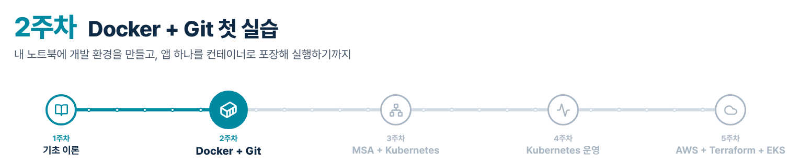

[🏠 과정 목차](../../README.md) › [2주차](../README.md) › [2일차](README.md)

# 2주차 2일차 — Docker 기본

📕 2주차 이북 PDF: [보기](../../downloads/pdf/week2.pdf) · [내려받기](https://github.com/niceguy61/kdt_devops_lecture_2026_rev2/raw/main/downloads/pdf/week2.pdf) &nbsp;|&nbsp; 📊 2일차 슬라이드: [PPTX 내려받기](https://github.com/niceguy61/kdt_devops_lecture_2026_rev2/raw/main/downloads/pptx/week2-day2.pptx)

## 오늘의 목표

어제는 작업대를 만들고 `hello-world`를 실행했습니다. 오늘은 남이 만들어 둔 이미지(Alpine Linux, nginx 웹 서버)로 **컨테이너를 다루는 손기술**을 익힙니다. 띄우고, 들어가 보고, 밖에서 접속하고, 로그를 보고, 멈추고, 지우는 것까지. 1주차에 개념으로 배운 **격리된 프로세스**, **포트**, **종료 코드**, **`127.0.0.1`과 `0.0.0.0`**을 오늘 하나씩 눈으로 확인합니다.

- 이미지와 컨테이너의 차이를 설명하고, `docker images`와 `docker ps -a`로 확인합니다.
- `docker run -it`으로 컨테이너 안에 들어가 격리를 직접 확인합니다.
- nginx를 백그라운드로 실행하고, `-p`로 포트를 연결해 브라우저로 접속합니다.
- `logs`, `exec`, `inspect`, `stats`로 실행 중인 컨테이너를 관찰합니다.
- `stop`, `start`, `rm`, `prune`으로 생명주기를 다루고 깨끗하게 정리합니다.
- 자주 만나는 실패 다섯 가지를 일부러 만들고 고칩니다.

## 시간표

| 교시 | 주제 | 실습 결과물 |
|---|---|---|
| 1교시 | 어제 요약 + 이미지와 컨테이너 | `docker images`, `docker ps -a` 읽기 |
| 2교시 | 컨테이너 안에 들어가 보기 | Alpine 안에서 `ps`, `hostname` |
| 3교시 | nginx를 백그라운드로 실행 | `docker ps`에 Up |
| 4교시 | 포트 연결 | 브라우저에서 `localhost:8080` |
| 5교시 | 관찰하기 — logs·exec·inspect·stats | 컨테이너 안 HTML 바꾸기 |
| 6교시 | 생명주기와 정리 | 종료 코드 0·137 확인, 깨끗이 정리 |
| 7교시 | 실패 사례 다섯 가지 | 에러 → 원인 → 해결 표 완성 |
| 8교시 | 배움일기 | |

## 오늘 쓰는 이미지

| 이미지 | 무엇 | 크기 감각 |
|---|---|---|
| `alpine:3.24` | 아주 작은 Linux 배포판 | 수 MB |
| `nginx:1.30-alpine` | Alpine 위에 올린 nginx 웹 서버 (1.30 = 2026년 4월부터의 안정판) | 수십 MB |
| `python:3.14-slim` | 파이썬이 들어 있는 Debian 기반 이미지 (7교시에서만) | 수십~100MB대 |

## 교시별 자료

1. [이미지와 컨테이너](lesson-01.md)
2. [컨테이너 안에 들어가 보기](lesson-02.md)
3. [nginx를 백그라운드로 실행](lesson-03.md)
4. [포트 연결](lesson-04.md)
5. [관찰하기 — logs·exec·inspect·stats](lesson-05.md)
6. [생명주기와 정리](lesson-06.md)
7. [실패 사례 다섯 가지](lesson-07.md)

---

| 이전 | 목차 | 다음 |
|:--|:--:|--:|
| ⬅️ [7교시 · 설치 점검과 문제 해결](../day1/lesson-07.md) | [⬆️ 2주차 목차](../README.md) | [1교시 · 이미지와 컨테이너](lesson-01.md) ➡️ |
