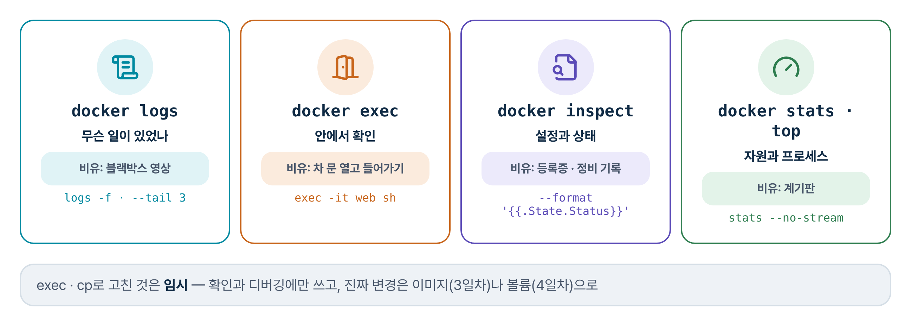

[🏠 과정 목차](../../README.md) › [2주차](../README.md) › [2일차](README.md)

# 5교시 · 관찰하기 — logs · exec · inspect · stats

> [!NOTE]
> **이번 시간에 할 일**
>
> - `docker logs`로 컨테이너가 남긴 기록을 봅니다.
> - `docker exec`로 실행 중인 컨테이너 안에서 명령을 실행하고, 웹 페이지를 바꿔 봅니다.
> - `docker cp`로 내 노트북의 파일을 컨테이너에 넣습니다.
> - `docker inspect`, `docker top`, `docker stats`로 상태를 숫자로 확인합니다.

## 관찰 도구 네 가지

컨테이너가 Up이라고 해서 정상인 것은 아닙니다(1주차 3일차 6교시의 "단계별로 좁혀 가기"). 운영자는 컨테이너를 **관찰하는 도구**를 손에 익혀야 합니다.



| 질문 | 명령 | 비유 |
|---|---|---|
| 무슨 일이 있었나? | `docker logs` | 블랙박스 영상 |
| 안에서 직접 확인하고 싶다 | `docker exec` | 차 문을 열고 들어가 보기 |
| 어떻게 설정되어 있나? | `docker inspect` | 차량 등록증과 정비 기록 |
| 자원을 얼마나 쓰나? | `docker stats`, `docker top` | 계기판 |

## 실습 9 · 로그 보기

> **🧪 실습: 실습 목표**
>
> nginx에 요청을 보내고, 그 요청이 로그에 남는 것을 확인합니다.

### 단계 1 — 준비

```bash
docker run -d --name web -p 8080:80 nginx:1.30-alpine
curl -s http://localhost:8080 > /dev/null
curl -s http://localhost:8080/없는페이지 > /dev/null
```

- `> /dev/null` : 출력을 버린다 (1주차 2일차의 "블랙홀" 파일)

### 단계 2 — 로그 보기

```bash
docker logs web
```

> **🟢 확인: 이렇게 나오면 성공**
>
> ```text
> /docker-entrypoint.sh: Configuration complete; ready for start up
> ...
> 172.17.0.1 - - [30/Nov/2026:02:14:05 +0000] "GET / HTTP/1.1" 200 896 "-" "curl/8.5.0" "-"
> 172.17.0.1 - - [30/Nov/2026:02:14:06 +0000] "GET /%EC%97%86… HTTP/1.1" 404 153 "-" "curl/8.5.0" "-"
> 2026/11/30 02:14:06 [error] 30#30: *2 open() "/usr/share/nginx/html/없는페이지" failed (2: No such file or directory) …
> ```
> 1주차 3일차 5교시의 **상태 코드**가 로그에 그대로 있습니다. 첫 요청은 **200**, 없는 페이지는 **404**와 그 이유(`No such file or directory`)까지 남았습니다. 요청한 쪽 주소 `172.17.0.1`은 Docker가 만든 가상 네트워크의 문(게이트웨이) 주소입니다(4일차).

### 단계 3 — 필요한 만큼만, 실시간으로

```bash
docker logs --tail 3 web
docker logs -f web
```

- `--tail 3` : 마지막 3줄만
- `-f` : **f**ollow — 새 로그가 생길 때마다 계속 보여 준다

`-f` 상태에서 브라우저로 `http://localhost:8080`을 몇 번 새로고침해 보세요. 로그가 실시간으로 올라옵니다. `Ctrl` + `C`로 빠져나옵니다(컨테이너는 계속 실행됩니다).

> [!IMPORTANT]
> **로그는 어디에서 오나 — 표준 출력**
>
> `docker logs`가 보여 주는 것은 컨테이너의 PID 1이 **표준 출력(stdout)과 표준 에러(stderr)**로 쓴 내용입니다. 그래서 nginx 공식 이미지는 로그 파일을 따로 쓰지 않고 표준 출력으로 내보내도록 설정되어 있습니다. 1주차 4일차 6교시 **12-Factor App의 XI. 로그 — "로그는 파일이 아니라 표준 출력 스트림으로"**가 바로 이것입니다. 3일차에 만드는 DevMart API도 같은 원칙을 따릅니다.

## 실습 10 · 컨테이너 안에서 명령 실행하기

> **🧪 실습: 실습 목표**
>
> `docker exec`로 실행 중인 nginx 컨테이너 안에 들어가 웹 페이지 파일을 바꿔 봅니다.

### 단계 1 — 한 줄짜리 명령

```bash
docker exec web nginx -v
docker exec web ls /usr/share/nginx/html
```

> **🟢 확인: 이렇게 나오면 성공**
>
> ```text
> nginx version: nginx/1.30.6
> 50x.html
> index.html
> ```
> `docker exec 컨테이너 명령` = "그 컨테이너 **안에서** 이 명령을 실행해 줘". 2교시의 `docker run -it`가 **새** 컨테이너를 만든 것과 달리, `exec`는 **이미 실행 중인** 컨테이너에 명령을 하나 더 띄웁니다.

### 단계 2 — 안으로 들어가 페이지 바꾸기

```bash
docker exec -it web sh
```

```sh
cd /usr/share/nginx/html
echo "<h1>컨테이너 안에서 바꾼 페이지</h1>" > index.html
cat index.html
exit
```

```bash
curl http://localhost:8080
```

> **🟢 확인: 이렇게 나오면 성공**
>
> ```text
> <h1>컨테이너 안에서 바꾼 페이지</h1>
> ```
> 브라우저를 새로고침해도 바뀐 페이지가 보입니다. `exit`으로 나왔지만 **컨테이너는 계속 실행 중**입니다. exec로 띄운 셸만 끝났고, PID 1(nginx)은 그대로이기 때문입니다.

### 단계 3 — 내 파일을 컨테이너에 넣기

VS Code에서 `~/devops-lab/day2/index.html`을 만들고 아래를 붙여 넣어 저장합니다.

```html
<!doctype html>
<html lang="ko">
<head><meta charset="utf-8"><title>내 첫 컨테이너 웹 페이지</title></head>
<body>
  <h1>안녕하세요, 저는 nginx 컨테이너입니다</h1>
  <p>2주차 2일차 실습 — docker cp로 넣은 파일</p>
</body>
</html>
```

```bash
cd ~/devops-lab
docker cp day2/index.html web:/usr/share/nginx/html/index.html
curl http://localhost:8080
```

> **🟢 확인: 이렇게 나오면 성공**
>
> ```text
> Successfully copied 2.05kB to web:/usr/share/nginx/html/index.html
> <!doctype html>
> ...
>   <h1>안녕하세요, 저는 nginx 컨테이너입니다</h1>
> ```
> `docker cp 원본 컨테이너:경로` — 방향을 바꾸면(`docker cp web:/경로 .`) 컨테이너에서 꺼내 올 수도 있습니다.

> [!WARNING]
> **exec와 cp로 고친 것은 '임시'다**
>
> 지금 바꾼 페이지는 **이 컨테이너 안에만** 있습니다. 컨테이너를 지우고 새로 만들면 원래의 Welcome 페이지로 돌아갑니다(1교시: 이미지는 읽기 전용). 1교시 학술 노트의 **불변 인프라** 관점에서 보면, 운영 중인 컨테이너를 exec로 고치는 것은 **눈송이 서버**를 만드는 일입니다. exec는 **확인과 디버깅**에 쓰고, 진짜 변경은 다음 두 방법으로 합니다.
>
> - 3일차: 파일을 **이미지에 넣어서** 새로 빌드 (Dockerfile)
> - 4일차: 내 폴더를 컨테이너에 **연결해서** 실시간 반영 (bind mount)

## 실습 11 · 설정과 상태를 숫자로

> **🧪 실습: 실습 목표**
>
> `inspect`, `top`, `stats`로 컨테이너의 설정과 자원 사용량을 확인합니다.

### 단계 1 — inspect: 모든 정보

```bash
docker inspect web | head -30
```

수백 줄의 JSON이 나옵니다. 처음부터 다 읽을 필요는 없고, 필요한 값만 꺼내 봅니다.

```bash
docker inspect --format '{{.State.Status}}' web
docker inspect --format '{{.Config.Image}}' web
docker inspect --format '{{range .NetworkSettings.Networks}}{{.IPAddress}}{{end}}' web
docker inspect --format '{{json .HostConfig.PortBindings}}' web
```

> **🟢 확인: 이렇게 나오면 성공**
>
> ```text
> running
> nginx:1.30-alpine
> 172.17.0.2
> {"80/tcp":[{"HostIp":"","HostPort":"8080"}]}
> ```
> 컨테이너는 자기만의 IP 주소(`172.17.0.2`)를 가지고 있습니다. 1주차 3일차의 **사설 IP 대역 `172.16.0.0/12`** 안의 주소입니다. 4일차에 이 주소 대신 **이름**으로 컨테이너끼리 대화하는 법을 배웁니다.

### 단계 2 — top: 컨테이너 안의 프로세스를 바깥에서

```bash
docker top web
```

> **🟢 확인: 이렇게 나오면 성공**
>
> ```text
> UID    PID    PPID   …   CMD
> root   1283   1258   …   nginx: master process nginx -g daemon off;
> 101    1312   1283   …   nginx: worker process
> 101    1313   1283   …   nginx: worker process
> ```
> 2교시에 컨테이너 **안**에서는 PID 1이었던 nginx가, **바깥**에서 보면 `1283` 같은 평범한 PID를 가진 프로세스입니다. **같은 프로세스를 두 개의 이름표로 보는 것**, 이것이 PID 네임스페이스의 정체입니다. 1주차 2일차의 결론 "컨테이너도 결국 프로세스"를 눈으로 확인했습니다.

### 단계 3 — stats: 자원 사용량

```bash
docker stats --no-stream web
```

> **🟢 확인: 이렇게 나오면 성공**
>
> ```text
> CONTAINER ID   NAME   CPU %   MEM USAGE / LIMIT     MEM %   NET I/O        BLOCK I/O   PIDS
> 7c1e3a9b2f4d   web    0.00%   3.7MiB / 7.6GiB       0.05%   3.2kB / 4.1kB  0B / 8kB    3
> ```
> nginx는 메모리를 수 MB만 씁니다. LIMIT은 지금 Docker가 쓸 수 있는 전체 메모리입니다(제한을 걸지 않았으므로). `--no-stream`을 빼면 `top`처럼 계속 갱신되고, `Ctrl` + `C`로 빠져나옵니다. 1주차 2일차의 **cgroups**가 이 숫자를 세고 있습니다. 3주차 Kubernetes에서 이 값에 **제한(limits)**을 거는 법을 배웁니다.

> **🧹 정리: 정리**
>
> ```bash
> docker rm -f web
> cd ~/devops-lab
> git add day2/index.html
> git commit -m "2일차: docker cp 실습용 페이지"
> git push
> ```

> **🎓 학술 노트 — 관찰 가능성의 시작: 로그**
>
> 소프트웨어가 무슨 일을 했는지 기록하는 **로그**의 역사는 컴퓨터만큼 오래되었지만, 형식을 표준으로 만든 것은 1980년대 BSD Unix의 **syslog**였습니다. 에릭 올먼(Eric Allman)이 메일 서버 sendmail을 위해 만든 이 형식은 이후 RFC 3164(2001), RFC 5424(2009)로 표준화되었고, 지금도 많은 시스템이 쓰고 있습니다.
>
> 로그는 4주차에 배울 **관찰 가능성(Observability)의 세 기둥 — 로그·지표·추적** 중 첫 번째입니다. 오늘 `docker logs`는 "무슨 일이 있었나"를, `docker stats`는 "숫자로 얼마나"를 보여 주었습니다. 4주차에는 이것을 수십 개 컨테이너에서 한꺼번에 모아 보는 Prometheus와 Grafana를 씁니다. 그때도 출발점은 오늘처럼 **로그를 표준 출력으로 내보내는 앱**입니다.
>
> - Gerhards, R. (2009). *RFC 5424: The Syslog Protocol*. IETF.
> - Majors, C., Fong-Jones, L., & Miranda, G. (2022). *Observability Engineering*. O'Reilly.

## 정리

- `docker logs [-f] [--tail N]` — 컨테이너의 **표준 출력**을 봅니다. 앱은 로그를 표준 출력으로 내보내야 합니다.
- `docker exec [-it] 컨테이너 명령` — **실행 중인** 컨테이너 안에서 명령을 실행합니다.
- `docker cp` — 노트북과 컨테이너 사이에 파일을 복사합니다. **exec·cp로 고친 것은 임시**입니다.
- `docker inspect --format`, `docker top`, `docker stats` — 설정, 프로세스, 자원 사용량을 확인합니다.
- 컨테이너 안의 PID 1이 바깥에서는 평범한 PID — **컨테이너도 결국 프로세스**입니다.

> **✅ 확인 문제**
>
> 1. 없는 페이지를 요청했을 때 nginx 로그에 남은 상태 코드는?
> 2. `docker logs -f`에서 `-f`의 의미는?
> 3. `docker run -it`과 `docker exec -it`의 차이는?
> 4. exec로 바꾼 index.html은 컨테이너를 다시 만들면 어떻게 되나요?
> 5. 컨테이너 안에서 PID 1인 nginx가 `docker top`에서는 다른 번호인 이유는?
>
> <details><summary>정답</summary>
>
> 1. 404
> 2. 새 로그를 계속 따라가며 보여 준다 (follow)
> 3. `run -it`은 새 컨테이너를 만들어 들어가고, `exec -it`은 이미 실행 중인 컨테이너 안에 명령(셸)을 하나 더 띄운다
> 4. 사라지고 이미지에 있던 원래 페이지로 돌아간다
> 5. PID 네임스페이스 때문에 같은 프로세스가 안에서는 1, 바깥에서는 호스트의 PID로 보인다
>
> </details>

## 참고 문헌

- Docker Docs. *docker container logs / exec / cp / inspect / top / stats*. docs.docker.com/reference/cli
- Docker Hub. *nginx — logging to stdout/stderr*. hub.docker.com/_/nginx
- Wiggins, A. (2011). *The Twelve-Factor App — XI. Logs*. 12factor.net/logs
- Gerhards, R. (2009). *RFC 5424: The Syslog Protocol*. IETF.

---

⬅️ 이전: [4교시 · 포트 연결](lesson-04.md) &nbsp;|&nbsp; [⬆️ 2일차 목차](README.md) &nbsp;|&nbsp; 다음: [6교시 · 생명주기와 정리](lesson-06.md) ➡️
