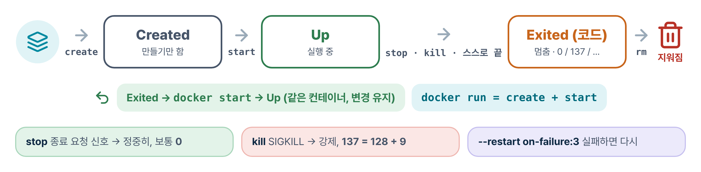

[🏠 과정 목차](../../README.md) › [2주차](../README.md) › [2일차](README.md)

# 6교시 · 생명주기와 정리

> [!NOTE]
> **이번 시간에 할 일**
>
> - 컨테이너의 상태(Created, Up, Exited)와 그 사이를 오가는 명령을 압니다.
> - `stop`과 `kill`의 차이를 종료 코드로 확인합니다.
> - 재시작 정책으로 "죽으면 다시 살리기"를 맛봅니다.
> - 쓰지 않는 컨테이너와 이미지를 안전하게 정리합니다.

## 컨테이너의 일생



| 상태 | 뜻 | 들어가는 명령 |
|---|---|---|
| **Created** | 만들어졌지만 아직 시작 안 함 | `docker create` (또는 `run`이 시작에 실패할 때) |
| **Up** (running) | 실행 중 | `docker start`, `docker run` |
| **Exited (코드)** | 끝남. 괄호 안은 종료 코드 | 프로그램이 스스로 끝남, `docker stop`, `docker kill` |
| (없음) | 지워짐 | `docker rm` |

`docker run` = `docker create` + `docker start`입니다. 1주차 2일차 3교시의 **프로세스 생명주기**(생성 → 준비 → 실행 → 종료)와 거의 같은 모양입니다.

## 실습 12 · 멈추고, 다시 켜고, 지우기

> **🧪 실습: 실습 목표**
>
> 한 컨테이너를 멈추고 다시 켜면서 상태 변화를 확인하고, 안에서 바꾼 내용이 언제 사라지는지 봅니다.

### 단계 1 — 실행하고 흔적 남기기

```bash
docker run -d --name web -p 8080:80 nginx:1.30-alpine
docker exec web sh -c 'echo "<h1>멈췄다 켜도 남을까?</h1>" > /usr/share/nginx/html/index.html'
curl -s http://localhost:8080
```

### 단계 2 — 멈추기

```bash
docker stop web
docker ps -a --format "table {{.Names}}\t{{.Status}}"
```

> **🟢 확인: 이렇게 나오면 성공**
>
> ```text
> web
> NAMES     STATUS
> web       Exited (0) 2 seconds ago
> ```
> **Exited (0)** — 정상 종료입니다. 컨테이너는 사라지지 않고 **멈춘 채로 남아** 있습니다.

### 단계 3 — 다시 켜기

```bash
docker start web
curl -s http://localhost:8080
```

> **🟢 확인: 이렇게 나오면 성공**
>
> ```text
> web
> <h1>멈췄다 켜도 남을까?</h1>
> ```
> **남아 있습니다.** 멈췄다 켜는 것은 같은 컨테이너를 다시 쓰는 것이라 안의 변경도 그대로입니다. 노트북을 껐다 켜도 파일이 남아 있는 것과 같습니다.

### 단계 4 — 지우고 새로 만들기

```bash
docker rm -f web
docker run -d --name web -p 8080:80 nginx:1.30-alpine
curl -s http://localhost:8080 | grep title
```

> **🟢 확인: 이렇게 나오면 성공**
>
> ```text
> <title>Welcome to nginx!</title>
> ```
> **지우고 새로 만들면 사라집니다.** 정리하면 이렇습니다.

| 한 일 | 안에서 바꾼 내용 |
|---|---|
| `stop` → `start` | 남는다 (같은 컨테이너) |
| `rm` → 새로 `run` | **사라진다** (새 컨테이너) |

## 실습 13 · stop과 kill, 그리고 종료 코드

> **🧪 실습: 실습 목표**
>
> 정중하게 끝내기(stop)와 강제로 끝내기(kill)를 종료 코드로 비교하고, 내가 정한 종료 코드도 만들어 봅니다.

### 단계 1 — 강제 종료

```bash
docker kill web
docker ps -a --format "table {{.Names}}\t{{.Status}}"
```

> **🟢 확인: 이렇게 나오면 성공**
>
> ```text
> NAMES     STATUS
> web       Exited (137) 1 second ago
> ```

| 명령 | 보내는 신호 | 앱의 입장 | 종료 코드 |
|---|---|---|---|
| `docker stop` | 먼저 **종료 요청 신호**(보통 SIGTERM, nginx 이미지는 SIGQUIT — 정중히 "그만해 주세요"), 10초 뒤에도 안 끝나면 SIGKILL | 하던 요청을 마무리하고 끝낼 기회가 있다 | 보통 **0** |
| `docker kill` | 바로 **SIGKILL**(강제) | 아무것도 정리하지 못하고 즉시 끝 | **137** |

**137 = 128 + 9**(SIGKILL의 번호)입니다. 1주차 2일차 3교시에 배운 "종료 코드 128 이상은 신호로 죽었다는 뜻"이 바로 이것입니다. 3주차 Kubernetes에서 메모리를 너무 써서 강제 종료된 Pod를 볼 때도 **137**과 `OOMKilled`를 만나게 됩니다. 1주차 4일차 12-Factor의 **IX. 폐기 가능성 — 우아한 종료**가 SIGTERM을 잘 처리하라는 뜻입니다.

### 단계 2 — 내가 정한 종료 코드

```bash
docker run --name exit3 alpine:3.24 sh -c "echo 작업 실패!; exit 3"
docker ps -a --format "table {{.Names}}\t{{.Status}}"
```

> **🟢 확인: 이렇게 나오면 성공**
>
> ```text
> 작업 실패!
> NAMES     STATUS
> exit3     Exited (3) 2 seconds ago
> web       Exited (137) 1 minute ago
> ```
> 프로그램이 `exit 3`으로 끝나면 컨테이너의 종료 코드도 3입니다. **자동화는 이 숫자만 봅니다**(1주차 5일차 2교시의 파이프라인 관문). 3주차 CI에서 테스트가 실패하면 종료 코드가 0이 아니어서 파이프라인이 멈추는 것도 같은 원리입니다.

## 실습 14 · 죽으면 다시 살리기 — 재시작 정책

> **🧪 실습: 실습 목표**
>
> 계속 실패하는 컨테이너에 재시작 정책을 걸어, Docker가 자동으로 다시 살리는 모습을 봅니다.

### 단계 1 — 실패하는 컨테이너에 정책 걸기

```bash
docker run -d --name crash --restart on-failure:3 alpine:3.24 sh -c "echo 시작합니다; exit 1"
```

- `--restart on-failure:3` : 종료 코드가 0이 아니면 **최대 3번** 다시 시작한다.

### 단계 2 — 결과 확인 (10초쯤 기다린 뒤)

```bash
docker logs crash
docker inspect --format '재시작 횟수: {{.RestartCount}}' crash
docker ps -a --format "table {{.Names}}\t{{.Status}}"
```

> **🟢 확인: 이렇게 나오면 성공**
>
> ```text
> 시작합니다
> 시작합니다
> 시작합니다
> 시작합니다
> 재시작 횟수: 3
> NAMES     STATUS
> crash     Exited (1) 5 seconds ago
> ...
> ```
> 처음 1번 + 재시작 3번 = **4번** 실행되고 포기했습니다.

| 정책 | 동작 | 쓰는 곳 |
|---|---|---|
| `no` (기본) | 다시 시작하지 않는다 | 실습, 한 번 하고 끝나는 작업 |
| `on-failure[:N]` | 실패(0이 아닌 코드)했을 때만, 최대 N번 | 일시적 오류가 있을 수 있는 작업 |
| `unless-stopped` | 내가 멈추기 전까지 항상 | 노트북에서 늘 켜 두는 서비스 |
| `always` | 항상 (Docker 재시작 후에도) | 단일 서버 운영 |

> [!WARNING]
> **재시작은 '고치는 것'이 아니다**
>
> 재시작 정책은 **일시적인** 문제(잠깐 네트워크가 끊김 등)에는 도움이 되지만, 설정 오류나 버그처럼 **매번 실패하는** 문제는 고치지 못합니다. 오히려 끝없이 재시작하며 로그만 쌓고 문제를 가립니다. 3주차 Kubernetes의 **CrashLoopBackOff**(재시작 간격을 점점 늘리며 반복)가 이 상황의 이름입니다. 재시작이 반복되면 **로그부터** 봅니다.

## 실습 15 · 깨끗하게 정리하기

> **🧪 실습: 실습 목표**
>
> 쓰지 않는 컨테이너와 이미지를 정리하고, Docker가 디스크를 얼마나 쓰는지 확인합니다.

### 단계 1 — 디스크 사용량 보기

```bash
docker system df
```

> **🟢 확인: 이렇게 나오면 성공**
>
> ```text
> TYPE            TOTAL     ACTIVE    SIZE      RECLAIMABLE
> Images          4         0         …MB       …MB (…%)
> Containers      3         0         …kB       …kB (100%)
> Local Volumes   0         0         0B        0B
> Build Cache     0         0         0B        0B
> ```
> RECLAIMABLE은 "지워도 되는 양"입니다.

### 단계 2 — 멈춘 컨테이너 모두 지우기

```bash
docker container prune
```

```text
WARNING! This will remove all stopped containers.
Are you sure you want to continue? [y/N]
```

`y`를 입력합니다. **멈춘 것만** 지우므로 실행 중인 컨테이너는 안전합니다.

### 단계 3 — 이미지 지우기

```bash
docker image rm hello-world:latest
docker images
```

> **🟢 확인: 이렇게 나오면 성공**
>
> ```text
> Untagged: hello-world:latest
> Deleted: sha256:f7931603f70e…
> ```
> 이미지를 쓰는 컨테이너가 남아 있으면 `image is being used by stopped container`라며 거부합니다. 그때는 컨테이너부터 지웁니다.

| 정리 명령 | 지우는 것 | 위험도 |
|---|---|---|
| `docker rm 이름` | 그 컨테이너 하나 | 낮음 |
| `docker container prune` | 멈춘 컨테이너 전부 | 낮음 |
| `docker image rm 이름` | 그 이미지 하나 | 낮음 (다시 받으면 된다) |
| `docker image prune` | 이름표 없는 이미지(3일차에 생김) | 낮음 |
| `docker system prune` | 멈춘 컨테이너, 안 쓰는 네트워크, 이름표 없는 이미지, 빌드 캐시 | 중간 |
| `docker system prune -a --volumes` | **위 + 안 쓰는 모든 이미지 + 볼륨(데이터!)** | **높음 — 데이터가 사라진다** |

> [!WARNING]
> **`--volumes`는 데이터를 지운다**
>
> 4일차부터는 DB 데이터를 **볼륨**에 저장합니다. 인터넷에서 "Docker 용량 정리"를 검색하면 나오는 `docker system prune -a --volumes`를 생각 없이 실행하면 **실습 DB 데이터가 통째로 사라집니다.** 1주차 5일차의 "되돌릴 수 없는 작업은 한 번 더 확인"을 기억하세요. 정리는 **좁은 범위부터** 합니다.

> **🎓 학술 노트 — 우아한 종료와 신호**
>
> Unix의 **신호(signal)**는 1970년대부터 있던, 운영체제가 프로세스에게 "무슨 일이 생겼다"고 알리는 짧은 메시지입니다. `SIGTERM`(15)은 "정리하고 끝내 달라"는 요청이라 프로그램이 받아서 처리할 수 있지만, `SIGKILL`(9)은 프로그램에게 전달되지 않고 커널이 즉시 끝내 버립니다. POSIX 표준이 이 동작을 정의합니다.
>
> 클라우드에서 이것이 중요한 이유는 컨테이너가 **자주, 일상적으로 교체되기** 때문입니다. 새 버전을 배포할 때마다, 서버를 줄일 때마다 기존 컨테이너는 SIGTERM을 받습니다. 이때 처리 중이던 주문 요청을 끝까지 마무리하지 않고 바로 죽는 앱은 배포할 때마다 몇 건씩 주문을 잃습니다. 그래서 1주차 4일차의 12-Factor는 **빠른 시작과 우아한 종료(graceful shutdown)**를 원칙으로 꼽았고, Kubernetes는 SIGTERM 후 기본 30초를 기다려 줍니다(3주차).
>
> - IEEE & The Open Group. *POSIX.1-2024 — signal.h*.
> - Wiggins, A. (2011). *The Twelve-Factor App — IX. Disposability*. 12factor.net

> **📈 트렌드 — '쓰고 버리는' 개발 환경**
>
> `--rm`처럼 **필요할 때 만들고 끝나면 버리는** 컨테이너는 실습만의 이야기가 아닙니다. 테스트 코드가 실행될 때마다 진짜 PostgreSQL·Kafka 컨테이너를 잠깐 띄웠다가 끝나면 지우는 **Testcontainers** 같은 도구가 널리 쓰이고 있고, AI 코딩 에이전트도 작업마다 새 컨테이너를 만들어 그 안에서 실험하고 버리는 방식이 늘고 있습니다. "고쳐 쓰는 서버"에서 "버리고 새로 만드는 컨테이너"로 — 1교시의 불변 인프라가 일상이 된 모습입니다.

## 정리

- 컨테이너는 **Created → Up → Exited → (rm)**의 일생을 삽니다. `run` = `create` + `start`.
- `stop` → `start`는 같은 컨테이너라 변경이 **남고**, `rm` 후 새로 `run`하면 **사라집니다.**
- `stop`은 SIGTERM으로 정중히(보통 0), `kill`은 SIGKILL로 강제(**137 = 128 + 9**).
- 재시작 정책은 일시적 실패에만 도움이 되고, 반복 실패는 **로그부터** 봅니다.
- 정리는 **좁은 범위부터**. `--volumes`는 데이터를 지웁니다.

> **✅ 확인 문제**
>
> 1. 컨테이너를 stop했다가 start하면 안에서 바꾼 파일은 어떻게 되나요?
> 2. `docker kill` 후 종료 코드가 137인 이유는?
> 3. `--restart on-failure:3`인 컨테이너가 계속 실패하면 총 몇 번 실행되나요?
> 4. 실행 중인 컨테이너에 영향을 주지 않고 멈춘 컨테이너만 지우는 명령은?
> 5. `docker system prune -a --volumes`를 조심해야 하는 이유는?
>
> <details><summary>정답</summary>
>
> 1. 남아 있다 (같은 컨테이너를 다시 쓰므로)
> 2. SIGKILL(9번 신호)로 강제 종료되어 128 + 9 = 137
> 3. 4번 (처음 1번 + 재시작 3번)
> 4. `docker container prune`
> 5. 안 쓰는 모든 이미지와 볼륨(DB 데이터 등)까지 지워 되돌릴 수 없기 때문
>
> </details>

## 참고 문헌

- Docker Docs. *docker container stop / kill / start / rm / prune*, *Start containers automatically (restart policies)*. docs.docker.com
- Docker Docs. *Prune unused Docker objects*. docs.docker.com/engine/manage-resources/pruning
- IEEE & The Open Group. *POSIX.1-2024, signal.h*.
- Testcontainers. *Testcontainers documentation*. testcontainers.com

---

⬅️ 이전: [5교시 · 관찰하기 — logs · exec · inspect · stats](lesson-05.md) &nbsp;|&nbsp; [⬆️ 2일차 목차](README.md) &nbsp;|&nbsp; 다음: [7교시 · 실패 사례 다섯 가지](lesson-07.md) ➡️
