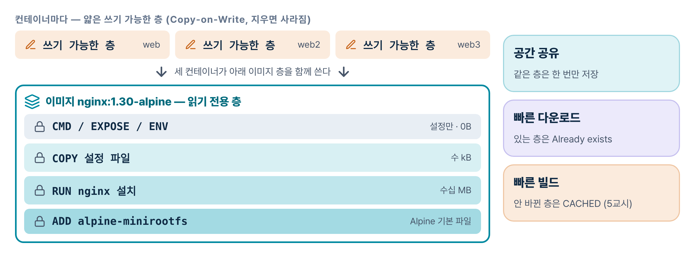

[🏠 과정 목차](../../README.md) › [2주차](../README.md) › [3일차](README.md)

# 1교시 · 이미지 레이어

> [!NOTE]
> **이번 시간에 할 일**
>
> - 어제 배운 Docker 기본 명령을 10분 동안 되짚습니다.
> - 이미지가 여러 층(레이어)으로 쌓여 있다는 것을 확인합니다.
> - 레이어가 왜 저장 공간과 다운로드 시간을 아껴 주는지 이해합니다.
> - 컨테이너의 "쓰기 가능한 층"과 복사 후 쓰기(Copy-on-Write)를 압니다.

## 어제 요약 — 손으로 확인하기

다음 명령을 **보지 않고** 쳐 보세요. 막히면 어제 7교시의 정리 표를 봅니다.

```bash
docker run -d --name warmup -p 8080:80 nginx:1.30-alpine
docker ps
curl -s http://localhost:8080 | grep title
docker logs --tail 2 warmup
docker rm -f warmup
```

| 어제 배운 것 | 한 문장 |
|---|---|
| 이미지 · 컨테이너 | 읽기 전용 틀과 그 틀로 만든 실행 단위 |
| 안에 들어가기 | 안에서는 내가 PID 1, 커널은 바깥과 공유 |
| 포트 | `-p 바깥:안`, `127.0.0.1`은 내 컴퓨터만 |
| 관찰 | logs · exec · inspect · stats, exec로 고친 건 임시 |
| 생명주기 | stop은 0, kill은 137, 정리는 좁은 범위부터 |

## 이미지는 여러 층이다

어제 `docker pull`에서 `Pull complete`가 여러 줄 나온 것을 기억하나요? 이미지는 **투명한 필름을 여러 장 겹친 것**과 같습니다. 각 필름(레이어)에는 "이전 층에서 무엇이 바뀌었나"만 담겨 있고, 위에서 내려다보면 하나의 완성된 파일 시스템으로 보입니다.



## 실습 1 · 레이어 들여다보기

> **🧪 실습: 실습 목표**
>
> nginx 이미지가 어떤 층으로 이루어져 있는지 `docker image history`로 확인합니다.

### 단계 1 — 이미지의 역사

```bash
docker image history nginx:1.30-alpine
```

> **🟢 확인: 이렇게 나오면 성공**
>
> ```text
> IMAGE          CREATED       CREATED BY                                      SIZE
> a1b2c3d4e5f6   3 weeks ago   CMD ["nginx" "-g" "daemon off;"]                0B
> <missing>      3 weeks ago   STOPSIGNAL SIGQUIT                              0B
> <missing>      3 weeks ago   EXPOSE map[80/tcp:{}]                           0B
> <missing>      3 weeks ago   ENTRYPOINT ["/docker-entrypoint.sh"]            0B
> <missing>      3 weeks ago   COPY 30-tune-worker-processes.sh /docker-ent…   16.4kB
> ...
> <missing>      3 weeks ago   RUN /bin/sh -c set -x && addgroup -g 101 -S …   …MB
> <missing>      3 weeks ago   ENV NGINX_VERSION=1.30.6                        0B
> ...
> <missing>      5 weeks ago   ADD alpine-minirootfs-3.24.4-x86_64.tar.gz /…   …MB
> ```
> **아래에서 위로** 읽습니다. 맨 아래는 Alpine Linux의 기본 파일(`ADD alpine-minirootfs…`), 그 위에 nginx 설치(`RUN …`), 맨 위에 실행 명령(`CMD`)이 쌓여 있습니다. 어제 1교시에서 본 `STOPSIGNAL SIGQUIT`도 보입니다. 각 줄이 **Dockerfile의 명령 한 줄**에 해당합니다. 2교시에 우리가 쓸 Dockerfile도 이렇게 쌓입니다.

### 단계 2 — 크기가 0B인 층

`CMD`, `EXPOSE`, `ENV` 줄은 크기가 **0B**입니다. 파일을 바꾸지 않고 **설정(메타데이터)**만 기록하기 때문입니다. 파일을 추가·변경하는 `RUN`, `COPY`, `ADD`만 크기를 가집니다.

| Dockerfile 명령 | 층에 담기는 것 | 크기 |
|---|---|---|
| `FROM` | 베이스 이미지의 층들을 그대로 가져온다 | 베이스 크기 |
| `RUN`, `COPY`, `ADD` | **파일 변경분** | 있음 |
| `CMD`, `ENV`, `EXPOSE`, `USER`, `WORKDIR` | 설정 정보 | 0B (WORKDIR은 폴더 하나) |

## 레이어가 주는 세 가지 이익

| 이익 | 설명 | 예 |
|---|---|---|
| **저장 공간 공유** | 같은 층은 한 번만 저장 | `nginx:1.30-alpine`과 `alpine:3.24`가 Alpine 층을 공유 |
| **빠른 다운로드** | 이미 있는 층은 다시 받지 않음 | pull할 때 `Already exists` |
| **빠른 빌드** | 바뀌지 않은 층은 다시 만들지 않음 | 5교시의 **빌드 캐시** |

> **🧩 비유 — 겹쳐 그린 투명 필름**
>
> 수업 시간에 투명 필름을 여러 장 겹쳐 그림을 완성하는 것을 떠올려 보세요. 첫 장에는 배경(Alpine), 둘째 장에는 건물(nginx), 셋째 장에는 간판(설정 파일)을 그립니다. 간판만 바꾸고 싶으면 **셋째 장만** 새로 그리면 됩니다. 그리고 다른 그림에서도 같은 배경 필름을 **빌려 쓸** 수 있습니다.

## 컨테이너의 쓰기 가능한 층

이미지 층은 모두 **읽기 전용**입니다. 그런데 어제 컨테이너 안에서 `index.html`을 바꿀 수 있었지요. 어떻게 된 걸까요?

컨테이너를 만들 때 Docker는 이미지 층들 맨 위에 **얇은 쓰기 가능한 층**을 하나 올립니다. 컨테이너 안에서 파일을 바꾸면, 원본(아래 층)은 그대로 두고 **바뀐 파일을 위층에 복사해서** 고칩니다. 이것을 **복사 후 쓰기(Copy-on-Write, CoW)**라고 합니다.

- 컨테이너 세 개가 같은 이미지를 써도 이미지 층은 **한 벌만** 있으면 됩니다. 각자 얇은 위층만 따로 가집니다.
- 컨테이너를 지우면 **위층만** 사라집니다. 그래서 어제 "지우면 변경도 사라진다"였던 것입니다.
- 이 층은 **데이터 보관용이 아닙니다.** DB 데이터처럼 남겨야 할 것은 내일 **볼륨**에 둡니다.

> **🎓 학술 노트 — 겹쳐 보이는 파일 시스템 (Union File System)**
>
> 여러 디렉터리를 겹쳐서 하나처럼 보이게 하는 **유니온 마운트(union mount)**의 아이디어는 1990년대 벨 연구소의 Plan 9 운영체제와 BSD의 연구로 거슬러 올라갑니다. 1995년 펜드리(Pendry)와 맥쿠식(McKusick)은 USENIX 학회 논문에서 BSD의 **union 파일 시스템**을 발표했는데, CD-ROM처럼 읽기 전용인 층 위에 쓰기 가능한 층을 겹쳐 마치 쓸 수 있는 것처럼 만드는 용도였습니다. 컨테이너의 "읽기 전용 이미지 + 쓰기 가능한 층"과 정확히 같은 구조입니다.
>
> Linux에서는 이 기능이 여러 구현을 거쳐 2014년 커널 3.18에 **OverlayFS**로 정식 포함되었고, 오늘날 Docker의 기본 저장 방식(`overlay2`, 그리고 최신 Docker의 containerd 기반 `overlayfs`)이 바로 이것입니다. 30년 된 아이디어가 컨테이너 시대의 핵심 기술이 된 셈입니다. 그리고 각 층을 **내용의 지문(해시)**으로 부르는 것은 2주차 1일차 3교시의 Git과 같은 **내용 주소 지정** 방식입니다.
>
> - Pendry, J.-S., & McKusick, M. K. (1995). Union mounts in 4.4BSD-Lite. *USENIX 1995 Technical Conference*.
> - Linux Kernel Documentation. *Overlay Filesystem*. kernel.org/doc/html/latest/filesystems/overlayfs.html

> **📈 트렌드 — 레이어를 필요할 때만 받기**
>
> 이미지가 커질수록(특히 AI 모델이 든 수 GB짜리 이미지) **다 받을 때까지 기다리는 시간**이 문제가 됩니다. 연구에 따르면 컨테이너가 시작할 때 실제로 읽는 데이터는 이미지 전체의 일부에 불과합니다(Harter 외, FAST 2016 — 시작 시간의 대부분이 이미지 다운로드이고, 그중 읽는 데이터는 소량). 그래서 **필요한 파일만 그때그때 받으며 먼저 실행을 시작하는**(lazy pulling) 기술이 발전해 왔습니다. AWS의 SOCI, containerd의 stargz 스냅샷터 같은 것들입니다. Docker도 containerd 기반 이미지 저장소로 옮겨 가면서 이런 기능을 쓸 수 있는 바탕이 마련되었습니다. 2주차 1일차의 `docker images` 표가 예전과 다르게 생긴 것도 이 변화 때문입니다.

## 정리

- 이미지는 **읽기 전용 층(레이어)**이 쌓인 것이며, `docker image history`로 아래에서 위로 읽습니다.
- `RUN`·`COPY`·`ADD`는 파일 변경을 담아 크기가 있고, `CMD`·`ENV`·`EXPOSE`는 설정만 담아 0B입니다.
- 같은 층은 **공유**되어 공간·다운로드·빌드 시간을 아낍니다.
- 컨테이너는 맨 위에 **쓰기 가능한 얇은 층**을 가지며(Copy-on-Write), 지우면 그 층만 사라집니다.

> **✅ 확인 문제**
>
> 1. `docker image history`는 어느 방향으로 읽나요?
> 2. `CMD`와 `EXPOSE` 층의 크기가 0B인 이유는?
> 3. pull할 때 `Already exists`가 나오는 층은 무엇을 뜻하나요?
> 4. 같은 이미지로 컨테이너 세 개를 만들면 이미지 층은 몇 벌 필요한가요?
> 5. 컨테이너 안에서 파일을 바꿀 때 원본은 그대로 두고 위층에 복사해 고치는 방식의 이름은?
>
> <details><summary>정답</summary>
>
> 1. 아래에서 위로 (맨 아래가 베이스, 맨 위가 마지막 명령)
> 2. 파일을 바꾸지 않고 설정(메타데이터)만 기록하기 때문
> 3. 이미 내 컴퓨터에 있는 층이라 다시 받지 않는다
> 4. 한 벌 (각 컨테이너는 얇은 쓰기 가능한 층만 따로)
> 5. 복사 후 쓰기 (Copy-on-Write)
>
> </details>

## 참고 문헌

- Docker Docs. *Understanding the image layers*, *Storage drivers*. docs.docker.com
- Pendry, J.-S., & McKusick, M. K. (1995). Union mounts in 4.4BSD-Lite. *USENIX 1995*.
- Harter, T. et al. (2016). Slacker: Fast distribution with lazy Docker containers. *USENIX FAST '16*.
- OCI. *Image Format Specification — Layer*. github.com/opencontainers/image-spec

---

⬅️ 이전: [2주차 3일차 목차](README.md) &nbsp;|&nbsp; [⬆️ 3일차 목차](README.md) &nbsp;|&nbsp; 다음: [2교시 · DevMart API와 Dockerfile 문법](lesson-02.md) ➡️
