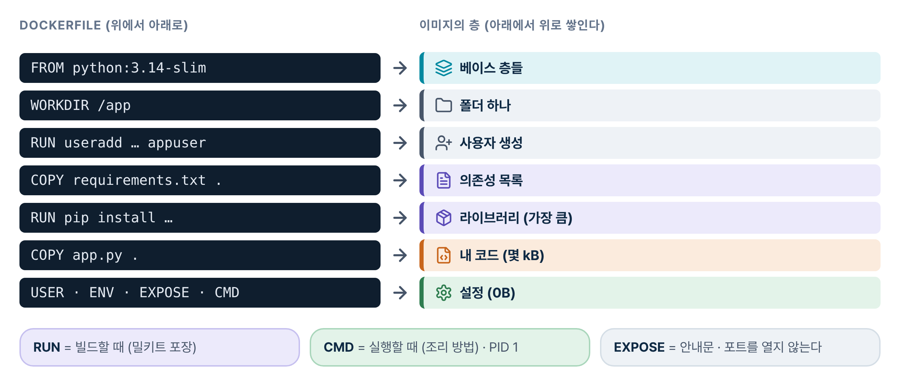

<sub>[🏠 과정 목차](../../README.md) › [2주차](../README.md) › [3일차](README.md) › 2/7교시</sub>

# 2교시 · DevMart API와 Dockerfile 문법

> [!NOTE]
> **이번 시간에 할 일**
>
> - DevMart 상품 API의 코드와 동작을 이해합니다.
> - 실습 폴더에 API 코드와 의존성 목록을 만듭니다.
> - Dockerfile을 한 줄씩 직접 작성하며 각 명령의 뜻을 익힙니다.
> - `CMD`와 `EXPOSE`에 대한 흔한 오해를 바로잡습니다.

## DevMart 상품 API — 오늘의 주인공

1주차 4일차 1교시 그림의 "이름·설명 → 상품 카탈로그"를 맡는 작은 백엔드입니다. Python 웹 프레임워크 **Flask**로 만들었고, 주소 세 개를 제공합니다.

| 주소 | 하는 일 | 쓰이는 곳 |
|---|---|---|
| `GET /health` | `{"status":"ok"}` — 살아 있다는 신호 | 1주차 3일차 7교시의 **헬스 체크**, 3주차 probe |
| `GET /api/info` | 서비스 이름, 버전, 환경, **컨테이너 호스트 이름** | 어느 컨테이너가 응답했는지 확인 |
| `GET /api/products` | 상품 목록 (JSON) | 5일차 웹 화면 |

> [!IMPORTANT]
> **오늘은 코드보다 '포장'에 집중**
>
> 이 과정은 개발 과정이 아닙니다. 코드를 한 줄 한 줄 이해할 필요는 없고, 다음 세 가지만 기억하면 됩니다.
>
> 1. **환경 변수 `DB_HOST`가 없으면** 코드 안의 샘플 상품 3개를 돌려준다. (오늘)
> 2. **`DB_HOST`가 있으면** PostgreSQL에서 상품을 읽는다. (내일)
> 3. 버전과 환경은 **`APP_VERSION`, `APP_ENV` 환경 변수**로 바꿀 수 있다. (1주차 4일차 12-Factor의 "설정은 환경 변수에")

## 실습 2 · API 코드 준비

> **🧪 실습: 실습 목표**
>
> `~/devops-lab/devmart/catalog-api` 폴더에 API 코드(`app.py`)와 의존성 목록(`requirements.txt`)을 만듭니다.

### 단계 1 — 폴더 만들기

```bash
mkdir -p ~/devops-lab/devmart/catalog-api
cd ~/devops-lab/devmart/catalog-api
code .
```

### 단계 2 — `app.py`

VS Code에서 새 파일 `app.py`를 만들고 아래를 붙여 넣어 저장합니다. (강의 저장소의 `labs/week2/devmart/catalog-api/app.py`와 같은 내용입니다.)

```python
"""DevMart 상품 API — 2주차 실습용.

- DB_HOST 환경 변수가 없으면 코드 안의 샘플 상품을 돌려준다.
- DB_HOST가 있으면 PostgreSQL의 products 테이블에서 읽는다.
"""
import os
import socket

from flask import Flask, jsonify

app = Flask(__name__)
app.json.ensure_ascii = False  # 한글을 그대로 보여 준다

APP_VERSION = os.getenv("APP_VERSION", "1.0.0")
APP_ENV = os.getenv("APP_ENV", "local")

SAMPLE_PRODUCTS = [
    {"id": 1, "name": "러닝화", "price": 59000},
    {"id": 2, "name": "후드 집업", "price": 45000},
    {"id": 3, "name": "에코백", "price": 12000},
]


def db_configured() -> bool:
    return bool(os.getenv("DB_HOST"))


def load_products_from_db():
    import psycopg  # DB를 쓸 때만 불러온다

    conninfo = (
        f"host={os.environ['DB_HOST']} "
        f"port={os.getenv('DB_PORT', '5432')} "
        f"dbname={os.getenv('DB_NAME', 'devmart')} "
        f"user={os.getenv('DB_USER', 'devmart')} "
        f"password={os.getenv('DB_PASSWORD', '')}"
    )
    with psycopg.connect(conninfo, connect_timeout=3) as conn:
        rows = conn.execute("SELECT id, name, price FROM products ORDER BY id").fetchall()
    return [{"id": r[0], "name": r[1], "price": r[2]} for r in rows]


@app.get("/health")
def health():
    return jsonify(status="ok")


@app.get("/api/info")
def info():
    return jsonify(
        service="catalog-api",
        version=APP_VERSION,
        env=APP_ENV,
        hostname=socket.gethostname(),
        database="configured" if db_configured() else "not configured (sample data)",
    )


@app.get("/api/products")
def products():
    if not db_configured():
        return jsonify(source="sample", items=SAMPLE_PRODUCTS)
    try:
        return jsonify(source="database", items=load_products_from_db())
    except Exception as e:  # 실습에서 장애 원인을 읽을 수 있도록 에러 종류를 보여 준다
        app.logger.error("DB 조회 실패: %s", e)
        return jsonify(error="database unavailable", detail=type(e).__name__), 503


if __name__ == "__main__":
    app.run(host="0.0.0.0", port=8000)
```

### 단계 3 — `requirements.txt`

```text
flask==3.1.3
gunicorn==27.0.1
psycopg[binary]==3.3.9
```

| 라이브러리 | 하는 일 |
|---|---|
| `flask` | 웹 API를 만드는 프레임워크 |
| `gunicorn` | Flask 앱을 운영 환경에서 실행하는 **애플리케이션 서버** |
| `psycopg[binary]` | PostgreSQL에 연결하는 드라이버 (내일 사용) |

버전을 `==`로 **정확히 고정**한 것에 주목하세요. 어제 1교시의 `latest` 문제와 같은 이유입니다. 버전을 안 적으면 오늘 빌드한 이미지와 한 달 뒤 빌드한 이미지 안의 라이브러리가 달라집니다.

> [!TIP]
> **내 노트북에 파이썬이 없어도 됩니다**
>
> 지금 만든 코드를 실행하려면 원래는 파이썬 설치 → 가상 환경 → `pip install` → 실행을 해야 합니다. 그리고 동료와 버전이 다르면 1주차 5일차 7교시의 "다섯 가지 고통"이 시작됩니다. 오늘은 그 모든 것을 **Dockerfile에 적고**, 파이썬은 **컨테이너 안에만** 둡니다.

## Dockerfile — 이미지 만드는 레시피

**Dockerfile**은 "이 이미지를 어떻게 만드는가"를 위에서 아래로 적은 **텍스트 파일**입니다. 명령 하나가 1교시에서 본 **층 하나**가 됩니다.



## 실습 3 · Dockerfile 작성

> **🧪 실습: 실습 목표**
>
> `catalog-api` 폴더에 Dockerfile을 **한 덩어리씩** 직접 쓰면서 각 명령의 뜻을 익힙니다.

VS Code에서 새 파일 **`Dockerfile`**(확장자 없음, 대문자 D)을 만들고, 아래 덩어리를 차례로 추가합니다.

### 덩어리 1 — 어디서 시작할까

```dockerfile
# 1) 베이스 이미지: 파이썬이 이미 설치된 가벼운 Linux
FROM python:3.14-slim

# 2) 컨테이너 안에서 작업할 폴더
WORKDIR /app
```

| 명령 | 뜻 |
|---|---|
| `FROM` | 무엇을 바탕으로 시작할지. **모든 Dockerfile의 첫 명령** (주석 제외) |
| `WORKDIR` | 이후 명령이 실행될 폴더. 없으면 만들고, `cd`한 것처럼 이동한다 |

`python:3.14-slim`은 Debian Linux에 파이썬 3.14를 설치해 둔 **공식 이미지**입니다. `slim`은 꼭 필요한 것만 남긴 작은 버전입니다.

### 덩어리 2 — 실행용 사용자

```dockerfile
# 3) 관리자(root)가 아닌 실행용 사용자를 만든다 (거의 바뀌지 않으므로 앞쪽에)
RUN useradd --create-home --uid 10001 appuser
```

| 명령 | 뜻 |
|---|---|
| `RUN` | **이미지를 만드는 동안** 실행할 명령. 결과(파일 변경)가 층으로 저장된다 |

어제 2교시 학술 노트에서 "컨테이너 안에서도 root로 실행하지 않기"를 배웠습니다. 앱 전용 사용자를 미리 만들어 둡니다.

### 덩어리 3 — 의존성 설치

```dockerfile
# 4) 의존성 목록을 먼저 복사하고 설치한다 (캐시를 잘 쓰기 위한 순서)
COPY requirements.txt .
RUN pip install --no-cache-dir -r requirements.txt
```

| 명령 | 뜻 |
|---|---|
| `COPY 원본 대상` | **내 폴더**의 파일을 **이미지 안**으로 복사. `.`은 WORKDIR(`/app`) |
| `pip install --no-cache-dir` | 라이브러리 설치. 설치 파일 캐시를 남기지 않아 이미지가 작아진다 |

왜 `app.py`보다 `requirements.txt`를 먼저 복사할까요? **5교시의 비밀**입니다. 지금은 그대로 따라 씁니다.

### 덩어리 4 — 앱 코드

```dockerfile
# 5) 앱 코드를 복사한다 (가장 자주 바뀌므로 마지막에)
COPY app.py .
```

### 덩어리 5 — 실행 설정

```dockerfile
# 6) 실행할 사용자, 기본 설정, 문서용 포트 표시
USER appuser
ENV APP_VERSION=1.0.0
EXPOSE 8000

# 7) 컨테이너가 시작될 때 실행할 명령
CMD ["gunicorn", "--bind", "0.0.0.0:8000", "--access-logfile", "-", "app:app"]
```

| 명령 | 뜻 |
|---|---|
| `USER` | 이후 명령과 **컨테이너 실행**을 이 사용자로 한다 |
| `ENV` | 기본 환경 변수. 실행할 때 `-e`로 덮어쓸 수 있다 (3교시) |
| `EXPOSE` | "이 이미지는 8000번을 쓴다"는 **문서 표시** |
| `CMD` | **컨테이너가 시작될 때** 실행할 명령 (PID 1이 된다) |

`CMD`의 뜻을 하나씩 보면 이렇습니다.

| 조각 | 뜻 |
|---|---|
| `gunicorn` | 애플리케이션 서버를 실행 |
| `--bind 0.0.0.0:8000` | **모든 주소**의 8000번에서 기다린다 — 어제 7교시 실패 4의 교훈! |
| `--access-logfile -` | 접속 기록을 `-`(**표준 출력**)으로 — 어제 5교시, 12-Factor의 로그 원칙 |
| `app:app` | `app.py` 파일 안의 `app` 객체를 실행 |

> **❓ 오해 — EXPOSE를 쓰면 포트가 열린다**
>
> `EXPOSE 8000`은 **아무 포트도 열지 않습니다.** "이 이미지는 8000을 쓴다"는 **안내문**일 뿐입니다. 바깥에서 접속하려면 여전히 실행할 때 `-p 8000:8000`이 필요합니다. 어제 3교시의 `PORTS 80/tcp`(화살표 없음)가 바로 nginx 이미지의 `EXPOSE 80`이 보여 준 안내문이었습니다.

> **❓ 오해 — RUN과 CMD는 비슷하다**
>
> | | `RUN` | `CMD` |
> |---|---|---|
> | 언제 | **이미지를 만들 때** (`docker build`) | **컨테이너를 시작할 때** (`docker run`) |
> | 몇 번 | 여러 번 쓸 수 있고 모두 실행 | 마지막 하나만 유효 |
> | 결과 | 층으로 저장 | 실행할 명령으로 기록 (0B) |
> | 비유 | 밀키트를 **포장할 때** 재료 손질 | 밀키트를 **열었을 때** 조리 방법 |

### 단계 — 완성본 확인

```bash
cat Dockerfile
ls
```

> **🟢 확인: 이렇게 나오면 성공**
>
> ```text
> Dockerfile  app.py  requirements.txt
> ```
> Dockerfile에 `FROM`부터 `CMD`까지 일곱 번호 주석이 차례대로 있으면 됩니다.

> **🎓 학술 노트 — 실행할 수 있는 문서**
>
> 1주차 5일차 6교시에서 README와 런북을 배웠습니다. 그런데 문서는 시간이 지나면 **현실과 어긋납니다.** 누군가 서버에 라이브러리를 하나 더 설치하고 문서를 안 고치면, 문서는 거짓말이 됩니다. 키프 모리스(Kief Morris)는 『Infrastructure as Code』에서 이 문제의 해결책으로 **환경을 만드는 과정 자체를 코드로 정의**하라고 제안합니다. 코드는 실행되므로 현실과 어긋날 수 없습니다.
>
> Dockerfile이 바로 그런 **실행할 수 있는 문서**입니다. "파이썬 3.14 slim 위에, 이 라이브러리를, 이 버전으로 설치하고, 이 사용자로, 이 명령을 실행한다." 사람이 읽을 수 있고, 기계가 그대로 실행하며, Git으로 변경 이력이 남습니다. 1주차 4일차의 "애플리케이션 = 코드 + 실행 조건"에서 **실행 조건이 코드가 된** 순간입니다. 5주차 Terraform은 같은 생각을 서버와 네트워크 전체로 넓힙니다.
>
> - Morris, K. (2020). *Infrastructure as Code* (2nd ed.). O'Reilly.
> - Humble, J., & Farley, D. (2010). *Continuous Delivery*, Ch. 11 Managing Infrastructure and Environments.

> **📈 트렌드 — Dockerfile도 검사받는다**
>
> Dockerfile에도 흔한 실수가 있습니다. 버전 없는 `FROM`, root로 실행, 쓸데없이 큰 베이스 이미지 같은 것들입니다. 최근 Docker는 빌드할 때 이런 문제를 경고해 주는 **빌드 검사(build checks)** 기능을 넣었고, `docker build --check .`로 빌드하지 않고 검사만 할 수도 있습니다. 또 `docker init` 명령은 프로젝트를 보고 **모범 사례에 맞는 Dockerfile 초안**을 만들어 주고, AI 코딩 도구도 Dockerfile을 잘 써 줍니다. 하지만 오늘처럼 **한 줄씩 의미를 알고 쓴** 경험이 있어야, 도구가 만든 초안의 실수를 알아볼 수 있습니다.

## 정리

- DevMart 상품 API는 `/health`, `/api/info`, `/api/products` 세 주소를 제공하고, 설정은 **환경 변수**로 바꿉니다.
- 의존성 버전은 `==`로 **정확히 고정**합니다.
- `FROM` → `WORKDIR` → `RUN` → `COPY` → `USER`·`ENV`·`EXPOSE` → `CMD` 순서로 썼습니다.
- `RUN`은 **빌드할 때**, `CMD`는 **실행할 때**. `EXPOSE`는 **안내문**일 뿐 포트를 열지 않습니다.
- Dockerfile은 **실행할 수 있는 문서**입니다.

> **✅ 확인 문제**
>
> 1. DB_HOST 환경 변수가 없을 때 `/api/products`는 무엇을 돌려주나요?
> 2. Dockerfile의 첫 명령은 보통 무엇인가요?
> 3. `COPY requirements.txt .`에서 `.`은 이미지 안의 어디인가요?
> 4. `EXPOSE 8000`만 쓰고 `-p` 없이 실행하면 바깥에서 접속할 수 있나요?
> 5. gunicorn을 `--bind 0.0.0.0:8000`으로 실행하는 이유는?
>
> <details><summary>정답</summary>
>
> 1. 코드 안의 샘플 상품 3개 (source: sample)
> 2. `FROM`
> 3. `WORKDIR`로 정한 `/app`
> 4. 없다. EXPOSE는 안내문일 뿐이고 `-p`로 연결해야 한다
> 5. 컨테이너 안 앱이 127.0.0.1에서만 기다리면 바깥에서 들어온 요청을 받을 수 없기 때문 (어제 7교시 실패 4)
>
> </details>

## 참고 문헌

- Docker Docs. *Dockerfile reference*. docs.docker.com/reference/dockerfile
- Docker Docs. *Build checks*, *docker init*. docs.docker.com
- Docker Hub. *python Docker Official Image*. hub.docker.com/_/python
- Morris, K. (2020). *Infrastructure as Code* (2nd ed.). O'Reilly.
- Flask Docs. *Deploying to Production — Gunicorn*. flask.palletsprojects.com

---

| 이전 | 목차 | 다음 |
|:--|:--:|--:|
| ⬅️ [1교시 · 이미지 레이어](lesson-01.md) | [⬆️ 3일차 목차](README.md) | [3교시 · 첫 빌드와 실행](lesson-03.md) ➡️ |
