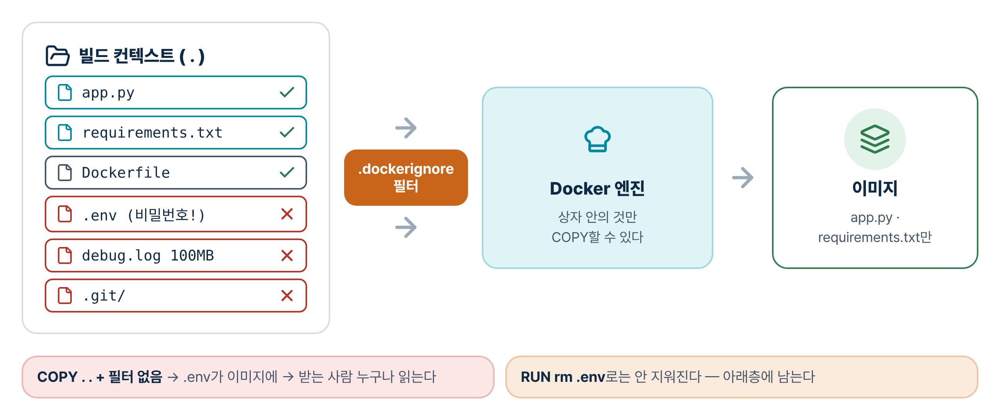

<sub>[🏠 과정 목차](../../README.md) › [2주차](../README.md) › [3일차](README.md) › 4/7교시</sub>

# 4교시 · 빌드 컨텍스트와 .dockerignore

> [!NOTE]
> **이번 시간에 할 일**
>
> - `docker build`의 마지막 `.`(빌드 컨텍스트)이 무엇을 뜻하는지 이해합니다.
> - `COPY . .` 한 줄 때문에 **비밀값이 이미지에 들어가는 사고**를 직접 재현합니다.
> - `.dockerignore`로 사고를 막고, 빌드 속도도 빠르게 합니다.
> - 이미지에 비밀값을 넣으면 안 되는 이유를 연구 결과로 확인합니다.

## 빌드 컨텍스트 — 택배로 보내는 재료 상자

`docker build -t 이름 .`을 실행하면, Docker CLI는 **`.` 폴더 안의 파일 전체를 묶어서** 엔진(주방)에 보냅니다. 이 묶음을 **빌드 컨텍스트**라고 합니다. Dockerfile의 `COPY`는 이 상자 **안에 있는 것만** 꺼낼 수 있습니다.



> **🧩 비유 — 이삿짐 상자**
>
> 이삿짐 센터(엔진)에 "이 방에 있는 거 다 가져가 주세요(`.`)"라고 하면, 필요한 가구뿐 아니라 **쓰레기통, 일기장, 통장**까지 상자에 담깁니다. 그리고 새 집(이미지)에 "방에 있던 거 그대로 놓아 주세요(`COPY . .`)"라고 하면, 일기장과 통장도 **새 집 거실에** 놓입니다. `.dockerignore`는 "이건 상자에 넣지 마세요"라고 붙여 두는 **스티커**입니다.

## 실습 7 · 비밀값이 새어 나가는 이미지 만들기

> **🧪 실습: 실습 목표**
>
> 흔히 쓰는 `COPY . .` 패턴 때문에 `.env` 파일의 비밀번호와 쓸데없이 큰 파일이 이미지에 들어가는 것을 직접 확인합니다. **실습용 가짜 비밀번호**만 씁니다.

### 단계 1 — 위험한 재료 만들기

```bash
cd ~/devops-lab/devmart/catalog-api
echo "DB_PASSWORD=super-secret-123" > .env
dd if=/dev/zero of=debug.log bs=1M count=100
ls -la
```

- `.env` : 1주차 5일차에 배운 "비밀값을 담는 파일" (실습용 가짜 값)
- `dd … count=100` : 100MB짜리 빈 파일을 만든다 (실수로 남은 로그 파일 역할)

> **🟢 확인: 이렇게 나오면 성공**
>
> ```text
> -rw-r--r-- 1 devops devops        29 … .env
> -rw-r--r-- 1 devops devops      … Dockerfile
> -rw-r--r-- 1 devops devops      … app.py
> -rw-r--r-- 1 devops devops 104857600 … debug.log
> -rw-r--r-- 1 devops devops        55 … requirements.txt
> ```

### 단계 2 — "다 복사하는" Dockerfile

인터넷 예제에 아주 흔한 형태입니다. VS Code에서 `Dockerfile.copyall` 파일을 만듭니다.

```dockerfile
FROM python:3.14-slim
WORKDIR /app
COPY . .
RUN pip install --no-cache-dir -r requirements.txt
CMD ["gunicorn", "--bind", "0.0.0.0:8000", "app:app"]
```

### 단계 3 — 빌드

```bash
docker build -f Dockerfile.copyall -t devmart/catalog-api:leaky .
```

- `-f 파일` : 기본 `Dockerfile` 대신 다른 이름의 파일을 쓴다

> **🟢 확인: 보이는 것**
>
> ```text
>  => [internal] load build context                                          1.2s
>  => => transferring context: 104.88MB                                      1.1s
> ```
> **104.88MB**를 엔진으로 보냈습니다. 코드는 몇 kB인데 쓰레기 파일 때문에 상자가 커졌습니다.

### 단계 4 — 이미지 안을 들여다보기

```bash
docker run --rm devmart/catalog-api:leaky ls -la
docker run --rm devmart/catalog-api:leaky cat .env
```

> **🟢 확인: 보이는 것 — 사고!**
>
> ```text
> -rw-r--r-- 1 root root        29 … .env
> -rw-r--r-- 1 root root      … Dockerfile
> -rw-r--r-- 1 root root      … Dockerfile.copyall
> -rw-r--r-- 1 root root      … app.py
> -rw-r--r-- 1 root root 104857600 … debug.log
> ...
> DB_PASSWORD=super-secret-123
> ```
> **비밀번호가 이미지 안에 그대로 있습니다.** 이 이미지를 6교시처럼 Docker Hub에 공개로 올리면, 이미지를 받는 **전 세계 누구나** 이 명령 한 줄로 비밀번호를 읽을 수 있습니다. 100MB 로그 파일까지 들어가 이미지도 쓸데없이 커졌습니다.

> [!WARNING]
> **지워도 남는다**
>
> "그럼 Dockerfile 끝에 `RUN rm .env`를 넣으면 되지 않나요?" — **안 됩니다.** 1교시에서 배웠듯이 이미지는 층이 쌓인 것이라, 위층에서 지워도 **아래층(COPY한 층)에는 그대로 남아 있습니다.** 층을 꺼내 보면 누구나 읽을 수 있습니다. 비밀값은 **처음부터 상자에 넣지 않는 것**만이 답입니다.

## 실습 8 · `.dockerignore`로 막기

> **🧪 실습: 실습 목표**
>
> `.dockerignore`를 만들어 비밀값과 쓰레기 파일을 빌드 컨텍스트에서 빼고, 같은 빌드를 다시 해서 차이를 확인합니다.

### 단계 1 — `.dockerignore` 만들기

`catalog-api` 폴더에 **`.dockerignore`** 파일을 만듭니다(점으로 시작).

```text
# 이미지에 넣지 않을 것들
.git
.env
__pycache__/
*.pyc
.venv/
venv/
*.log
Dockerfile*
.dockerignore
```

문법은 `.gitignore`와 거의 같습니다. `*`는 "아무 글자나"라는 뜻입니다.

### 단계 2 — 같은 Dockerfile로 다시 빌드

```bash
docker build -f Dockerfile.copyall -t devmart/catalog-api:leaky .
docker run --rm devmart/catalog-api:leaky ls -la
docker run --rm devmart/catalog-api:leaky cat .env
```

> **🟢 확인: 이렇게 나오면 성공**
>
> ```text
>  => => transferring context: 63B
> ...
> -rw-r--r-- 1 root root  … app.py
> -rw-r--r-- 1 root root  … requirements.txt
> cat: .env: No such file or directory
> ```
> 상자가 **104MB → 수십 바이트~몇 kB**로 줄었고, 이미지 안에는 `app.py`와 `requirements.txt`만 들어갔습니다. 비밀번호 파일은 **상자에 담기지도 않았습니다.**

### 단계 3 — 정리

```bash
docker image rm devmart/catalog-api:leaky
rm Dockerfile.copyall debug.log .env
ls -la
```

`.dockerignore`는 남겨 둡니다. 우리 원래 Dockerfile은 `COPY app.py .`처럼 **필요한 파일만 이름을 지정해** 복사하므로 이미 안전하지만, `.dockerignore`를 두 겹째 안전장치로 함께 씁니다.

| | `.gitignore` | `.dockerignore` |
|---|---|---|
| 무엇을 막나 | **Git 저장소**(GitHub)에 올라가는 것 | **이미지**에 들어가는 것 |
| 위치 | 저장소 최상위 (또는 하위 폴더) | `docker build`의 컨텍스트 폴더 |
| `.env` | 넣어야 한다 | 넣어야 한다 |
| 결론 | **둘 다 필요하다.** 하나만 있으면 다른 쪽으로 샌다 | |

```bash
cd ~/devops-lab
git add devmart/catalog-api/.dockerignore
git status
git commit -m "3일차: catalog-api에 .dockerignore 추가"
git push
```

`git status`에 `.env`가 보이지 않는 것도 확인하세요. 2주차 1일차 5교시의 `.gitignore`가 막아 주고 있습니다.

> [!IMPORTANT]
> **비밀값은 이미지에 넣지 않는다 — 실행할 때 넣는다**
>
> | 하지 말 것 | 이유 |
> |---|---|
> | `.env`를 `COPY` | 이미지를 받는 누구나 읽는다 |
> | Dockerfile에 `ENV DB_PASSWORD=…` | `docker image history`와 `docker inspect`로 그대로 보인다 |
> | `RUN rm`으로 나중에 지우기 | 아래층에 남는다 |
>
> 비밀값은 3교시처럼 **컨테이너를 실행할 때** `-e`나 파일로 넣습니다. 내일 4일차에 DB 비밀번호를 이 방법으로 다루고, 3주차 Kubernetes에서는 **Secret**, 5주차 AWS에서는 **Secrets Manager**가 같은 역할을 합니다.

> **🎓 학술 노트 — 이미지 12개 중 1개에 비밀값 (Dahlmanns et al., 2023)**
>
> 독일 RWTH 아헨 공과대학의 연구진은 ACM AsiaCCS 2023 학회 논문 「컨테이너 이미지에 드러난 비밀: 인터넷 규모의 발생과 영향 연구」에서, Docker Hub와 인터넷에 공개된 8,076개의 사설 레지스트리에서 모은 **337,171개 이미지**를 분석했습니다. 그 결과 **8.5%**의 이미지에 비밀값이 들어 있었습니다. 유효한 **개인 키 52,107개**와 **API 비밀값 3,158개**가 발견되었고, 그중 일부는 실제 운영 중인 서버의 인증서와 같은 키였습니다. Docker Hub(9.0%)가 사설 레지스트리(6.3%)보다 비율이 높았습니다.
>
> 연구진이 꼽은 주된 원인이 바로 오늘의 실습 7이었습니다. **빌드 컨텍스트의 파일을 통째로 복사**하면서 의도하지 않은 비밀 파일이 함께 들어간 것입니다. 이 논문은 "개발자가 이미지에 무엇이 들어가는지 정확히 모르는 채 공개한다"는 것을 숫자로 보여 주었습니다. 그래서 1주차 5일차 2교시 파이프라인의 **④ 보안 검사** 단계에서 비밀값 탐지 도구를 돌리는 것이 표준이 되었습니다.
>
> - Dahlmanns, M., Sander, C., Decker, R., & Wehrle, K. (2023). Secrets revealed in container images: An internet-wide study on occurrence and impact. *ACM ASIA CCS '23*.

> **📈 트렌드 — 빌드 중에만 잠깐 쓰는 비밀값**
>
> 가끔은 **빌드하는 도중에** 비밀값이 필요합니다. 예를 들어 회사 내부 패키지 저장소에서 라이브러리를 받으려면 토큰이 있어야 합니다. 이때 `ENV`나 `COPY`를 쓰면 층에 남으므로, 최신 Docker(BuildKit)는 **빌드 비밀값(build secrets)** 기능을 제공합니다. `RUN --mount=type=secret,id=token …`처럼 쓰면 그 명령이 실행되는 동안만 비밀값이 임시로 보이고 **층에는 저장되지 않습니다.** 3주차 GitHub Actions에서 이미지를 자동 빌드할 때 이런 방식을 만나게 됩니다.

## 정리

- 빌드 컨텍스트 = `docker build`의 마지막 `.` 폴더 전체. `COPY`는 그 안에서만 꺼낸다.
- `COPY . .`는 비밀값(`.env`)과 쓰레기 파일까지 이미지에 넣는다. **이미지를 받는 누구나 읽는다.**
- `RUN rm`으로 지워도 **아래층에 남는다.** 처음부터 넣지 않아야 한다.
- `.dockerignore`는 이미지 쪽, `.gitignore`는 Git 쪽. **둘 다 필요하다.**
- 비밀값은 이미지가 아니라 **실행할 때** 넣는다.

> **✅ 확인 문제**
>
> 1. `docker build … .`에서 마지막 `.`의 이름과 뜻은?
> 2. `COPY . .`가 위험한 이유는?
> 3. Dockerfile 끝에 `RUN rm .env`를 넣으면 비밀번호가 사라지나요?
> 4. `.gitignore`가 있으면 `.dockerignore`는 없어도 되나요?
> 5. Dahlmanns 등의 연구에서 비밀값이 든 이미지의 비율은?
>
> <details><summary>정답</summary>
>
> 1. 빌드 컨텍스트 — 그 폴더 전체를 엔진으로 보내 빌드 재료로 쓴다
> 2. 폴더의 모든 파일(비밀값, 로그, Git 기록 등)이 이미지에 들어가기 때문
> 3. 아니다. 아래층(COPY한 층)에 그대로 남는다
> 4. 아니다. `.gitignore`는 Git, `.dockerignore`는 이미지를 막는다. 둘 다 필요하다
> 5. 약 8.5% (337,171개 중)
>
> </details>

## 참고 문헌

- Docker Docs. *Build context — .dockerignore files*. docs.docker.com/build/concepts/context
- Docker Docs. *Build secrets*. docs.docker.com/build/building/secrets
- Dahlmanns, M., Sander, C., Decker, R., & Wehrle, K. (2023). Secrets revealed in container images. *ACM ASIA CCS '23*. arxiv.org/abs/2307.03958
- OWASP. *Docker Security Cheat Sheet*. cheatsheetseries.owasp.org

---

| 이전 | 목차 | 다음 |
|:--|:--:|--:|
| ⬅️ [3교시 · 첫 빌드와 실행](lesson-03.md) | [⬆️ 3일차 목차](README.md) | [5교시 · 빌드 캐시와 명령 순서](lesson-05.md) ➡️ |
