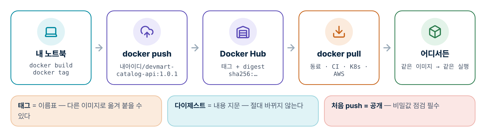

[🏠 과정 목차](../../README.md) › [2주차](../README.md) › [3일차](README.md)

# 6교시 · 태그와 Docker Hub

> [!NOTE]
> **이번 시간에 할 일**
>
> - 태그가 이미지의 "이름표"일 뿐이라는 것을 확인합니다.
> - Docker Hub 계정을 만들고 CLI로 로그인합니다.
> - 내 이미지에 태그를 붙여 Docker Hub에 push합니다.
> - 다이제스트로 이미지를 정확히 가리키는 법을 배우고, 동료의 이미지를 받아 실행해 봅니다.

## 지금까지의 이미지는 내 노트북에만 있다

3~5교시에 만든 `devmart/catalog-api:1.0.1`은 **내 노트북 안에만** 있습니다. 동료, CI 서버, Kubernetes, AWS가 이 이미지를 쓰려면 모두가 접근할 수 있는 **창고(레지스트리)**에 올려야 합니다. 1주차 5일차 2교시 파이프라인의 **⑤ 이미지 저장** 단계입니다.



## 태그는 이름표일 뿐

```bash
docker tag devmart/catalog-api:1.0.1 devmart/catalog-api:latest
docker images devmart/catalog-api
```

> **🟢 확인: 이렇게 나오면 성공**
>
> ```text
> IMAGE                        ID             DISK USAGE   CONTENT SIZE   EXTRA
> devmart/catalog-api:1.0.0    b5965886b8ee        …MB          …MB
> devmart/catalog-api:1.0.1    7d2e41c0a9f3        …MB          …MB
> devmart/catalog-api:latest   7d2e41c0a9f3        …MB          …MB
> ```
> `1.0.1`과 `latest`의 **ID가 같습니다.** `docker tag`는 이미지를 복사하지 않고 **같은 이미지에 이름표를 하나 더** 붙인 것입니다. 이름표는 언제든 다른 이미지로 옮겨 붙일 수 있습니다. 그래서 2일차 1교시에서 "`latest`는 받는 시점에 따라 다르다"고 한 것입니다.

```bash
docker image rm devmart/catalog-api:latest
```

이름표만 떼어집니다(`Untagged`). 이미지는 `1.0.1` 이름표로 남아 있습니다.

## 실습 11 · Docker Hub 계정과 로그인

> **🧪 실습: 실습 목표**
>
> Docker Hub 계정을 만들고 터미널에서 로그인합니다.

### 단계 1 — 계정 만들기

[hub.docker.com](https://hub.docker.com)에서 **Sign up**. 사용자 이름(Docker ID)이 이미지 이름 앞에 붙습니다(`내아이디/이미지`). GitHub처럼 **2단계 인증**도 켭니다(2주차 1일차 4교시).

### 단계 2 — 로그인

```bash
docker login
```

> **🟢 확인: 이렇게 나오면 성공**
>
> ```text
> USING WEB-BASED LOGIN
>
> Your one-time device confirmation code is: ABCD-EFGH
> Press ENTER to open your browser or submit your device code here: https://login.docker.com/activate
>
> Waiting for authentication in the browser…
>
> Login Succeeded
> ```
> 어제 GitHub CLI와 같은 **브라우저 로그인** 방식입니다. 브라우저가 안 열리면 주소를 직접 열고 코드를 입력합니다. Docker Desktop에 이미 로그인했다면 바로 `Login Succeeded`가 나옵니다.

> [!WARNING]
> **비밀번호를 터미널에 치지 않습니다**
>
> `docker login -u 아이디 -p 비밀번호`처럼 비밀번호를 명령에 쓰면 **셸 기록(history)**에 남습니다. 자동화(3주차 CI)에서는 계정 비밀번호 대신 Docker Hub의 **개인 액세스 토큰(PAT)**을 만들어 쓰고, 그 토큰도 GitHub의 **Secrets**에 넣어 둡니다. 2주차 1일차 4교시의 "토큰은 비밀번호와 똑같이 다룬다"가 여기서도 적용됩니다.

## 실습 12 · 내 이미지를 Docker Hub에 올리기

> **🧪 실습: 실습 목표**
>
> `devmart/catalog-api:1.0.1`에 내 Docker ID가 들어간 이름표를 붙이고 push합니다. 아래 `내아이디`는 **본인의 Docker ID**로 바꿉니다.

### 단계 1 — 올릴 이름으로 태그 붙이기

```bash
docker tag devmart/catalog-api:1.0.1 내아이디/devmart-catalog-api:1.0.1
docker images | grep catalog
```

Docker Hub에 올리려면 이름이 **`Docker ID/저장소이름:태그`** 형식이어야 합니다. `devmart/…`는 내 계정 이름이 아니므로 그대로는 올릴 수 없습니다.

### 단계 2 — push

```bash
docker push 내아이디/devmart-catalog-api:1.0.1
```

> **🟢 확인: 이렇게 나오면 성공**
>
> ```text
> The push refers to repository [docker.io/내아이디/devmart-catalog-api]
> a7f3c2e1b9d0: Pushed
> 5c1e8b2a4f6d: Pushed
> 3e9a0d7c1b5f: Pushed
> 8b4f2e6a1c3d: Mounted from library/python
> ...
> 1.0.1: digest: sha256:3b8a9f1e…c42d size: 856
> ```
> - **Pushed** : 내가 만든 층(라이브러리, 코드)을 올렸다.
> - **Mounted from library/python** : 파이썬 베이스 층은 Docker Hub에 **이미 있으므로** 올리지 않고 연결만 했다. 1교시의 "층 공유"가 레지스트리에서도 일어난다.
> - 마지막 줄의 **digest**가 이 이미지의 **내용 지문**이다.

### 단계 3 — 웹에서 확인

브라우저에서 `https://hub.docker.com/r/내아이디/devmart-catalog-api`를 엽니다. **Tags** 탭에 `1.0.1`이 보이면 성공입니다.

> [!WARNING]
> **Docker Hub 저장소는 기본이 '공개'입니다**
>
> 처음 push하면 저장소가 **공개(public)**로 만들어집니다. 전 세계 누구나 받을 수 있다는 뜻입니다. 4교시에서 `.dockerignore`를 만든 이유가 여기 있습니다. 회사 코드나 비밀값이 든 이미지는 **비공개 저장소**나 회사 전용 레지스트리(5주차의 AWS ECR 등)에 올립니다. 저장소 설정에서 공개 여부를 바꿀 수 있습니다.

## 실습 13 · 다이제스트와 동료의 이미지

> **🧪 실습: 실습 목표**
>
> 태그와 다이제스트의 차이를 이해하고, 옆자리 동료가 올린 이미지를 받아 실행합니다.

### 단계 1 — 다이제스트 보기

```bash
docker image inspect --format '{{index .RepoDigests 0}}' 내아이디/devmart-catalog-api:1.0.1
```

> **🟢 확인: 이렇게 나오면 성공**
>
> ```text
> 내아이디/devmart-catalog-api@sha256:3b8a9f1e…c42d
> ```

| | 태그 (`:1.0.1`) | 다이제스트 (`@sha256:…`) |
|---|---|---|
| 정체 | 사람이 붙인 **이름표** | 내용으로 계산한 **지문** |
| 바뀔 수 있나 | 누군가 같은 태그로 다시 push하면 **다른 이미지를 가리킨다** | 내용이 같으면 항상 같고, **절대 다른 이미지를 가리키지 않는다** |
| 쓰는 곳 | 사람이 읽고 말할 때 | 운영 배포, 보안 검증 — "정확히 이 이미지" |

### 단계 2 — 동료의 이미지 실행 (짝 실습)

옆자리 동료에게 Docker ID를 물어보고, 그 사람의 이미지를 실행합니다.

```bash
docker run -d --name friend -p 8002:8000 동료아이디/devmart-catalog-api:1.0.1
curl http://localhost:8002/api/products
docker rm -f friend
```

> **🟢 확인: 이렇게 나오면 성공**
>
> `Unable to find image … locally` → `Pulling` 후, 동료가 바꾼 **에코백 가격**이 보입니다. 동료의 노트북에서 만든 이미지가 **내 노트북에서 똑같이** 실행되었습니다. 1주차 4일차 7교시의 "**어디서든 똑같이 실행**"이 완성되는 순간입니다. 짝이 없으면 내 이미지를 지웠다가(`docker image rm 내아이디/devmart-catalog-api:1.0.1`) 다시 받아 실행해 봅니다.

## 태그를 붙이는 관례

| 태그 | 뜻 | 쓰임 |
|---|---|---|
| `1.0.1` | 정확한 버전 | 운영 배포, 되돌리기 |
| `1.0` | 1.0.x 중 최신 | "작은 수정은 자동으로 따라가기" (오늘 nginx:1.30처럼) |
| `latest` | 태그를 안 적었을 때의 기본 | 개인 실험용. **운영에는 쓰지 않는다** |
| `git-3f2a1c9` | 이 이미지를 만든 **커밋 해시** | 3주차 CI — 어떤 코드로 만들었는지 추적 |

버전 번호 `주.부.수`는 **유의적 버전(Semantic Versioning)** 관례를 따릅니다. 호환되지 않게 바뀌면 **주** 버전(2.0.0), 기능이 추가되면 **부** 버전(1.1.0), 버그만 고치면 **수** 버전(1.0.1)을 올립니다. 오늘 가격 하나를 바꾼 것은 1.0.0 → **1.0.1**입니다.

> **🎓 학술 노트 — 낡은 이미지의 위험 (Zerouali et al., 2019)**
>
> 벨기에 몽스 대학교와 스페인 연구진(Zerouali, Mens, Robles, González-Barahona)은 2019년 SANER 학회 논문에서 Docker Hub의 Debian 기반 이미지 **7,380개**를 분석했습니다. 대부분의 이미지에 **최신이 아닌(outdated) 패키지**가 들어 있었고, 그 낡은 패키지들이 알려진 보안 취약점과 버그를 함께 가지고 있었습니다. 핵심은 이미지가 **한 번 만들어지면 그 순간에 멈춘다**는 것입니다. 오늘 만든 1.0.1 이미지 안의 파이썬과 Debian 패키지는, 내가 다시 빌드하지 않는 한 1년 뒤에도 오늘 버전 그대로입니다.
>
> 그래서 실무에서는 코드를 바꾸지 않아도 **정기적으로 이미지를 다시 빌드**해 베이스 이미지의 보안 패치를 받고, 7교시에 배울 **취약점 검사**로 낡은 패키지를 찾아냅니다. 2일차 3교시의 "주 버전은 고정, 패치는 따라가기"가 이미지 관리 전체로 넓어진 원칙입니다.
>
> - Zerouali, A., Mens, T., Robles, G., & González-Barahona, J. M. (2019). On the relation between outdated Docker containers, severity vulnerabilities, and bugs. *IEEE SANER 2019*.
> - Preston-Werner, T. *Semantic Versioning 2.0.0*. semver.org

> **📈 트렌드 — 레지스트리는 Docker Hub만이 아니다**
>
> Docker Hub는 가장 큰 공개 레지스트리지만, 회사들은 목적에 따라 여러 레지스트리를 씁니다. 코드와 같은 곳에 두는 **GitHub Container Registry(ghcr.io)**, 클라우드 안에서 빠르고 권한 관리가 쉬운 **AWS ECR**(5주차), 회사 내부에 직접 두는 **Harbor** 같은 것들입니다. 모두 OCI 표준(2주차 1일차 6교시)을 따르므로 `docker tag`·`push`·`pull` 사용법은 같고 **주소만** 다릅니다(`ghcr.io/아이디/이미지`). 또 Docker Hub는 로그인하지 않은 사용자의 이미지 받기 횟수를 제한하므로, CI처럼 이미지를 많이 받는 환경에서는 로그인하거나 회사 레지스트리에 **사본(미러)**을 두는 것이 보통입니다.

## 정리

- `docker tag`는 같은 이미지에 **이름표를 하나 더** 붙인다. 이름표는 옮겨 붙일 수 있다.
- Docker Hub에 올리려면 **`Docker ID/저장소:태그`** 이름이 필요하고, `docker login` → `docker push`.
- push 출력의 **Mounted from**은 이미 있는 층을 재사용한 것, **digest**는 내용 지문이다.
- 태그는 바뀔 수 있고, **다이제스트는 절대 바뀌지 않는다.**
- 버전은 **주.부.수**, 운영에는 `latest`를 쓰지 않는다. 이미지는 **정기적으로 다시 빌드**한다.

> **✅ 확인 문제**
>
> 1. `docker tag` 후 두 이름의 IMAGE ID가 같은 이유는?
> 2. `devmart/catalog-api:1.0.1`을 그대로 Docker Hub에 push할 수 없는 이유는?
> 3. push 출력의 `Mounted from library/python`은 무엇을 뜻하나요?
> 4. "정확히 이 이미지"를 가리키려면 태그와 다이제스트 중 무엇을 쓰나요?
> 5. 가격 하나를 고친 변경은 1.0.0에서 어떤 버전이 되나요?
>
> <details><summary>정답</summary>
>
> 1. 이미지를 복사한 것이 아니라 같은 이미지에 이름표만 하나 더 붙였기 때문
> 2. 이름 앞부분이 내 Docker ID가 아니기 때문 (`내아이디/저장소:태그`여야 한다)
> 3. 파이썬 베이스 층이 Docker Hub에 이미 있어서 다시 올리지 않고 연결만 했다
> 4. 다이제스트 (`@sha256:…`)
> 5. 1.0.1 (버그·작은 수정 = 수 버전)
>
> </details>

## 참고 문헌

- Docker Docs. *docker image tag / push / login*, *Docker Hub repositories*. docs.docker.com
- Docker Docs. *Usage and pull limits*. docs.docker.com/docker-hub/usage
- OCI. *Distribution Specification*. github.com/opencontainers/distribution-spec
- Preston-Werner, T. *Semantic Versioning 2.0.0*. semver.org
- Zerouali, A. et al. (2019). On the relation between outdated Docker containers, severity vulnerabilities, and bugs. *IEEE SANER 2019*.

---

⬅️ 이전: [5교시 · 빌드 캐시와 명령 순서](lesson-05.md) &nbsp;|&nbsp; [⬆️ 3일차 목차](README.md) &nbsp;|&nbsp; 다음: [7교시 · 멀티 스테이지와 이미지 크기·보안](lesson-07.md) ➡️
