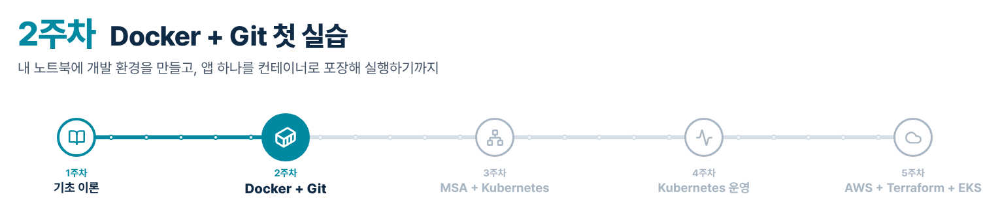

[🏠 과정 목차](../../README.md) › [2주차](../README.md) › [4일차](README.md)

# 2주차 4일차 — 볼륨 · 네트워크 · 환경 변수

📕 2주차 이북 PDF: [보기](../../downloads/pdf/week2.pdf) · [내려받기](https://github.com/niceguy61/kdt_devops_lecture_2026_rev2/raw/main/downloads/pdf/week2.pdf) &nbsp;|&nbsp; 📊 4일차 슬라이드: [PPTX 내려받기](https://github.com/niceguy61/kdt_devops_lecture_2026_rev2/raw/main/downloads/pptx/week2-day4.pptx)

## 오늘의 목표

어제 만든 상품 API는 혼자서 샘플 데이터 3개만 돌려주었습니다. 오늘은 API가 **진짜 데이터베이스(PostgreSQL)**와 대화하게 만듭니다. 그러려면 세 가지 문제를 풀어야 합니다.

1. **데이터는 어디에 두나?** — 컨테이너를 지우면 안의 데이터도 사라집니다. → **볼륨**
2. **서로를 어떻게 찾나?** — API 컨테이너는 DB 컨테이너의 주소를 모릅니다. → **네트워크와 이름 찾기(DNS)**
3. **비밀번호는 어떻게 건네나?** — 이미지에 넣으면 안 된다고 어제 배웠습니다. → **환경 변수와 비밀값**

하루가 끝나면 **웹(nginx) → API(catalog-api) → DB(PostgreSQL)** 세 컨테이너를 손으로 연결해, 브라우저에서 DB의 상품 5개를 봅니다. 그리고 그 명령이 얼마나 긴지 느끼면서 내일의 **Docker Compose**를 기다리게 됩니다.

- 볼륨 없이 DB를 지우면 데이터가 사라지는 것을 직접 봅니다.
- 이름 있는 볼륨으로 DB 데이터를 지키고, 백업 파일을 만듭니다.
- 바인드 마운트로 내 폴더의 웹 파일을 nginx에 바로 보여 줍니다.
- 기본 네트워크와 사용자 정의 네트워크의 차이(이름 찾기)를 확인합니다.
- API를 DB에 연결하고, 연결이 끊기는 세 가지 고장을 진단합니다.
- 비밀번호를 명령어에서 빼서 `.env` 파일로 옮깁니다.

## 시간표

| 교시 | 주제 | 실습 결과물 |
|---|---|---|
| 1교시 | 어제 요약 + 컨테이너의 데이터는 어디에 | 볼륨 없이 지우면 사라지는 것 확인 |
| 2교시 | 이름 있는 볼륨 | `devmart-db` 볼륨 + 상품 5개 + 백업 |
| 3교시 | 바인드 마운트 | 내 폴더의 `web/`을 nginx로 보여 주기 |
| 4교시 | Docker 네트워크와 이름 찾기 | `devmart-net` 네트워크 |
| 5교시 | API와 DB 연결하기 | `"source":"database"` 응답 + 고장 진단 |
| 6교시 | 환경 변수와 비밀값 | `.env` + `--env-file` |
| 7교시 | 세 컨테이너 손으로 조립하기 | 브라우저에서 DevMart 화면 |
| 8교시 | 백업과 복구 — pg_dump와 복원 훈련 | 사고 후 복원, `devmart-backup.sh` |

배움일기는 수업이 끝난 뒤 각자 씁니다(마지막 교시 끝의 질문).

## 교시별 자료

1. [컨테이너의 데이터는 어디에](lesson-01.md)
2. [이름 있는 볼륨](lesson-02.md)
3. [바인드 마운트](lesson-03.md)
4. [Docker 네트워크와 이름 찾기](lesson-04.md)
5. [API와 DB 연결하기](lesson-05.md)
6. [환경 변수와 비밀값](lesson-06.md)
7. [세 컨테이너 손으로 조립하기](lesson-07.md)
8. [백업과 복구](lesson-08.md)

> [!IMPORTANT]
> **오늘 실습 전에 확인할 것**
>
> - 어제 만든 이미지 `devmart/catalog-api:1.0.1`이 있어야 합니다. `docker images devmart/catalog-api`로 확인하세요. 없으면 어제 3교시·5교시대로 다시 빌드합니다.
> - 오늘은 PostgreSQL 이미지(풀면 수백 MB)를 처음 받습니다. 강의실 네트워크가 느리면 1교시 시작 전에 `docker pull postgres:18`을 미리 해 둡니다.
> - 실습 폴더는 `~/devops-lab/devmart/`입니다. 반드시 **WSL(Linux) 쪽 폴더**에서 합니다. `/mnt/c/...` 아래에서 하면 3교시 바인드 마운트가 느리고 파일 변경 감지가 잘 안 됩니다.

---

| 이전 | 목차 | 다음 |
|:--|:--:|--:|
| ⬅️ [8교시 · 이미지 취약점 스캔과 SBOM — Trivy](../day3/lesson-08.md) | [⬆️ 2주차 목차](../README.md) | [1교시 · 컨테이너의 데이터는 어디에](lesson-01.md) ➡️ |
