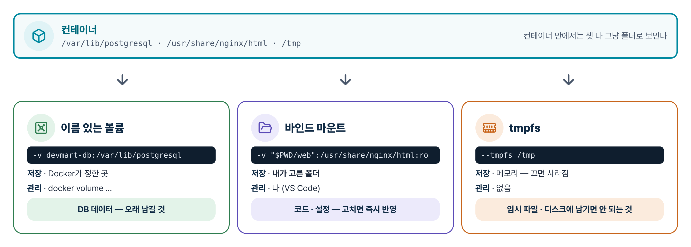

[🏠 과정 목차](../../README.md) › [2주차](../README.md) › [4일차](README.md)

# 3교시 · 바인드 마운트

> [!NOTE]
> **이번 시간에 할 일**
>
> - **바인드 마운트**로 내 폴더를 컨테이너에 그대로 보여 줍니다.
> - DevMart 웹 화면 파일 3개를 만들고 nginx로 띄웁니다.
> - 파일을 고치면 **다시 빌드하지 않아도 바로 반영**되는 것을 확인합니다.
> - `:ro`(읽기 전용)로 컨테이너가 내 파일을 망가뜨리지 못하게 합니다.
> - 이름 있는 볼륨 · 바인드 마운트 · tmpfs를 비교합니다.

## 바인드 마운트 = 내 폴더를 그대로 보여 주기

2교시의 이름 있는 볼륨은 **Docker가 관리하는 금고**였습니다. 위치는 Docker가 정하고, 우리는 이름만 압니다. **바인드 마운트(bind mount)**는 반대로 **내가 고른 폴더**를 컨테이너 안의 폴더에 그대로 연결합니다. 사실 2교시에 초기화 SQL을 넣을 때 이미 한 번 썼습니다.

```text
-v  이름          : 컨테이너 폴더     → 이름 있는 볼륨 (이름에 / 가 없다)
-v  /절대/경로     : 컨테이너 폴더     → 바인드 마운트 (경로가 / 또는 ~ 로 시작)
```

Docker는 왼쪽이 **경로처럼 생겼는지**로 둘을 구분합니다. `"$PWD/web"`, `~/devops-lab/backup`처럼 쓰면 바인드 마운트입니다.



> **🧩 비유 — 창문**
>
> 이름 있는 볼륨이 호텔 바깥의 **금고**라면, 바인드 마운트는 호텔 방에 낸 **창문**입니다. 창문 너머로 **내 집 책상**이 그대로 보입니다. 내가 책상 위 종이를 고치면 방 안에서도 즉시 바뀐 종이가 보입니다. 반대로 방 안에서 창문 너머로 손을 뻗어 종이를 찢을 수도 있으니, 필요하면 **창문을 잠가야(`:ro`)** 합니다.

## 실습 5 · DevMart 웹 화면 띄우기

> **🧪 실습: 실습 목표**
>
> DevMart 웹 화면 파일 3개(`index.html`, `style.css`, `app.js`)를 만들고, 이미지를 빌드하지 않고 nginx 공식 이미지에 **폴더째 보여 줘서** 띄웁니다.

### 단계 1 — 웹 파일 3개 만들기

```bash
cd ~/devops-lab/devmart
mkdir -p web
code web/index.html web/style.css web/app.js
```

VS Code에 탭 세 개가 열립니다. 각각 아래 내용을 붙여 넣고 저장합니다. (강의 저장소의 `labs/week2/devmart/web/`과 같습니다.)

**`web/index.html`** — 화면의 뼈대

```html
<!doctype html>
<html lang="ko">
<head>
  <meta charset="utf-8">
  <meta name="viewport" content="width=device-width, initial-scale=1">
  <title>DevMart</title>
  <link rel="stylesheet" href="style.css">
</head>
<body>
  <header>
    <h1>DevMart</h1>
    <p id="info">API 정보를 불러오는 중…</p>
  </header>
  <main>
    <p id="source" class="badge"></p>
    <ul id="products" class="grid"></ul>
  </main>
  <script src="app.js"></script>
</body>
</html>
```

**`web/style.css`** — 모양

```css
body { font-family: system-ui, sans-serif; margin: 0; background: #f1f5f9; color: #1e293b; }
header { background: #0f2a44; color: #fff; padding: 24px 32px; }
header h1 { margin: 0 0 6px; }
header p { margin: 0; color: #a5c4d8; }
main { padding: 24px 32px; }
.badge { display: inline-block; background: #e0f3f6; color: #006a7c; padding: 4px 12px; border-radius: 99px; font-weight: 700; }
.badge.error { background: #fbe7e5; color: #b83227; }
.grid { list-style: none; padding: 0; display: grid; grid-template-columns: repeat(auto-fill, minmax(180px, 1fr)); gap: 16px; }
.grid li { background: #fff; border: 1px solid #d5dee6; border-radius: 12px; padding: 18px; display: flex; flex-direction: column; gap: 8px; }
.grid li span { color: #c8651b; font-weight: 700; }
```

**`web/app.js`** — 브라우저에서 API를 불러와 상품 카드를 그린다

```javascript
// 같은 주소의 /api/... 로 요청한다. nginx가 catalog-api로 전달해 준다.
async function load() {
  const info = document.getElementById("info");
  const list = document.getElementById("products");
  const source = document.getElementById("source");
  try {
    const i = await (await fetch("/api/info")).json();
    info.textContent = `${i.service} v${i.version} · ${i.env} · 컨테이너 ${i.hostname}`;
  } catch (e) {
    info.textContent = "API에 연결할 수 없습니다 (catalog-api가 실행 중인지 확인하세요)";
  }
  try {
    const res = await fetch("/api/products");
    const data = await res.json();
    if (!res.ok) throw new Error(data.error || res.status);
    source.textContent = data.source === "database" ? "데이터베이스에서 불러옴" : "샘플 데이터";
    list.innerHTML = data.items
      .map((p) => `<li><b>${p.name}</b><span>${p.price.toLocaleString()}원</span></li>`)
      .join("");
  } catch (e) {
    source.textContent = `상품을 불러오지 못했습니다: ${e.message}`;
    source.classList.add("error");
  }
}
load();
```

코드를 이해하지 않아도 됩니다. 핵심은 한 줄입니다. 브라우저가 **같은 주소의 `/api/…`**로 요청을 보낸다는 것. 이 요청을 누가 API에 전달하는지는 7교시에 완성합니다.

### 단계 2 — nginx에 폴더째 보여 주기

```bash
docker run -d --name web -p 8080:80 \
  -v "$PWD/web":/usr/share/nginx/html:ro \
  nginx:1.30-alpine
```

- `-v "$PWD/web":/usr/share/nginx/html:ro` : 내 `web/` 폴더를 nginx가 웹 파일을 찾는 폴더에 **읽기 전용**으로 연결
- `"$PWD/web"`를 따옴표로 감싸는 이유: 폴더 경로에 빈칸이 있어도 안전하게

브라우저에서 **http://localhost:8080** 을 엽니다.

> **🟢 확인: 이렇게 보이면 성공**
>
> 짙은 남색 머리말에 **DevMart**가 보이고, 그 아래에 빨간 안내가 나옵니다.
>
> ```text
> API에 연결할 수 없습니다 (catalog-api가 실행 중인지 확인하세요)
> 상품을 불러오지 못했습니다: …
> ```
> **이것이 지금 정상입니다.** 화면(웹)은 떴지만, 화면이 부를 API가 아직 연결되지 않았습니다. 7교시에 이 빨간 글씨를 상품 카드로 바꿉니다.

### 단계 3 — 고치면 바로 반영된다

VS Code에서 `web/index.html`의 `<h1>DevMart</h1>`을 아래처럼 바꾸고 저장합니다.

```html
    <h1>DevMart 🛒 (바인드 마운트 테스트)</h1>
```

브라우저를 **새로 고침(F5)** 합니다.

> **🟢 확인: 이렇게 보이면 성공**
>
> 제목이 바로 바뀝니다. **이미지를 다시 빌드하지도, 컨테이너를 다시 시작하지도 않았습니다.** 컨테이너가 보는 폴더가 곧 내 폴더이기 때문입니다.
>
> 어제처럼 웹 파일을 `COPY`로 이미지에 넣었다면 한 글자 고칠 때마다 `docker build` → `docker rm` → `docker run`을 해야 했을 것입니다. 그래서 바인드 마운트는 **개발 중에** 아주 많이 씁니다.

제목은 원래대로 `<h1>DevMart</h1>`으로 되돌려 저장합니다.

### 단계 4 — 읽기 전용 확인

```bash
docker exec web sh -c 'echo hacked > /usr/share/nginx/html/index.html'
```

> **🟢 확인: 이렇게 나오면 성공**
>
> ```text
> sh: can't create /usr/share/nginx/html/index.html: Read-only file system
> ```
> `:ro` 덕분에 컨테이너 안에서는 **내 파일을 고칠 수 없습니다.** 만약 nginx가 해킹당해도 공격자가 내 노트북의 웹 파일을 바꿔치기하지 못합니다. 컨테이너가 **읽기만 하면 되는 폴더는 항상 `:ro`**로 붙이는 습관을 들입니다.

> **🧹 정리: 정리**
>
> ```bash
> docker rm -f web
> cd ~/devops-lab
> git add devmart/web devmart/db
> git commit -m "4일차: DevMart 웹 화면과 DB 초기화 SQL"
> git push
> ```

## 세 가지 마운트 비교

| | 이름 있는 볼륨 | 바인드 마운트 | tmpfs |
|---|---|---|---|
| 문법 | `-v devmart-db:/경로` | `-v "$PWD/web":/경로` | `--tmpfs /경로` |
| 저장 위치 | Docker가 정한 곳 | **내가 고른 폴더** | **메모리** (꺼지면 사라짐) |
| 누가 관리 | Docker (`docker volume …`) | 나 (탐색기, VS Code) | 없음 |
| 주 용도 | **DB 데이터** 등 오래 남길 것 | **개발 중 코드·설정 파일** 공유 | 임시 파일, 디스크에 남기면 안 되는 것 |
| 오늘의 예 | `devmart-db` | `web/`, `db/init/` | (5주차 등에서 다시) |

> **❓ 오해 — '바인드 마운트가 더 편하니 DB도 내 폴더에 두자'**
>
> 가능은 하지만 권하지 않습니다. 첫째, 컨테이너 안의 DB 프로그램은 자기 **사용자 번호(UID)**로 파일을 만들기 때문에 내 폴더에 **권한이 꼬인 파일**이 생기기 쉽습니다(지우려 해도 `Permission denied`). 둘째, Windows·Mac의 Docker Desktop에서는 내 폴더와 가상 머신 사이에 파일을 옮겨 주는 층이 있어 **DB처럼 작은 쓰기가 많은 작업은 느립니다.** DB는 이름 있는 볼륨, 코드와 설정은 바인드 마운트 — 이렇게 나누는 것이 정석입니다.

> [!WARNING]
> **Windows 사용자 — 프로젝트는 WSL 안에**
>
> `/mnt/c/Users/…`(Windows 드라이브)에 있는 폴더를 바인드 마운트하면 Windows ↔ Linux 사이를 오가느라 **매우 느리고**, 파일을 고쳐도 컨테이너가 변경을 **알아채지 못하는** 경우가 있습니다. 2주차 1일차에 실습 폴더를 `~/devops-lab`(WSL 쪽)에 만든 이유가 이것입니다.

> **🎓 학술 노트 — 같은 파일, 다른 세계: 마운트 네임스페이스**
>
> 컨테이너 안의 `/usr/share/nginx/html`과 내 노트북의 `~/devops-lab/devmart/web`이 **같은 폴더**일 수 있는 이유는 1주차 2일차에 배운 리눅스 **네임스페이스** 덕분입니다. 그중 가장 먼저(2002년, 리눅스 2.4.19) 들어온 것이 **마운트 네임스페이스**입니다. 프로세스마다 "어떤 폴더가 어디에 붙어 있는지"의 목록(마운트 표)을 따로 갖게 해 줍니다.
>
> 에릭 비더만(Eric W. Biederman)은 2006년 오타와 리눅스 심포지엄 논문 「전역 리눅스 네임스페이스의 여러 인스턴스」에서 이렇게 커널의 전역 자원을 프로세스 묶음마다 따로 보이게 하는 설계를 정리했고, 이것이 오늘날 컨테이너의 기초가 되었습니다. 바인드 마운트는 이 마운트 표에 "**바깥의 이 폴더를 안의 저 경로에 연결**"이라는 한 줄을 추가하는 것일 뿐입니다. 파일을 복사하지 않으므로 고치는 즉시 양쪽에서 보이는 것이지요.
>
> - Biederman, E. W. (2006). Multiple instances of the global Linux namespaces. *Proceedings of the Linux Symposium*, Ottawa.

> **📈 트렌드 — 저장하면 컨테이너가 알아서 따라온다**
>
> 바인드 마운트의 편리함을 더 밀어붙인 기능들이 나왔습니다. Docker Compose의 **`watch`** 기능은 내 폴더의 파일이 바뀌면 컨테이너에 **자동으로 동기화**하거나, 의존성 목록이 바뀌면 **자동으로 다시 빌드**합니다. Docker Desktop도 큰 프로젝트에서 바인드 마운트가 느린 문제를 줄이려고 파일을 미리 동기화해 두는 기능을 추가했습니다. 개발자가 "코드 저장 → 결과 확인"을 몇 초 안에 반복하는 **안쪽 루프(inner loop)**를 짧게 만드는 것이 개발 도구 경쟁의 중심입니다. 내일 Compose를 배운 뒤 `docker compose watch`를 맛보기로 써 봅니다.

## 정리

- **바인드 마운트** = 내가 고른 폴더를 컨테이너 폴더에 그대로 연결. 왼쪽이 경로(`/`, `~`, `$PWD`)로 시작한다.
- 파일을 고치면 **빌드·재시작 없이** 즉시 반영 → 개발 중에 유용.
- 컨테이너가 읽기만 하면 되는 폴더는 **`:ro`**.
- DB 데이터는 이름 있는 볼륨, 코드·설정은 바인드 마운트, 임시 파일은 tmpfs.
- Windows는 프로젝트를 **WSL 쪽 폴더**에 둔다.

> **✅ 확인 문제**
>
> 1. `-v devmart-db:/data`와 `-v "$PWD/web":/data`는 각각 어떤 마운트인가요? Docker는 어떻게 구분하나요?
> 2. 바인드 마운트한 `index.html`을 고쳤을 때 다시 해야 하는 일은?
> 3. `:ro`를 붙이는 이유는?
> 4. DB 데이터를 바인드 마운트보다 이름 있는 볼륨에 두는 이유 두 가지는?
>
> <details><summary>정답</summary>
>
> 1. 이름 있는 볼륨 / 바인드 마운트. 왼쪽이 경로처럼 생겼는지(`/`, `~` 등으로 시작)로 구분한다
> 2. 없다. 브라우저 새로 고침만 하면 된다
> 3. 컨테이너 안에서 내 파일을 고치거나 망가뜨리지 못하게 (컨테이너가 뚫려도 안전하게)
> 4. 파일 권한(UID)이 꼬이기 쉽고, Docker Desktop에서는 느리기 때문
>
> </details>

## 참고 문헌

- Docker Docs. *Bind mounts*. docs.docker.com/engine/storage/bind-mounts
- Docker Docs. *tmpfs mounts*. docs.docker.com/engine/storage/tmpfs
- Docker Docs. *Use Compose Watch*. docs.docker.com/compose/how-tos/file-watch
- Microsoft Learn. *Working across Windows and Linux file systems (WSL)*. learn.microsoft.com/windows/wsl/filesystems
- Biederman, E. W. (2006). Multiple instances of the global Linux namespaces. *Linux Symposium*.

---

⬅️ 이전: [2교시 · 이름 있는 볼륨](lesson-02.md) &nbsp;|&nbsp; [⬆️ 4일차 목차](README.md) &nbsp;|&nbsp; 다음: [4교시 · Docker 네트워크와 이름 찾기](lesson-04.md) ➡️
