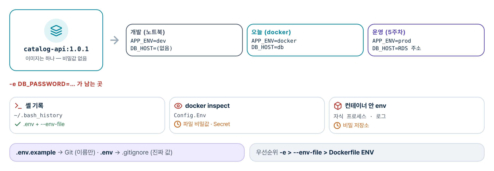

<sub>[🏠 과정 목차](../../README.md) › [2주차](../README.md) › [4일차](README.md) › 6/8교시</sub>

# 6교시 · 환경 변수와 비밀값

> [!NOTE]
> **이번 시간에 할 일**
>
> - 지금까지 명령어에 쓴 비밀번호가 **어디에 남는지** 찾아봅니다.
> - `.env` 파일과 `--env-file`로 비밀번호를 명령어에서 뺍니다.
> - 환경 변수의 **우선순위**를 확인합니다.
> - 환경 변수로 넘긴 비밀값의 **한계**와, 그다음 단계(파일로 넘기는 비밀값, Secret, Secrets Manager)를 압니다.

## 설정과 비밀값 — 무엇을 이미지 바깥에 두나

어제와 오늘, 우리는 같은 이미지 `devmart/catalog-api:1.0.1`에 환경 변수만 바꿔서 샘플 모드와 DB 모드를 오갔습니다. 1주차 4일차 6교시에 배운 **12-Factor App의 III번 "설정(Config)"** 원칙입니다. 환경마다 달라지는 것은 코드나 이미지가 아니라 **환경에** 둡니다.



| 구분 | 예 | 어디에 |
|---|---|---|
| 코드 | `app.py`, 라이브러리 | **이미지** |
| 일반 설정 | `APP_ENV=docker`, `DB_HOST=db` | 환경 변수 (Git에 올려도 됨) |
| **비밀값** | `DB_PASSWORD`, API 키, 토큰 | 환경 변수 또는 파일 — **Git·이미지·명령어 기록에 남기지 않음** |

12-Factor는 "설정을 코드에서 제대로 분리했는지" 확인하는 시험을 하나 제안합니다. **"지금 당장 이 코드 저장소를 공개해도 비밀값이 하나도 새지 않는가?"** 우리 `devops-lab` 저장소는 이미 공개(public)이니, 이 시험을 실제로 치르고 있는 셈입니다.

## 실습 10 · 비밀번호는 어디에 남았나

> **🧪 실습: 실습 목표**
>
> 오늘 명령어에 직접 쓴 비밀번호 `devmart-pw`가 어디에서 보이는지 찾습니다.

### 찾기 1 — 셸 기록

```bash
history | grep devmart-pw
```

> **🟢 확인: 보이는 것**
>
> ```text
>   512  docker run -d --name db-temp \ ...  -e POSTGRES_PASSWORD=devmart-pw ...
>   530  docker run -d --name db ...
>   561  docker run -d --name catalog-api ... -e DB_PASSWORD=devmart-pw ...
> ```
> 셸은 입력한 명령을 `~/.bash_history` 파일에 저장합니다. 노트북을 잠깐 빌려 쓴 사람, 화면 공유를 보던 사람, 나중에 이 파일을 실수로 어딘가에 올린 나 — 모두 비밀번호를 볼 수 있습니다. 어제 6교시에 `docker login -p 비밀번호`를 쓰지 말라고 한 것도 같은 이유입니다.

### 찾기 2 — `docker inspect`

```bash
docker inspect catalog-api --format '{{range .Config.Env}}{{println .}}{{end}}'
```

> **🟢 확인: 보이는 것**
>
> ```text
> APP_ENV=docker
> DB_HOST=db
> DB_PASSWORD=devmart-pw
> PATH=/usr/local/bin:/usr/local/sbin:/usr/sbin:/usr/bin:/sbin:/bin
> ...
> APP_VERSION=1.0.1
> ```
> `-e`로 넣은 값은 컨테이너 설정에 **그대로** 기록됩니다. Docker를 쓸 수 있는 사람이라면 누구나 읽을 수 있습니다.

### 찾기 3 — 컨테이너 안

```bash
docker exec catalog-api env | grep DB_
```

컨테이너 안의 프로그램, 그리고 그 프로그램이 실행하는 모든 자식 프로그램도 환경 변수를 봅니다. 오류가 났을 때 **환경 변수를 통째로 로그에 찍는** 라이브러리도 있어서, 비밀값이 로그로 새는 사고가 실제로 자주 일어납니다.

> [!IMPORTANT]
> **세 곳 중 오늘 고칠 수 있는 것**
>
> | 새는 곳 | 오늘 | 다음 단계 |
> |---|---|---|
> | 셸 기록 | **`.env` + `--env-file`로 해결** | |
> | `docker inspect` | 남는다 | 파일로 넘기는 비밀값 (내일 Compose `secrets`, 3주차 K8s Secret) |
> | 컨테이너 안 환경 변수 | 남는다 | 앱이 파일·비밀 저장소에서 직접 읽기 (5주차 AWS Secrets Manager) |

## 실습 11 · `.env` 파일로 옮기기

> **🧪 실습: 실습 목표**
>
> 비밀번호를 `.env` 파일 하나에 모으고, Git에 올라가지 않는 것을 확인한 뒤 `--env-file`로 API를 다시 띄웁니다.

### 단계 1 — 예시 파일과 진짜 파일

팀 저장소에는 **어떤 값이 필요한지만** 알려 주는 예시 파일(`.env.example`)을 올리고, 진짜 값이 든 `.env`는 각자 만들어 씁니다.

```bash
cd ~/devops-lab/devmart
code .env.example
```

```text
# 이 파일을 .env 로 복사한 뒤 값을 바꿔 쓰세요:  cp .env.example .env
# .env 파일은 절대 Git에 커밋하지 않습니다 (.gitignore에 등록되어 있음)
DB_PASSWORD=change-me-local-only
```

저장한 뒤 진짜 파일을 만듭니다.

```bash
cp .env.example .env
code .env
```

`.env`의 마지막 줄을 아래처럼 바꿉니다. 2교시에 볼륨을 만들 때 쓴 비밀번호와 **같아야** 합니다(이유는 아래 경고).

```text
DB_PASSWORD=devmart-pw
```

> [!WARNING]
> **PostgreSQL 비밀번호는 '처음 한 번'만 정해진다**
>
> `POSTGRES_PASSWORD`도 2교시의 초기화 SQL처럼 **볼륨이 비어 있을 때 한 번만** 적용됩니다. 이미 만들어진 `devmart-db` 볼륨에는 `devmart-pw`가 저장되어 있으므로, 지금 `.env`에 다른 값을 쓰고 DB 컨테이너를 다시 띄워도 **DB 비밀번호는 바뀌지 않고**, API만 새 값으로 접속하려다 5교시 고장 2(`password authentication failed`)가 납니다. 비밀번호를 바꾸려면 DB 안에서 `ALTER USER`로 바꾸거나, 실습이라면 볼륨을 지우고 새로 시작합니다.

### 단계 2 — Git이 막아 주는지 확인

```bash
cd ~/devops-lab
code devmart/.gitignore
```

`devmart/.gitignore`에 아래가 있는지 확인하고, 없으면 추가합니다.

```text
.env
__pycache__/
*.pyc
.venv/
```

```bash
git check-ignore -v devmart/.env
git status --short
```

> **🟢 확인: 이렇게 나오면 성공**
>
> ```text
> devmart/.gitignore:1:.env	devmart/.env
>  ?? devmart/.env.example
>  ?? devmart/.gitignore
> ```
> `check-ignore`가 "`devmart/.gitignore`의 1번째 줄 규칙 때문에 무시된다"고 알려 줍니다. `git status`에 `.env.example`은 보이지만 **`.env`는 보이지 않습니다.**

```bash
git add devmart/.env.example devmart/.gitignore
git commit -m "4일차: .env 예시 파일과 .gitignore"
git push
```

### 단계 3 — `--env-file`로 API 다시 띄우기

```bash
cd ~/devops-lab/devmart
docker rm -f catalog-api
docker run -d --name catalog-api \
  --network devmart-net -p 8000:8000 \
  --env-file .env \
  -e APP_ENV=docker -e DB_HOST=db \
  devmart/catalog-api:1.0.1
curl -s http://localhost:8000/api/products | head -c 80; echo
```

- `--env-file .env` : 파일의 `이름=값` 줄을 모두 환경 변수로 넣는다. `#`으로 시작하는 줄은 주석으로 건너뛴다
- 비밀이 아닌 `APP_ENV`, `DB_HOST`는 `-e`로 그대로 둔다

> **🟢 확인: 이렇게 나오면 성공**
>
> ```text
> {"items":[{"id":1,"name":"러닝화","price":59000},{"id":2,"name":"후드 집…
> ```
> 이번 명령에는 비밀번호가 **한 글자도** 없습니다. `history | grep devmart-pw`를 다시 해도 새 줄이 생기지 않습니다.

### 단계 4 — 오늘 남긴 기록 지우기

이미 남은 기록은 지워 둡니다.

```bash
history -c && history -w
```

- `history -c` : 지금 셸의 기록을 비운다
- `history -w` : 빈 기록을 `~/.bash_history` 파일에 덮어쓴다

> [!TIP]
> **어쩔 수 없이 비밀값을 명령에 써야 할 때**
>
> Ubuntu의 bash는 기본 설정(`HISTCONTROL=ignoreboth`)에서 **빈칸으로 시작하는 명령은 기록하지 않습니다.** ` docker run … -e TOKEN=…`처럼 맨 앞에 빈칸을 하나 넣으면 됩니다. 비상용 기술이고, 습관은 `.env` 쪽입니다.

## 환경 변수의 우선순위

같은 이름의 환경 변수가 여러 곳에서 오면 누가 이길까요?

```bash
printf 'APP_ENV=from-file\n' > /tmp/test.env
docker run --rm --env-file /tmp/test.env -e APP_ENV=from-cli devmart/catalog-api:1.0.1 env | grep APP_
```

> **🟢 확인: 보이는 것**
>
> ```text
> APP_ENV=from-cli
> APP_VERSION=1.0.1
> ```

| 순위 | 어디서 | 예 |
|---|---|---|
| 1 (가장 셈) | `docker run -e` | `-e APP_ENV=from-cli` |
| 2 | `docker run --env-file` | `.env`의 `APP_ENV=from-file` |
| 3 (가장 약함) | Dockerfile의 `ENV` | `ENV APP_VERSION=1.0.1` |

**나중에, 더 구체적으로 준 값이 이깁니다.** 이미지에 기본값을 두고, 환경 파일로 환경별 값을, 명령줄로 그때그때 덮어쓰는 구조입니다. 내일 Compose에서도 같은 생각이 이어집니다.

> **❓ 오해 — '`.env`에 넣었으니 이제 안전하다'**
>
> `.env`는 **명령어 기록과 Git**에서 비밀값을 빼 준 것일 뿐입니다. 컨테이너에 들어간 뒤에는 여전히 `docker inspect`와 `env`로 보입니다. 그리고 `.env` 파일 자체는 **암호화되지 않은 평문**이라, 노트북을 잃어버리면 그대로 읽힙니다. 개발용으로는 충분하지만 운영에서는 비밀 저장소(3주차 Kubernetes Secret + 외부 저장소, 5주차 AWS Secrets Manager)를 씁니다. 비밀값을 다루는 단계는 계속 올라갑니다.

| 단계 | 방법 | 막는 것 |
|---|---|---|
| 0 | 코드·Dockerfile에 직접 | 아무것도 못 막음 |
| 1 | 명령어 `-e` | 이미지·Git에는 안 남음 (기록·inspect에는 남음) |
| 2 | **`.env` + `--env-file` (오늘)** | + 셸 기록 |
| 3 | 파일로 넘기는 비밀값 (`/run/secrets/…`) | + `docker inspect`·환경 변수 노출 |
| 4 | 비밀 저장소 + 짧게 사는 자격 증명 | + 오래된 비밀번호의 위험, 누가 언제 읽었는지 기록 |

> **🎓 학술 노트 — 공개 저장소에서 매일 새는 비밀값 (Meli et al., 2019)**
>
> 미국 노스캐롤라이나 주립대학의 연구진은 NDSS 2019 학회 논문 「Git으로 얼마나 나빠질 수 있나? 공개 GitHub 저장소의 비밀값 유출 분석」에서 GitHub 검색 API와 공개 데이터셋으로 수많은 공개 저장소를 조사했습니다. **10만 개가 넘는 저장소**에서 API 키와 개인 키 같은 비밀값이 발견되었고, **매일 수천 개의 새로운 비밀값**이 새어 나오고 있었습니다. 유출된 비밀값의 상당수는 올라온 지 **몇 시간 안에** 다시 노출된 채 남아 있었고, 저장소 주인이 나중에 지워도 Git 기록에 남아 있는 경우가 많았습니다.
>
> 어제의 Dahlmanns 연구(이미지 속 비밀값)와 이 연구(저장소 속 비밀값)가 말하는 것은 같습니다. **비밀값은 한 번 새면 회수할 수 없다.** 그래서 대책은 ① 처음부터 넣지 않기(`.gitignore`, `.dockerignore`, `.env`) ② 새면 **즉시 그 비밀값을 폐기하고 새로 발급**하기 ③ 애초에 **짧게 살다 사라지는** 자격 증명 쓰기입니다. "Git에서 지웠으니 괜찮다"는 틀린 생각입니다.
>
> - Meli, M., McNiece, M. R., & Reaves, B. (2019). How bad can it git? Characterizing secret leakage in public GitHub repositories. *NDSS Symposium 2019*.

> **📈 트렌드 — 올리기 전에 막는다, 그리고 비밀번호를 없앤다**
>
> GitHub는 공개 저장소에 대해 **비밀값 스캐닝**과 **푸시 보호(push protection)**를 기본으로 켜 두고 있습니다. 알려진 형식의 토큰이 들어간 커밋을 `git push`하면 **푸시 자체를 거절**합니다. 사람이 실수해도 마지막 문에서 막는 것입니다. 한 걸음 더 나아가, 오래 쓰는 비밀번호 자체를 없애는 흐름도 뚜렷합니다. 3주차 GitHub Actions에서는 AWS 키를 저장하는 대신 **OIDC**로 그때그때 몇 분짜리 임시 자격 증명을 받아 쓰고, 5주차에는 AWS 안의 서비스가 **IAM 역할**로 비밀번호 없이 권한을 얻습니다. "비밀값을 잘 숨기기"에서 "숨길 비밀값을 없애기"로 가는 중입니다.

## 정리

- 비밀번호를 `-e`로 명령에 쓰면 **셸 기록 · `docker inspect` · 컨테이너 환경 변수** 세 곳에 남는다.
- `.env.example`(필요한 이름만, Git에 올림) + `.env`(진짜 값, `.gitignore`) + `--env-file`로 **셸 기록과 Git**에서 뺀다.
- 우선순위: `-e` > `--env-file` > Dockerfile `ENV`.
- PostgreSQL 비밀번호는 **볼륨이 비어 있을 때 한 번만** 정해진다.
- 비밀값은 한 번 새면 회수할 수 없다 → 넣지 않기, 새면 폐기, 짧게 사는 자격 증명.

> **✅ 확인 문제**
>
> 1. `-e DB_PASSWORD=…`로 넣은 비밀번호가 보이는 곳 세 군데는?
> 2. `.env.example`과 `.env` 중 Git에 올리는 것은? 각각 무엇이 들어 있나요?
> 3. `--env-file .env`에 `APP_ENV=dev`가 있고 `-e APP_ENV=prod`도 주면 컨테이너 안의 값은?
> 4. 이미 만든 DB 볼륨이 있는데 `.env`의 비밀번호를 바꾸고 DB를 다시 띄우면 무슨 일이 생기나요?
> 5. 실수로 비밀값을 GitHub에 올렸다가 다음 커밋에서 지웠습니다. 이제 안전한가요?
>
> <details><summary>정답</summary>
>
> 1. 셸 기록(`~/.bash_history`), `docker inspect`, 컨테이너 안의 환경 변수(`env`)
> 2. `.env.example`을 올린다. 예시 파일에는 필요한 변수 이름과 가짜 값, `.env`에는 진짜 값
> 3. `prod` (`-e`가 가장 세다)
> 4. DB 비밀번호는 볼륨에 처음 저장된 값 그대로라, API가 새 비밀번호로 접속하다 인증 실패가 난다
> 5. 아니다. Git 기록과 누군가의 복사본에 남는다. 그 비밀값을 즉시 폐기하고 새로 발급해야 한다
>
> </details>

## 참고 문헌

- Wiggins, A. (2011). *The Twelve-Factor App — III. Config*. 12factor.net/config
- Docker Docs. *Set environment variables (docker run --env, --env-file)*. docs.docker.com/reference/cli/docker/container/run
- Docker Docs. *Secrets in Compose*. docs.docker.com/compose/how-tos/use-secrets
- Meli, M., McNiece, M. R., & Reaves, B. (2019). How bad can it git? *NDSS 2019*.
- GitHub Docs. *About push protection*. docs.github.com/code-security/secret-scanning

---

| 이전 | 목차 | 다음 |
|:--|:--:|--:|
| ⬅️ [5교시 · API와 DB 연결하기](lesson-05.md) | [⬆️ 4일차 목차](README.md) | [7교시 · 세 컨테이너 손으로 조립하기](lesson-07.md) ➡️ |
