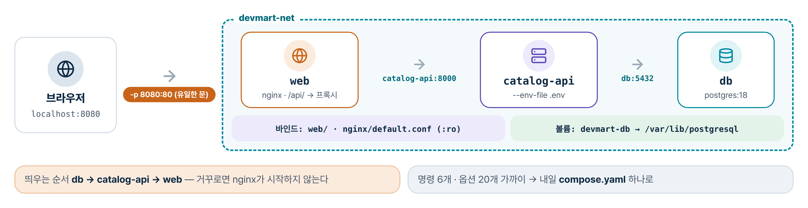

<sub>[🏠 과정 목차](../../README.md) › [2주차](../README.md) › [4일차](README.md) › 7/7교시</sub>

# 7교시 · 세 컨테이너 손으로 조립하기

> [!NOTE]
> **이번 시간에 할 일**
>
> - nginx가 `/api/` 요청을 상품 API로 넘기도록 설정합니다(리버스 프록시).
> - **web → catalog-api → db** 세 컨테이너를 손으로 띄워 브라우저에서 DevMart 화면을 완성합니다.
> - 띄우는 **순서**가 틀리면 어떻게 되는지 확인합니다.
> - 긴 명령을 스크립트로 묶어 보고, 그 한계에서 내일의 **Docker Compose**가 왜 필요한지 느낍니다.
> - 배움일기를 씁니다.

## 오늘의 완성 그림



- 바깥으로 열린 문은 **`web`의 8080 하나**뿐입니다.
- 브라우저가 `/api/products`를 요청하면 **nginx가 대신** `catalog-api:8000`에 물어보고 답을 돌려줍니다.
- `catalog-api`와 `db`에는 `-p`가 없습니다. 바깥에서는 보이지 않습니다.

웹 · 앱 · DB의 **3계층 구조**, 그리고 1주차 3일차의 "바깥에 노출하면 안 되는 서버는 사설 서브넷에"를 노트북 위에 컨테이너로 옮긴 것입니다.

> **📖 용어 — 리버스 프록시(reverse proxy)**
>
> 손님(브라우저)의 요청을 받아 **뒤에 있는 서버에 대신 전달**하고 답을 돌려주는 서버. 손님은 뒤에 누가 있는지 모릅니다. 식당의 **홀 직원**과 같습니다. 손님은 주방(API)에 직접 가지 않고 홀 직원에게 주문하면, 직원이 주방에 전달하고 음식을 가져다줍니다. 3주차 Kubernetes의 Ingress, 5주차 AWS의 ALB도 같은 역할입니다.

## 실습 12 · nginx 프록시 설정 만들기

```bash
cd ~/devops-lab/devmart
mkdir -p nginx
code nginx/default.conf
```

```nginx
server {
    listen 80;
    root /usr/share/nginx/html;
    index index.html;

    # /api/ 로 시작하는 요청은 catalog-api 컨테이너로 넘긴다 (리버스 프록시)
    location /api/ {
        proxy_pass http://catalog-api:8000;
        proxy_set_header Host $host;
    }

    location / {
        try_files $uri $uri/ /index.html;
    }
}
```

- `location /api/ { proxy_pass http://catalog-api:8000; }` : `/api/`로 시작하는 요청은 **컨테이너 이름** `catalog-api`의 8000번으로 넘긴다. 4교시의 "이름이 곧 주소"가 여기서 쓰입니다
- 나머지 요청은 `web/` 폴더의 파일을 그대로 준다

> [!WARNING]
> **설정 파일을 `web/` 안에 두지 않는 이유**
>
> `web/`은 nginx가 **누구에게나 보여 주는** 폴더입니다. 거기에 `default.conf`를 두면 `http://localhost:8080/default.conf`로 서버 설정이 그대로 공개됩니다. 화면 파일과 서버 설정은 **다른 폴더**에 둡니다.

## 실습 13 · 세 컨테이너 손으로 띄우기

> **🧪 실습: 실습 목표**
>
> 지금까지 띄운 것을 모두 정리하고, 처음부터 **db → catalog-api → web** 순서로 띄워 브라우저에서 상품 5개를 봅니다.

### 단계 0 — 깨끗하게 시작

```bash
docker rm -f web catalog-api db 2>/dev/null
docker ps -a
docker network ls | grep devmart
docker volume ls | grep devmart
```

컨테이너는 모두 지웠고, **네트워크 `devmart-net`과 볼륨 `devmart-db`는 남아 있어야** 합니다. 볼륨에는 5교시에 9,900원으로 바꾼 에코백이 그대로 있습니다.

### 단계 1 — 비밀값 불러오기

```bash
set -a; source .env; set +a
echo "비밀번호 길이: ${#DB_PASSWORD}"
```

- `source .env` : `.env`의 `이름=값` 줄을 지금 셸의 변수로 읽는다
- `set -a … set +a` : 그 사이에 읽은 변수를 **자식 프로그램에도 넘겨주도록** 표시한다
- 확인할 때도 비밀번호 자체가 아니라 **길이만** 출력합니다(`devmart-pw`면 10). 화면 공유 중에도 안전하게.

### 단계 2 — DB

```bash
docker run -d --name db --network devmart-net \
  -e POSTGRES_USER=devmart -e POSTGRES_DB=devmart -e POSTGRES_PASSWORD="$DB_PASSWORD" \
  -v devmart-db:/var/lib/postgresql \
  -v "$PWD/db/init":/docker-entrypoint-initdb.d:ro \
  postgres:18
docker exec db pg_isready -U devmart
```

`POSTGRES_PASSWORD="$DB_PASSWORD"` — 비밀번호를 직접 쓰지 않고 **변수 이름**을 씁니다. 셸 기록에는 `$DB_PASSWORD`라는 글자만 남습니다.

### 단계 3 — API

```bash
docker run -d --name catalog-api --network devmart-net \
  --env-file .env -e APP_ENV=docker -e DB_HOST=db \
  devmart/catalog-api:1.0.1
```

이번에는 `-p`가 **없습니다.** API는 nginx를 통해서만 들어옵니다.

### 단계 4 — 웹

```bash
docker run -d --name web --network devmart-net -p 8080:80 \
  -v "$PWD/web":/usr/share/nginx/html:ro \
  -v "$PWD/nginx/default.conf":/etc/nginx/conf.d/default.conf:ro \
  nginx:1.30-alpine
docker ps --format 'table {{.Names}}\t{{.Status}}\t{{.Ports}}'
```

> **🟢 확인: 이렇게 나오면 성공**
>
> ```text
> NAMES         STATUS          PORTS
> web           Up 3 seconds    0.0.0.0:8080->80/tcp
> catalog-api   Up 10 seconds   8000/tcp
> db            Up 25 seconds   5432/tcp
> ```
> `PORTS` 열을 보세요. `web`만 `0.0.0.0:8080->`로 **바깥과 연결**되어 있고, `catalog-api`와 `db`는 `8000/tcp`, `5432/tcp`처럼 **안쪽 포트만** 적혀 있습니다.

### 단계 5 — 브라우저로 확인

브라우저에서 **http://localhost:8080** 을 열고 새로 고침합니다.

> **🟢 확인: 이렇게 보이면 성공**
>
> - 머리말 아래: `catalog-api v1.0.1 · docker · 컨테이너 7aa87814e242`
> - 파란 배지: **데이터베이스에서 불러옴**
> - 상품 카드 **5개**: 러닝화 59,000원 · 후드 집업 45,000원 · 에코백 **9,900원** · 텀블러 18,000원 · 무선 이어폰 89,000원
>
> 3교시의 빨간 글씨가 상품 카드로 바뀌었습니다. 에코백이 9,900원인 것은 5교시에 DB에서 바꾼 값이 **볼륨에 남아 있기** 때문입니다. 오늘 배운 세 가지(볼륨 · 네트워크 · 환경 변수)가 한 화면에 모두 들어 있습니다.

```bash
curl -s http://localhost:8080/api/products | head -c 60; echo
curl -s -m 2 http://localhost:8000/health || echo "8000번은 닫혀 있음 (정상)"
```

두 번째 명령이 실패하는 것이 **정상**입니다. API는 이제 바깥에 직접 문을 열지 않습니다.

> **🛠️ 막혔다면: 막혔다면**
>
> | 증상 | 확인 |
> |---|---|
> | 화면은 뜨는데 "API에 연결할 수 없습니다" | `docker logs web` — `connect() failed` 또는 `502`. `catalog-api`가 `devmart-net`에 있나? |
> | 배지가 "상품을 불러오지 못했습니다: database unavailable" | `docker logs catalog-api` → 5교시 진단 표 |
> | `web`이 바로 `Exited (1)` | 아래 실습 14 |
> | 8080 접속 자체가 안 됨 | `docker ps`에 `web`이 있나, 다른 프로그램이 8080을 쓰나 (2일차 4교시) |

## 실습 14 · 순서가 틀리면

> **🧪 실습: 실습 목표**
>
> API보다 웹을 먼저 띄우면 어떻게 되는지 봅니다.

```bash
docker rm -f catalog-api web
docker run -d --name web --network devmart-net -p 8080:80 \
  -v "$PWD/web":/usr/share/nginx/html:ro \
  -v "$PWD/nginx/default.conf":/etc/nginx/conf.d/default.conf:ro \
  nginx:1.30-alpine
docker ps -a --filter name=web --format '{{.Names}}  {{.Status}}'
docker logs web 2>&1 | tail -1
```

> **🟢 확인: 보이는 것**
>
> ```text
> web  Exited (1) 2 seconds ago
> … [emerg] 1#1: host not found in upstream "catalog-api" in /etc/nginx/conf.d/default.conf:8
> ```
> nginx는 시작할 때 설정에 적힌 `catalog-api`라는 이름을 찾아보는데, 아직 그 컨테이너가 없어서 **아예 시작을 거부**했습니다. `[emerg]`는 "비상(emergency)" 등급의 오류입니다.

세 컨테이너 사이에는 **의존 관계**가 있습니다.

```text
db  ←  catalog-api  ←  web
(먼저)                   (나중)
```

```bash
docker rm -f web
docker run -d --name catalog-api --network devmart-net \
  --env-file .env -e APP_ENV=docker -e DB_HOST=db devmart/catalog-api:1.0.1
docker run -d --name web --network devmart-net -p 8080:80 \
  -v "$PWD/web":/usr/share/nginx/html:ro \
  -v "$PWD/nginx/default.conf":/etc/nginx/conf.d/default.conf:ro \
  nginx:1.30-alpine
```

순서대로 다시 띄우면 정상입니다. 사람이 순서를 기억해야 한다는 것, 이것이 첫 번째 불편함입니다.

## 이 명령들, 매번 칠 수 있을까?

오늘 DevMart를 띄우려고 친 것을 세어 봅시다.

| 항목 | 개수 |
|---|---|
| `docker` 명령 | 네트워크 1 + 볼륨 1 + 컨테이너 3 + 준비 확인 1 = **6개** |
| 옵션(`-e`, `-v`, `-p`, `--network`, `--env-file` …) | **20개 가까이** |
| 기억해야 할 순서 | db → api → web |
| 기억해야 할 이름 | `devmart-net`, `devmart-db`, `db`, `catalog-api`, `web` |

새로 온 동료에게 "이거 그대로 치면 돼"라고 이 명령들을 메신저로 보낸다고 생각해 보세요. 옵션 하나 빠지면 5교시의 고장이 납니다. 1주차 5일차 CALMS의 **자동화 — "반복 작업은 기계에게"**를 적용할 때입니다.

### 실습 15 · 스크립트로 묶어 보기 (맛보기)

가장 쉬운 방법은 셸 스크립트입니다. 강의 저장소의 `labs/week2/day4/`에 두 파일이 있습니다. `~/devops-lab/day4/`에 같은 이름으로 만들어 내용을 붙여 넣습니다.

```bash
mkdir -p ~/devops-lab/day4
code ~/devops-lab/day4/devmart-up.sh ~/devops-lab/day4/devmart-down.sh
```

**`devmart-up.sh`** (핵심 부분)

```bash
#!/usr/bin/env bash
set -euo pipefail
set -a; source .env; set +a

docker network inspect devmart-net >/dev/null 2>&1 || docker network create devmart-net
docker volume inspect devmart-db  >/dev/null 2>&1 || docker volume create devmart-db

docker run -d --name db --network devmart-net \
  -e POSTGRES_USER=devmart -e POSTGRES_DB=devmart -e POSTGRES_PASSWORD="$DB_PASSWORD" \
  -v devmart-db:/var/lib/postgresql \
  -v "$PWD/db/init":/docker-entrypoint-initdb.d:ro \
  postgres:18
until docker exec db pg_isready -U devmart >/dev/null 2>&1; do sleep 1; done

docker run -d --name catalog-api --network devmart-net \
  --env-file .env -e APP_ENV=docker -e DB_HOST=db devmart/catalog-api:1.0.1

docker run -d --name web --network devmart-net -p 8080:80 \
  -v "$PWD/web":/usr/share/nginx/html:ro \
  -v "$PWD/nginx/default.conf":/etc/nginx/conf.d/default.conf:ro \
  nginx:1.30-alpine
```

- `set -euo pipefail` : 중간에 하나라도 실패하면 **바로 멈춘다** (실패한 채로 다음 단계를 진행하지 않게)
- `… inspect … || … create …` : 이미 있으면 그대로, 없으면 만든다
- `until … do sleep 1; done` : DB가 준비될 때까지 1초마다 다시 묻는다

**`devmart-down.sh`**

```bash
#!/usr/bin/env bash
docker rm -f web catalog-api db 2>/dev/null || true
docker network rm devmart-net 2>/dev/null || true
if [ "${1:-}" = "--volumes" ]; then
  docker volume rm devmart-db
fi
```

실행해 봅니다. `.env`와 `db/`, `web/`, `nginx/`가 있는 **`devmart` 폴더에서** 실행해야 합니다.

```bash
cd ~/devops-lab/devmart
bash ../day4/devmart-down.sh
bash ../day4/devmart-up.sh
```

> **🟢 확인: 이렇게 나오면 성공**
>
> ```text
> …
> DB 준비 기다리는 중. 완료
> NAMES         STATUS                  PORTS
> web           Up Less than a second   0.0.0.0:8080->80/tcp
> catalog-api   Up Less than a second   8000/tcp
> db            Up 1 second             5432/tcp
> 브라우저에서 http://localhost:8080 을 여세요
> ```
> 명령 하나로 세 컨테이너가 순서대로 떴습니다. (강의 저장소 버전은 안내 문구 몇 줄이 더 있습니다.)

### 스크립트의 한계

스크립트는 좋은 출발이지만 금방 벽에 부딪힙니다.

| 하고 싶은 것 | 스크립트로는 |
|---|---|
| API만 새 버전으로 바꾸기 | `up.sh`를 다시 돌리면 "이름이 이미 있다" 오류 → 지우는 코드를 또 써야 함 |
| 지금 상태 보기 | `docker ps`를 직접 |
| 세 컨테이너 로그를 한 번에 | 직접 세 번 |
| 설정이 바뀐 컨테이너만 다시 띄우기 | 무엇이 바뀌었는지 스크립트가 모름 |
| 다른 팀원 노트북에서 | 셸·OS 차이로 깨지기 쉬움 |

우리 스크립트는 **"이 순서로 이 명령을 실행하라"**고 적은 **명령형(imperative)** 방식입니다. 내일 배울 **Docker Compose**는 **"이런 상태가 되어 있어야 한다"**고 적으면 도구가 알아서 맞춰 주는 **선언형(declarative)** 방식입니다. 3주차 Kubernetes, 4주차 ArgoCD, 5주차 Terraform까지 이어지는 이 과정에서 가장 중요한 생각입니다.

> **🧹 정리: 정리 — 오늘 끝**
>
> ```bash
> cd ~/devops-lab/devmart
> bash ../day4/devmart-down.sh          # 컨테이너와 네트워크만 지움, 데이터는 남김
> cd ~/devops-lab
> git add devmart/nginx day4
> git status --short                    # .env가 없는지 꼭 확인!
> git commit -m "4일차: nginx 프록시 설정과 3계층 실행 스크립트"
> git push
> ```
> 볼륨 `devmart-db`는 남겨 둡니다. 내일 Compose는 **자기 이름의 볼륨**을 새로 만들기 때문에, 오늘 볼륨은 비교용으로 두었다가 내일 마지막에 지웁니다.

> **🎓 학술 노트 — 고된 반복 작업(toil)을 없애는 것이 일이다**
>
> 구글의 SRE(사이트 신뢰성 엔지니어링) 책(Beyer 외, 2016)은 **토일(toil)**이라는 말을 정의합니다. ① 손으로 하고 ② 반복되며 ③ 자동화할 수 있고 ④ 그때그때 반응하는 일이며 ⑤ 해도 서비스가 나아지지 않고 ⑥ 서비스가 커지면 같이 늘어나는 일입니다. 오늘 친 긴 `docker run` 명령들이 딱 그렇습니다. 컨테이너가 3개면 참을 만하지만, 4주차 MSA에서 서비스가 늘어나면 손으로는 감당할 수 없습니다.
>
> 책은 SRE 엔지니어가 **일하는 시간의 50% 이상을 토일이 아닌 엔지니어링(토일을 없애는 도구 만들기)에** 쓰도록 목표를 둔다고 설명합니다. 오늘 스크립트를 만든 것이 토일을 없애는 첫걸음이고, 내일 Compose, 3주차 CI/CD, 4주차 ArgoCD로 갈수록 사람이 손으로 하던 일이 점점 **선언된 파일과 자동화**로 바뀝니다.
>
> - Beyer, B., Jones, C., Petoff, J., & Murphy, N. R. (Eds.). (2016). *Site Reliability Engineering: How Google Runs Production Systems*. O'Reilly. (5장 "Eliminating Toil")

> **📈 트렌드 — 같은 파일로 노트북부터 클라우드까지**
>
> 오늘 손으로 조립한 구조를 **파일 하나로 적어 두는** 방식이 표준이 되었습니다. Docker Compose의 파일 형식은 **Compose Specification**이라는 공개 표준으로 정리되어 Docker뿐 아니라 여러 도구가 읽습니다. 개발자 노트북에서는 Compose 파일로 웹·API·DB를 한 번에 띄우고, 테스트 중에는 **Testcontainers** 같은 도구가 코드 안에서 진짜 DB 컨테이너를 잠깐 띄웠다 지우며, 운영에서는 같은 이미지를 Kubernetes 설정 파일로 배포합니다. 모든 단계에서 **"이미지 + 바깥에서 넣는 설정 + 볼륨 + 네트워크"**라는 오늘의 네 조각은 그대로입니다.

## 정리

- nginx **리버스 프록시**: 브라우저는 `web`만 알고, `/api/`는 nginx가 `catalog-api:8000`에 대신 묻는다.
- 바깥 문은 **8080 하나**. API와 DB에는 `-p`를 주지 않는다 (최소 노출).
- 의존 순서 **db → catalog-api → web**. nginx는 upstream 이름을 못 찾으면 시작하지 않는다.
- 손 명령은 길고 실수하기 쉽다 → 스크립트(명령형) → 내일 **Compose(선언형)**.

> **✅ 확인 문제**
>
> 1. 브라우저가 `http://localhost:8080/api/products`를 요청하면 어떤 경로로 응답이 오나요?
> 2. `docker ps`의 `PORTS`에서 `0.0.0.0:8080->80/tcp`와 `8000/tcp`의 차이는?
> 3. `web`을 `catalog-api`보다 먼저 띄우면 어떻게 되나요? 로그의 핵심 문장은?
> 4. 스크립트(명령형)와 Compose(선언형)의 차이를 한 문장으로?
> 5. SRE에서 말하는 토일(toil)의 예를 오늘 실습에서 하나 들어 보세요.
>
> <details><summary>정답</summary>
>
> 1. 브라우저 → web(nginx, 8080) → `catalog-api:8000` (devmart-net 안, 이름으로) → `db:5432` → 거꾸로 응답
> 2. 앞의 것은 노트북 바깥과 연결된 포트(공개), 뒤의 것은 컨테이너 안쪽 포트만 있고 바깥과 연결되지 않음
> 3. nginx가 시작하지 못하고 종료된다. `host not found in upstream "catalog-api"`
> 4. 명령형은 "이 순서로 실행하라", 선언형은 "이런 상태여야 한다"고 적고 도구가 맞춰 준다
> 5. 매번 긴 `docker run` 명령 세 개를 순서대로 손으로 치는 일 (반복되고, 자동화 가능하며, 서비스가 늘면 같이 는다)
>
> </details>

> [!NOTE]
> **오늘의 배움일기**
>
> - 볼륨 없이 DB를 지웠을 때와, 볼륨을 붙이고 지웠을 때의 차이를 '호텔 방과 금고'로 설명해 보기
> - 이름 있는 볼륨과 바인드 마운트를 각각 언제 쓰는지 내 말로 한 줄씩
> - 5교시 고장 세 가지 중 가장 헷갈렸던 것과, 로그의 어떤 문장으로 구분했는지
> - 오늘 `history | grep`으로 비밀번호를 찾았을 때 든 생각
> - DevMart 화면을 처음 봤을 때 소감 — 그리고 세 컨테이너를 띄우는 명령을 동료에게 어떻게 전해 줄지
> - 내일(Compose + GitHub 협업) 전에 궁금한 것

## 참고 문헌

- nginx Docs. *Module ngx_http_proxy_module — proxy_pass*. nginx.org/en/docs/http/ngx_http_proxy_module.html
- Docker Docs. *Networking — Container communication*. docs.docker.com/engine/network
- Compose Specification. compose-spec.io
- Beyer, B., Jones, C., Petoff, J., & Murphy, N. R. (Eds.). (2016). *Site Reliability Engineering*. O'Reilly.
- Testcontainers. testcontainers.com

---

| 이전 | 목차 | 다음 |
|:--|:--:|--:|
| ⬅️ [6교시 · 환경 변수와 비밀값](lesson-06.md) | [⬆️ 4일차 목차](README.md) | [2주차 5일차 목차](../day5/README.md) ➡️ |
