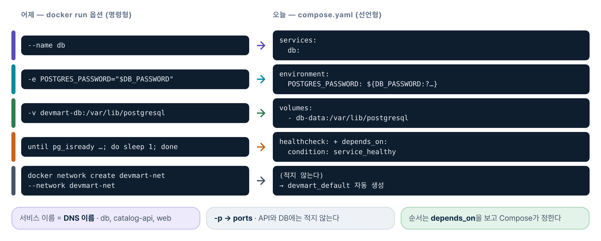

<sub>[🏠 과정 목차](../../README.md) › [2주차](../README.md) › [5일차](README.md) › 1/8교시</sub>

# 1교시 · compose.yaml 읽기

> [!NOTE]
> **이번 시간에 할 일**
>
> - 어제의 손 명령과 스크립트가 왜 불편했는지 되짚습니다.
> - **명령형**과 **선언형**의 차이를 이해합니다.
> - YAML 문법을 5분 만에 익힙니다.
> - 어제의 `docker run` 명령들을 `compose.yaml`로 한 줄씩 옮겨 씁니다.

## 어제 요약 — 6개의 명령과 20개의 옵션

어제는 DevMart를 띄우려고 이렇게 했습니다.

| 순서 | 한 일 | 명령 |
|---|---|---|
| 1 | 네트워크 | `docker network create devmart-net` |
| 2 | 볼륨 | `docker volume create devmart-db` |
| 3 | DB | `docker run … -e … -v … -v … postgres:18` |
| 4 | 준비 기다리기 | `pg_isready`가 될 때까지 반복 |
| 5 | API | `docker run … --env-file … -e … -e …` |
| 6 | 웹 | `docker run … -p … -v … -v … nginx:1.30-alpine` |

그리고 스크립트로 묶어 보았지만, "API만 바꾸기", "상태 보기", "로그 한 번에 보기"는 여전히 직접 해야 했습니다.

## 명령형과 선언형

> **🧩 비유 — 길 안내와 목적지**
>
> **명령형(imperative)**은 택시 기사에게 "직진 300m, 우회전, 두 번째 신호에서 좌회전…"이라고 **길을 하나하나** 알려 주는 것입니다. 중간에 길이 막히면 다시 설명해야 합니다. **선언형(declarative)**은 "**서울역으로 가 주세요**"라고 **목적지만** 말하는 것입니다. 길은 기사(도구)가 알아서 찾고, 막히면 돌아갑니다.

| | 명령형 (어제의 스크립트) | 선언형 (오늘의 Compose) |
|---|---|---|
| 적는 것 | **어떻게** — 실행할 명령과 순서 | **무엇을** — 있어야 할 상태 |
| 두 번 실행하면 | "이름이 이미 있다" 오류 | 이미 그 상태면 **아무것도 안 함** |
| 일부만 바꾸면 | 무엇을 다시 할지 내가 판단 | 도구가 **차이만** 찾아 고침 |
| 이 과정의 예 | 셸 스크립트 | Compose, Kubernetes, ArgoCD, Terraform |

두 번 실행해도 결과가 같은 성질을 **멱등성(idempotency)**이라고 합니다. 선언형 도구는 이 성질을 가집니다. 3주차부터 만나는 도구들이 모두 이 방식이라, 오늘 Compose가 그 연습입니다.

## YAML 5분

`compose.yaml`은 **YAML** 형식으로 씁니다. 3주차의 GitHub Actions 파일과 Kubernetes 파일도 모두 YAML이라, 오늘 익혀 두면 계속 씁니다. 규칙은 몇 개뿐입니다.

```yaml
# 샵(#) 뒤는 주석
name: devmart            # 이름: 값

services:                # 아래에 들여 쓴 것들이 services에 속한다
  web:                   # 들여쓰기 = 소속 (공백 2칸, Tab 금지!)
    image: nginx:1.30-alpine
    ports:               # 목록은 줄마다 "- "로 시작
      - "8080:80"
```

| 규칙 | 설명 |
|---|---|
| `이름: 값` | 콜론 뒤에 **공백 한 칸** |
| 들여쓰기 | **공백**으로 소속을 나타낸다. Tab 키는 오류. 이 과정은 공백 2칸 |
| `- 항목` | 목록(여러 개) |
| 따옴표 | `"8080:80"`처럼 숫자·콜론이 섞이면 따옴표로 감싸 안전하게 |

> [!WARNING]
> **YAML 오류의 90%는 들여쓰기**
>
> 눈으로는 같아 보여도 공백 개수가 하나 다르면 소속이 바뀝니다. VS Code 오른쪽 아래 상태 표시줄에서 `Spaces: 2`인지 확인하고, VS Code가 빨간 밑줄로 알려 주는 곳을 봅니다. (Container Tools 확장이 `compose.yaml`의 잘못된 항목도 표시해 줍니다.)

## 실습 1 · 어제의 명령을 compose.yaml로

> **🧪 실습: 실습 목표**
>
> 어제의 `docker run` 명령을 옆에 두고 `compose.yaml`로 한 덩어리씩 옮깁니다.

```bash
cd ~/devops-lab/devmart
code compose.yaml
```



### 덩어리 1 — 프로젝트 이름과 DB

```yaml
name: devmart

services:
  db:
    image: postgres:18
    environment:
      POSTGRES_DB: devmart
      POSTGRES_USER: devmart
      POSTGRES_PASSWORD: ${DB_PASSWORD:?DB_PASSWORD를 .env 파일에 적어 주세요}
    volumes:
      - db-data:/var/lib/postgresql
      - ./db/init:/docker-entrypoint-initdb.d:ro
    healthcheck:
      test: ["CMD-SHELL", "pg_isready -U devmart -d devmart"]
      interval: 5s
      timeout: 3s
      retries: 10
```

| 어제의 `docker run` | 오늘의 `compose.yaml` |
|---|---|
| `--name db` | 서비스 이름 `db:` — 이것이 **네트워크에서의 이름**이 된다 |
| `-e POSTGRES_PASSWORD="$DB_PASSWORD"` | `${DB_PASSWORD:?…}` — `.env`에서 읽는다. 없으면 `?` 뒤 문장으로 **멈춘다** |
| `-v devmart-db:/var/lib/postgresql` | `db-data:/var/lib/postgresql` (볼륨 이름은 아래에서 선언) |
| `-v "$PWD/db/init":…:ro` | `./db/init:…:ro` — `compose.yaml`이 있는 폴더 기준 상대 경로 |
| `until pg_isready …` 반복 | `healthcheck:` — Docker가 5초마다 대신 물어본다 |

### 덩어리 2 — API

```yaml
  catalog-api:
    build: ./catalog-api
    image: devmart/catalog-api:dev
    environment:
      APP_ENV: compose
      DB_HOST: db
      DB_NAME: devmart
      DB_USER: devmart
      DB_PASSWORD: ${DB_PASSWORD:?DB_PASSWORD를 .env 파일에 적어 주세요}
    depends_on:
      db:
        condition: service_healthy
```

- `build: ./catalog-api` : 이미지가 없으면 이 폴더의 Dockerfile로 **직접 빌드**한다
- `image: devmart/catalog-api:dev` : 빌드한 이미지에 붙일 이름. Compose로 만드는 개발용 이미지라 `dev` 태그를 쓴다
- `depends_on … condition: service_healthy` : **db의 헬스 체크가 통과한 뒤에** 시작한다 — 어제 손으로 하던 "기다리기"
- `ports:`가 **없다** — 어제 7교시처럼 API는 바깥에 열지 않는다

### 덩어리 3 — 웹과 볼륨 선언

```yaml
  web:
    image: nginx:1.30-alpine
    ports:
      - "8080:80"
    volumes:
      - ./web:/usr/share/nginx/html:ro
      - ./nginx/default.conf:/etc/nginx/conf.d/default.conf:ro
    depends_on:
      - catalog-api

volumes:
  db-data:
```

- `depends_on: - catalog-api` : API 컨테이너가 **시작된 뒤에** 웹을 띄운다 (어제 실습 14의 `host not found in upstream` 방지)
- 맨 아래 `volumes: db-data:` : 이 프로젝트에서 쓸 이름 있는 볼륨을 **선언**한다

### 무엇이 사라졌나

`compose.yaml` 어디에도 **네트워크**가 없습니다. Compose는 프로젝트마다 **`devmart_default`라는 네트워크를 자동으로** 만들고 모든 서비스를 거기에 넣습니다. 서비스 이름(`db`, `catalog-api`, `web`)이 그대로 DNS 이름이 되므로, 어제 만든 `nginx/default.conf`의 `proxy_pass http://catalog-api:8000;`과 API의 `DB_HOST: db`가 **고치지 않고 그대로** 동작합니다.

### 확인 — 문법 검사

```bash
cat .env                     # DB_PASSWORD=… 줄이 있는지 (어제 만든 파일)
docker compose config --quiet && echo "문법 OK"
```

> **🟢 확인: 이렇게 나오면 성공**
>
> ```text
> 문법 OK
> ```
> `docker compose config`는 파일을 읽어 `.env` 값까지 채운 **최종 설정**을 만들어 봅니다. `--quiet`는 결과는 숨기고 오류만 보여 줍니다. (`--quiet` 없이 실행하면 비밀번호가 채워진 결과가 화면에 나오니 화면 공유 중에는 조심합니다.)

> **🛠️ 막혔다면: 막혔다면**
>
> | 오류 | 원인 |
> |---|---|
> | `required variable DB_PASSWORD is missing a value: DB_PASSWORD를 .env 파일에 적어 주세요` | `.env`가 없거나 다른 폴더에 있다. `compose.yaml`과 **같은 폴더**에 있어야 한다 |
> | `yaml: line 12: mapping values are not allowed in this context` | 들여쓰기 또는 콜론 뒤 공백. 알려 준 줄 번호 **근처 위아래**를 본다 |
> | `services.web.ports must be a list` | `- "8080:80"`의 `-`를 빠뜨렸다 |

> **🎓 학술 노트 — 원하는 상태로 '수렴'시키기 (CFEngine, 1993)**
>
> 선언형 운영 도구의 뿌리는 1993년 노르웨이 오슬로 대학의 마크 버제스(Mark Burgess)가 만든 **CFEngine**입니다. 당시 서버 관리는 관리자가 명령을 하나씩 실행하는 스크립트가 전부였고, 서버마다 상태가 조금씩 달라지는 문제가 끝없이 생겼습니다. 버제스는 "서버가 **있어야 할 상태**를 적어 두면, 도구가 지금 상태와 비교해 **차이만 고쳐서 목표 상태로 수렴(convergence)**시킨다"는 방식을 제안했습니다. 몇 번을 실행해도 결과가 같고(멱등성), 누군가 손으로 바꿔 놓아도 다음 실행 때 되돌아옵니다.
>
> 이 생각은 Puppet, Chef, Ansible을 거쳐 Kubernetes의 **조정 루프(reconciliation loop)** — "선언된 상태와 실제 상태를 계속 비교해 맞춘다" — 로 이어집니다. 오늘 Compose가 하는 일이 그 작은 버전이고, 4주차 ArgoCD는 이 수렴을 **Git 저장소 기준으로** 끊임없이 합니다.
>
> - Burgess, M. (1995). Cfengine: a site configuration engine. *USENIX Computing Systems, 8*(3).

> **📈 트렌드 — Compose 파일은 공개 표준이 되었다**
>
> Compose 파일 형식은 **Compose Specification**이라는 공개 표준으로 관리되어, Docker 말고도 여러 도구가 같은 파일을 읽습니다. 예전 강의 자료에 자주 보이는 파일 맨 위의 `version: "3.8"` 줄은 이제 **쓰지 않습니다**(넣으면 "더 이상 쓰지 않는 항목"이라는 경고가 나옵니다). 파일 이름도 `docker-compose.yml`보다 `compose.yaml`을 권장합니다. 명령 역시 옛날의 `docker-compose`(하이픈)가 아니라 `docker compose`(띄어쓰기, Docker CLI 플러그인)입니다. 인터넷 예제를 볼 때 이 세 가지로 **얼마나 오래된 자료인지** 가늠할 수 있습니다.

## 정리

- 명령형은 **어떻게**, 선언형은 **무엇을**. 선언형은 몇 번 실행해도 결과가 같다(멱등성).
- YAML: `이름: 값`, 공백 들여쓰기(Tab 금지), `- 목록`.
- `--name` → 서비스 이름, `-e` → `environment`, `-v` → `volumes`, `-p` → `ports`, 기다리기 → `healthcheck` + `depends_on`.
- 네트워크는 Compose가 `프로젝트_default`로 **자동** 생성. 서비스 이름 = DNS 이름.
- `${DB_PASSWORD:?메시지}` — `.env`에서 읽고, 없으면 멈춘다.

> **✅ 확인 문제**
>
> 1. 명령형 스크립트를 두 번 실행하면 생기는 문제와, 선언형 도구가 그 문제를 피하는 방법은?
> 2. YAML에서 Tab 키로 들여 쓰면?
> 3. `compose.yaml`에 네트워크를 적지 않았는데 `catalog-api`가 `db`를 찾을 수 있는 이유는?
> 4. `depends_on`에 `condition: service_healthy`를 쓰면 어떤 일이 일어나나요?
> 5. 인터넷 예제의 첫 줄에 `version: "3.8"`이 있다면 무엇을 짐작할 수 있나요?
>
> <details><summary>정답</summary>
>
> 1. "이미 있다" 오류. 선언형은 현재 상태와 비교해 차이가 있을 때만 바꾼다(멱등성)
> 2. 오류가 난다. YAML 들여쓰기는 공백만 쓴다
> 3. Compose가 프로젝트 기본 네트워크를 자동으로 만들고, 서비스 이름을 DNS 이름으로 등록하기 때문
> 4. db의 헬스 체크가 통과(healthy)할 때까지 기다렸다가 catalog-api를 시작한다
> 5. 옛 Compose 파일 형식으로 쓰인 오래된 자료일 가능성이 크다
>
> </details>

## 참고 문헌

- Docker Docs. *Compose file reference*, *How Compose works*. docs.docker.com/reference/compose-file
- Compose Specification. compose-spec.io
- YAML 1.2 Specification. yaml.org/spec
- Burgess, M. (1995). Cfengine: a site configuration engine. *USENIX Computing Systems, 8*(3).

---

| 이전 | 목차 | 다음 |
|:--|:--:|--:|
| ⬅️ [2주차 5일차 목차](README.md) | [⬆️ 5일차 목차](README.md) | [2교시 · up · ps · logs · down과 헬스 체크](lesson-02.md) ➡️ |
