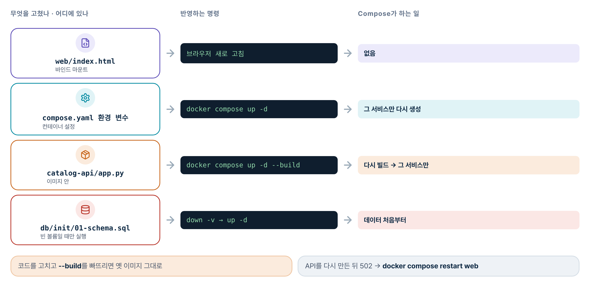

<sub>[🏠 과정 목차](../../README.md) › [2주차](../README.md) › [5일차](README.md) › 3/8교시</sub>

# 3교시 · Compose로 하는 일상 작업

> [!NOTE]
> **이번 시간에 할 일**
>
> - 웹 파일, 설정, 코드를 고쳤을 때 각각 **무엇을 해야 하는지** 구분합니다.
> - Compose가 **바뀐 서비스만** 다시 만드는 것을 확인합니다.
> - API를 **3개로 늘리고**, 요청이 나뉘어 가는 것을 봅니다.
> - 어제의 손 작업과 오늘의 Compose를 비교하고 커밋합니다.

## 무엇을 고쳤느냐에 따라 할 일이 다르다

개발하면서 가장 자주 하는 질문은 "고쳤는데 왜 안 바뀌지?"입니다. 답은 **고친 것이 어디에 들어 있느냐**에 달려 있습니다.



| 고친 것 | 들어 있는 곳 | 반영하려면 | Compose가 하는 일 |
|---|---|---|---|
| `web/index.html` | 바인드 마운트 | **브라우저 새로 고침** | 없음 |
| `compose.yaml`의 환경 변수 | 컨테이너 설정 | `docker compose up -d` | 그 서비스만 **다시 생성** |
| `catalog-api/app.py` | **이미지** | `docker compose up -d --build` | 이미지 다시 빌드 → 그 서비스만 다시 생성 |
| `db/init/01-schema.sql` | 빈 볼륨일 때만 실행 | `down -v` 후 `up` | 볼륨부터 새로 |

## 실습 5 · 세 가지를 고쳐 보기

> **🧪 실습: 실습 목표**
>
> 웹 파일 · 설정 · 코드를 하나씩 고치고, 각각 필요한 명령과 Compose의 반응을 확인합니다.

### 고치기 1 — 웹 파일 (바인드 마운트)

`web/index.html`의 `<h1>DevMart</h1>`을 `<h1>DevMart · Compose</h1>`로 바꾸고 저장한 뒤 브라우저를 새로 고칩니다. **명령이 필요 없습니다.** 어제 3교시 그대로입니다. 확인했으면 원래대로 되돌립니다.

### 고치기 2 — 설정 (환경 변수)

`compose.yaml`의 `catalog-api` → `environment`에 한 줄을 추가합니다.

```yaml
    environment:
      APP_ENV: compose
      APP_VERSION: 1.1.0-dev
      DB_HOST: db
```

```bash
docker compose up -d
```

> **🟢 확인: 보이는 것**
>
> ```text
>  ✔ Container devmart-db-1           Healthy
>  ✔ Container devmart-catalog-api-1  Started
>  ✔ Container devmart-web-1          Running
> ```
> **catalog-api만** 다시 만들어졌고(`Started`), db와 web은 그대로(`Running`, `Healthy`)입니다. Compose가 `compose.yaml`과 지금 상태를 비교해 **차이가 있는 서비스만** 고쳤습니다. 1교시의 "수렴"입니다.

```bash
curl -s http://localhost:8080/api/info; echo
```

`"version":"1.1.0-dev"`가 보입니다. Dockerfile의 `ENV APP_VERSION`을 `compose.yaml`의 값이 덮어썼습니다(어제 6교시의 우선순위).

### 고치기 3 — 코드 (이미지)

`catalog-api/app.py`의 `/api/info` 부분에 한 줄을 추가합니다. **`내아이디`는 내 GitHub 아이디로** 바꿉니다.

```python
@app.get("/api/info")
def info():
    return jsonify(
        service="catalog-api",
        version=APP_VERSION,
        env=APP_ENV,
        hostname=socket.gethostname(),
        owner="내아이디",
        database="configured" if db_configured() else "not configured (sample data)",
    )
```

먼저 `--build` **없이** 해 봅니다.

```bash
docker compose up -d
curl -s http://localhost:8080/api/info; echo
```

`owner`가 **없습니다.** 코드는 이미지 안에 들어 있는데, 이미지를 다시 만들지 않았기 때문입니다. 이번에는 빌드합니다.

```bash
docker compose up -d --build catalog-api
curl -s http://localhost:8080/api/info; echo
```

- 끝의 `catalog-api` : 이 서비스만 대상으로

> **🟢 확인: 이렇게 나오면 성공**
>
> ```text
>  ✔ Image devmart/catalog-api:dev    Built
>  ✔ Container devmart-catalog-api-1  Recreated
> {"database":"configured","env":"compose","hostname":"02ae4c936f55","owner":"내아이디","service":"catalog-api","version":"1.1.0-dev"}
> ```
> 어제 3일차 5교시의 캐시 덕분에 `pip install` 층은 `CACHED`이고 `COPY app.py`만 다시 실행되어 몇 초 만에 끝납니다.

> **🛠️ 막혔다면: 막혔다면 — 502 Bad Gateway**
>
> API를 다시 만든 뒤 화면이나 `curl`이 **502 Bad Gateway**를 돌려주면, nginx가 **시작할 때 알아 둔 옛 API의 IP**로 계속 보내고 있는 것입니다(새 컨테이너는 IP가 바뀔 수 있다 — 어제 4교시). nginx는 기본 설정에서 upstream 이름을 시작할 때 한 번만 찾습니다. `docker compose restart web`으로 nginx를 다시 시작하면 새 IP를 찾습니다. 운영에서는 nginx에 `resolver` 설정을 넣어 주기적으로 다시 찾게 하거나, 3주차 Kubernetes **Service**처럼 IP가 바뀌지 않는 고정 주소를 앞에 둡니다.

## 실습 6 · API를 3개로 늘리기

> **🧪 실습: 실습 목표**
>
> 1주차 4일차에 배운 **스케일 아웃**을 한 줄로 해 봅니다.

```bash
docker compose up -d --scale catalog-api=3
docker compose ps catalog-api
```

> **🟢 확인: 보이는 것**
>
> ```text
> NAME                    SERVICE       STATUS
> devmart-catalog-api-1   catalog-api   Up 3 minutes
> devmart-catalog-api-2   catalog-api   Up 5 seconds
> devmart-catalog-api-3   catalog-api   Up 5 seconds
> ```
> 번호 `-1`, `-2`, `-3`의 의미가 이제 보입니다. 같은 서비스의 **복제본**입니다.

`compose.yaml`에서 API에 `ports:`를 주지 **않은** 덕분에 가능한 일입니다. 만약 `"8000:8000"`이 있었다면 세 컨테이너가 노트북의 8000번을 두고 다투다가 2일차 4교시의 포트 충돌이 났을 것입니다.

이제 웹을 다시 시작하고(새 API 2개의 IP를 알아 두도록) 여러 번 요청해 봅니다.

```bash
docker compose restart web
for i in 1 2 3 4 5 6; do curl -s http://localhost:8080/api/info | grep -o '"hostname":"[^"]*"'; done
```

> **🟢 확인: 보이는 것**
>
> ```text
> "hostname":"c2022e9bc2d7"
> "hostname":"c2022e9bc2d7"
> "hostname":"226fefc99f9e"
> "hostname":"d8ec2f24f936"
> "hostname":"c2022e9bc2d7"
> "hostname":"226fefc99f9e"
> ```
> **세 가지 hostname**이 섞여 나옵니다. Docker DNS가 `catalog-api`라는 이름에 **IP 3개**를 알려 주고, nginx가 그 셋에 요청을 **돌아가며** 보냈습니다. 브라우저에서 새로 고침을 여러 번 해도 머리말의 컨테이너 번호가 바뀝니다. 2주차 3일차에 `/api/info`에 hostname을 넣어 둔 이유가 이것입니다.

```bash
docker compose up -d --scale catalog-api=1
docker compose restart web
```

원래대로 1개로 줄입니다.

> **❓ 오해 — '컨테이너 3개면 3배 튼튼하다'**
>
> 오늘의 3개는 **같은 노트북** 위에 있습니다. 노트북이 꺼지면 셋 다 꺼집니다. 그리고 하나가 죽어도 Compose는 **자동으로 다시 띄우지 않고**, nginx는 죽은 컨테이너에도 계속 요청을 보낼 수 있습니다. 여러 서버에 나눠 두고, 죽으면 다시 띄우고, 살아 있는 것에만 보내는 일 — 이것이 3주차 **Kubernetes**가 필요한 이유입니다. Compose는 **한 대의 컴퓨터를 위한** 도구입니다.

## 어제 vs 오늘

| 하고 싶은 것 | 어제 (손 명령) | 오늘 (Compose) |
|---|---|---|
| 전부 띄우기 | 명령 6개 + 순서 기억 | `docker compose up -d` |
| 상태 보기 | `docker ps` (다른 컨테이너와 섞임) | `docker compose ps` (이 프로젝트만) |
| 로그 | 컨테이너마다 `docker logs` | `docker compose logs` |
| API만 새 코드로 | `rm` → `build` → `run`(옵션 다시) | `up -d --build catalog-api` |
| API 3개로 | `run` 3번, 이름 3개 | `--scale catalog-api=3` |
| 전부 지우기 | `rm` 3번 + `network rm` | `docker compose down` |
| 동료에게 전달 | 명령을 메신저로 | **`compose.yaml`을 Git으로** |

마지막 줄이 가장 중요합니다. 실행 방법이 **파일**이 되었으므로 **Git으로 버전 관리하고, 리뷰하고, 함께 고칠** 수 있습니다. 오후 수업의 주제입니다.

```bash
cd ~/devops-lab
git add devmart/compose.yaml devmart/catalog-api/app.py
git status --short                    # .env가 없는지 확인
git commit -m "5일차: compose.yaml로 DevMart 실행, /api/info에 owner 추가"
git push
```

> **🎓 학술 노트 — 이름 하나에 주소 여럿: DNS 부하 분산 (RFC 1794, 1995)**
>
> 실습 6에서 이름 `catalog-api`가 IP 3개로 풀린 것은 인터넷 초창기부터 쓰인 기법입니다. 1995년 RFC 1794 「부하 분산을 위한 DNS 지원」(T. Brisco)은 DNS 서버가 같은 이름에 여러 주소를 **돌아가며(round-robin)** 알려 주어 요청을 여러 서버에 나누는 방법을 정리했습니다. 간단하고 공짜라서 지금도 쓰이지만, 약점이 뚜렷합니다. 서버 하나가 죽어도 DNS는 그 사실을 모르고 계속 그 주소를 알려 주고, 클라이언트(오늘은 nginx)가 주소를 **기억해 두면** 바뀐 것을 반영하지 못합니다. 오늘 `restart web`이 필요했던 이유가 정확히 그것입니다.
>
> 그래서 실제 서비스에서는 DNS 앞에 **살아 있는 서버만 골라 보내는 로드 밸런서**를 둡니다. 3주차 Kubernetes의 Service, 5주차 AWS의 ALB가 그 역할이고, 4주차 Istio는 요청 하나하나의 수준에서 비율까지 조절합니다.
>
> - Brisco, T. (1995). *DNS Support for Load Balancing* (RFC 1794). IETF.

> **📈 트렌드 — 저장하면 바로 반영되는 Compose Watch**
>
> 오늘은 코드를 고칠 때마다 `--build`를 직접 쳤습니다. Compose에는 이것도 자동으로 해 주는 **Watch** 기능이 있습니다. `compose.yaml`의 서비스에 `develop: watch:` 항목을 적고 `docker compose watch`를 실행하면, 파일을 저장할 때마다 Compose가 컨테이너에 **동기화(sync)**하거나 **다시 빌드(rebuild)**합니다. 어제 3교시 트렌드에서 말한 "안쪽 루프 줄이기"의 Compose 버전입니다. 관심 있는 사람은 공식 문서 "Use Compose Watch"를 보고 `catalog-api`에 `action: rebuild`를 걸어 보세요.

## 정리

- 바인드 마운트 파일은 **새로 고침**, 설정은 **`up -d`**, 코드는 **`up -d --build`**, 초기화 SQL은 **`down -v` 후 `up`**.
- Compose는 **바뀐 서비스만** 다시 만든다.
- `--scale catalog-api=3` — `ports:`가 없는 서비스라서 가능. nginx는 다시 시작해야 새 주소를 안다.
- Compose는 **한 대의 컴퓨터**용. 여러 서버 · 자동 복구 · 살아 있는 곳에만 보내기는 Kubernetes.
- 실행 방법이 **파일**이 되었다 → Git으로 함께 관리한다.

> **✅ 확인 문제**
>
> 1. `app.py`를 고치고 `docker compose up -d`만 했더니 바뀌지 않았습니다. 왜이고, 무엇을 해야 하나요?
> 2. `compose.yaml`의 API 환경 변수만 바꾸고 `up -d`를 하면 어떤 서비스가 다시 만들어지나요?
> 3. API에 `ports: - "8000:8000"`이 있다면 `--scale catalog-api=3`은 어떻게 되나요?
> 4. API를 다시 만든 뒤 502 Bad Gateway가 나는 이유와 해결은?
> 5. Compose로 API를 3개 띄워도 Kubernetes가 필요한 이유 한 가지는?
>
> <details><summary>정답</summary>
>
> 1. 코드는 이미지 안에 있어서 이미지를 다시 빌드해야 한다. `docker compose up -d --build catalog-api`
> 2. catalog-api만 (db와 web은 그대로)
> 3. 세 컨테이너가 노트북의 8000번을 두고 충돌해 2개는 시작하지 못한다
> 4. nginx가 시작할 때 알아 둔 옛 IP로 보내기 때문. `docker compose restart web`
> 5. 모두 한 컴퓨터에 있고, 죽은 컨테이너를 자동으로 다시 띄우거나 살아 있는 것에만 보내지 못한다
>
> </details>

## 참고 문헌

- Docker Docs. *docker compose up — --build, --scale*. docs.docker.com/reference/cli/docker/compose/up
- Docker Docs. *Use Compose Watch*. docs.docker.com/compose/how-tos/file-watch
- nginx Docs. *ngx_http_upstream_module — resolve, resolver*. nginx.org/en/docs/http/ngx_http_upstream_module.html
- Brisco, T. (1995). *DNS Support for Load Balancing* (RFC 1794). IETF.

---

| 이전 | 목차 | 다음 |
|:--|:--:|--:|
| ⬅️ [2교시 · up · ps · logs · down과 헬스 체크](lesson-02.md) | [⬆️ 5일차 목차](README.md) | [4교시 · Git 브랜치](lesson-04.md) ➡️ |
