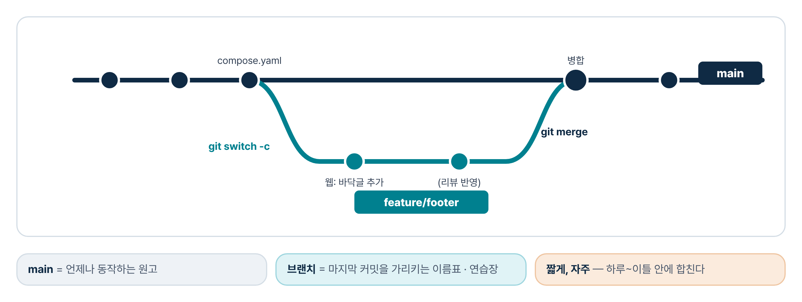

<sub>[🏠 과정 목차](../../README.md) › [2주차](../README.md) › [5일차](README.md) › 4/7교시</sub>

# 4교시 · Git 브랜치

> [!NOTE]
> **이번 시간에 할 일**
>
> - 혼자 `main`에 바로 커밋하던 방식이 팀에서 왜 문제가 되는지 이해합니다.
> - **브랜치**가 무엇인지 그림으로 이해합니다.
> - 브랜치를 만들고, 오가고, 합치고, 지웁니다.
> - 짧게 사는 브랜치와 GitHub Flow를 압니다.

## 지금까지의 방식 — 모두가 main에

2주차 1일차부터 우리는 `git commit` → `git push`를 바로 `main`에 했습니다. 혼자라면 괜찮습니다. 하지만 다섯 명이 한 저장소의 `main`에 동시에 커밋한다고 생각해 보세요.

- 동료가 **고치는 중인 반쯤 된 코드**가 내 화면에 섞여 들어옵니다.
- 누군가의 실수 하나로 `main`이 깨지면 **모두가 멈춥니다.**
- 아무도 내 변경을 **보지 않은 채** 운영에 나갈 수 있습니다.

해결책은 **"`main`은 언제나 동작하는 상태로 두고, 작업은 따로 한 뒤 검토를 거쳐 합친다"**입니다. 이 "따로"가 **브랜치**입니다.

## 브랜치 = 갈라져 나온 작업 줄기



> **🧩 비유 — 원고와 연습장**
>
> `main`은 출판사에 넘길 **원고**입니다. 원고에 바로 낙서하지 않고, 원고를 **복사한 연습장(브랜치)**에서 마음껏 고칩니다. 다 고친 뒤 편집자(리뷰어)가 보고 "좋다"고 하면 원고에 옮겨 적습니다(병합). 연습장이 엉망이 되어도 원고는 안전하고, 여러 사람이 각자 연습장을 가질 수 있습니다.

Git의 브랜치는 실제로 파일을 복사하지 않습니다. 2주차 1일차 3교시에 배운 대로 커밋은 **내용 주소(해시)**로 저장되고, 브랜치는 **"이 줄기의 마지막 커밋이 어디인지 가리키는 이름표"**일 뿐입니다. 그래서 브랜치를 만드는 데는 순간이면 충분하고, 공간도 거의 들지 않습니다.

## 실습 7 · 브랜치에서 작업하고 합치기

> **🧪 실습: 실습 목표**
>
> DevMart 웹 화면에 바닥글(footer)을 다는 작업을 브랜치에서 하고, `main`과 오가며 차이를 본 뒤 합칩니다.

### 단계 1 — 지금 어디에 있나

```bash
cd ~/devops-lab
git status
git branch
```

> **🟢 확인: 보이는 것**
>
> ```text
> On branch main
> Your branch is up to date with 'origin/main'.
> nothing to commit, working tree clean
> * main
> ```
> `*`는 **지금 서 있는 브랜치**입니다. 작업 전에는 항상 "어느 브랜치에 있나", "깨끗한가(clean)"부터 확인합니다.

### 단계 2 — 브랜치 만들고 옮겨 가기

```bash
git switch -c feature/footer
git branch
```

- `git switch -c 이름` : 새 브랜치를 만들고(**c**reate) 그리로 옮겨 간다
- 이름 규칙: `feature/하는-일`처럼 **무엇을 하는 브랜치인지** 드러나게. 버그 수정은 `fix/…`

> **🟢 확인: 보이는 것**
>
> ```text
> Switched to a new branch 'feature/footer'
> * feature/footer
>   main
> ```

### 단계 3 — 브랜치에서 고치고 커밋

`devmart/web/index.html`의 `</main>` 바로 아래에 한 줄을 넣습니다.

```html
  </main>
  <footer style="padding:16px 32px;color:#64748b">© 2026 DevMart · 2주차 실습</footer>
```

```bash
git add devmart/web/index.html
git commit -m "웹: 바닥글 추가"
git log --oneline --graph --all -5
```

> **🟢 확인: 보이는 것**
>
> ```text
> * db271c8 (HEAD -> feature/footer) 웹: 바닥글 추가
> * 7dbcc1a (origin/main, main) 5일차: compose.yaml로 DevMart 실행, …
> * …
> ```
> `feature/footer`는 한 칸 앞서 있고, `main`과 `origin/main`(GitHub)은 아직 그 전 커밋에 있습니다. `HEAD`는 "지금 내가 서 있는 곳"입니다.

### 단계 4 — main으로 돌아가 보기

```bash
git switch main
grep -c footer devmart/web/index.html
```

> **🟢 확인: 보이는 것**
>
> ```text
> Switched to branch 'main'
> 0
> ```
> 바닥글이 **사라졌습니다.** `main`에는 아직 그 커밋이 없으니까요. 브라우저를 새로 고쳐 보면(바인드 마운트!) 화면에서도 바닥글이 없습니다. 다시 `git switch feature/footer`를 하면 돌아옵니다. Git이 브랜치를 옮길 때마다 **폴더의 파일을 그 브랜치의 상태로 바꿔 놓는** 것입니다.

> [!WARNING]
> **고친 것을 커밋하지 않고 브랜치를 옮기면**
>
> 커밋하지 않은 변경이 있으면 Git이 `switch`를 거절하거나, 변경이 **다른 브랜치로 따라 넘어갑니다.** 초보 때 가장 흔한 혼란입니다. 브랜치를 옮기기 전에 `git status`가 `clean`인지 확인하는 습관을 들입니다.

### 단계 5 — 합치고 정리하기

```bash
git switch main
git merge feature/footer
git push
git branch -d feature/footer
git log --oneline --graph --all -3
```

> **🟢 확인: 이렇게 나오면 성공**
>
> ```text
> Updating 7dbcc1a..db271c8
> Fast-forward
>  devmart/web/index.html | 1 +
>  1 file changed, 1 insertion(+)
> Deleted branch feature/footer (was db271c8).
> * db271c8 (HEAD -> main, origin/main) 웹: 바닥글 추가
> ```
> **Fast-forward**(빨리 감기)는 `main`이 그동안 움직이지 않아서, `main` 이름표를 앞으로 **옮기기만** 하면 된 경우입니다. 합친 뒤 다 쓴 브랜치는 `-d`로 지웁니다.

이번에는 **혼자** 브랜치를 만들고 **혼자** 합쳤습니다. 다음 시간에는 합치기 전에 **동료가 검토하는 단계(Pull Request)**를 넣습니다.

## 자주 쓰는 브랜치 명령

| 하고 싶은 것 | 명령 |
|---|---|
| 브랜치 목록 (`*` = 현재) | `git branch` |
| 새로 만들고 옮겨 가기 | `git switch -c feature/이름` |
| 있는 브랜치로 옮겨 가기 | `git switch 이름` |
| 브랜치 줄기 그림 | `git log --oneline --graph --all` |
| 지금 브랜치에 다른 브랜치 합치기 | `git merge 다른브랜치` |
| 다 쓴 브랜치 지우기 | `git branch -d 이름` |
| 새 브랜치를 GitHub에 처음 올리기 | `git push -u origin 이름` |

> [!TIP]
> **`checkout`과 `switch`**
>
> 인터넷 자료에는 `git checkout -b 이름`이 많이 나옵니다. 같은 일을 합니다. `checkout`이 하는 일이 너무 많아 헷갈렸기 때문에, Git 2.23(2019)부터 브랜치 옮기기는 **`switch`**, 파일 되돌리기는 **`restore`**로 나뉘었습니다. 이 과정은 새 명령을 씁니다.

## 브랜치 전략 — 짧게, 자주

| 방식 | 모양 | 특징 |
|---|---|---|
| **GitHub Flow** | `main` + 짧은 `feature/…` | `main`은 언제나 배포 가능. 브랜치 → PR → 리뷰 → 병합 → 배포. **이 과정의 방식** |
| 트렁크 기반 개발 | `main`(트렁크)에 아주 짧은 브랜치를 하루 안에 합침 | 고성과 팀의 특징으로 연구됨 (아래 학술 노트) |
| Git Flow | `main`, `develop`, `release/…`, `hotfix/…` | 정해진 날 배포하는 제품에 맞음. 규칙이 많고 브랜치가 오래 산다 |

> **❓ 오해 — '브랜치는 기능이 다 될 때까지 오래 키우는 것'**
>
> 브랜치가 오래 살수록 `main`과 **멀어지고**, 합칠 때 충돌이 커집니다(6교시). 좋은 습관은 **작게 나눠, 하루~이틀 안에** 합치는 것입니다. "쇼핑몰 장바구니 전체"가 아니라 "장바구니 담기 버튼", "수량 바꾸기"처럼 잘게 나눕니다.

> **🎓 학술 노트 — 짧게 사는 브랜치와 성과 (Forsgren, Humble & Kim, 2018)**
>
> 1주차에 본 DORA 연구를 책으로 정리한 『Accelerate』(Forsgren, Humble, Kim, 2018)는 수년간의 설문 분석에서 **배포 성과를 예측하는 기술 실천** 중 하나로 **트렁크 기반 개발**을 꼽았습니다. 고성과 팀일수록 ① 동시에 열려 있는 브랜치가 **3개 이하**로 적고 ② 브랜치가 **하루 이내**에 `main`에 합쳐지며 ③ "코드 동결(code freeze)" 기간이 거의 없었습니다.
>
> 이유는 간단합니다. 오래 떨어져 있던 코드일수록 합칠 때 문제가 많고, 문제가 늦게 발견될수록 고치는 비용이 큽니다. 1주차 5일차의 **CI(지속적 통합)**라는 이름 자체가 "**자주 통합하라**"는 뜻입니다. 3주차에 PR마다 자동 테스트를 돌리는 CI를 만들 때, 오늘의 "짧은 브랜치"가 그 전제입니다.
>
> - Forsgren, N., Humble, J., & Kim, G. (2018). *Accelerate: The Science of Lean Software and DevOps*. IT Revolution. (4장 기술 실천)

> **📈 트렌드 — 병합도 줄을 선다: 머지 큐**
>
> 여러 사람이 동시에 PR을 합치면, 각각은 테스트를 통과했어도 **합쳐진 결과**는 깨질 수 있습니다. 그래서 큰 팀에서는 **머지 큐(merge queue)**를 씁니다. 병합하려는 PR들이 줄을 서고, 도구가 "현재 `main` + 내 변경"을 다시 테스트한 뒤 차례로 합칩니다. GitHub도 저장소 규칙으로 머지 큐를 제공합니다. 목표는 같습니다. **`main`은 언제나 동작한다.**

## 정리

- 팀에서는 `main`을 언제나 동작하는 상태로 두고, 작업은 **브랜치**에서 한다.
- 브랜치 = 마지막 커밋을 가리키는 **이름표**. 만들기 빠르고 가볍다.
- `git switch -c`, `git switch`, `git merge`, `git branch -d`, `git log --oneline --graph --all`.
- 브랜치를 옮기면 폴더의 파일도 그 브랜치 상태로 바뀐다. 옮기기 전에 `git status`.
- **짧게, 자주** 합친다. 이 과정은 GitHub Flow.

> **✅ 확인 문제**
>
> 1. 팀원 모두가 `main`에 바로 커밋하면 생기는 문제 두 가지는?
> 2. Git 브랜치가 만들기 빠르고 가벼운 이유는?
> 3. `feature/footer`에서 커밋한 뒤 `git switch main`을 하면 바닥글은 어떻게 되나요?
> 4. `Fast-forward` 병합은 어떤 경우인가요?
> 5. 『Accelerate』가 말하는 고성과 팀의 브랜치 특징은?
>
> <details><summary>정답</summary>
>
> 1. 반쯤 된 코드가 섞이고, 한 사람의 실수로 `main`이 깨져 모두가 멈추며, 검토 없이 나간다 (중 두 가지)
> 2. 파일을 복사하지 않고 마지막 커밋을 가리키는 이름표만 만들기 때문
> 3. 폴더에서 사라진다 (main에는 아직 그 커밋이 없다). 다시 feature/footer로 가면 돌아온다
> 4. main이 그동안 움직이지 않아 main 이름표를 앞으로 옮기기만 하면 되는 경우
> 5. 브랜치가 적고(3개 이하) 하루 안에 main에 합쳐진다
>
> </details>

## 참고 문헌

- Chacon, S., & Straub, B. *Pro Git* (2nd ed.) — 3장 Git 브랜치. git-scm.com/book/ko/v2
- GitHub Docs. *GitHub flow*. docs.github.com/get-started/using-github/github-flow
- Forsgren, N., Humble, J., & Kim, G. (2018). *Accelerate*. IT Revolution.
- GitHub Docs. *Managing a merge queue*. docs.github.com

---

| 이전 | 목차 | 다음 |
|:--|:--:|--:|
| ⬅️ [3교시 · Compose로 하는 일상 작업](lesson-03.md) | [⬆️ 5일차 목차](README.md) | [5교시 · Pull Request와 코드 리뷰](lesson-05.md) ➡️ |
