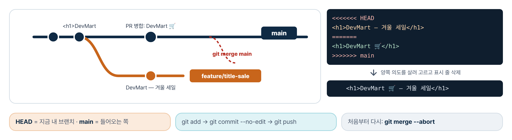

<sub>[🏠 과정 목차](../../README.md) › [2주차](../README.md) › [5일차](README.md) › 6/8교시</sub>

# 6교시 · 충돌 해결

> [!NOTE]
> **이번 시간에 할 일**
>
> - **충돌(conflict)**이 언제 생기고 언제 생기지 않는지 이해합니다.
> - PR 두 개로 일부러 충돌을 만듭니다.
> - 충돌 표시(`<<<<<<<`, `=======`, `>>>>>>>`)를 읽고 VS Code에서 해결합니다.
> - 충돌을 줄이는 습관을 정리합니다.

## 충돌은 언제 생기나

Git은 똑똑해서 대부분의 병합을 **알아서** 합니다. 두 사람이 **다른 파일**이나 같은 파일의 **다른 줄**을 고쳤다면 둘 다 받아들이면 그만입니다. 문제는 **같은 파일의 같은 줄**을 두 사람이 **다르게** 고쳤을 때입니다. 어느 쪽이 맞는지 Git은 알 수 없으므로, 사람에게 묻습니다. 이것이 충돌입니다.

| 상황 | 결과 |
|---|---|
| 다른 파일을 고침 | 자동 병합 |
| 같은 파일, 다른 줄 | 자동 병합 |
| 같은 파일, **같은 줄**을 다르게 | **충돌** — 사람이 골라야 함 |
| 한쪽은 고치고, 한쪽은 파일을 지움 | **충돌** |

> **🧩 비유 — 같은 문장에 다른 빨간 펜**
>
> 편집자 두 명이 원고의 **다른 쪽**을 고쳤다면 둘 다 반영하면 됩니다. 그런데 둘이 **같은 문장**을 서로 다르게 고쳤다면, 작가가 직접 보고 "이걸로 하자" 또는 "둘을 섞자"를 정해야 합니다. Git은 그 문장 자리에 **두 버전을 나란히 적어 두고** 작가를 부릅니다.



## 실습 12 · 일부러 충돌 만들기

> **🧪 실습: 실습 목표**
>
> 같은 줄(웹 화면 제목)을 고치는 브랜치 두 개로 PR 두 개를 만들고, 하나를 먼저 병합해 나머지에 충돌이 생기게 합니다.

### 단계 1 — 두 브랜치, 같은 줄

```bash
cd ~/devops-lab
git switch main && git pull
git switch -c feature/title-cart
```

`devmart/web/index.html`의 제목 줄을 바꿉니다.

```html
    <h1>DevMart 🛒</h1>
```

```bash
git commit -am "웹: 제목에 장바구니 아이콘"
git push -u origin feature/title-cart
gh pr create --title "웹: 제목에 장바구니 아이콘" --body "제목 옆에 🛒 추가"
```

이번에는 **`main`에서 다시** 두 번째 브랜치를 만듭니다. (첫 번째 브랜치에서 만들면 안 됩니다. 두 사람이 각자 `main`에서 출발한 상황을 흉내 내는 것입니다.)

```bash
git switch main
git switch -c feature/title-sale
```

같은 줄을 **다르게** 바꿉니다.

```html
    <h1>DevMart — 겨울 세일</h1>
```

```bash
git commit -am "웹: 제목에 겨울 세일 문구"
git push -u origin feature/title-sale
gh pr create --title "웹: 제목에 겨울 세일 문구" --body "시즌 문구 추가"
```

### 단계 2 — 첫 PR을 먼저 병합

```bash
gh pr list
gh pr merge feature/title-cart --squash --delete-branch
```

- PR 번호 대신 **브랜치 이름**으로도 고를 수 있습니다

### 단계 3 — 두 번째 PR 보기

```bash
gh pr view feature/title-sale --web
```

> **🟢 확인: 보이는 것**
>
> PR 페이지 아래쪽에 회색 상자로 **"This branch has conflicts that must be resolved"**가 보이고 **Merge** 버튼이 비활성화되어 있습니다. 충돌 파일로 `devmart/web/index.html`이 표시됩니다. `main`의 제목은 이미 `DevMart 🛒`인데, 이 브랜치는 원래의 `DevMart`를 `DevMart — 겨울 세일`로 바꾸려고 하기 때문입니다.

## 실습 13 · 충돌 풀기

> **🧪 실습: 실습 목표**
>
> 내 노트북에서 최신 `main`을 두 번째 브랜치에 합쳐 충돌을 재현하고, VS Code로 풀어서 다시 push합니다.

### 단계 1 — 최신 main을 내 브랜치로 가져오기

```bash
git switch main
git pull
git switch feature/title-sale
git merge main
```

> **🟢 확인: 보이는 것**
>
> ```text
> Auto-merging devmart/web/index.html
> CONFLICT (content): Merge conflict in devmart/web/index.html
> Automatic merge failed; fix conflicts and then commit the result.
> ```

```bash
git status
```

> **🟢 확인: 보이는 것**
>
> ```text
> On branch feature/title-sale
> You have unmerged paths.
>   (fix conflicts and run "git commit")
>   (use "git merge --abort" to abort the merge)
>
> Unmerged paths:
>   (use "git add <file>..." to mark resolution)
>         both modified:   devmart/web/index.html
> ```
> `both modified` — 양쪽이 모두 고친 파일입니다. Git이 친절하게 **다음에 할 일**(`fix conflicts and run "git commit"`)과 **되돌리는 법**(`git merge --abort`)까지 알려 줍니다.

### 단계 2 — 충돌 표시 읽기

```bash
code devmart/web/index.html
```

제목 줄 자리에 이렇게 적혀 있습니다.

```text
<<<<<<< HEAD
    <h1>DevMart — 겨울 세일</h1>
=======
    <h1>DevMart 🛒</h1>
>>>>>>> main
```

| 표시 | 뜻 |
|---|---|
| `<<<<<<< HEAD` 부터 `=======` 까지 | **지금 내 브랜치**(feature/title-sale)의 내용 |
| `=======` 부터 `>>>>>>> main` 까지 | **합치려는 쪽**(main)의 내용 |
| 표시 줄 세 개 | Git이 넣은 것. 해결할 때 **모두 지워야** 한다 |

### 단계 3 — 고르기

VS Code는 충돌 부분 위에 작은 버튼을 보여 줍니다.

- **Accept Current Change** — 내 것(겨울 세일)만
- **Accept Incoming Change** — 들어오는 것(🛒)만
- **Accept Both Changes** — 둘 다 (두 줄이 됨)

오늘은 **둘을 섞기로** 합니다. 표시 줄을 모두 지우고 한 줄로 직접 씁니다.

```html
    <h1>DevMart 🛒 — 겨울 세일</h1>
```

> [!TIP]
> **고를 기준은 '무엇이 맞는가'**
>
> 충돌 해결은 기계적으로 한쪽을 고르는 일이 아닙니다. **두 변경의 의도**를 이해하고 둘 다 살릴 수 있으면 살립니다. 모르겠으면 상대 PR을 열어 보거나 **작성자에게 물어봅니다.** 충돌은 "대화하라"는 신호이기도 합니다.

### 단계 4 — 확인하고 완료하기

```bash
grep -n "<<<<<<<\|>>>>>>>\|=======" devmart/web/index.html || echo "충돌 표시 없음"
```

표시가 남아 있지 않은지 확인합니다. 남은 표시가 그대로 커밋되는 실수가 생각보다 많습니다. 브라우저를 새로 고쳐 제목도 눈으로 확인합니다(바인드 마운트!).

```bash
git add devmart/web/index.html
git commit --no-edit
git push
```

- `git add` : "이 파일의 충돌을 해결했다"고 Git에 알린다
- `git commit --no-edit` : Git이 미리 만들어 둔 메시지(`Merge branch 'main' into feature/title-sale`)로 병합 커밋을 만든다

> **🟢 확인: 이렇게 되면 성공**
>
> PR 페이지를 새로 고치면 회색 상자가 **"This branch has no conflicts with the base branch"**로 바뀌고 **Merge** 버튼이 초록색이 됩니다.

```bash
gh pr merge feature/title-sale --squash --delete-branch
git log --oneline -3
```

> **🛠️ 막혔다면: 막혔다면**
>
> | 상황 | 해결 |
> |---|---|
> | 무엇을 했는지 모르겠고 처음부터 다시 하고 싶다 | `git merge --abort` — 병합 전 상태로 돌아간다 |
> | `git commit`을 했더니 이상한 편집기 화면이 떴다 | `--no-edit`를 빠뜨려 Git이 메시지 편집기(vim 등)를 열었다. vim이면 `Esc` → `:wq` → `Enter` |
> | 충돌 표시를 지우지 않고 커밋했다 | 파일을 고치고 새 커밋을 만들어 push. 브라우저에 `<<<<<<<`가 보이는 것으로 발견하는 경우가 많다 |
> | GitHub 화면의 **Resolve conflicts** 버튼 | 간단한 충돌은 웹 편집기에서도 풀 수 있다. 다만 결과를 **실행해 보고** 확인할 수 없으므로, 오늘처럼 노트북에서 푸는 방법을 먼저 익힌다 |

## 충돌을 줄이는 습관

| 습관 | 이유 |
|---|---|
| 작업 시작 전 `git switch main && git pull` | 최신에서 출발한다 |
| 브랜치는 **작게, 짧게** (4교시) | 떨어져 있는 시간이 짧을수록 충돌이 작다 |
| 오래 걸리면 중간에 `git merge main` | 충돌을 작을 때 조금씩 푼다 |
| 같은 파일을 크게 고치기 전에 팀에 공유 | "제가 `index.html` 전체를 정리할게요" 한마디로 큰 충돌을 피한다 |
| 자동 정렬(포매터)을 팀 전체가 같은 설정으로 | 공백·줄바꿈만 다른 "가짜 충돌"을 없앤다 |

> **❓ 오해 — '충돌이 났다 = 누군가 잘못했다'**
>
> 충돌은 **여러 사람이 동시에 일한다는 증거**일 뿐, 잘못이 아닙니다. 위험한 것은 충돌을 **대충** 푸는 것입니다. 남의 변경을 확인 없이 지워 버리면(`Accept Current`만 누르기) 동료의 작업이 조용히 사라집니다. 충돌을 풀 때는 **양쪽 의도를 모두 이해했는지** 스스로 묻습니다.

> **🎓 학술 노트 — 글자로는 합쳐져도 동작은 충돌할 수 있다 (Brun et al., 2011)**
>
> 워싱턴 대학의 브런(Yuriy Brun) 등은 ESEC/FSE 2011 논문 「협업 충돌의 사전 탐지」에서 여러 오픈소스 프로젝트의 기록을 다시 재생하며 충돌을 조사했습니다. 그 결과 오늘 본 것 같은 **글자 충돌(textual conflict)**이 흔하게, 그리고 때로는 며칠씩 해결되지 않은 채 남아 있다는 것을 보였습니다. 더 중요한 발견은 **글자로는 깨끗하게 합쳐졌는데 빌드나 테스트가 깨지는 "고차 충돌"**도 적지 않다는 점입니다. 예를 들어 한 사람은 함수 이름을 바꾸고, 다른 사람은 다른 파일에서 옛 이름으로 그 함수를 부르면 Git은 아무 경고 없이 합쳐 주지만 프로그램은 실행되지 않습니다.
>
> 그래서 "충돌 없음"은 "문제 없음"이 아닙니다. 합친 결과를 **실제로 빌드하고 테스트해 봐야** 합니다. 오늘은 브라우저로 눈으로 확인했고, 3주차에는 PR마다 이 확인을 **CI가 자동으로** 합니다. 4교시 트렌드의 머지 큐도 이 고차 충돌을 막으려는 장치입니다.
>
> - Brun, Y., Holmes, R., Ernst, M. D., & Notkin, D. (2011). Proactive detection of collaboration conflicts. *ESEC/FSE '11*.

> **📈 트렌드 — 충돌을 더 잘 보여 주는 도구들**
>
> VS Code는 충돌 파일을 **세 칸 병합 편집기**(내 것 · 들어오는 것 · 결과)로 열어 줄 수 있습니다. 충돌 부분 아래의 **Resolve in Merge Editor** 버튼을 눌러 보세요. 양쪽의 공통 조상까지 보면서 고를 수 있습니다. AI 도구가 "두 변경의 의도를 합친 결과"를 제안해 주기도 하지만, 그 제안이 맞는지 판단하고 실행해 확인하는 것은 여전히 사람의 몫입니다. 도구가 좋아질수록 **"양쪽 의도를 이해했는가"**라는 질문이 더 중요해집니다.

## 정리

- 충돌 = **같은 파일의 같은 줄**을 두 쪽이 다르게 고쳤을 때. 다른 줄이면 자동 병합.
- 풀기: `git switch main && git pull` → `git switch 내브랜치` → `git merge main` → 파일에서 고르기(표시 줄 삭제) → `git add` → `git commit --no-edit` → `git push`.
- `<<<<<<< HEAD`(내 것) / `=======` / `>>>>>>> main`(들어오는 것).
- 처음부터 다시: `git merge --abort`.
- 글자 충돌이 없어도 동작은 깨질 수 있다 → 합친 뒤 **실행해서 확인**, 3주차부터는 CI가.

> **✅ 확인 문제**
>
> 1. A는 `app.py`를, B는 `index.html`을 고쳤습니다. 병합하면 충돌이 나나요?
> 2. 충돌 표시에서 `<<<<<<< HEAD`와 `=======` 사이는 누구의 내용인가요?
> 3. 충돌을 해결했다고 Git에 알리는 명령은?
> 4. 병합 도중 엉망이 되어 처음 상태로 돌아가고 싶을 때는?
> 5. Git이 충돌 없이 합쳐 줬는데도 프로그램이 깨질 수 있는 예를 들어 보세요.
>
> <details><summary>정답</summary>
>
> 1. 나지 않는다. 다른 파일이므로 자동 병합된다
> 2. 지금 내가 서 있는 브랜치(HEAD)의 내용
> 3. `git add 파일` (그 뒤 `git commit`)
> 4. `git merge --abort`
> 5. 한 사람은 함수 이름을 바꾸고 다른 사람은 다른 파일에서 옛 이름으로 호출하는 경우 (고차 충돌)
>
> </details>

## 참고 문헌

- Chacon, S., & Straub, B. *Pro Git* (2nd ed.) — 3.2 기본 브랜치와 Merge의 기초 (충돌의 기초). git-scm.com/book/ko/v2
- GitHub Docs. *Resolving a merge conflict using the command line*. docs.github.com/pull-requests
- VS Code Docs. *Resolve merge conflicts — 3-way merge editor*. code.visualstudio.com/docs/sourcecontrol
- Brun, Y., Holmes, R., Ernst, M. D., & Notkin, D. (2011). Proactive detection of collaboration conflicts. *ESEC/FSE '11*.

---

| 이전 | 목차 | 다음 |
|:--|:--:|--:|
| ⬅️ [5교시 · Pull Request와 코드 리뷰](lesson-05.md) | [⬆️ 5일차 목차](README.md) | [7교시 · Compose 심화 — 덧씌우기 파일과 환경별 설정](lesson-07.md) ➡️ |
