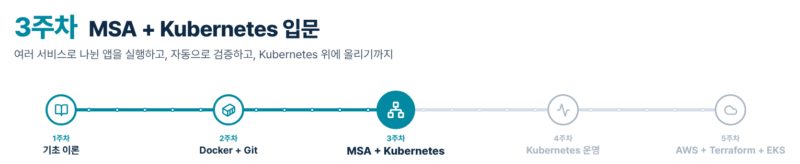

[🏠 과정 목차](../README.md)

# 3주차 · MSA + Kubernetes 입문

📕 3주차 이북 PDF: [보기](../downloads/pdf/week3.pdf) · [내려받기](https://github.com/niceguy61/kdt_devops_lecture_2026_rev2/raw/main/downloads/pdf/week3.pdf)

      

| 일차 | 주제 | 교시 | 슬라이드 |
|:--|:--|:--|:--|
| [**1일차**](day1/README.md) | MSA 개념과 실행 모놀리식과 MSA · 서비스 경계와 데이터 소유 · DevMart MSA 구조 읽기 · 여섯 서비스 실행 · 요청 ID로 통신 추적 · 동기와 비동기 · 연결 장애 | [1](day1/lesson-01.md) [2](day1/lesson-02.md) [3](day1/lesson-03.md) [4](day1/lesson-04.md) [5](day1/lesson-05.md) [6](day1/lesson-06.md) [7](day1/lesson-07.md) | [📊 PPTX](https://github.com/niceguy61/kdt_devops_lecture_2026_rev2/raw/main/downloads/pptx/week3-day1.pptx) |
| [**2일차**](day2/README.md) | MSA 장애와 CI 장애 전파 · 타임아웃과 재시도 · 헬스 체크와 재시작 · 큐 적체와 메시지 유실 · GitHub Actions · 자동 테스트 · 이미지 자동 빌드와 GHCR | [1](day2/lesson-01.md) [2](day2/lesson-02.md) [3](day2/lesson-03.md) [4](day2/lesson-04.md) [5](day2/lesson-05.md) [6](day2/lesson-06.md) [7](day2/lesson-07.md) | [📊 PPTX](https://github.com/niceguy61/kdt_devops_lecture_2026_rev2/raw/main/downloads/pptx/week3-day2.pptx) |
| [**3일차**](day3/README.md) | Kubernetes 아키텍처 왜 Kubernetes인가 · 컨트롤 플레인 · 노드와 Pod · 선언형과 reconcile · 장단점과 선택지 · kubectl과 kind 설치 · 첫 클러스터 | [1](day3/lesson-01.md) [2](day3/lesson-02.md) [3](day3/lesson-03.md) [4](day3/lesson-04.md) [5](day3/lesson-05.md) [6](day3/lesson-06.md) [7](day3/lesson-07.md) | [📊 PPTX](https://github.com/niceguy61/kdt_devops_lecture_2026_rev2/raw/main/downloads/pptx/week3-day3.pptx) |
| [**4일차**](day4/README.md) | Pod · Deployment · Service kubectl 루프 · 첫 Pod · Pod 장애 읽기 · Deployment · ReplicaSet과 자가 치유 · Service와 DNS · 롤링 업데이트와 되돌리기 | [1](day4/lesson-01.md) [2](day4/lesson-02.md) [3](day4/lesson-03.md) [4](day4/lesson-04.md) [5](day4/lesson-05.md) [6](day4/lesson-06.md) [7](day4/lesson-07.md) | [📊 PPTX](https://github.com/niceguy61/kdt_devops_lecture_2026_rev2/raw/main/downloads/pptx/week3-day4.pptx) |
| [**5일차**](day5/README.md) | 운영 가능한 워크로드 Namespace · ConfigMap과 Secret · probe · requests와 limits · DevMart MSA를 Kubernetes에 · 장애 연습 · 3주차 회고 | [1](day5/lesson-01.md) [2](day5/lesson-02.md) [3](day5/lesson-03.md) [4](day5/lesson-04.md) [5](day5/lesson-05.md) [6](day5/lesson-06.md) [7](day5/lesson-07.md) | [📊 PPTX](https://github.com/niceguy61/kdt_devops_lecture_2026_rev2/raw/main/downloads/pptx/week3-day5.pptx) |

교시 칸의 숫자는 교시 번호입니다. 처음이라면 1일차 목차부터 열고, 각 페이지 맨 아래의 <b>다음 ➡️</b>를 따라가세요.
