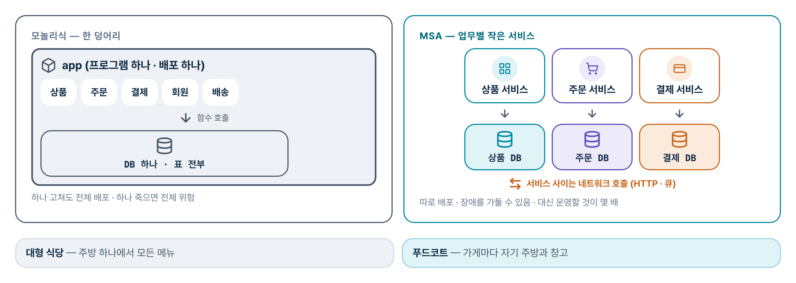

[🏠 과정 목차](../../README.md) › [3주차](../README.md) › [1일차](README.md)

# 1교시 · 모놀리식과 MSA

> [!NOTE]
> **이번 시간에 할 일**
>
> - 2주차에 만든 것을 10분 안에 되짚습니다.
> - **모놀리식**과 **마이크로서비스(MSA)**가 무엇인지 그림으로 이해합니다.
> - 둘을 배포 단위, 장애 범위, 확장, 운영 비용으로 비교합니다.
> - "MSA가 항상 정답은 아니다"라는 업계의 논쟁을 압니다.

## 2주차 10분 요약

| 일차 | 핵심 | 오늘 다시 쓰는 것 |
|---|---|---|
| 2일차 | 컨테이너 실행 · `logs` · `exec` | 서비스마다 로그를 읽는다 |
| 3일차 | Dockerfile · 이미지 · 캐시 | 서비스 셋을 각자 빌드한다 |
| 4일차 | 볼륨 · 네트워크 · 환경 변수 | 서비스 이름이 주소, 설정은 환경 변수로 |
| 5일차 | Compose · 헬스 체크 · `--scale` | 여섯 서비스를 한 줄로, 처리기를 3개로 |

손으로 한 번 확인합니다. 2주차 DevMart가 아직 떠 있다면 내려 둡니다.

```bash
cd ~/devops-lab/devmart
docker compose ps
docker compose down
```

`down`은 데이터(볼륨)를 남긴다는 것도 기억하세요(2주차 5일차 2교시).

## 모놀리식 — 한 덩어리

2주차의 `catalog-api`에 주문 기능을 넣는다고 생각해 봅시다. 가장 쉬운 방법은 `app.py`에 `/api/orders`를 추가하고, 같은 DB에 `orders` 표를 만드는 것입니다. 상품, 주문, 결제, 회원, 배송이 모두 **하나의 코드, 하나의 프로그램, 하나의 DB**에 들어갑니다. 이것을 **모놀리식(monolithic) 아키텍처**라고 합니다. '모놀리스'는 한 덩어리 돌이라는 뜻입니다.

모놀리식은 나쁜 것이 아닙니다. 처음 시작하는 서비스는 대부분 모놀리식입니다. 코드가 한곳에 있으니 이해하기 쉽고, 함수 호출 한 번이면 다른 기능을 쓸 수 있으며, 배포도 하나만 하면 됩니다.

문제는 회사와 서비스가 **커졌을 때** 생깁니다.

- 주문 코드 한 줄을 고쳐도 **상품 · 회원 · 결제까지 전부** 다시 빌드하고 배포해야 합니다.
- 주문 기능의 버그가 메모리를 다 쓰면 **상품 목록까지** 함께 멈춥니다.
- 연말 세일에 주문만 몰리는데, 늘릴 수 있는 것은 **프로그램 전체**뿐입니다.
- 개발자 100명이 한 저장소, 한 배포 일정에 묶여 서로를 기다립니다.

## 마이크로서비스 — 여러 개의 작은 서비스

**마이크로서비스 아키텍처(MSA, Microservice Architecture)**는 앱을 **업무 기능별로 작은 서비스**로 나눕니다. 각 서비스는 **자기 프로그램, 자기 데이터, 자기 배포 일정**을 갖고, 서로 **네트워크(HTTP, 메시지 큐)**로 대화합니다.



> **🧩 비유 — 대형 식당과 푸드코트**
>
> **모놀리식은 대형 식당**입니다. 주방 하나에서 한식 · 중식 · 양식을 모두 만듭니다. 메뉴 하나를 바꾸려 해도 주방 전체가 움직이고, 가스가 끊기면 모든 메뉴가 멈춥니다. **MSA는 푸드코트**입니다. 가게마다 자기 주방과 재료 창고가 있습니다. 중식집이 문을 닫아도 한식집은 영업하고, 점심에 줄이 긴 가게만 직원을 늘릴 수 있습니다. 대신 **손님 안내, 공용 계산대, 가게 사이 연락**이라는 새 일이 생깁니다. 그 "새 일"을 맡는 사람이 바로 인프라 · 플랫폼 엔지니어입니다.

## 무엇을 얻고 무엇을 잃나

| 기준 | 모놀리식 | MSA |
|---|---|---|
| 배포 단위 | 전체 한 번에 | 서비스마다 따로 — 주문만 하루 열 번 배포 가능 |
| 장애 범위 | 한 기능의 문제가 전체를 멈출 수 있다 | 잘 설계하면 한 서비스에 가둔다. **잘못 설계하면 연쇄로 퍼진다** (2일차) |
| 확장 | 전체를 통째로 늘린다 | 바쁜 서비스만 늘린다 (오늘 6교시) |
| 기술 선택 | 하나의 언어 · 프레임워크 | 서비스마다 고를 수 있다 |
| 기능 사이 호출 | 함수 호출 — 빠르고 실패하지 않는다 | **네트워크 호출** — 느릴 수 있고 실패할 수 있다 |
| 데이터 | 한 DB, 조인과 트랜잭션이 쉽다 | 서비스마다 DB, 서비스를 넘는 조인 · 트랜잭션이 어렵다 |
| 운영 | 프로그램 하나만 보면 된다 | 서비스 수만큼 **빌드 · 배포 · 모니터링 · 로그**가 는다 |
| 어울리는 곳 | 작은 팀, 초기 서비스 | 큰 조직, 팀마다 독립적으로 움직여야 할 때 |

표의 왼쪽이 "단순함", 오른쪽이 "독립성"입니다. MSA는 **독립성을 사는 대신 복잡함이라는 값을 치르는** 선택입니다. 1주차 3일차 6교시의 「분산 컴퓨팅의 8가지 오류」가 전부 현실이 되는 구조이기도 합니다. 함수 호출이 네트워크 호출로 바뀌는 순간, "네트워크는 믿을 수 있다", "지연 시간은 0이다"라는 착각이 모두 깨집니다.

> **❓ 오해 — 'MSA = 컨테이너를 여러 개 띄우는 것'**
>
> 컨테이너를 여러 개 띄운다고 MSA가 되지는 않습니다. 2주차 DevMart도 컨테이너가 셋이었지만, 그것은 **웹 서버 · 앱 · DB라는 기술 계층**을 나눈 것입니다. MSA는 **업무 기능**(상품, 주문, 결제)을 나누고, 각 기능이 **자기 데이터를 소유**하고 **따로 배포**되는 것입니다. 반대로 서비스를 열 개로 나눴는데 모두 한 DB의 같은 표를 고치고 늘 함께 배포해야 한다면, 그것은 MSA의 비용만 치르는 **분산 모놀리스(distributed monolith)**입니다. 2교시에서 경계를 나누는 기준을 봅니다.

> **📖 용어 — 서비스와 컨테이너**
>
> **서비스**는 하나의 업무 책임을 맡은 프로그램 단위입니다(예: 주문 서비스). **컨테이너**는 그 서비스를 실행하는 상자입니다. 서비스 하나가 컨테이너 여러 개로 실행될 수 있습니다(6교시의 처리기 3개, 3주차 후반 Kubernetes의 Pod 여러 개).

## 인프라 엔지니어에게 MSA가 뜻하는 것

개발자에게 MSA는 "코드를 어떻게 나누나"의 문제지만, 인프라 엔지니어에게는 **"관리할 것이 몇 배로 늘어난다"**는 뜻입니다.

| 모놀리식에서 하나였던 것 | MSA에서는 | 이 과정에서 |
|---|---|---|
| 이미지 하나 | 서비스 수만큼 이미지, 태그, 레지스트리 | 3주차 2일차 CI로 자동 빌드 |
| 배포 하나 | 서비스마다 배포 · 롤백 | 3주차 Kubernetes, 4주차 ArgoCD |
| 설정 파일 하나 | 서비스마다 환경 변수 · 비밀값 | 3주차 5일차 ConfigMap · Secret |
| 로그 한 곳 | 서비스마다 흩어진 로그 | 오늘 5교시 요청 ID, 4주차 로그 수집 |
| 함수 호출 | 네트워크 호출 · 타임아웃 · 재시도 | 3주차 2일차, 4주차 Istio |
| 내부 통신은 신경 안 씀 | 서비스 사이 보안 · 인증 | 4주차 Istio mTLS |

그래서 이번 주의 질문은 **"여러 서비스를 어떻게 실행하고, 연결을 확인하고, 문제를 찾고, 자동으로 배포할 것인가"**입니다.

> **🎓 학술 노트 — '마이크로서비스'라는 이름 (Lewis & Fowler, 2014)**
>
> '마이크로서비스'라는 말은 2011~2012년 무렵 소프트웨어 설계자들의 워크숍에서 쓰이기 시작했고, 제임스 루이스(James Lewis)와 마틴 파울러(Martin Fowler)가 2014년 3월 글 「Microservices」에서 그 특징을 정리하며 널리 퍼졌습니다. 이들이 꼽은 특징은 ① 서비스로 나눈 구성 요소 ② **업무 능력(business capability)**을 중심으로 한 조직 ③ 프로젝트가 아니라 제품 ④ 똑똑한 끝점과 단순한 연결 통로 ⑤ 분산된 데이터 관리 ⑥ 인프라 자동화 ⑦ 실패를 전제한 설계 등입니다.
>
> 눈여겨볼 것은 ⑥과 ⑦입니다. 글은 "자동화된 빌드 · 배포 없이는 마이크로서비스를 운영할 수 없다"고 강조하고, 서비스가 언제든 실패할 수 있다는 전제에서 설계해야 한다고 말합니다. 파울러는 같은 해 「마이크로서비스의 전제 조건(MicroservicePrerequisites)」이라는 글에서 **빠른 서버 준비, 기본 모니터링, 빠른 배포**를 갖추지 못한 조직은 MSA를 시작하지 말라고 조언했습니다. 이 과정의 2~5주차가 바로 그 전제 조건들입니다.
>
> - Lewis, J., & Fowler, M. (2014). *Microservices: a definition of this new architectural term*. martinfowler.com/articles/microservices.html

> **📈 트렌드 — '모듈러 모놀리스'의 귀환**
>
> 2010년대 후반 "모두 MSA로"라는 유행 뒤에, 많은 팀이 **필요 이상으로 잘게 쪼갠 비용**을 경험했습니다. 2023년 아마존 프라임 비디오 팀은 영상 품질 감시 시스템을 여러 서버리스 서비스로 나눴다가 **하나의 프로그램으로 다시 합쳐 인프라 비용을 90% 줄였다**는 사례를 공개해 큰 화제가 되었습니다. 그 뒤로 **모듈러 모놀리스** — 프로그램은 하나로 배포하되 안쪽은 경계가 분명한 모듈로 나눠 두는 방식 — 가 다시 주목받고 있습니다. 결론은 "MSA냐 아니냐"가 아니라, **조직 규모와 바뀌는 속도에 맞게 고르는 것**입니다. 오늘 DevMart를 나누는 것도 "이렇게 해야 한다"가 아니라, MSA를 **운영하는 연습**을 하기 위해서입니다.

## 정리

- **모놀리식** = 기능 전체가 한 프로그램 · 한 DB · 한 배포. 단순하지만 커지면 함께 묶인다.
- **MSA** = 업무 기능별 서비스가 자기 데이터와 배포를 갖고 네트워크로 대화. 독립적이지만 복잡하다.
- 함수 호출이 **네트워크 호출**이 되는 순간 실패 · 지연 · 타임아웃을 다뤄야 한다.
- 인프라 엔지니어에게 MSA는 이미지 · 배포 · 설정 · 로그 · 통신이 **서비스 수만큼** 느는 것.
- MSA는 정답이 아니라 선택. 모듈러 모놀리스도 좋은 선택지다.

> **✅ 확인 문제**
>
> 1. 모놀리식에서 주문 코드 한 줄을 고치면 무엇을 다시 배포해야 하나요?
> 2. MSA에서 기능 사이 호출이 함수 호출에서 무엇으로 바뀌나요? 그래서 생기는 문제 두 가지는?
> 3. 서비스는 열 개로 나눴지만 모두 한 DB의 같은 표를 고치고 항상 함께 배포한다면, 이것을 무엇이라고 부르나요?
> 4. 파울러가 말한 "MSA의 전제 조건" 세 가지는?
> 5. 프라임 비디오 사례가 주는 교훈은?
>
> <details><summary>정답</summary>
>
> 1. 프로그램 전체 (상품 · 회원 · 결제까지)
> 2. 네트워크 호출. 느려질 수 있고, 실패할 수 있다 (타임아웃, 연결 거부 등)
> 3. 분산 모놀리스 (distributed monolith)
> 4. 빠른 서버 준비, 기본 모니터링, 빠른(자동) 배포
> 5. 잘게 나누는 것이 항상 이득은 아니다. 규모와 상황에 맞게 골라야 한다
>
> </details>

## 참고 문헌

- Lewis, J., & Fowler, M. (2014). *Microservices*. martinfowler.com/articles/microservices.html
- Fowler, M. (2014). *MicroservicePrerequisites*. martinfowler.com/bliki/MicroservicePrerequisites.html
- Kolny, M. (2023). *Scaling up the Prime Video audio/video monitoring service and reducing costs by 90%*. Prime Video Tech Blog.
- AWS Whitepaper. *Implementing Microservices on AWS*. docs.aws.amazon.com/whitepapers

---

⬅️ 이전: [3주차 1일차 목차](README.md) &nbsp;|&nbsp; [⬆️ 1일차 목차](README.md) &nbsp;|&nbsp; 다음: [2교시 · 서비스 경계와 데이터 소유](lesson-02.md) ➡️
