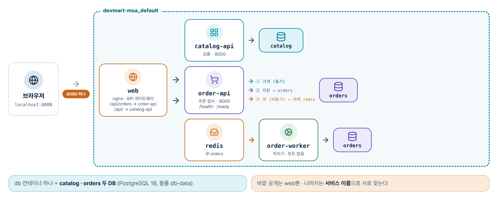

<sub>[🏠 과정 목차](../../README.md) › [3주차](../README.md) › [1일차](README.md) › 3/8교시</sub>

# 3교시 · DevMart MSA 구조 읽기

> [!NOTE]
> **이번 시간에 할 일**
>
> - DevMart MSA의 여섯 서비스와 **요청이 흐르는 방향**을 그림으로 익힙니다.
> - 인프라 엔지니어가 서비스마다 알아야 할 **일곱 가지**를 정리합니다.
> - `compose.yaml`을 읽고 서비스 목록표를 직접 채웁니다.
> - nginx가 **주소에 따라** 요청을 나눠 보내는 방법(API 게이트웨이)을 봅니다.

## 전체 그림



요청은 두 갈래로 흐릅니다.

1. **상품 보기**: 브라우저 → `web` → `catalog-api` → `db`(catalog)
2. **주문하기**: 브라우저 → `web` → `order-api` → ① `catalog-api`에 가격 확인 → ② `db`(orders)에 저장 → ③ `redis` 큐에 넣기 → (나중에) `order-worker`가 꺼내 처리 → `db`(orders) 상태 변경

바깥으로 열린 문은 2주차처럼 **`web`의 8080 하나**입니다.

## 서비스마다 알아야 할 일곱 가지

개발자가 "주문 서비스가 이상해요"라고 할 때, 인프라 엔지니어가 바로 답할 수 있어야 하는 것들입니다. 서비스가 늘어날수록 이 표가 **운영의 지도**가 됩니다.

| 항목 | 질문 | 어디서 보나 |
|---|---|---|
| ① 이름 | 네트워크에서 뭐라고 부르나? | `compose.yaml`의 서비스 이름 |
| ② 포트 | 어느 포트에서 듣나? 바깥에 열렸나? | Dockerfile `EXPOSE`, `ports:` |
| ③ 의존 | 누구를 부르나? 누가 나를 부르나? | 환경 변수(`*_HOST`, `*_URL`), nginx 설정 |
| ④ 설정 | 어떤 환경 변수가 필요한가? 비밀값은? | `environment:`, `.env` |
| ⑤ 헬스 | 살아 있는지 어떻게 아나? | `/health`, `/ready`, `healthcheck:` |
| ⑥ 로그 | 어디에 무엇을 남기나? | `docker compose logs 서비스` |
| ⑦ 데이터 | 무엇을 저장하나? 지우면 무엇이 사라지나? | `volumes:`, DB 이름 |

## 실습 2 · compose.yaml로 서비스 목록표 채우기

> **🧪 실습: 실습 목표**
>
> 실행하기 **전에** `compose.yaml`만 읽고 서비스 목록표를 채웁니다. 4교시에 실행한 뒤 맞았는지 확인합니다.

아래는 오늘 실습의 `compose.yaml`입니다(4교시에 파일로 받습니다). 2주차 5일차에 배운 문법 그대로이고, 서비스만 늘었습니다.

```yaml
name: devmart-msa

services:
  web:
    image: nginx:1.30-alpine
    ports:
      - "8080:80"
    volumes:
      - ./web:/usr/share/nginx/html:ro
      - ./nginx/default.conf:/etc/nginx/conf.d/default.conf:ro
    depends_on:
      - catalog-api
      - order-api

  catalog-api:
    build: ./catalog-api
    image: devmart/catalog-api:2.0.0
    environment:
      APP_ENV: compose
      DB_HOST: db
      DB_NAME: catalog
      DB_USER: devmart
      DB_PASSWORD: ${DB_PASSWORD:?DB_PASSWORD를 .env 파일에 적어 주세요}
    depends_on:
      db:
        condition: service_healthy

  order-api:
    build: ./order-api
    image: devmart/order-api:1.0.0
    environment:
      DB_HOST: db
      DB_NAME: orders
      DB_USER: devmart
      DB_PASSWORD: ${DB_PASSWORD:?DB_PASSWORD를 .env 파일에 적어 주세요}
      CATALOG_URL: http://catalog-api:8000
      CATALOG_TIMEOUT: "2"
      REDIS_HOST: redis
      QUEUE_NAME: orders
    depends_on:
      db:
        condition: service_healthy
      redis:
        condition: service_started

  order-worker:
    build: ./order-worker
    image: devmart/order-worker:1.0.0
    environment:
      DB_HOST: db
      DB_NAME: orders
      DB_USER: devmart
      DB_PASSWORD: ${DB_PASSWORD:?DB_PASSWORD를 .env 파일에 적어 주세요}
      REDIS_HOST: redis
      QUEUE_NAME: orders
      WORK_SECONDS: "1"
    depends_on:
      db:
        condition: service_healthy
      redis:
        condition: service_started

  redis:
    image: redis:8-alpine

  db:
    image: postgres:18
    environment:
      POSTGRES_DB: catalog
      POSTGRES_USER: devmart
      POSTGRES_PASSWORD: ${DB_PASSWORD:?DB_PASSWORD를 .env 파일에 적어 주세요}
    volumes:
      - db-data:/var/lib/postgresql
      - ./db/init:/docker-entrypoint-initdb.d:ro
    healthcheck:
      test: ["CMD-SHELL", "pg_isready -U devmart -d catalog"]
      interval: 5s
      timeout: 3s
      retries: 10

volumes:
  db-data:
```

`~/devops-lab/notes/week3-day1.md`에 표를 만들어 채웁니다. 몇 칸은 예시로 채워 두었습니다.

```markdown
| 서비스 | 포트(안) | 바깥 공개 | 부르는 대상 | 필요한 설정 | 헬스 | 데이터 |
|---|---|---|---|---|---|---|
| web | 80 | 8080 | catalog-api, order-api | 없음 | | 없음 |
| catalog-api | 8000 | 없음 | db(catalog) | DB_HOST, DB_NAME, DB_PASSWORD | /health | |
| order-api | | | | | /health, /ready | |
| order-worker | | | | | | |
| redis | | | | | | |
| db | | | | | | |
```

<details><summary>채운 표 (먼저 직접 해 보고 펼치기)</summary>

| 서비스 | 포트(안) | 바깥 공개 | 부르는 대상 | 필요한 설정 | 헬스 | 데이터 |
|---|---|---|---|---|---|---|
| web | 80 | 8080 | catalog-api, order-api | 없음 | (없음 — nginx 상태로 판단) | 없음 |
| catalog-api | 8000 | 없음 | db(catalog) | DB_HOST, DB_NAME, DB_PASSWORD | /health | 없음 (db에 저장) |
| order-api | 8000 | 없음 | catalog-api, db(orders), redis | CATALOG_URL, DB_*, REDIS_HOST, QUEUE_NAME | /health, /ready | 없음 (db · redis에 저장) |
| order-worker | **없음** | 없음 | redis, db(orders) | DB_*, REDIS_HOST, QUEUE_NAME, WORK_SECONDS | (없음 — 로그로 판단) | 없음 |
| redis | 6379 | 없음 | 없음 | 없음 | (없음) | 큐 메시지 (볼륨 없음 → 지우면 사라짐) |
| db | 5432 | 없음 | 없음 | POSTGRES_* | pg_isready | db-data 볼륨 |

</details>

### 읽으면서 찾아낼 것 다섯 가지

1. **`catalog-api`와 `order-api`가 둘 다 8000번**을 씁니다. 충돌하지 않을까요? → 컨테이너마다 네트워크 공간이 따로라 괜찮습니다(2주차 4일차 4교시). 노트북의 포트에 연결(`ports:`)할 때만 충돌합니다.
2. **`order-worker`에는 포트가 없습니다.** 요청을 받는 서버가 아니라, 큐에서 일을 **꺼내 가는** 프로그램이기 때문입니다. 그래서 `/health`도 없고, 상태는 **로그**로 봅니다.
3. **`order-api`와 `order-worker`의 `QUEUE_NAME`이 같아야** 합니다. 한쪽만 바꾸면 어떻게 될까요? 7교시에 해 봅니다.
4. **`redis`에는 볼륨이 없습니다.** 처리 대기 중인 메시지는 redis를 지우면 사라집니다. 실습에서는 괜찮지만 운영에서는 큰 문제입니다(2일차).
5. `DB_PASSWORD`가 네 번 나옵니다. 모두 `.env`의 **같은 값**을 읽습니다. 2주차 4일차 6교시의 "비밀값은 한 곳에".

## nginx — 주소로 나눠 보내는 안내 데스크

`nginx/default.conf`도 2주차보다 한 줄 늘었습니다.

```nginx
server {
    listen 80;
    root /usr/share/nginx/html;
    index index.html;

    # 요청마다 고유 번호를 붙여 뒤쪽 서비스들에 넘긴다 (분산 추적의 출발점)
    proxy_set_header X-Request-ID $request_id;
    add_header X-Request-ID $request_id always;

    # 주소에 따라 다른 서비스로 보낸다 (API 게이트웨이 역할)
    location /api/orders {
        proxy_pass http://order-api:8000;
    }

    location /api/ {
        proxy_pass http://catalog-api:8000;
    }

    location / {
        try_files $uri $uri/ /index.html;
    }
}
```

| 요청 주소 | 맞는 `location` | 보내는 곳 |
|---|---|---|
| `/api/orders` | `/api/orders` (더 길게 맞는 쪽이 이긴다) | `order-api` |
| `/api/products/3` | `/api/` | `catalog-api` |
| `/api/info` | `/api/` | `catalog-api` |
| `/index.html` | `/` | 파일 |

nginx는 주소의 앞부분이 **가장 길게 일치하는** `location`을 고릅니다. 그래서 `/api/orders`는 `/api/`보다 구체적인 `/api/orders`로 갑니다.

이렇게 바깥 요청을 한곳에서 받아 **주소에 따라 알맞은 서비스로 보내는** 역할을 **API 게이트웨이**라고 합니다. 브라우저는 서비스가 몇 개인지, 어디 있는지 몰라도 됩니다. 서비스를 나누거나 합쳐도 **바깥 주소는 그대로** 둘 수 있습니다.

`X-Request-ID` 두 줄은 5교시의 주인공입니다. 지금은 "nginx가 요청마다 번호표를 붙인다"고만 기억해 둡니다.

> **📖 용어 — 동서 트래픽과 남북 트래픽**
>
> 데이터센터 그림에서 바깥(위)에서 안으로 들어오는 요청을 **남북(north-south) 트래픽**, 서비스끼리 옆으로 주고받는 요청을 **동서(east-west) 트래픽**이라고 부릅니다. 오늘 DevMart에서 브라우저 → web은 남북, order-api → catalog-api는 동서입니다. MSA에서는 **동서 트래픽이 훨씬 많아집니다.** 4주차 Istio는 주로 이 동서 트래픽을 다룹니다.

> **🎓 학술 노트 — 게이트웨이 패턴과 '앞단을 위한 뒷단'**
>
> API 게이트웨이는 오래된 아이디어의 MSA판입니다. 에릭 감마(Erich Gamma) 등의 『디자인 패턴』(1994)에 나오는 **퍼사드(Facade) 패턴** — 복잡한 내부를 숨기고 단순한 창구 하나를 내보인다 — 과 같은 생각이지요. MSA에서는 넷플릭스가 2013년 무렵 자사 블로그에서 소개한 API 게이트웨이(Zuul)와, 사운드클라우드의 필 칼사도(Phil Calçado)가 2015년에 이름 붙인 **BFF(Backend for Frontend, 앞단을 위한 뒷단)** 패턴이 널리 알려졌습니다. BFF는 웹 · 모바일 앱처럼 **화면마다 전용 게이트웨이**를 두어, 각 화면에 필요한 데이터를 알맞게 모아 주는 방식입니다. 게이트웨이가 많은 일을 할수록 **그 자체가 단일 장애 지점**이 되기 쉽다는 점도 함께 기억해야 합니다.

> **📈 트렌드 — Kubernetes Gateway API**
>
> 오늘은 nginx 설정 파일로 주소별 안내를 직접 적었습니다. Kubernetes에서는 이 일을 예전에 **Ingress**라는 객체로 했는데, 기능이 부족해 회사마다 제각각의 확장을 붙여 썼습니다. 그래서 Kubernetes 공동체는 **Gateway API**라는 새 표준을 만들었고(2023년 정식), 주소 · 헤더별 안내, 가중치로 나누기 같은 기능을 표준 문법으로 정의했습니다. 널리 쓰이던 Ingress NGINX 컨트롤러도 은퇴를 발표하면서(1주차 3일차) 이동이 빨라지고 있습니다. 4주차에 Gateway API와 Istio로 오늘의 `location` 블록을 다시 만납니다.

## 정리

- DevMart MSA: `web` · `catalog-api` · `order-api` · `order-worker` · `redis` · `db`. 바깥 문은 8080 하나.
- 서비스마다 **이름 · 포트 · 의존 · 설정 · 헬스 · 로그 · 데이터** 일곱 가지를 표로 관리한다.
- 포트는 컨테이너마다 따로라 같은 8000이어도 괜찮다. `order-worker`는 포트가 없다.
- nginx = **API 게이트웨이**. 주소가 가장 길게 맞는 `location`으로 보낸다.
- 서비스끼리 주고받는 **동서 트래픽**이 MSA의 핵심 운영 대상.

> **✅ 확인 문제**
>
> 1. `catalog-api`와 `order-api`가 둘 다 8000번을 써도 충돌하지 않는 이유는?
> 2. `order-worker`에 포트와 `/health`가 없는 이유는?
> 3. `/api/orders` 요청은 nginx의 `/api/`와 `/api/orders` 중 어디로 가나요? 이유는?
> 4. `redis`를 `docker compose down -v` 없이 그냥 지웠다 다시 만들면 무엇이 사라지나요?
> 5. order-api → catalog-api 호출은 남북 트래픽인가요, 동서 트래픽인가요?
>
> <details><summary>정답</summary>
>
> 1. 컨테이너마다 네트워크 공간이 따로다. 노트북 포트에 연결할 때만 충돌한다
> 2. 요청을 받는 서버가 아니라 큐에서 일을 꺼내 가는 프로그램이기 때문. 상태는 로그로 본다
> 3. `/api/orders` — nginx는 가장 길게 일치하는 location을 고른다
> 4. 처리 대기 중인 큐 메시지 (볼륨이 없다)
> 5. 동서 트래픽 (서비스끼리)
>
> </details>

## 참고 문헌

- Docker Docs. *Compose file reference — services*. docs.docker.com/reference/compose-file/services
- nginx Docs. *ngx_http_core_module — location*, *$request_id*. nginx.org/en/docs/http/ngx_http_core_module.html
- Richardson, C. *Pattern: API Gateway / Backends for Frontends*. microservices.io
- Calçado, P. (2015). *Pattern: Backends For Frontends*. philcalcado.com
- Kubernetes Docs. *Gateway API*. kubernetes.io/docs/concepts/services-networking/gateway

---

| 이전 | 목차 | 다음 |
|:--|:--:|--:|
| ⬅️ [2교시 · 서비스 경계와 데이터 소유](lesson-02.md) | [⬆️ 1일차 목차](README.md) | [4교시 · 여섯 서비스 실행하기](lesson-04.md) ➡️ |
