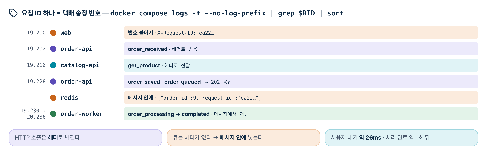

<sub>[🏠 과정 목차](../../README.md) › [3주차](../README.md) › [1일차](README.md) › 5/8교시</sub>

# 5교시 · 요청 ID로 통신 추적하기

> [!NOTE]
> **이번 시간에 할 일**
>
> - MSA에서 로그가 **흩어지는 문제**를 직접 겪어 봅니다.
> - nginx가 붙인 **요청 ID** 하나로 네 서비스의 로그를 이어 읽습니다.
> - 요청 하나가 어떤 순서로 서비스를 지나가는지 **시간 순 기록**을 만듭니다.
> - 구조화된(JSON) 로그가 왜 필요한지 이해합니다.

## 문제 — 로그가 네 군데에 흩어진다

모놀리식이었다면 주문 하나에 대한 기록은 **프로그램 하나의 로그**에 차례대로 남았을 것입니다. DevMart MSA에서 주문 하나는 `web` → `order-api` → `catalog-api` → `order-api` → `redis` → `order-worker`를 지나갑니다. 기록도 **네 서비스의 로그**에 나뉘어 남습니다. 1초에 주문이 100개씩 들어오면, `order-worker` 로그의 한 줄이 `order-api` 로그의 어느 줄과 같은 주문인지 어떻게 알까요?



해결책은 **요청이 처음 들어올 때 번호표를 붙이고, 모든 서비스가 그 번호를 이어 넘기며 로그에 적는 것**입니다. 이 번호를 **요청 ID**(request ID, correlation ID)라고 합니다.

> **🧩 비유 — 택배 송장 번호**
>
> 택배는 집하장 → 허브 → 지역 센터 → 배송 기사로 넘어갑니다. 각 장소는 자기 장부를 따로 씁니다. 그래도 고객은 **송장 번호 하나**로 전체 경로를 조회할 수 있습니다. 모든 장소가 같은 송장 번호로 기록하기 때문입니다. 요청 ID가 MSA의 송장 번호입니다.

## DevMart에서 번호표가 이어지는 방법

| 구간 | 번호를 넘기는 방법 | 코드/설정 |
|---|---|---|
| 브라우저 → nginx | nginx가 새 번호를 만든다 | `$request_id` (32자리 16진수) |
| nginx → `order-api` · `catalog-api` | HTTP 헤더 `X-Request-ID` | `proxy_set_header X-Request-ID $request_id;` |
| `order-api` → `catalog-api` | 받은 헤더를 그대로 붙여 호출 | `headers={"X-Request-ID": request_id}` |
| `order-api` → 큐 → `order-worker` | **메시지 안에** 함께 넣는다 | `{"order_id": 1, "request_id": "…"}` |
| 모든 서비스 | 로그 한 줄마다 적는다 | `{"service": …, "event": …, "request_id": …}` |

HTTP 호출은 헤더로, 큐 메시지는 **내용 안에** 넣어 넘깁니다. 큐에는 헤더가 없기 때문입니다. 어느 한 곳이라도 넘기기를 빠뜨리면 거기서 추적이 끊깁니다.

## 실습 4 · 주문 하나의 여행 기록

> **🧪 실습: 실습 목표**
>
> 주문을 하나 넣고, 응답 헤더의 요청 ID로 네 서비스의 로그를 시간 순으로 모읍니다.

### 단계 1 — 주문하고 요청 ID 받기

```bash
cd ~/devops-lab/devmart-msa
curl -si -X POST http://localhost:8080/api/orders \
  -H 'Content-Type: application/json' -d '{"product_id": 1}'
```

- `-i` : 응답 **헤더**까지 보여 준다

> **🟢 확인: 보이는 것**
>
> ```text
> HTTP/1.1 202 ACCEPTED
> Server: nginx/1.30.6
> Content-Type: application/json
> X-Request-ID: ea2298f15fcb37bfc986679ba76b7622
>
> {"order_id":9,"request_id":"ea2298f15fcb37bfc986679ba76b7622","status":"pending","total_price":59000}
> ```
> **202 Accepted** — "받았고, 처리는 나중에 하겠다"는 상태 코드입니다(6교시). 헤더의 `X-Request-ID`와 본문의 `request_id`가 같습니다.

### 단계 2 — 번호를 변수에 담기

긴 번호를 매번 복사하기 번거로우니 셸 변수에 담습니다.

```bash
RID=ea2298f15fcb37bfc986679ba76b7622        # 내 화면의 번호로 바꾼다
echo $RID
```

### 단계 3 — 모든 서비스의 로그에서 찾기

```bash
docker compose logs -t --no-log-prefix | grep $RID | sort
```

- `-t` : 줄마다 **시각**을 붙인다
- `--no-log-prefix` : 줄 앞의 `서비스-1 |`를 뺀다 (시각으로 정렬하기 위해)
- `grep $RID` : 이 요청의 줄만 고른다
- `sort` : 시각 순으로 정렬한다 — 서비스가 달라도 **일어난 순서**대로 보인다

> **🟢 확인: 이렇게 나오면 성공**
>
> ```text
> 2026-11-25T03:14:19.202Z {"service": "order-api", "event": "order_received", "request_id": "ea22…", "product_id": 1, "quantity": 1}
> 2026-11-25T03:14:19.216Z {"service": "catalog-api", "event": "get_product", "request_id": "ea22…", "product_id": 1}
> 2026-11-25T03:14:19.227Z {"service": "order-api", "event": "order_saved", "request_id": "ea22…", "order_id": 9, "total_price": 59000}
> 2026-11-25T03:14:19.228Z {"service": "order-api", "event": "order_queued", "request_id": "ea22…", "order_id": 9}
> 2026-11-25T03:14:19.230Z {"service": "order-worker", "event": "order_processing", "request_id": "ea22…", "order_id": 9}
> 2026-11-25T03:14:20.236Z {"service": "order-worker", "event": "order_completed", "request_id": "ea22…", "order_id": 9}
> ```
> (화면에서는 시각이 더 길고, `order-worker` 줄에는 `worker` 칸도 있습니다.)

### 단계 4 — 여행 기록 해석하기

`notes/week3-day1.md`에 표로 옮깁니다.

| 시각 (초) | 서비스 | 사건 | 걸린 시간 |
|---|---|---|---|
| 19.202 | order-api | 주문 받음 | — |
| 19.216 | catalog-api | 상품 조회 | 약 14ms (네트워크 + DB) |
| 19.227 | order-api | 주문 저장 | 약 11ms |
| 19.228 | order-api | 큐에 넣음 → **여기서 202 응답** | 1ms |
| 19.230 | order-worker | 처리 시작 | 큐에서 꺼내는 데 2ms |
| 20.236 | order-worker | 처리 완료 | **약 1초** (WORK_SECONDS) |

사용자가 기다린 시간은 **약 26ms**(19.202 → 19.228)이고, 실제 처리가 끝난 것은 **약 1초 뒤**입니다. 오래 걸리는 일을 큐 뒤로 보낸 덕분입니다. 그리고 `catalog-api` 호출 한 번에 14ms가 들었습니다. 함수 호출이었다면 1ms도 걸리지 않았을 일입니다. 1교시에 말한 "네트워크 호출의 비용"이 숫자로 보입니다.

### 단계 5 — nginx 로그와 비교

```bash
docker compose logs web --no-log-prefix | tail -3
```

> **🟢 확인: 보이는 것**
>
> ```text
> 172.18.0.1 - - [25/Nov/2026:03:14:19 +0000] "POST /api/orders HTTP/1.1" 202 102 "-" "curl/8.5.0"
> ```
> nginx의 기본 로그에는 요청 ID가 **없습니다.** 그래서 nginx 줄은 `grep $RID`에 걸리지 않았습니다. 게이트웨이 로그에도 번호를 남기려면 nginx의 `log_format`에 `$request_id`를 넣어야 합니다. 3주차 2일차에 장애 조사를 하며 직접 바꿔 봅니다.

## 왜 JSON 로그인가

2주차 `catalog-api`의 로그는 사람이 읽기 좋은 문장이었습니다(`DB 조회 실패: …`). 오늘 서비스들은 **한 줄에 JSON 하나**를 씁니다.

```json
{"service": "order-api", "event": "order_saved", "request_id": "ea22…", "order_id": 9, "total_price": 59000}
```

| | 문장 로그 | JSON 로그 |
|---|---|---|
| 사람이 읽기 | 쉽다 | 조금 불편하다 |
| 기계가 고르기 | 정규식으로 힘들게 | `request_id`, `order_id` 같은 **칸 이름으로** 바로 |
| 여러 서비스 합치기 | 서비스마다 형식이 달라 어렵다 | 같은 칸 이름이면 쉽게 합쳐진다 |
| 4주차 로그 수집 도구 | 파싱 규칙을 따로 써야 한다 | 그대로 읽는다 |

서비스가 하나일 때는 문장 로그도 충분하지만, 서비스가 늘어나면 **기계가 읽을 수 있는 로그**가 필수가 됩니다. 이것을 **구조화된 로그(structured logging)**라고 합니다. 팀 전체가 `service`, `event`, `request_id` 같은 **칸 이름을 약속**해 두는 것이 중요합니다.

> [!TIP]
> **jq로 JSON 로그 보기**
>
> `sudo apt install jq`로 `jq`를 설치하면 JSON 로그를 보기 좋게 고를 수 있습니다.
> ```bash
> docker compose logs order-api --no-log-prefix | grep '^{' | jq -r '[.event, .order_id] | @tsv'
> ```

> **❓ 오해 — '로그만 잘 남기면 추적은 끝'**
>
> 요청 ID 추적은 "무슨 일이 있었나"는 알려 주지만, "**어디서 얼마나 오래 걸렸나**"를 보려면 오늘처럼 시각을 빼고 더하는 수작업이 필요합니다. 서비스가 수십 개면 불가능합니다. 그래서 각 구간의 시작과 끝을 자동으로 재서 **폭포 모양 그림**으로 보여 주는 **분산 추적(distributed tracing)** 도구가 생겼습니다. 오늘의 요청 ID는 그 도구의 **추적 ID(trace ID)**와 같은 역할입니다. 4주차에 OpenTelemetry로 자동화합니다.

> **🎓 학술 노트 — 구글의 Dapper (Sigelman et al., 2010)**
>
> 분산 추적을 대중화한 것은 구글의 기술 보고서 「Dapper, 대규모 분산 시스템 추적 기반 구조」(2010)입니다. 구글의 검색 요청 하나는 수천 대의 서버를 거치는데, 느린 요청이 **어디서** 느려졌는지 아무도 알 수 없었습니다. Dapper는 요청이 들어올 때 **추적 ID**를 붙이고, 서비스가 다른 서비스를 부를 때마다 **구간(span)** 하나를 만들어 "누가 누구를 불렀고(부모-자식), 언제 시작해 언제 끝났는지"를 기록했습니다.
>
> 보고서의 핵심 설계 원칙은 ① **모든 곳에 있어야 한다**(한 서비스라도 빠지면 추적이 끊긴다) ② **애플리케이션 개발자가 신경 쓰지 않아도 되도록** 공용 통신 라이브러리 안에 넣는다 ③ **오버헤드가 작아야 한다**(그래서 모든 요청이 아니라 일부만 표본 추출)였습니다. 오늘 실습에서 큐 메시지에 `request_id`를 직접 넣어야 했던 것이 ①의 어려움이고, 4주차 Istio가 사이드카로 추적 헤더를 자동으로 다루는 것이 ②의 답입니다. Dapper의 설계는 Zipkin(트위터, 2012), Jaeger(우버, 2015)를 거쳐 오늘의 OpenTelemetry로 이어졌습니다.
>
> - Sigelman, B. H., Barroso, L. A., Burrows, M., Stephenson, P., Plakal, M., Beaver, D., Jaspan, S., & Shanbhag, C. (2010). *Dapper, a Large-Scale Distributed Systems Tracing Infrastructure*. Google Technical Report.

> **📈 트렌드 — W3C Trace Context와 OpenTelemetry**
>
> 오늘은 `X-Request-ID`라는 이름을 우리끼리 약속해 썼습니다. 회사마다, 도구마다 헤더 이름이 달라 서로 이어지지 않는 문제가 있었기 때문에, W3C(웹 표준 기구)는 **Trace Context**라는 표준을 만들어 `traceparent`라는 헤더 하나로 추적 정보를 넘기도록 정했습니다(2020년 권고안). 그리고 CNCF의 **OpenTelemetry**가 로그 · 지표 · 추적을 모으는 사실상의 표준 도구가 되었습니다. 1주차 1일차에 본 CNCF 조사에서 운영 환경 사용률이 약 50%였던 바로 그 도구입니다. 4주차에는 오늘의 `X-Request-ID`를 `traceparent`로 바꾸고, Jaeger 같은 화면에서 폭포 그림으로 봅니다.

## 정리

- MSA에서는 요청 하나의 기록이 **여러 서비스의 로그에 흩어진다.**
- **요청 ID**를 입구(nginx)에서 붙이고, HTTP는 **헤더**로, 큐는 **메시지 안**에 넣어 이어 넘긴다.
- `docker compose logs -t --no-log-prefix | grep $RID | sort` — 서비스를 넘어 시간 순 기록.
- 사용자는 약 26ms 기다렸고, 처리는 약 1초 뒤 끝났다. 서비스 간 호출 한 번에 십수 ms.
- **구조화된(JSON) 로그**는 기계가 칸 이름으로 고르고 합칠 수 있게 한다.
- 요청 ID → 분산 추적(Dapper → OpenTelemetry)의 출발점.

> **✅ 확인 문제**
>
> 1. MSA에서 요청 ID가 필요한 이유는?
> 2. HTTP 호출과 큐 메시지에서 요청 ID를 넘기는 방법은 각각?
> 3. `docker compose logs`에 `-t`와 `sort`를 함께 쓰는 이유는?
> 4. 오늘 실습에서 nginx 로그가 `grep $RID`에 나오지 않은 이유는?
> 5. Dapper가 말한 분산 추적의 설계 원칙 하나를 말해 보세요.
>
> <details><summary>정답</summary>
>
> 1. 요청 하나의 기록이 여러 서비스 로그에 흩어지므로, 같은 요청의 줄을 이어 읽기 위해
> 2. HTTP는 `X-Request-ID` 헤더로, 큐는 메시지 내용 안에 함께 넣는다
> 3. 서비스가 달라도 일어난 시각 순서대로 보기 위해
> 4. nginx의 기본 로그 형식에 `$request_id`가 들어 있지 않기 때문
> 5. 모든 곳에 있어야 한다 / 개발자가 신경 쓰지 않도록 공용 라이브러리에 넣는다 / 오버헤드가 작아야 한다 (표본 추출) 중 하나
>
> </details>

## 참고 문헌

- Sigelman, B. H. et al. (2010). *Dapper, a Large-Scale Distributed Systems Tracing Infrastructure*. Google Technical Report dapper-2010-1.
- W3C (2020). *Trace Context — W3C Recommendation*. w3.org/TR/trace-context
- OpenTelemetry. *Documentation — Traces, Context propagation*. opentelemetry.io/docs
- nginx Docs. *$request_id*, *log_format*. nginx.org/en/docs

---

| 이전 | 목차 | 다음 |
|:--|:--:|--:|
| ⬅️ [4교시 · 여섯 서비스 실행하기](lesson-04.md) | [⬆️ 1일차 목차](README.md) | [6교시 · 동기와 비동기 — 큐와 처리기](lesson-06.md) ➡️ |
