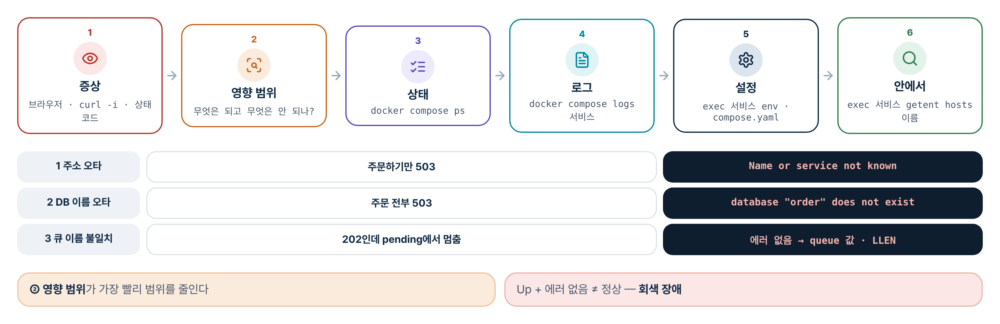

<sub>[🏠 과정 목차](../../README.md) › [3주차](../README.md) › [1일차](README.md) › 7/8교시</sub>

# 7교시 · 장애 시나리오 1 — 연결이 끊겼다

> [!NOTE]
> **이번 시간에 할 일**
>
> - MSA에서 가장 흔한 **설정 실수 세 가지**를 일부러 만듭니다.
> - 증상 → 영향 범위 → 로그 → 설정 순서로 원인을 좁힙니다.
> - **에러가 하나도 없는 장애**(조용한 장애)를 경험합니다.
> - `git restore`로 설정을 되돌립니다.

## 진단 순서 — 바깥에서 안으로



| 순서 | 질문 | 명령 |
|---|---|---|
| ① 증상 | 사용자는 무엇을 보나? 상태 코드는? | 브라우저, `curl -i` |
| ② 영향 범위 | 무엇은 되고 무엇은 안 되나? | 상품 보기 / 주문하기 / 주문 처리를 각각 확인 |
| ③ 상태 | 모든 서비스가 떠 있나? | `docker compose ps` |
| ④ 로그 | 어느 서비스가 무엇을 불평하나? | `docker compose logs 서비스 --tail 20` |
| ⑤ 설정 | 그 서비스의 설정이 맞나? | `docker compose exec 서비스 env`, `compose.yaml` |
| ⑥ 안에서 | 그 서비스 자리에서 상대가 보이나? | `docker compose exec 서비스 getent hosts 이름` |

2주차 4일차 5교시의 "이름 → 연결 → 인증 → DB → 표" 순서를 서비스가 여럿인 상황으로 넓힌 것입니다. 핵심은 ②입니다. **"무엇은 되고 무엇은 안 되나"**를 먼저 확인하면 범위가 확 줄어듭니다.

시작하기 전에 지금 상태가 정상인지(4교시 기준선) 확인하고, `compose.yaml`이 커밋되어 있는지 봅니다. 고장 낸 뒤 `git restore`로 되돌릴 것입니다.

```bash
cd ~/devops-lab/devmart-msa
git status --short .        # 아무것도 안 나와야 한다 (모두 커밋됨)
```

## 장애 1 · 주소 오타

> **🧪 실습: 만들어 보기**
>
> `compose.yaml`의 `order-api` → `environment`에서 `CATALOG_URL`의 서비스 이름을 틀리게 바꿉니다.

```yaml
      CATALOG_URL: http://catalog:8000      # catalog-api 가 맞다
```

```bash
docker compose up -d order-api
```

### 증상과 영향 범위

```bash
curl -s -w '  (HTTP %{http_code})\n' http://localhost:8080/api/products | tail -c 40
curl -s -w '  (HTTP %{http_code})\n' http://localhost:8080/api/orders | tail -c 40
curl -s -w '  (HTTP %{http_code})\n' -X POST http://localhost:8080/api/orders \
  -H 'Content-Type: application/json' -d '{"product_id": 1}'
```

> **🟢 확인: 보이는 것**
>
> ```text
> …,"stock":5}]}  (HTTP 200)
> …}  (HTTP 200)
> {"error":"catalog unavailable","request_id":"0080c016…"}  (HTTP 503)
> ```
> | 기능 | 결과 |
> |---|---|
> | 상품 보기 | ✅ 된다 |
> | 주문 목록 | ✅ 된다 |
> | **주문하기** | ❌ 503 `catalog unavailable` |
>
> 상품 보기는 되니까 **catalog-api는 살아 있습니다.** 그런데 주문할 때만 "catalog를 쓸 수 없다"고 합니다. → 문제는 catalog-api가 아니라 **order-api가 catalog-api를 부르는 길**에 있습니다.

### 로그와 설정

```bash
docker compose logs order-api --no-log-prefix | grep catalog_error | tail -1
docker compose exec order-api env | grep CATALOG
docker compose exec order-api getent hosts catalog
docker compose exec order-api getent hosts catalog-api
```

> **🟢 확인: 보이는 것**
>
> ```text
> {"service": "order-api", "event": "catalog_error", "request_id": "0080c016…", "error": "<urlopen error [Errno -2] Name or service not known>"}
> CATALOG_URL=http://catalog:8000
> 172.18.0.5      catalog-api
> ```
> `Name or service not known` — **이름을 찾지 못했습니다**(2주차 4일차 5교시의 `failed to resolve host`와 같은 뜻). 설정을 보니 `catalog`라고 되어 있고, `getent hosts catalog`는 아무것도 출력하지 않지만 `catalog-api`는 IP가 나옵니다. **원인 확정: 서비스 이름 오타.**

> [!TIP]
> **로그의 request_id로 사용자 문의에 답하기**
>
> 사용자가 "주문이 안 돼요, 화면에 요청 ID `0080c016…`이 떴어요"라고 알려 오면, 5교시처럼 `grep 0080c016`으로 그 요청의 로그만 바로 찾을 수 있습니다. 화면의 주문 실패 알림에 요청 ID를 보여 주도록 만든 이유입니다.

```bash
git restore compose.yaml
docker compose up -d order-api
```

## 장애 2 · DB 이름 오타

> **🧪 실습: 만들어 보기**
>
> 이번엔 `order-api`의 `DB_NAME`을 틀리게 바꿉니다.

```yaml
      DB_NAME: order        # orders 가 맞다
```

```bash
docker compose up -d order-api
curl -s -w '  (HTTP %{http_code})\n' http://localhost:8080/api/products | tail -c 30
curl -s -w '  (HTTP %{http_code})\n' http://localhost:8080/api/orders
curl -s -w '  (HTTP %{http_code})\n' -X POST http://localhost:8080/api/orders \
  -H 'Content-Type: application/json' -d '{"product_id": 1}'
```

> **🟢 확인: 보이는 것**
>
> ```text
> …,"stock":5}]}  (HTTP 200)
> {"error":"database unavailable"}  (HTTP 503)
> {"error":"database unavailable","request_id":"6948e70c…"}  (HTTP 503)
> ```
> 이번에는 **주문 목록까지** 안 됩니다. 주문과 관련된 모든 것이 막혔고, 상품은 됩니다. 브라우저 화면에서도 상품 카드는 나오지만 주문 표에 빨간 글씨가 뜹니다. **한 서비스의 장애가 그 서비스의 기능에만 갇혀 있습니다.** 1교시에 말한 MSA의 장점 — 장애 범위를 가둔다 — 이 보이는 순간입니다.

```bash
docker compose logs order-api --no-log-prefix | grep db_error | tail -1
```

> **🟢 확인: 보이는 것**
>
> ```text
> {"service": "order-api", "event": "db_error", …, "error": "connection failed: connection to server at \"172.18.0.2\", port 5432 failed: FATAL:  database \"order\" does not exist"}
> ```
> IP `172.18.0.2`가 보이므로 **이름 찾기와 연결은 됐고**, 인증도 통과했고, `database "order" does not exist` — **DB가 없습니다.** 2주차 4일차 5교시 진단 표의 네 번째 줄입니다.

```bash
docker compose exec db psql -U devmart -l | head -8
```

`orders`는 있고 `order`는 없습니다. 원인 확정.

```bash
git restore compose.yaml
docker compose up -d order-api
```

## 장애 3 · 조용한 장애 — 큐 이름 불일치

> **🧪 실습: 만들어 보기**
>
> 이번엔 `order-worker`의 큐 이름만 바꿉니다. `order-api`는 그대로 둡니다.

```yaml
  order-worker:
    environment:
      …
      QUEUE_NAME: order      # order-api 는 orders 에 넣는다
```

```bash
docker compose up -d order-worker
curl -s -X POST http://localhost:8080/api/orders \
  -H 'Content-Type: application/json' -d '{"product_id": 2}'; echo
sleep 5
curl -s http://localhost:8080/api/orders | head -c 160; echo
```

> **🟢 확인: 보이는 것**
>
> ```text
> {"order_id":12,"request_id":"33c27652…","status":"pending","total_price":45000}
> {"hostname":"b1e5…","items":[{"id":12,"product_name":"후드 집업","quantity":1,…,"status":"pending",…
> ```
> 주문은 **202로 성공**했습니다. 그런데 5초가 지나도 **pending**입니다. 화면에서도 주문이 주황색 pending에서 멈춰 있습니다.

### 이번엔 에러가 없다

```bash
docker compose ps
docker compose logs order-api --no-log-prefix --tail 3
docker compose logs order-worker --no-log-prefix --tail 3
```

> **🟢 확인: 보이는 것**
>
> ```text
> (모든 서비스 Up)
> {"service": "order-api", "event": "order_received", …}
> {"service": "order-api", "event": "order_saved", …}
> {"service": "order-api", "event": "order_queued", …}
> {"service": "order-worker", …, "event": "worker_started", "queue": "order", "work_seconds": 1.0}
> ```
> 모든 서비스가 **Up**이고, 로그 어디에도 **error가 없습니다.** order-api는 "큐에 넣었다"고 하고, order-worker는 "시작했다" 이후 아무 말이 없습니다. 이런 장애가 가장 무섭습니다. 경보도 울리지 않고, 사용자가 "주문이 처리가 안 돼요"라고 연락해 와야 알게 됩니다.

### 단서 — 로그에 남은 큐 이름과 큐의 상태

로그를 자세히 보면 `worker_started`에 `"queue": "order"`가 있습니다. 큐를 직접 봅니다.

```bash
docker compose exec redis redis-cli KEYS '*'
docker compose exec redis redis-cli LLEN orders
docker compose exec redis redis-cli LLEN order
```

> **🟢 확인: 보이는 것**
>
> ```text
> 1) "orders"
> (integer) 1
> (integer) 0
> ```
> `order-api`가 넣은 `orders` 큐에는 메시지가 **1개 쌓여 있고**, 처리기가 기다리는 `order` 큐는 **비어 있습니다.** 두 서비스가 **서로 다른 우체통**을 보고 있었습니다.

```bash
git restore compose.yaml
docker compose up -d order-worker
sleep 3
docker compose exec redis redis-cli LLEN orders
```

`0`이 되고, 화면의 pending 주문이 completed로 바뀝니다. 메시지가 큐에서 **기다려 준** 덕분에 잃어버린 주문은 없습니다. 6교시에 말한 비동기의 장점입니다.

> [!IMPORTANT]
> **조용한 장애에서 배우는 것**
>
> | 교훈 | 방법 |
> |---|---|
> | "Up"과 "에러 없음"은 정상이 아니다 | 기능이 **끝까지** 되는지 확인한다 (pending → completed) |
> | 두 서비스가 같은 값을 써야 하는 설정은 위험하다 | 한 곳에서 정의하고 둘이 함께 읽는다 (3주차 5일차 ConfigMap) |
> | 비동기는 큐 길이로 감시한다 | `LLEN`이 계속 늘면 경보 (4주차) |
> | 시작할 때 설정을 로그에 남긴다 | `worker_started … "queue": "order"`가 결정적 단서였다 |

## 세 장애 비교

| 장애 | 증상 | 영향 범위 | 로그의 결정적 문장 | 원인 층 |
|---|---|---|---|---|
| 1 주소 오타 | 주문하기 503 | 주문하기만 | `Name or service not known` | 이름 찾기 |
| 2 DB 이름 오타 | 주문 관련 전부 503 | 주문 목록 + 주문하기 | `database "order" does not exist` | DB |
| 3 큐 이름 불일치 | **성공처럼 보이지만** pending에서 멈춤 | 주문 처리 | **없음** — `queue` 값과 `LLEN`으로 찾음 | 서비스 사이 약속 |

`notes/week3-day1.md`에 위 표를 옮기고, 각 장애마다 **"다시 일어나지 않게 하려면?"** 한 줄을 덧붙입니다. 예: "서비스 이름은 compose.yaml에서 복사해 붙인다", "QUEUE_NAME은 한 곳에서 정의한다".

```bash
cd ~/devops-lab
git add notes
git commit -m "3주차 1일차: MSA 장애 3종 진단 기록"
git push
```

> **🎓 학술 노트 — 회색 장애 (Huang et al., 2017)**
>
> 마이크로소프트 연구진과 존스 홉킨스 대학의 황펑(Peng Huang) 등은 HotOS 2017 학회 논문 「회색 장애: 클라우드 규모 시스템의 아킬레스건」에서, 대형 클라우드 장애의 상당수가 **완전히 멈춘 장애**가 아니라 **"감시 시스템은 정상이라고 하는데 사용자는 문제를 겪는"** 상태에서 시작된다고 보고했습니다. 이들은 이것을 **회색 장애(gray failure)**라고 불렀습니다. 흑(멈춤)도 백(정상)도 아닌 회색이라는 뜻입니다.
>
> 논문의 핵심 관찰은 **관찰자의 차이(differential observability)**입니다. 헬스 체크는 "프로세스가 떠 있나"를 보고, 사용자는 "내 일이 끝나나"를 봅니다. 둘이 다른 것을 보는 한, 감시는 초록불인데 사용자는 실패하는 틈이 생깁니다. 오늘 장애 3이 정확히 그것입니다. 모든 컨테이너가 Up이었지만 주문은 끝나지 않았습니다. 논문이 제안하는 방향은 **사용자 관점에서 끝까지 확인하는 감시**를 더하는 것이고, 4주차에 "주문이 pending으로 1분 넘게 머무는 수"를 지표로 만드는 것이 그 예입니다.
>
> - Huang, P., Guo, C., Zhou, L., Lorch, J. R., Dang, Y., Chintalapati, M., & Yao, R. (2017). Gray failure: The Achilles' heel of cloud-scale systems. *HotOS '17*.

> **📈 트렌드 — 설정도 코드처럼 검사한다**
>
> 오늘 세 장애는 모두 **설정 실수**였습니다. 실제로 여러 대형 장애 사후 보고서에서도 설정 변경이 단골 원인으로 꼽힙니다. 그래서 요즘은 설정을 코드처럼 **변경 전에 자동으로 검사**합니다. `docker compose config`처럼 문법을 보는 것을 넘어, "모든 서비스의 큐 이름이 서로 맞는가", "참조하는 서비스 이름이 실제로 있는가" 같은 규칙을 정책 도구로 검사하고, PR 단계의 CI에서 막습니다. 내일 GitHub Actions로 첫 자동 검사를 만들고, 4주차에는 Kubernetes 정책 도구(Kyverno)로 이런 규칙을 클러스터 입구에서 막아 봅니다.

## 정리 — 오늘 끝

> **🧹 정리: 정리**
>
> ```bash
> cd ~/devops-lab/devmart-msa
> docker compose down          # 데이터(db-data 볼륨)는 남긴다
> ```
> 내일 2일차에 같은 DevMart MSA로 장애 전파와 CI를 다룹니다. 볼륨은 남겨 두세요.

- 진단 순서: **증상 → 영향 범위 → 상태 → 로그 → 설정 → 안에서 확인.**
- "무엇은 되고 무엇은 안 되나"가 범위를 가장 빨리 줄인다.
- 장애 1·2는 로그가 알려 줬지만, 장애 3은 **에러 없이** 멈췄다 — 회색 장애.
- 두 서비스가 함께 맞춰야 하는 설정(큐 이름)은 특히 위험하다.
- `git restore`로 설정을 되돌린다. 설정도 버전 관리의 대상이다.

> **✅ 확인 문제**
>
> 1. 장애 1에서 "catalog-api 자체는 정상"이라고 판단한 근거는?
> 2. 장애 2의 로그에 IP가 보였다는 것은 어떤 단계까지 통과했다는 뜻인가요?
> 3. 장애 3에서 `docker compose ps`와 로그만으로 원인을 찾기 어려운 이유는?
> 4. 장애 3을 빨리 알아채려면 무엇을 감시해야 하나요?
> 5. 회색 장애란?
>
> <details><summary>정답</summary>
>
> 1. 상품 보기(catalog-api 직접 호출)는 정상이었다. 주문할 때 order-api → catalog-api 구간만 실패했다
> 2. 이름 찾기와 네트워크 연결 (그리고 인증까지) — 문제는 DB 이름 단계
> 3. 모든 서비스가 Up이고 에러 로그가 없기 때문 (조용한 장애)
> 4. 큐 길이(LLEN), pending 상태로 오래 머문 주문 수
> 5. 감시 시스템은 정상이라고 보는데 사용자는 문제를 겪는, 흑도 백도 아닌 장애
>
> </details>

## 참고 문헌

- Huang, P. et al. (2017). Gray failure: The Achilles' heel of cloud-scale systems. *HotOS '17*.
- Docker Docs. *docker compose exec / logs*. docs.docker.com/reference/cli/docker/compose
- Redis Docs. *KEYS*, *LLEN*. redis.io/docs/latest/commands
- Google SRE Book (2016). *Chapter 12 — Effective Troubleshooting*. sre.google/sre-book

---

| 이전 | 목차 | 다음 |
|:--|:--:|--:|
| ⬅️ [6교시 · 동기와 비동기 — 큐와 처리기](lesson-06.md) | [⬆️ 1일차 목차](README.md) | [8교시 · 서비스 사이의 약속 — API 계약 · 버전 · 하위 호환](lesson-08.md) ➡️ |
