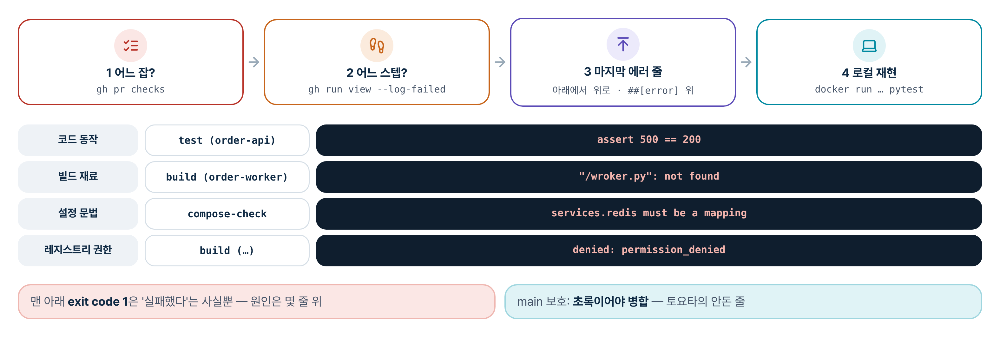

<sub>[🏠 과정 목차](../../README.md) › [3주차](../README.md) › [2일차](README.md) › 7/8교시</sub>

# 7교시 · CI 실패 읽기와 main 보호

> [!NOTE]
> **이번 시간에 할 일**
>
> - CI가 실패하는 **대표적인 세 가지**를 일부러 만들고 로그로 원인을 찾습니다.
> - `main`에 **"CI가 초록이어야 병합 가능"** 규칙을 겁니다.
> - 경로 필터와 필수 검사가 부딪히는 **함정**을 압니다.
> - 오늘을 정리합니다.

## CI 실패 읽는 순서



| 순서 | 질문 | 어디서 |
|---|---|---|
| ① | **어느 잡**이 빨간가? | PR 화면 체크 목록, `gh pr checks` |
| ② | 그 잡의 **어느 스텝**인가? | 실행 화면에서 빨간 스텝, `gh run view --log-failed` |
| ③ | **마지막 에러 줄**은? | 로그 맨 아래에서 위로 — `##[error]` 바로 위 |
| ④ | 내 노트북에서 **재현**되나? | 같은 명령을 로컬에서 (5교시 `docker run … pytest`) |

로그는 **아래에서 위로** 읽습니다. 맨 아래 `Process completed with exit code 1`은 "실패했다"는 사실뿐이고, 진짜 이유는 그 몇 줄 위에 있습니다.

## 실습 16 · 실패 세 가지

> **🧪 실습: 실습 목표**
>
> 한 브랜치에서 실패를 하나씩 만들고, 각각 어느 잡 · 어느 스텝에서 어떤 문장으로 실패하는지 기록합니다.

```bash
cd ~/devops-lab
git switch main && git pull
git switch -c ci/failure-drills
```

### 실패 1 · Dockerfile 오타

`devmart-msa/order-worker/Dockerfile`의 한 줄을 틀리게 고칩니다.

```dockerfile
COPY wroker.py .
```

```bash
git commit -am "실패 연습 1: Dockerfile 오타"
git push -u origin ci/failure-drills
gh pr create --title "CI 실패 연습" --body "일부러 실패시키는 PR — 병합하지 않습니다"
gh pr checks --watch
gh run view --log-failed | grep -i error | tail -3
```

> **🟢 확인: 보이는 것**
>
> ```text
> X  build (order-worker)
> ✓  build (catalog-api)
> ✓  build (order-api)
> ERROR: failed to build: failed to solve: failed to compute cache key: failed to calculate checksum of ref …: "/wroker.py": not found
> ```
> 잡: `build (order-worker)` → 스텝: `빌드` → 원인: **`"/wroker.py": not found`**. 테스트는 통과했는데 빌드에서 걸렸습니다. order-worker에는 테스트가 없어서, 빌드가 첫 관문입니다. PR에서도 **빌드만은 해 보는** 이유가 이것입니다. 매트릭스의 다른 두 서비스는 영향 없이 성공했습니다.

```bash
sed -i 's/wroker.py/worker.py/' devmart-msa/order-worker/Dockerfile
git commit -am "실패 연습 1 고침"
```

### 실패 2 · compose.yaml 들여쓰기

`devmart-msa/compose.yaml`의 `redis:` 서비스에서 `image` 뒤의 콜론을 빠뜨립니다.

```yaml
  redis:
    image redis:8-alpine
```

```bash
docker compose -f devmart-msa/compose.yaml config --quiet     # 로컬에서 먼저 확인
git commit -am "실패 연습 2: compose 문법"
git push
gh pr checks --watch
```

> **🟢 확인: 보이는 것**
>
> ```text
> X  compose-check
> -  build (…)      (건너뜀)
> services.redis must be a mapping
> ```
> `compose-check`가 실패하자 `build` 셋이 모두 건너뛰어졌습니다(`needs`). 로컬의 `docker compose config`에서도 **같은 문장**이 나왔을 것입니다. CI는 로컬에서 할 수 있는 검사를 **빠뜨리지 않게** 해 주는 장치입니다.

```bash
git restore --source=main devmart-msa/compose.yaml
git commit -am "실패 연습 2 고침"
```

### 실패 3 · 권한 부족

`build` 잡의 `permissions:`에서 `packages: write` 줄을 지웁니다. 이 실패는 **push가 일어나는 main**에서만 드러나므로, 실습용으로 잠시 `push: true`로 바꿔 PR에서도 push를 시도하게 만듭니다.

```yaml
    permissions:
      contents: read
    …
      - name: GHCR 로그인 (main에 push될 때만)
        if: true
    …
          push: true
```

```bash
git commit -am "실패 연습 3: 권한 부족"
git push
gh pr checks --watch
gh run view --log-failed | grep -i "denied\|error" | tail -3
```

> **🟢 확인: 보이는 것**
>
> ```text
> X  build (catalog-api)
> ERROR: failed to push ghcr.io/내아이디/devmart-catalog-api:sha-…: denied: permission_denied: write_package
> ```
> (메시지는 계정 종류에 따라 `denied: installation not allowed to Write organization package`처럼 조금 다를 수 있습니다.) 핵심 단어는 **`denied`** — 로그인은 됐지만 **쓸 권한이 없다**입니다. 2주차 4일차 5교시의 "이름 → 연결 → 인증 → 권한" 순서에서 맨 마지막 층입니다.

```bash
git restore --source=main .github/workflows/devmart-ci.yml
git commit -am "실패 연습 3 고침"
git push
gh pr checks --watch            # 다시 모두 초록
gh pr close --delete-branch     # 연습용 PR은 병합하지 않고 닫는다
```

| 실패 | 잡 | 결정적 문장 | 층 |
|---|---|---|---|
| 1 Dockerfile 오타 | `build (order-worker)` | `"/wroker.py": not found` | 빌드 재료 |
| 2 compose 문법 | `compose-check` | `services.redis must be a mapping` | 설정 문법 |
| 3 권한 부족 | `build (…)` | `denied` | 레지스트리 권한 |
| (5교시) 테스트 | `test (order-api)` | `assert 500 == 200` | 코드 동작 |

## 실습 17 · main 보호 — 초록이어야 병합

> **🧪 실습: 실습 목표**
>
> `main`에 "PR을 거쳐야 하고, CI 검사가 모두 통과해야 병합할 수 있다"는 규칙을 겁니다.

2주차 5일차 5교시 "도전"에서 본 **Rulesets**를 씁니다.

1. 저장소 **Settings** → **Rules** → **Rulesets** → **New ruleset** → **New branch ruleset**
2. **Ruleset Name**: `main 보호`, **Enforcement status**: `Active`
3. **Target branches** → **Add target** → **Include default branch**
4. 규칙 체크:
    - **Require a pull request before merging** (Required approvals: 혼자 실습하면 `0`, 짝과 하면 `1`)
    - **Require status checks to pass** → **Add checks**에서 `test (catalog-api)`, `test (order-api)`, `compose-check`, `build (catalog-api)`, `build (order-api)`, `build (order-worker)` 선택
    - **Block force pushes**
5. **Create**

> **🟢 확인: 이렇게 되면 성공**
>
> 실패 연습 PR처럼 빨간 X가 있는 PR은 병합 버튼이 **회색**으로 잠기고 "Required statuses must pass before merging"이 표시됩니다. `main`에 직접 `git push`를 하면 다음처럼 거절됩니다.
>
> ```text
> remote: error: GH013: Repository rule violations found for refs/heads/main.
> remote: - Changes must be made through a pull request.
> ```

> [!WARNING]
> **함정 — 경로 필터와 필수 검사**
>
> 우리 워크플로에는 `paths: ["devmart-msa/**", …]`가 있습니다. 그러면 **`notes/`만 고친 PR**에서는 CI가 아예 돌지 않습니다. 그런데 규칙은 "`test (order-api)`가 통과해야 병합"이라고 요구합니다. 돌지도 않은 검사를 기다리느라 PR이 **영원히 "Expected — Waiting for status"** 상태로 막힙니다.
>
> 해결 방법은 몇 가지가 있습니다. ① 필수 검사를 정할 때 이 점을 알고 쓴다 ② 워크플로에서 `paths:`를 빼고 잡 안에서 바뀐 파일을 확인해 건너뛴다 ③ 항상 도는 작은 "요약" 잡 하나만 필수로 지정한다. 실습에서는 notes만 고칠 때 **규칙을 잠시 끄거나**, 그런 PR에서는 관리자 권한으로 우회(bypass)합니다. 실무에서 아주 자주 만나는 함정이라 이름을 기억해 두세요.

```bash
cd ~/devops-lab
git switch main && git pull
git push origin main          # 이제 거절되어야 한다 (새 커밋이 없으면 Everything up-to-date)
```

> **🎓 학술 노트 — 빨간 빌드는 '줄을 멈춰라'**
>
> 토요타 생산 방식에는 **안돈(andon) 줄**이 있습니다. 조립 라인의 누구든 문제를 발견하면 줄을 당겨 **라인 전체를 멈추고**, 모두가 문제를 해결한 뒤에 다시 움직입니다. 불량을 다음 공정으로 넘기지 않기 위해서입니다(Ohno, 『도요타 생산 방식』, 1978).
>
> 제즈 험블(Jez Humble)과 데이비드 팔리(David Farley)의 『Continuous Delivery』(2010)는 이 원칙을 소프트웨어로 옮겨, **"빌드가 깨지면 누구도 새 코드를 올리지 말고, 먼저 고쳐라"**를 CI의 핵심 규율로 꼽았습니다. 깨진 `main` 위에 다른 사람이 코드를 쌓으면, 어디서 무엇이 깨졌는지 점점 알 수 없게 되기 때문입니다. 오늘 만든 "초록이어야 병합" 규칙은 사람의 규율을 **도구가 강제하게** 만든 것입니다.
>
> - Ohno, T. (1988). *Toyota Production System: Beyond Large-Scale Production*. Productivity Press. (일본어 원서 1978)
> - Humble, J., & Farley, D. (2010). *Continuous Delivery*. Addison-Wesley.

> **📈 트렌드 — 실패한 CI를 AI가 먼저 읽는다**
>
> CI 실패 로그는 길고, 원인은 그 안의 한 줄입니다. 최근 CI 화면에는 실패한 잡의 로그를 AI가 요약해 "원인은 `wroker.py` 오타로 보입니다"처럼 설명해 주는 기능이 붙고 있고, 에이전트가 실패를 보고 **고친 커밋을 제안**하기도 합니다. 그래도 오늘 연습한 "잡 → 스텝 → 마지막 에러 줄 → 로컬 재현" 순서를 아는 사람만이 그 제안이 맞는지 판단할 수 있습니다. 1주차 1일차의 AI 검증 4단계가 CI에서도 그대로 적용됩니다.

## 정리 — 오늘 끝

> **🧹 정리: 정리**
>
> ```bash
> cd ~/devops-lab/devmart-msa
> docker compose down          # 볼륨은 남긴다
> ```
> `.github/workflows/hello.yml`은 지우거나 `on: workflow_dispatch`만 남기고 PR로 병합합니다(이제 main은 PR로만 바뀝니다).

- 실패 로그는 **잡 → 스텝 → 마지막 에러 줄 → 로컬 재현** 순서로, 아래에서 위로 읽는다.
- 빌드 재료(`not found`) · 설정 문법(`must be a mapping`) · 권한(`denied`) · 코드 동작(`assert`) — 층을 구분한다.
- **Rulesets**: PR 필수 + 필수 상태 검사 + 강제 push 금지 → 빨간 PR은 병합 불가.
- 함정: `paths:` 필터 때문에 돌지 않은 필수 검사가 PR을 영원히 막을 수 있다.

> **✅ 확인 문제**
>
> 1. CI 로그는 왜 아래에서 위로 읽나요?
> 2. order-worker의 Dockerfile 오타가 테스트 단계가 아니라 빌드 단계에서 걸린 이유는?
> 3. compose-check가 실패했을 때 build 잡들이 건너뛰어진 이유는?
> 4. 로그의 `denied`는 이름 · 연결 · 인증 · 권한 중 어느 층의 문제인가요?
> 5. `paths:` 필터가 있는 워크플로의 검사를 필수로 지정하면 어떤 문제가 생길 수 있나요?
>
> <details><summary>정답</summary>
>
> 1. 맨 아래는 "실패했다"는 사실(exit code 1)뿐이고, 진짜 원인은 그 몇 줄 위에 있기 때문
> 2. order-worker에는 테스트가 없고, Dockerfile은 빌드할 때 처음 읽히기 때문
> 3. build에 `needs: [test, compose-check]`가 있어서 앞 잡이 하나라도 실패하면 시작하지 않는다
> 4. 권한 (로그인은 됐지만 쓸 권한이 없다)
> 5. 해당 경로를 바꾸지 않은 PR에서는 워크플로가 돌지 않아, 필수 검사를 영원히 기다리며 병합할 수 없게 된다
>
> </details>

## 참고 문헌

- GitHub Docs. *About rulesets*, *Available rules for rulesets — Require status checks to pass*. docs.github.com/repositories
- GitHub Docs. *Troubleshooting required status checks — Handling skipped but required checks*. docs.github.com
- GitHub CLI Manual. *gh pr checks*, *gh run view*. cli.github.com/manual
- Humble, J., & Farley, D. (2010). *Continuous Delivery*. Addison-Wesley.
- Ohno, T. (1988). *Toyota Production System*. Productivity Press.

---

| 이전 | 목차 | 다음 |
|:--|:--:|--:|
| ⬅️ [6교시 · 이미지 자동 빌드와 GHCR](lesson-06.md) | [⬆️ 2일차 목차](README.md) | [8교시 · CI 검문소 늘리기 — 이미지 스캔 · 계약 테스트 · 액션 고정](lesson-08.md) ➡️ |
