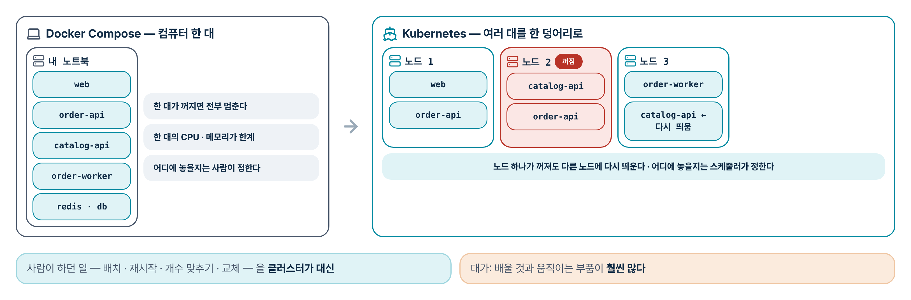
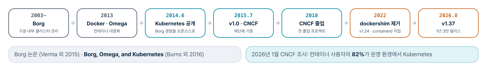

[🏠 과정 목차](../../README.md) › [3주차](../README.md) › [3일차](README.md)

# 1교시 · 왜 Kubernetes인가

> [!NOTE]
> **이번 시간에 할 일**
>
> - 1~2일차에 겪은 일을 다시 꺼내, **Compose로는 안 되는 일**을 목록으로 만듭니다.
> - Kubernetes가 무엇을 대신해 주는지 한 문장으로 말할 수 있게 됩니다.
> - Borg에서 Kubernetes 1.37까지, 짧은 역사를 봅니다.

## 2일차 요약 — 손으로 다시 확인

어제 배운 것 중 오늘과 이어지는 세 가지만 다시 짚습니다.

| 어제 본 것 | 오늘과의 연결 |
|---|---|
| `restart: unless-stopped` — 처리기가 죽으면 Docker가 다시 띄운다 | **같은 컴퓨터 안에서만**. 컴퓨터가 꺼지면? |
| 크래시 루프 — 틀린 설정은 재시작으로 고쳐지지 않는다 | Kubernetes에서도 똑같다. 이름만 `CrashLoopBackOff` |
| `/health`와 `/ready` — 살아 있음과 준비됨은 다르다 | Kubernetes가 이 둘을 **직접 묻고**, 결과에 따라 행동한다 (5일차) |
| GHCR에 올린 `sha-…` 태그 이미지 | 내일부터 클러스터가 이 이미지를 받아 간다 |

## Compose로는 안 되는 일

DevMart MSA가 잘 팔려서 손님이 열 배로 늘었다고 해 봅시다. 노트북 한 대로는 버틸 수 없으니 서버 세 대를 샀습니다. 이제 무엇이 어려워질까요?

> **📘 생각 실험 — 서버 세 대로 DevMart 돌리기**
>
> 1. `catalog-api`를 몇 대에 몇 개씩 띄울까요? 서버마다 남은 메모리가 다른데, **누가** 계산할까요?
> 2. 새벽 3시에 서버 2번의 전원이 나갔습니다. 거기 있던 `order-api`를 **누가** 다른 서버에 띄울까요?
> 3. `order-api`가 세 서버에 흩어져 있습니다. nginx는 그중 **어디로** 요청을 보내야 할까요? 하나가 죽으면?
> 4. 새 버전을 배포합니다. 한꺼번에 바꾸면 그동안 주문이 멈춥니다. **하나씩 바꾸고, 문제가 생기면 되돌리는** 일은 누가 할까요?
> 5. 행사 기간에만 `order-worker`를 10개로 늘리고 싶습니다. 끝나면 다시 3개로.
>
> Compose 파일 하나로는 이 다섯 질문 모두에 "사람이 한다"고 답할 수밖에 없습니다. Compose는 **컴퓨터 한 대**를 위한 도구이기 때문입니다.

위 질문에 붙는 이름이 각각 있습니다. 앞으로 계속 나오니 지금 한 번 정리해 둡니다.

| 질문 | 이름 | Kubernetes에서 하는 부품 | 배우는 날 |
|---|---|---|---|
| 어디에 놓을까 | **스케줄링** | kube-scheduler | 오늘 |
| 죽으면 다시 | **자가 치유(self-healing)** | 컨트롤러 + kubelet | 오늘 · 내일 |
| 어디로 보낼까 | **서비스 발견 · 부하 분산** | Service · kube-proxy · DNS | 내일 |
| 하나씩 바꾸고 되돌리기 | **롤링 업데이트 · 롤백** | Deployment | 내일 |
| 늘렸다 줄였다 | **스케일링** | Deployment · HPA | 내일 · 4주차 |

> [!IMPORTANT]
> **핵심 — Kubernetes를 한 문장으로**
>
> **여러 대의 컴퓨터를 한 대처럼 쓰게 해 주고, 내가 적어 둔 "원하는 상태"를 계속 지켜 주는 시스템.** 앞부분이 클러스터, 뒷부분이 4교시의 reconcile입니다.

> **🧩 비유 — 물류 회사의 본부와 창고들**
>
> Compose는 **혼자 운영하는 작은 가게**입니다. 사장이 직접 물건을 진열하고, 떨어지면 채우고, 문을 엽니다. Kubernetes는 **창고 여러 곳을 가진 물류 회사**입니다. 본부(컨트롤 플레인)는 주문서를 받아 기록하고, 어느 창고에 맡길지 정하고, 재고가 모자라면 채우라고 지시합니다. 각 창고(노드)의 반장(kubelet)은 본부 지시대로 물건(컨테이너)을 놓습니다. 창고 하나에 불이 나도 본부는 다른 창고로 일을 옮깁니다.

## 이름의 뜻

**Kubernetes**(쿠버네티스)는 그리스어로 **배의 조타수**(키잡이)입니다. 로고가 배의 키 모양인 이유입니다. 컨테이너(화물 컨테이너)를 실은 배를 조종한다는 뜻입니다. 줄여서 **K8s**라고 씁니다. K와 s 사이에 글자가 8개(ubernete)라서입니다.

## 짧은 역사

- **Borg (2003년경~)** — 구글은 검색 · 지메일 · 유튜브를 수십만 대의 서버에서 돌리기 위해 내부 클러스터 관리 시스템 Borg를 만들었습니다. 일을 "어디서 돌릴지"를 사람이 아니라 시스템이 정했습니다.
- **2014년 6월** — 구글이 Borg와 그 후속 실험(Omega)의 경험을 바탕으로 **Kubernetes를 오픈소스로 공개**했습니다. 처음부터 Docker 컨테이너를 대상으로 했습니다.
- **2015년 7월** — v1.0 출시와 함께 리눅스 재단 산하 **CNCF**(Cloud Native Computing Foundation)에 기증되었습니다. 한 회사의 제품이 아니라 **여러 회사가 함께 키우는 공공재**가 된 순간입니다. AWS · Azure · Google이 모두 관리형 Kubernetes(EKS · AKS · GKE)를 파는 이유입니다.
- **2022년 v1.24** — Docker를 거쳐 컨테이너를 띄우던 연결부(dockershim)를 없애고, **containerd 같은 런타임을 직접** 쓰게 되었습니다. "Kubernetes가 Docker를 버렸다"는 오해가 퍼졌지만, Docker로 만든 이미지는 그대로 돌아갑니다(3교시).
- **2026년 8월 v1.37** — Kubernetes는 1년에 세 번(대략 4월 · 8월 · 12월) 새 버전을 냅니다. 각 버전은 약 14개월 동안 보안 패치를 받습니다. 오늘 만드는 클러스터가 v1.37입니다.

> **❓ 오해 — Kubernetes는 Docker의 경쟁자다**
>
> 아닙니다. **층이 다릅니다.** Docker(정확히는 containerd)는 컴퓨터 **한 대 안에서** 컨테이너를 띄우는 도구이고, Kubernetes는 **여러 대 위에서** "무엇을 어디에 몇 개" 띄울지 정하는 도구입니다. Kubernetes 노드 안에서도 결국 containerd가 컨테이너를 띄웁니다. Compose와 Kubernetes가 같은 층의 경쟁자에 가깝습니다.

> **🎓 학술 노트 — Borg 논문과 '세 시스템' 논문**
>
> - **Verma, A. 외 (2015). "Large-scale cluster management at Google with Borg." EuroSys.** — Borg를 처음 공개한 논문입니다. 서로 다른 일을 같은 서버에 섞어 놓아(bin packing) 서버 수를 줄인 경험, 일을 "운영 중 서비스"와 "배치 작업"으로 나눠 우선순위를 준 설계가 나옵니다. Kubernetes의 requests/limits(5일차)와 우선순위 개념의 뿌리입니다.
> - **Burns, B., Grant, B., Oppenheimer, D., Brewer, E., & Wilkes, J. (2016). "Borg, Omega, and Kubernetes." ACM Queue 14(1).** — Borg와 Omega의 교훈이 Kubernetes에 어떻게 반영되었는지 직접 설명합니다. 대표적인 교훈: 일을 **라벨**로 묶어라(5교시 · 내일), 모든 부품이 **같은 API**로 말하게 하라(2교시), 컨테이너를 **함께 사는 무리(Pod)**로 다뤄라(3교시).

> **📈 트렌드 2026 — Kubernetes는 이제 '기본값'**
>
> 2026년 1월 발표된 CNCF 연례 조사에서 컨테이너 사용자의 **82%**가 운영 환경에서 Kubernetes를 쓴다고 답했습니다(2023년 66%). 생성형 AI 모델을 직접 운영하는 조직의 **66%**도 추론(inference)을 Kubernetes 위에서 돌립니다. 반대로 아직 클라우드 네이티브를 거의 쓰지 않는 조직은 10%로, **새로 도입하는 속도는 느려지고** 있습니다. 이제 질문은 "Kubernetes를 쓸까?"보다 "**어떻게 잘** 쓸까, 얼마나 **덜 직접** 다룰까?"(관리형 서비스 · 플랫폼 팀, 5교시)로 옮겨 가고 있습니다.

## 실습 1 · Compose로 안 되는 일 목록

> **🧪 실습: 실습 목표**
>
> 1~2일차 DevMart 경험을 바탕으로, Kubernetes가 대신해 줄 일을 내 말로 적습니다. 오늘 하루 동안 이 목록에 답을 하나씩 채워 갑니다.

배움 노트에 다음 표를 옮겨 적고, 왼쪽 칸을 채웁니다. 오른쪽 칸은 비워 두었다가 7교시가 끝날 때 채웁니다.

| 1~2일차에 내가 손으로 한 일 | Kubernetes에서는 누가? (7교시에 채우기) |
|---|---|
| 예: `docker compose up -d --scale order-worker=3` | |
| 예: 처리기가 죽은 뒤 `restart:` 정책이 다시 띄움 | |
| | |
| | |

> **🟢 확인: 이런 항목이 나오면 좋습니다**
>
> 컨테이너 개수 정하기 · 죽은 컨테이너 다시 띄우기 · 새 이미지로 바꾸기 · 포트 열기 · 환경 변수 넣기 · 비밀번호(`.env`) 넣기 · 헬스 체크 · 로그 보기 · 서비스 이름으로 찾아가기(Compose DNS)

> **✅ 확인 문제**
>
> 1. Compose의 `restart: unless-stopped`가 해 주지 **못하는** 일은 무엇인가요?
> 2. "K8s"의 8은 무엇을 뜻하나요?
> 3. Kubernetes와 같은 층에서 비교할 도구는 Docker(containerd)와 Compose 중 어느 쪽인가요?
>
> 

정답

>
> 1. 컴퓨터가 통째로 꺼졌을 때 **다른 컴퓨터에** 다시 띄우는 일 (그 밖에 배치 결정, 여러 대에 걸친 부하 분산 등)
> 2. K와 s 사이의 글자 수 8개 (ubernete)
> 3. Compose — 둘 다 "무엇을 몇 개, 어떻게 연결해 띄울지"를 정한다. containerd는 그 아래에서 실제로 띄우는 층
>
> 

## 참고 문헌

- Verma, A., Pedrosa, L., Korupolu, M., Oppenheimer, D., Tune, E., & Wilkes, J. (2015). Large-scale cluster management at Google with Borg. *EuroSys '15*.
- Burns, B., Grant, B., Oppenheimer, D., Brewer, E., & Wilkes, J. (2016). Borg, Omega, and Kubernetes. *ACM Queue*, 14(1).
- CNCF (2026). *The CNCF Annual Cloud Native Survey: The Infrastructure of AI's Future*. cncf.io/reports
- Kubernetes. *Kubernetes Releases* · *Version Skew Policy*. kubernetes.io/releases

---

⬅️ 이전: [3주차 3일차 목차](README.md) &nbsp;|&nbsp; [⬆️ 3일차 목차](README.md) &nbsp;|&nbsp; 다음: [2교시 · 컨트롤 플레인 — 결정하고 기록하는 본부](lesson-02.md) ➡️
