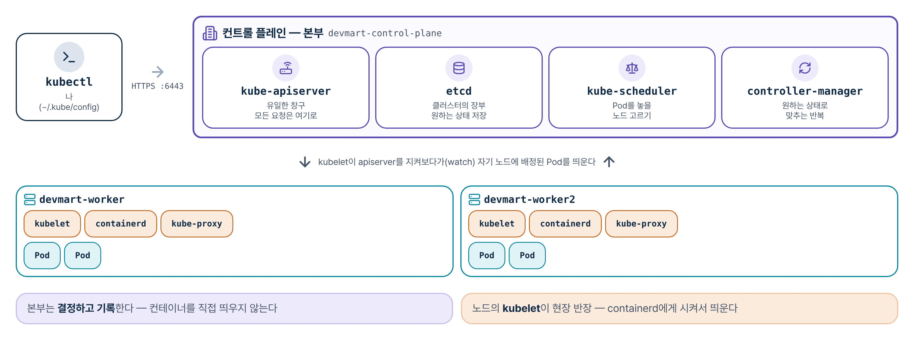

<sub>[🏠 과정 목차](../../README.md) › [3주차](../README.md) › [3일차](README.md) › 2/8교시</sub>

# 2교시 · 컨트롤 플레인 — 결정하고 기록하는 본부

> [!NOTE]
> **이번 시간에 할 일**
>
> - 클러스터 = **컨트롤 플레인 + 노드**라는 큰 그림을 잡습니다.
> - 컨트롤 플레인의 네 부품 — **kube-apiserver · etcd · kube-scheduler · kube-controller-manager** — 의 역할을 구분합니다.
> - "모두 apiserver를 통해서만 말한다"는 원칙이 왜 중요한지 이해합니다.

## 큰 그림 — 본부와 현장



Kubernetes 클러스터는 두 종류의 컴퓨터로 이루어집니다.

| | 컨트롤 플레인 (control plane) | 노드 (node, 워커 노드) |
|---|---|---|
| 비유 | 본부 | 현장 창고 |
| 하는 일 | 주문서를 받고, 기록하고, 배치를 결정하고, 어긋나면 고치라고 지시 | 지시받은 컨테이너를 실제로 띄우고, 상태를 보고 |
| 앱 컨테이너 | 보통 띄우지 않는다 | 여기서 돈다 |
| 운영 환경 대수 | 3대(또는 5대) — 하나가 죽어도 본부가 멈추지 않게 | 수 대 ~ 수천 대 |
| 오늘 kind 클러스터 | `devmart-control-plane` 1대 | `devmart-worker`, `devmart-worker2` 2대 |

> **📖 용어 — 컨트롤 플레인과 데이터 플레인**
>
> 네트워크 장비에서 온 말입니다. **컨트롤 플레인**은 "어떻게 할지 결정하는 층", **데이터 플레인**은 "실제 일(데이터)이 흐르는 층"입니다. Kubernetes에서 데이터 플레인은 노드와 그 위의 Pod입니다. 이 구분은 4주차 서비스 메시(Istio), 5주차 EKS(AWS가 컨트롤 플레인을 대신 운영)에서 다시 나옵니다.

## 부품 1 · kube-apiserver — 유일한 창구

**모든 요청이 거치는 단 하나의 문**입니다. 나(`kubectl`), 스케줄러, 컨트롤러, 각 노드의 kubelet — 모두 apiserver에게만 말합니다. 서로 직접 부르지 않습니다.

apiserver가 요청 하나를 받으면 차례로 하는 일:

1. **인증**(Authentication) — 너는 누구인가? (인증서 · 토큰)
2. **인가**(Authorization) — 너는 이 일을 해도 되는가? (RBAC, 4주차 5일차)
3. **허가 제어**(Admission) — 규칙에 맞는가? 기본값을 채워 넣을까? (정책 엔진 Kyverno, 4주차 5일차)
4. **검증**(Validation) — 형식이 맞는가? (필드 이름 오타, 타입)
5. **저장** — etcd에 기록

> **🧩 비유 — 은행 창구**
>
> 은행 금고(etcd)에 손님이 직접 들어가지 않습니다. 창구 직원(apiserver)이 신분증을 확인하고(인증), 이 계좌에서 돈을 뺄 권한이 있는지 보고(인가), 서류가 규정에 맞는지 확인한 뒤(허가 · 검증) 장부에 적습니다. 직원들끼리도 서로의 서랍을 열지 않고 반드시 창구 시스템을 거칩니다.

apiserver는 **REST API 서버**입니다. 2주차에 `curl`로 DevMart API를 불렀듯이, `kubectl get nodes`도 속으로는 `GET /api/v1/nodes` HTTPS 요청입니다. 7교시에 `kubectl get nodes -v=6`으로 직접 확인합니다.

## 부품 2 · etcd — 클러스터의 장부

클러스터의 **모든 상태가 저장되는 키-값 데이터베이스**입니다. "order-api는 2개여야 한다", "Pod A는 worker2에 있다", "Secret의 값" — 전부 여기 있습니다.

- **etcd를 잃으면 클러스터를 잃습니다.** 노드와 컨테이너는 남아 있어도, 무엇이 무엇인지 아는 기록이 사라집니다. 그래서 운영 환경에서는 etcd를 3대 또는 5대로 두고, 정기적으로 백업(스냅샷)합니다.
- etcd에 직접 읽고 쓰는 것은 **apiserver뿐**입니다.
- 3대 중 2대(과반)가 살아 있으면 계속 일합니다. 과반이 동의해야 기록하는 **Raft 합의 알고리즘** 덕분입니다. 그래서 대수는 홀수(3, 5)로 둡니다. 4대는 3대와 버틸 수 있는 고장 수(1대)가 같으면서 비용만 늘어납니다.

> [!WARNING]
> **Secret은 기본적으로 '암호화'가 아니다**
>
> Kubernetes의 Secret(5일차)은 기본 설정에서 etcd에 **base64로만 인코딩**되어 저장됩니다. base64는 누구나 되돌릴 수 있는 변환일 뿐 암호가 아닙니다. 운영 환경에서는 etcd 저장 시 암호화(encryption at rest)를 켭니다. EKS 같은 관리형 서비스는 대부분 이것을 기본으로 켜 줍니다(5주차).

## 부품 3 · kube-scheduler — 놓을 자리 고르기

새 Pod가 생겼는데 **아직 어느 노드에도 배정되지 않았으면**, 스케줄러가 노드를 고릅니다.

1. **거르기**(Filtering) — 놓을 수 **없는** 노드를 뺍니다. 남은 메모리 · CPU가 모자란 노드, 고장 난 노드, "이 Pod는 GPU 노드에만" 같은 조건에 안 맞는 노드.
2. **점수 매기기**(Scoring) — 남은 노드에 점수를 매깁니다. 자원이 고르게 쓰이는지, 같은 앱이 한 노드에 몰리지 않는지 등.
3. **결정 기록** — 1등 노드의 이름을 Pod의 `spec.nodeName`에 적어 apiserver에 보냅니다.

> [!IMPORTANT]
> **스케줄러는 컨테이너를 띄우지 않는다**
>
> 스케줄러가 하는 일은 딱 **"이 Pod는 worker2로"라고 적는 것**까지입니다. 실제로 띄우는 것은 worker2의 kubelet입니다(3교시). 결정과 실행이 나뉘어 있습니다.

## 부품 4 · kube-controller-manager — 맞추는 반복들

**컨트롤러**(controller)들을 모아 하나의 프로그램으로 돌리는 부품입니다. 컨트롤러 하나는 한 가지 종류만 맡아, **원하는 상태와 실제 상태를 끝없이 비교하고 맞춥니다**(4교시의 reconcile).

| 컨트롤러 | 지키는 것 | 예 |
|---|---|---|
| ReplicaSet 컨트롤러 | Pod 개수 | "2개여야 하는데 1개다 → 하나 더 만들어라" |
| Deployment 컨트롤러 | 버전 교체 | "새 버전으로 하나씩 바꿔라" (내일) |
| Node 컨트롤러 | 노드 생존 | "worker2가 응답 없다 → NotReady로 표시" (7교시) |
| Job 컨트롤러 | 한 번 하고 끝나는 일 | "백업 작업이 성공할 때까지" |
| EndpointSlice 컨트롤러 | 서비스 뒤의 주소 목록 | "준비된 Pod의 IP만 목록에" (내일) |

> **📖 용어 — cloud-controller-manager**
>
> 클라우드(AWS 등) 위의 클러스터에는 다섯 번째 부품이 있습니다. "LoadBalancer 서비스를 만들면 AWS에 로드 밸런서를 만들어라", "노드가 꺼지면 EC2가 정말 지워졌는지 AWS에 물어봐라" 같은 **클라우드와의 연결**을 맡습니다. kind에는 없습니다. 5주차 EKS에서 만납니다.

## 왜 "모두 apiserver를 통해서만"인가

부품끼리 직접 부르면 더 빠를 텐데, 왜 굳이 apiserver를 거칠까요?

- **기록이 한곳에 남는다.** 누가 언제 무엇을 바꿨는지 apiserver가 모두 안다(감사 로그).
- **부품을 갈아 끼울 수 있다.** 스케줄러를 내가 만든 것으로 바꿔도, apiserver에 같은 방식으로 말하기만 하면 된다.
- **부품 하나가 죽어도 나머지는 산다.** 스케줄러가 잠깐 죽으면 새 Pod 배치만 멈추고, 이미 떠 있는 앱은 계속 돈다.
- **보안 경계가 하나다.** 인증 · 인가를 apiserver 한 곳에서만 지키면 된다.

1교시 학술 노트의 Burns 외(2016)가 꼽은 교훈 — "모든 부품이 같은 API로 말하게 하라" — 가 이것입니다. 1일차에 MSA에서 "다른 서비스의 DB에 직접 붙지 말고 API로 물어라"고 한 것과 같은 원리입니다.

> **📘 예시 — 컨트롤 플레인 부품이 하나씩 멈추면**
>
> | 멈춘 부품 | 이미 떠 있는 앱 | 새로 하려는 일 |
> |---|---|---|
> | kube-apiserver | 계속 돈다 | `kubectl`이 전부 실패. 아무것도 바꿀 수 없음 |
> | etcd | 계속 돈다 | apiserver가 저장을 못 함 → 사실상 apiserver 장애와 같음 |
> | kube-scheduler | 계속 돈다 | 새 Pod가 `Pending`에서 멈춤 |
> | kube-controller-manager | 계속 돈다 | Pod가 죽어도 새로 안 만들어짐, 노드 장애 감지 안 됨 |
>
> **본부가 멈춰도 현장은 하던 일을 계속합니다.** 다만 아무것도 바꿀 수 없고, 고장이 나도 고쳐 주는 사람이 없습니다. 그래서 "컨트롤 플레인 장애 = 즉시 서비스 장애"는 아니지만, 오래 두면 안 됩니다.

> **🎓 학술 노트 — Raft 합의 알고리즘**
>
> **Ongaro, D., & Ousterhout, J. (2014). "In Search of an Understandable Consensus Algorithm." USENIX ATC.** — etcd가 쓰는 Raft를 소개한 논문입니다. 여러 대의 서버가 "무엇을 기록했는지"에 대해 항상 같은 답을 내도록 하는 방법(합의)입니다. 이전의 Paxos가 너무 이해하기 어렵다는 문제의식에서 출발해, **리더 선출 → 로그 복제 → 과반 확인**으로 단계를 나눴습니다. 제목 자체가 "이해할 수 있는" 알고리즘을 찾는다는 뜻입니다. 3대 중 2대, 5대 중 3대가 살아 있어야 하는 이유가 여기서 나옵니다.

> **📈 트렌드 2026 — 컨트롤 플레인은 '사는 것'**
>
> 직접 컨트롤 플레인을 설치 · 업그레이드 · 백업하는 회사는 줄고 있습니다. EKS · GKE · AKS는 컨트롤 플레인을 **클라우드가 대신 운영**하고, 사용자는 노드와 앱만 신경 씁니다. 한발 더 나아가 노드까지 클라우드가 관리하는 방식(EKS Auto Mode, GKE Autopilot)도 널리 쓰입니다. 그래도 구조를 아는 사람만이 "Pending에서 멈췄다 → 스케줄러가 못 놓았다 → 왜?"를 따라갈 수 있습니다.

## 실습 2 · 부품 네 개 역할 카드

> **🧪 실습: 실습 목표**
>
> 오후에 클러스터 안에서 이 부품들을 직접 찾아봅니다. 그 전에 내 말로 정리해 둡니다.

배움 노트에 카드 네 장을 만듭니다. 각 카드에 세 줄씩.

```text
[kube-apiserver]
- 한 줄 역할:
- 물류 회사 비유로:
- 멈추면 생기는 일:
```

> **🟢 확인: 스스로 점검**
>
> - 네 카드 중 **etcd에 직접 쓰는 것**은 하나뿐인가요? (apiserver)
> - **컨테이너를 직접 띄우는** 카드가 있나요? (없어야 정답 — 3교시의 kubelet 몫)

> **✅ 확인 문제**
>
> 1. `kubectl get nodes`를 실행하면 가장 먼저 요청을 받는 부품은?
> 2. 새 Pod가 계속 `Pending`입니다. 컨트롤 플레인 부품 중 가장 먼저 의심할 것은?
> 3. etcd를 4대가 아니라 3대나 5대로 두는 이유는?
> 4. 컨트롤 플레인이 통째로 멈췄습니다. 지금 돌고 있는 DevMart 웹사이트는 어떻게 되나요?
>
> <details><summary>정답</summary>
>
> 1. kube-apiserver
> 2. kube-scheduler (놓을 노드를 못 찾았거나 스케줄러가 멈춤). 내일 `kubectl describe pod`의 Events에서 이유를 읽는다
> 3. 과반이 살아 있어야 하므로, 4대는 3대와 버틸 수 있는 고장 수(1대)가 같아 비용만 늘어난다
> 4. 계속 돈다. 다만 그동안 Pod가 죽으면 다시 띄워 주지 않고, 배포 · 변경도 할 수 없다
>
> </details>

## 참고 문헌

- Kubernetes Docs. *Cluster Architecture* · *Kubernetes Components*. kubernetes.io/docs/concepts/architecture
- Kubernetes Docs. *Kubernetes Scheduler* · *Controllers*. kubernetes.io/docs/concepts
- Ongaro, D., & Ousterhout, J. (2014). In Search of an Understandable Consensus Algorithm. *USENIX ATC '14*.
- Burns, B., Grant, B., Oppenheimer, D., Brewer, E., & Wilkes, J. (2016). Borg, Omega, and Kubernetes. *ACM Queue*, 14(1).

---

| 이전 | 목차 | 다음 |
|:--|:--:|--:|
| ⬅️ [1교시 · 왜 Kubernetes인가](lesson-01.md) | [⬆️ 3일차 목차](README.md) | [3교시 · 노드와 Pod — 실제로 돌리는 현장](lesson-03.md) ➡️ |
