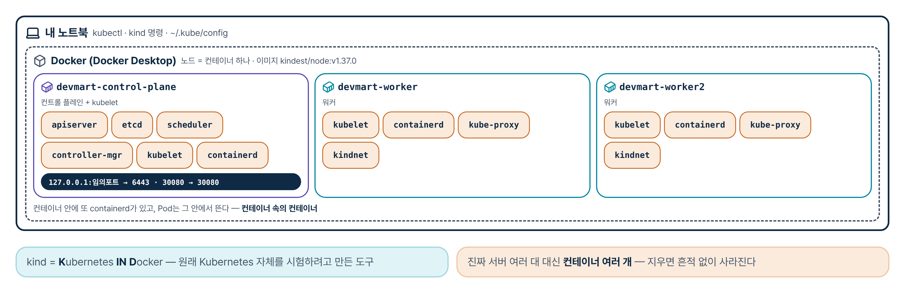

<sub>[🏠 과정 목차](../../README.md) › [3주차](../README.md) › [3일차](README.md) › 5/8교시</sub>

# 5교시 · 장단점과 선택지

> [!NOTE]
> **이번 시간에 할 일**
>
> - Kubernetes가 주는 것과 **치르게 하는 비용**을 나란히 놓고 봅니다.
> - Kubernetes를 **쓰지 말아야 할 때**와 그때의 다른 선택지를 압니다.
> - 직접 설치 · 관리형 · 로컬 학습용 클러스터의 차이를 구분하고, 오늘 **kind**를 고른 이유를 이해합니다.

## 주는 것과 치르는 것

| 얻는 것 | 치르는 것 |
|---|---|
| 노드가 죽어도 다른 노드로 옮겨 다시 띄움 | 컨트롤 플레인 · 노드 · 네트워크 · 저장소 — **움직이는 부품이 많다** |
| 원하는 상태를 적어 두면 계속 지켜 줌 | 배울 개념이 많다 — 오늘 하루가 통째로 개념인 이유 |
| 무중단 교체 · 되돌리기 · 늘리고 줄이기가 기본 기능 | YAML이 길다. Compose 20줄이 매니페스트 100줄이 되기도 한다 |
| 어느 클라우드 · 어느 데이터센터에서도 같은 방식 | 장애가 나면 **층이 많아** 원인 찾기가 어렵다 (앱? Pod? 노드? 네트워크? 컨트롤 플레인?) |
| Helm · Argo CD · Prometheus 등 거대한 생태계 (4주차) | 생태계가 너무 커서 고르는 것 자체가 일이다 |
| 여러 팀이 한 클러스터를 나눠 쓰기 (Namespace · RBAC) | 클러스터를 운영할 사람(플랫폼 팀)이 필요하다 |

> [!IMPORTANT]
> **Kubernetes는 '복잡함을 옮기는' 도구**
>
> Kubernetes는 복잡함을 없애지 않습니다. 서비스마다 제각각이던 배포 · 재시작 · 확장의 복잡함을 **한곳(클러스터)으로 모읍니다.** 서비스가 2~3개면 모으는 비용이 더 큽니다. 서비스가 수십 개, 팀이 여럿이면 모으는 쪽이 이깁니다. 1일차의 "MSA는 공짜가 아니다"와 같은 이야기입니다.

## 쓰지 말아야 할 때

> **📘 예시 — 이런 경우에는 Kubernetes가 과하다**
>
> - **서비스 1~3개, 팀 하나.** 서버 한 대 + Compose, 또는 관리형 컨테이너 서비스로 충분하다.
> - **트래픽이 작고 일정하다.** 자동 확장이 줄 이득이 없다.
> - **운영할 사람이 없다.** 클러스터 업그레이드(1년에 최소 한 번, 2교시)와 보안 패치를 맡을 사람이 없다면 관리형이라도 부담이다.
> - **정적 웹사이트 · 간단한 API.** 정적 호스팅이나 서버리스 함수가 훨씬 싸고 단순하다.
> - **"이력서에 쓰려고".** 실제로 흔한 도입 이유이고, 실제로 흔한 실패 이유다.

### 다른 선택지

| 선택지 | 무엇 | 언제 |
|---|---|---|
| 서버 한 대 + Docker Compose | 2주차에 한 그대로 | 작은 서비스, 사내 도구, 학습 |
| 관리형 컨테이너 서비스 (**ECS + Fargate**, Google Cloud Run, Azure Container Apps) | 컨테이너 이미지만 주면 클라우드가 띄우고 늘려 준다. 클러스터 개념이 거의 없다 | 서비스 수가 적고 한 클라우드에 머물 때 |
| 서버리스 함수 (AWS Lambda 등) | 코드 조각을 요청이 올 때만 실행 | 이벤트 처리, 간헐적 작업 |
| HashiCorp Nomad | 더 단순한 오케스트레이터 | 컨테이너 외 작업도 섞어 돌릴 때 |
| **Kubernetes** | 오늘부터 배우는 것 | 서비스 · 팀이 많고, 여러 환경에서 같은 방식이 필요할 때 |

> [!WARNING]
> **AWS App Runner는 쓰지 않는다**
>
> "이미지만 주면 띄워 주는" AWS 서비스로 App Runner가 자주 소개되었지만, **2026년 4월 30일부터 새 고객을 받지 않습니다.** 옛 블로그 글을 보고 따라 하지 마세요. AWS에서 컨테이너를 돌리는 기준은 **ECS**와 **EKS**(5주차)입니다.

## 어떤 Kubernetes를 쓸까

Kubernetes는 하나의 오픈소스이지만, 받는 방법은 여러 가지입니다.

| 종류 | 예 | 컨트롤 플레인은 누가 | 언제 |
|---|---|---|---|
| **관리형** | Amazon **EKS**, Google GKE, Azure AKS | 클라우드가 운영 · 업그레이드 · 백업 | 운영 환경의 대부분. 5주차 |
| **직접 설치** | kubeadm, Rancher(RKE2), OpenShift | 우리 팀 | 자체 데이터센터, 규제 산업 |
| **경량 배포판** | k3s, k0s | 우리 팀 (부품을 하나로 묶어 가볍게) | 공장 · 매장 같은 엣지, 작은 서버 |
| **로컬 학습 · 시험용** | **kind**, minikube, k3d, Docker Desktop의 Kubernetes | 내 노트북 | 학습, 개발, CI에서 시험 |

### 로컬 도구 중 kind를 고른 이유

| 도구 | 방식 | 노드 여러 대 | 특징 |
|---|---|---|---|
| **kind** | 노드 = Docker 컨테이너 | 쉬움 (설정 파일 한 줄) | Kubernetes 프로젝트 자체의 시험용 도구. 만들고 지우기가 빠르고 깨끗하다 |
| minikube | 가상 머신 또는 컨테이너 | 가능 | 대시보드 등 부가 기능(애드온)이 많다 |
| k3d | k3s를 Docker 컨테이너로 | 쉬움 | 가볍다. 다만 k3s는 표준과 다른 부품이 섞여 있다 |
| Docker Desktop의 Kubernetes | Docker Desktop 설정에서 켜기 | 버전에 따라 다름 | 켜기는 가장 쉽지만, 버전과 구성을 고르기 어렵다 |

kind를 고른 이유는 세 가지입니다.

1. **표준 그대로** — kubeadm으로 만든 진짜 Kubernetes입니다. 컨트롤 플레인 부품을 하나하나 볼 수 있습니다(7교시).
2. **2주차의 Docker 위에서** 돕니다. 새 가상화 도구를 배울 필요가 없습니다. 노드가 컨테이너이니 `docker stop`으로 노드 장애를 흉내 낼 수 있습니다.
3. **지우면 흔적이 없습니다.** 망가뜨려도 `kind delete cluster` 후 1~2분이면 새로 만듭니다. 실습에서 가장 중요한 성질입니다.



> **❓ 오해 — kind는 '가짜' Kubernetes라서 배워 봐야 소용없다**
>
> kind 안의 Kubernetes는 진짜입니다. EKS와 **같은 apiserver, 같은 kubectl, 같은 매니페스트**를 씁니다. 다른 것은 **노드가 진짜 서버가 아니라 컨테이너**라는 점, 그래서 클라우드 로드 밸런서 같은 바깥 연결이 없다는 점뿐입니다. 3~4주차에 kind에서 만든 매니페스트를 5주차에 EKS에 그대로 올립니다.

> **🎓 학술 노트 — '부수적 복잡성'**
>
> **Brooks, F. P. (1987). "No Silver Bullet — Essence and Accidents of Software Engineering." IEEE Computer 20(4).** — Brooks는 소프트웨어의 복잡성을 문제 자체에서 오는 **본질적 복잡성**(essential)과 도구 · 방법에서 오는 **부수적 복잡성**(accidental)으로 나눴습니다. Kubernetes는 "수십 개 서비스를 여러 서버에서 무중단으로" 같은 본질적 복잡성이 있을 때 그것을 다루는 도구입니다. 그런 문제가 없는데 Kubernetes를 들이면, 도구 자체가 **부수적 복잡성**이 됩니다. "이 복잡함은 문제에서 왔나, 도구에서 왔나?"는 기술 선택 때마다 던질 질문입니다.

> **📈 트렌드 2026 — 플랫폼 엔지니어링과 '덜 보이는 Kubernetes'**
>
> Kubernetes를 쓰는 회사가 늘수록, 모든 개발자가 Kubernetes를 깊이 알아야 하는 부담도 커졌습니다. 그래서 **플랫폼 팀**이 클러스터와 배포 파이프라인을 '사내 제품'처럼 만들고, 개발자는 정해진 틀(템플릿 · 셀프서비스 포털)로 배포하는 **플랫폼 엔지니어링**이 자리 잡았습니다. CNCF 2026년 조사도 기술 자체보다 **조직 문화 · 팀 간 협업**을 더 큰 걸림돌로 꼽았습니다. 이 과정에서 여러분이 맡을 역할은 그 플랫폼을 **만들고 고치는 쪽**입니다 — 그래서 구조부터 배웁니다.

## 실습 5 · 우리 팀에 Kubernetes가 필요한가

> **🧪 실습: 실습 목표**
>
> 세 가지 가상 회사에 대해 Kubernetes 도입 여부를 판단하고, 근거를 적습니다. 정답보다 **근거의 질**이 중요합니다.

| 회사 | 상황 |
|---|---|
| A. 동네 꽃집 예약 사이트 | 개발자 1명, API 1개 + DB, 하루 방문 300명 |
| B. DevMart (지금 우리) | 서비스 6개, 팀 2개(주문 · 상품), 행사 때 트래픽 10배 |
| C. 핀테크 스타트업 | 서비스 40개, 팀 8개, 금융 규제로 자체 데이터센터 + AWS를 함께 씀 |

각 회사마다 아래 칸을 채웁니다.

```text
[회사 ?]
- 판단: Kubernetes 쓴다 / 안 쓴다 / 나중에
- 쓴다면 어떤 종류: 관리형 / 직접 설치 / 경량
- 안 쓴다면 대신: 
- 근거 두 가지 (본질적 복잡성이 있나?):
- 그렇게 했을 때 가장 큰 위험:
```

> **🟢 확인: 토론 포인트**
>
> - A에 Kubernetes를 쓰자는 사람이 있다면, 그 사람이 말하는 이점은 A의 **어떤 문제**를 푸나요?
> - B는 지금 Compose로도 돌아갑니다. "행사 때 10배"를 Compose로 버티려면 무엇을 손으로 해야 하나요?
> - C는 왜 관리형 **하나만으로는** 안 될 수도 있나요?

> **✅ 확인 문제**
>
> 1. kind의 노드는 무엇으로 만들어지나요?
> 2. EKS 같은 관리형 Kubernetes에서 클라우드가 대신 운영해 주는 부분은?
> 3. kind에서 만든 매니페스트를 EKS에 그대로 쓸 수 있는 이유는?
> 4. 서비스 2개짜리 사내 도구에 Kubernetes를 도입하자는 제안에, Brooks의 개념으로 한 문장 답하세요.
>
> <details><summary>정답</summary>
>
> 1. Docker 컨테이너 (kindest/node 이미지)
> 2. 컨트롤 플레인 (apiserver · etcd · scheduler · controller-manager의 설치 · 업그레이드 · 백업)
> 3. 둘 다 같은 Kubernetes API를 쓰는 진짜 Kubernetes이기 때문 (다른 것은 노드의 정체와 바깥 연결)
> 4. 예: "이 도구에는 Kubernetes가 다룰 본질적 복잡성이 없어서, Kubernetes 자체가 부수적 복잡성만 늘린다"
>
> </details>

## 참고 문헌

- Brooks, F. P. (1987). No Silver Bullet — Essence and Accidents of Software Engineering. *IEEE Computer*, 20(4), 10–19.
- kind. *Quick Start* · *Design: Initial*. kind.sigs.k8s.io
- AWS. *AWS App Runner availability change*. docs.aws.amazon.com/apprunner
- CNCF (2026). *The CNCF Annual Cloud Native Survey: The Infrastructure of AI's Future*. cncf.io/reports
- CNCF TAG App Delivery (2023). *Platforms White Paper*. tag-app-delivery.cncf.io

---

| 이전 | 목차 | 다음 |
|:--|:--:|--:|
| ⬅️ [4교시 · 선언형과 reconcile](lesson-04.md) | [⬆️ 3일차 목차](README.md) | [6교시 · kubectl과 kind 설치](lesson-06.md) ➡️ |
