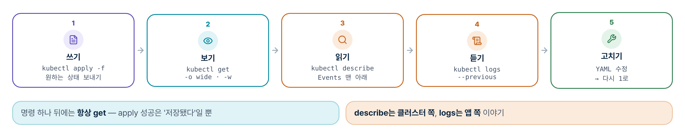

<sub>[🏠 과정 목차](../../README.md) › [3주차](../README.md) › [4일차](README.md) › 1/7교시</sub>

# 1교시 · 3일차 요약 + kubectl 루프

> [!NOTE]
> **이번 시간에 할 일**
>
> - 어제 만든 클러스터가 살아 있는지 확인하고, 어제 배운 구조를 다시 짚습니다.
> - 오늘 올릴 **이미지 주소**(GHCR · SHA 태그)를 확인하고 실습 파일에 채웁니다.
> - kubectl의 기본 동사 — `get` · `describe` · `explain` · `apply` · `delete` · `logs` — 와 출력 옵션을 익힙니다.

## 3일차 요약 — 손으로 다시 확인

```bash
cd ~/devops-lab/k8s
kubectl config current-context
bash cluster-tour.sh | head -20
```

> **🟢 확인: 이렇게 나오면 준비 완료**
>
> ```text
> kind-devmart
> ...
> NAME                    STATUS   ROLES           AGE   VERSION   INTERNAL-IP   ...
> devmart-control-plane   Ready    control-plane   20h   v1.37.0   172.18.0.3    ...
> devmart-worker          Ready    <none>          20h   v1.37.0   172.18.0.2    ...
> devmart-worker2         Ready    <none>          20h   v1.37.0   172.18.0.4    ...
> ```

> **🛠️ 막혔다면: The connection to the server 127.0.0.1:… was refused**
>
> 노트북을 재부팅해 노드 컨테이너가 꺼져 있습니다. 어제 7교시 실험 3과 같은 증상입니다.
> ```bash
> docker start devmart-control-plane devmart-worker devmart-worker2
> sleep 30 && kubectl get nodes
> ```
> 몇 분이 지나도 돌아오지 않으면 `kind delete cluster --name devmart` 후 다시 만듭니다.

어제의 핵심을 오늘 쓸 말로 바꾸면 이렇습니다.

| 어제 배운 것 | 오늘 쓰는 곳 |
|---|---|
| kubectl은 apiserver에 HTTPS 요청을 보낼 뿐 | `apply`가 성공해도 앱이 떴다는 뜻은 아니다 → 항상 `get`으로 확인 |
| Pod가 뜨기까지 6단계 | 망가진 Pod를 보면 "몇 단계에서 멈췄나" (3교시) |
| reconcile — 관찰 → 비교 → 행동 | Deployment가 Pod 개수를 지킨다 (4~5교시) |
| 라벨과 셀렉터 | Deployment도 Service도 라벨로 Pod를 찾는다 (4 · 6교시) |
| 컨트롤 플레인의 `NoSchedule` 테인트 | 내 Pod는 워커 두 대에만 놓인다 |

## 실습 1 · 오늘 올릴 이미지 확인

> **🧪 실습: 실습 목표**
>
> 2일차 6교시에 GHCR에 올린 이미지의 **정확한 주소**를 찾아, 오늘 실습 파일에 채웁니다.

### 단계 1 — 실습 파일 복사

```bash
cd ~/course && git pull
mkdir -p ~/devops-lab/k8s/day4
cp ~/course/labs/week3/day4/*.yaml ~/devops-lab/k8s/day4/
cd ~/devops-lab/k8s/day4 && ls
```

> **🟢 확인: 보이는 것**
>
> ```text
> broken-image.yaml  deployment.yaml  pod.yaml  service-nodeport.yaml  service.yaml  too-big.yaml  worker-crash.yaml
> ```

### 단계 2 — GHCR에 있는 태그 확인

```bash
GH=$(gh api user --jq .login | tr 'A-Z' 'a-z')
echo $GH
gh api /user/packages/container/devmart-catalog-api/versions \
  --jq '.[0].metadata.container.tags'
```

- `gh api user --jq .login` : 내 GitHub 아이디
- `tr 'A-Z' 'a-z'` : 이미지 주소는 **소문자만** 쓴다. 아이디에 대문자가 있어도 GHCR 주소는 소문자다
- `…/versions` : 이 패키지에 올라간 이미지 목록. `.[0]`이 가장 최근 것

> **🟢 확인: 이렇게 나오면 성공**
>
> ```text
> niceguy61
> ["sha-7f3c2e1","latest"]
> ```
> `sha-` 뒤의 7자리는 사람마다 다릅니다. 이것이 **2일차에 main에 병합된 커밋**입니다.

> **🛠️ 막혔다면: HTTP 403: You need at least read:packages scope**
>
> 2일차 6교시에 한 권한 추가를 다시 합니다.
> ```bash
> gh auth refresh -s read:packages
> ```

### 단계 3 — 실습 파일에 채우기

```bash
SHA=sha-7f3c2e1        # 단계 2에서 본 내 값으로
sed -i "s/YOUR_ID/$GH/g; s/YOUR_SHA/$SHA/g" *.yaml
grep -h 'image:' *.yaml
```

- Mac은 `sed -i ''` — `-i` 뒤에 빈 따옴표가 필요하다 (2주차 3일차)

> **🟢 확인: 보이는 것**
>
> ```text
>       image: ghcr.io/niceguy61/devmart-catalog-api:sha-0000000
>       image: ghcr.io/niceguy61/devmart-catalog-api:sha-7f3c2e1
>       image: ghcr.io/niceguy61/devmart-catalog-api:sha-7f3c2e1
>       image: ghcr.io/niceguy61/devmart-catalog-api:sha-7f3c2e1
>       image: ghcr.io/niceguy61/devmart-order-worker:sha-7f3c2e1
> ```
> `sha-0000000`은 3교시에 일부러 틀리게 둔 것입니다.

> [!TIP]
> **SHA 태그를 쓰는 이유**
>
> `latest`를 써도 오늘 실습은 돌아갑니다. 하지만 2일차 6교시에 본 것처럼 `latest`는 **main에 병합될 때마다 옮겨 붙습니다.** 같은 매니페스트가 어제와 오늘 다른 코드를 띄울 수 있다는 뜻입니다. 매니페스트에 SHA 태그를 적으면 "이 클러스터에 도는 코드 = 이 커밋"이 됩니다. 7교시 되돌리기와 4주차 GitOps가 이 성질에 기댑니다.

## kubectl 루프



오늘 하루 종일 이 순서를 반복합니다.

| 동사 | 하는 일 | 예 |
|---|---|---|
| `apply -f 파일` | 원하는 상태를 보낸다. 없으면 만들고, 있으면 고친다 | `kubectl apply -f pod.yaml` |
| `get 종류` | 목록과 한 줄 상태 | `kubectl get pods` |
| `describe 종류 이름` | 자세한 상태 + **Events**(클러스터가 한 일의 기록) | `kubectl describe pod catalog-api` |
| `logs 이름` | 컨테이너의 표준 출력 (2주차 `docker logs`) | `kubectl logs catalog-api` |
| `exec 이름 -- 명령` | 컨테이너 안에서 명령 (2주차 `docker exec`) | `kubectl exec catalog-api -- env` |
| `delete 종류 이름` 또는 `-f 파일` | 지운다 | `kubectl delete -f pod.yaml` |
| `explain 경로` | 매니페스트 필드 설명서 | `kubectl explain pod.spec.containers.image` |

> **🧩 비유 — 병원의 진료 순서**
>
> `get`은 **대기실 전광판**(이름과 상태 한 줄), `describe`는 **진료 기록**(언제 무슨 검사를 했고 무슨 일이 있었나), `logs`는 **환자 본인의 말**(앱이 스스로 남긴 기록)입니다. 전광판에서 이상을 보고, 진료 기록에서 클러스터가 무엇을 했는지 읽고, 환자 말로 앱 안에서 무슨 일이 있었는지 듣습니다.

### 출력을 바꾸는 옵션

`get`은 옵션에 따라 보여 주는 양이 달라집니다. 어제 만든 시스템 Pod로 연습합니다.

```bash
kubectl get pods -n kube-system -l k8s-app=kube-dns
kubectl get pods -n kube-system -l k8s-app=kube-dns -o wide
kubectl get pods -A | head -5
```

| 옵션 | 뜻 |
|---|---|
| `-n 이름` | 이 네임스페이스에서 (없으면 `default`) |
| `-A` | 모든 네임스페이스에서 |
| `-l 키=값` | 이 라벨이 붙은 것만 |
| `-o wide` | IP · 노드 같은 칸을 더 |
| `-o yaml` | 전체를 YAML로 — `spec`과 `status`가 모두 보인다 |
| `-w` | 바뀔 때마다 계속 보여 주기 (멈추려면 Ctrl+C) |

```bash
kubectl get deployment coredns -n kube-system -o yaml | grep -A4 '^status:'
```

> **🟢 확인: 보이는 것**
>
> ```text
> status:
>   availableReplicas: 2
>   conditions:
>   - lastTransitionTime: "2026-11-25T06:41:12Z"
>     lastUpdateTime: "2026-11-25T06:41:12Z"
> ```
> 어제 4교시의 "**status는 Kubernetes가 채운다**"를 직접 봅니다. 내가 쓴 적 없는 칸입니다.

### 필드 설명서 — `kubectl explain`

매니페스트의 칸 이름이 기억나지 않으면 인터넷보다 먼저 `explain`을 봅니다. **지금 내 클러스터 버전의** 설명을 apiserver에서 직접 가져옵니다.

```bash
kubectl explain pod.spec.containers.image
```

> **🟢 확인: 보이는 것 (앞부분)**
>
> ```text
> KIND:       Pod
> VERSION:    v1
>
> FIELD: image <string>
>
> DESCRIPTION:
>     Container image name. More info:
>     https://kubernetes.io/docs/concepts/containers/images ...
> ```

> **🎓 학술 노트 — 관찰 가능성은 '물어볼 수 있는 능력'**
>
> `describe`의 Events와 `status`는 Kubernetes가 **스스로 남기는 진술**입니다. 운영 분야에서는 시스템의 겉으로 드러난 출력만으로 속 상태를 알아낼 수 있는 정도를 **관찰 가능성**(observability)이라고 부릅니다. 원래 제어 이론의 개념입니다(Kalman, 1960). 내가 미리 예상하지 못한 질문에도 답할 수 있어야 관찰 가능하다고 봅니다. 오늘은 kubectl로 손수 묻고, 4주차 2일차에 Prometheus · Grafana로 이 질문을 자동화합니다.

> **📈 트렌드 2026 — kubectl 다음의 도구들**
>
> kubectl만으로 일하는 사람은 드뭅니다. 터미널 화면에서 Pod 목록을 키보드로 오가며 로그를 보는 **k9s**, 여러 클러스터를 그래픽으로 보는 Headlamp(Kubernetes SIG 프로젝트) 같은 도구가 널리 쓰입니다. 그래도 모든 도구는 결국 **kubectl과 같은 API**를 부릅니다. 장애 상황에서 마지막까지 믿을 수 있는 것은 kubectl이고, 다른 도구를 쓸 때도 "이 화면은 kubectl의 어떤 명령과 같은가"를 알면 헷갈리지 않습니다.

> **✅ 확인 문제**
>
> 1. 이미지 주소에 GitHub 아이디를 소문자로 바꿔 넣는 이유는?
> 2. `kubectl apply`와 `kubectl create`의 차이를 어제의 '명령형/선언형'으로 설명하면?
> 3. Pod에 무슨 일이 있었는지 **클러스터 쪽 기록**을 보려면 어떤 명령을?
> 4. 매니페스트 칸 이름이 기억나지 않을 때 쓰는 명령은?
>
> <details><summary>정답</summary>
>
> 1. 컨테이너 이미지 주소의 저장소 이름은 소문자만 허용된다
> 2. `create`는 "만들어라"(명령형 — 이미 있으면 오류), `apply`는 "이 상태여야 한다"(선언형 — 없으면 만들고 있으면 맞춘다, 몇 번 해도 같다)
> 3. `kubectl describe pod 이름` — 맨 아래 Events
> 4. `kubectl explain` (예: `kubectl explain deployment.spec.replicas`)
>
> </details>

## 참고 문헌

- Kubernetes Docs. *kubectl Quick Reference* · *kubectl Usage Conventions*. kubernetes.io/docs/reference/kubectl
- Kubernetes Docs. *Images — Image names*. kubernetes.io/docs/concepts/containers/images
- GitHub REST API. *Packages — List package versions for a package owned by the authenticated user*. docs.github.com/rest/packages
- Kalman, R. E. (1960). On the general theory of control systems. *Proceedings of the First IFAC Congress*.

---

| 이전 | 목차 | 다음 |
|:--|:--:|--:|
| ⬅️ [3주차 4일차 목차](README.md) | [⬆️ 4일차 목차](README.md) | [2교시 · 첫 Pod](lesson-02.md) ➡️ |
