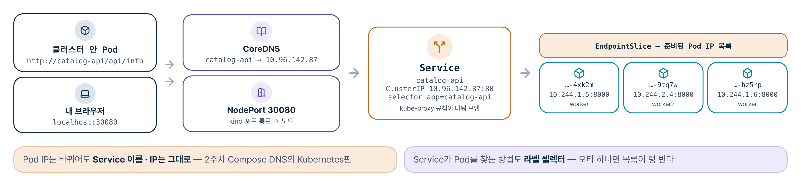

<sub>[🏠 과정 목차](../../README.md) › [3주차](../README.md) › [4일차](README.md) › 6/7교시</sub>

# 6교시 · Service와 DNS

> [!NOTE]
> **이번 시간에 할 일**
>
> - Pod IP가 바뀌어도 **바뀌지 않는 이름과 주소**를 주는 **Service**를 만듭니다.
> - Service가 Pod를 찾는 방법(라벨 셀렉터)과 **EndpointSlice**를 확인합니다.
> - 클러스터 안 다른 Pod에서 **DNS 이름**으로 부르고, 요청이 여러 Pod로 **나뉘는 것**을 봅니다.
> - **NodePort**로 브라우저의 `localhost:30080`에서 catalog-api를 엽니다.

## 문제 — Pod IP를 믿을 수 없다

어제 배움일기의 마지막 질문입니다. 5교시에서 본 것처럼 Pod는 지워지고 다시 생기며 **IP가 바뀝니다.** 노드가 꺼지면 다른 노드에서 다른 IP로 뜹니다. 그런데 2일차의 `order-api`는 `CATALOG_URL=http://catalog-api:8000`으로 catalog-api를 부릅니다. Kubernetes에서는 무엇이 `catalog-api`라는 이름에 답할까요?



**Service**는 Pod 묶음 앞에 서는 **고정된 대표 창구**입니다.

| Service가 주는 것 | 2주차 Compose에서 비슷한 것 |
|---|---|
| 바뀌지 않는 **이름** (`catalog-api`) | 서비스 이름으로 찾기 (Compose DNS) |
| 바뀌지 않는 **가상 IP** (ClusterIP) | 없음 |
| 뒤의 Pod 여러 개로 **나눠 보내기** | `--scale`했을 때 Compose DNS가 IP를 돌려 주던 것 |
| **준비된 Pod에만** 보내기 | 없음 (5일차 readiness probe와 연결) |

> **🧩 비유 — 회사 대표 전화번호**
>
> 상담원(Pod)은 매일 바뀌고, 자리(IP)도 바뀝니다. 손님은 **대표 번호**(Service) 하나만 압니다. 교환기(kube-proxy)는 지금 **근무 중인** 상담원 명단(EndpointSlice)을 보고 전화를 돌려 줍니다. 퇴근한 상담원에게는 연결하지 않습니다.

## 매니페스트 읽기

```bash
cd ~/devops-lab/k8s/day4
cat service.yaml
```

```yaml
apiVersion: v1
kind: Service
metadata:
  name: catalog-api        # 이 이름이 곧 DNS 이름
spec:
  type: ClusterIP          # 클러스터 안에서만 쓰는 주소 (기본값)
  selector:
    app: catalog-api       # 이 라벨이 붙은 Pod로 보낸다
  ports:
    - port: 80             # Service가 받는 포트
      targetPort: 8000     # Pod가 듣는 포트
```

- Deployment와 마찬가지로 **라벨 셀렉터**로 Pod를 찾습니다. Service는 Deployment를 모릅니다. 라벨이 맞는 Pod면 누가 만들었든 보냅니다.
- `port: 80` → `targetPort: 8000` — 부르는 쪽은 `http://catalog-api`(80)로 부르고, Service가 8000으로 넘깁니다. 앱의 포트가 바뀌어도 부르는 쪽은 그대로입니다.

## 실습 10 · Service 만들기

### 단계 1 — 적용하고 확인

```bash
kubectl apply -f service.yaml
kubectl get service
```

> **🟢 확인: 보이는 것**
>
> ```text
> service/catalog-api created
> NAME          TYPE        CLUSTER-IP     EXTERNAL-IP   PORT(S)   AGE
> catalog-api   ClusterIP   10.96.142.87   <none>        80/TCP    3s
> kubernetes    ClusterIP   10.96.0.1      <none>        443/TCP   1d
> ```
> - `10.96.142.87`은 **가상 IP**입니다. 어느 컨테이너의 IP도 아니고, 이 Service가 지워지기 전까지 바뀌지 않습니다.
> - `kubernetes` Service의 `10.96.0.1` — 2교시 `exec … env`에서 본 `KUBERNETES_SERVICE_HOST`입니다. **apiserver 자신도 Service**로 클러스터 안에 노출되어 있습니다.

### 단계 2 — 뒤에 누가 있나 (EndpointSlice)

```bash
kubectl get endpointslices -l kubernetes.io/service-name=catalog-api
kubectl get pods -l app=catalog-api -o custom-columns=NAME:.metadata.name,IP:.status.podIP
```

> **🟢 확인: 보이는 것**
>
> ```text
> NAME                ADDRESSTYPE   PORTS   ENDPOINTS                          AGE
> catalog-api-x7k2p   IPv4          8000    10.244.1.6,10.244.1.7,10.244.1.8   10s
> ```
> ```text
> NAME                           IP
> catalog-api-6b8f7c9d5c-hz5rp   10.244.1.6
> catalog-api-6b8f7c9d5c-k8d4s   10.244.1.8
> catalog-api-6b8f7c9d5c-w5j9d   10.244.1.7
> ```
> 두 목록의 IP가 같습니다. **EndpointSlice 컨트롤러**가 셀렉터에 맞고 **준비된**(Ready) Pod의 IP를 모아 이 목록을 계속 고칩니다. Pod가 바뀌면 목록이 바뀌고, Service 주소는 그대로입니다.

> [!TIP]
> **옛 이름 Endpoints**
>
> 오래된 자료에는 `kubectl get endpoints`가 나옵니다. 지금도 동작하지만 v1.33부터 **폐기 예정** 경고가 나옵니다. 큰 클러스터에서 목록 하나가 너무 커지는 문제를 풀려고 여러 조각(slice)으로 나눈 것이 EndpointSlice입니다.

## 실습 11 · 클러스터 안에서 이름으로 부르기

클러스터 안 다른 Pod가 되어 catalog-api를 불러 봅니다. 도구가 든 작은 이미지 `busybox`로 임시 Pod를 띄웁니다.

### 단계 1 — 임시 Pod로 들어가기

```bash
kubectl run tmp --rm -it --restart=Never --image=busybox:1.37 -- sh
```

- `kubectl run` : 매니페스트 없이 Pod 하나를 바로 만든다 (명령형 — 디버깅에만)
- `--rm -it` : 붙어서 대화하고, 나가면 지운다 (2주차 `docker run --rm -it`)
- `--restart=Never` : Deployment 없이 Pod 하나만

> **🟢 확인: 보이는 것**
>
> ```text
> If you don't see a command prompt, try pressing enter.
> / #
> ```

### 단계 2 — DNS 확인

```bash
nslookup catalog-api.default.svc.cluster.local
cat /etc/resolv.conf
```

> **🟢 확인: 보이는 것**
>
> ```text
> Server:    10.96.0.10
> Address:   10.96.0.10:53
>
> Name:      catalog-api.default.svc.cluster.local
> Address:   10.96.142.87
> ```
> ```text
> search default.svc.cluster.local svc.cluster.local cluster.local
> nameserver 10.96.0.10
> options ndots:5
> ```
> - 묻는 곳 `10.96.0.10`은 어제 본 **CoreDNS**의 Service 주소입니다.
> - 답은 Pod IP가 아니라 **Service의 가상 IP**입니다.
> - 정식 이름은 `서비스.네임스페이스.svc.cluster.local`입니다. `search` 줄 덕분에 **같은 네임스페이스에서는 `catalog-api`만** 써도 됩니다. 다른 네임스페이스라면 `catalog-api.다른네임스페이스`.

### 단계 3 — 여러 번 불러 보기

```bash
for i in 1 2 3 4 5 6; do wget -qO- http://catalog-api/api/info; echo; done
```

> **🟢 확인: 보이는 것 (순서는 매번 다름)**
>
> ```text
> {"env":"kind","hostname":"catalog-api-6b8f7c9d5c-w5j9d","service":"catalog-api","version":"2.0.0"}
> {"env":"kind","hostname":"catalog-api-6b8f7c9d5c-hz5rp","service":"catalog-api","version":"2.0.0"}
> {"env":"kind","hostname":"catalog-api-6b8f7c9d5c-w5j9d","service":"catalog-api","version":"2.0.0"}
> {"env":"kind","hostname":"catalog-api-6b8f7c9d5c-k8d4s","service":"catalog-api","version":"2.0.0"}
> ...
> ```
> `hostname`이 바뀝니다 — 요청이 **세 Pod로 나뉘어** 갑니다. 포트 80으로 불렀는데 8000의 앱이 답했습니다. `env`가 `kind`인 것은 Deployment의 `env:`에서 넣은 값입니다(2교시 Pod는 `local`이었다).

`exit`로 나옵니다. `pod "tmp" deleted`가 보이면 정리된 것입니다.

> **📖 용어 — kube-proxy가 하는 일**
>
> ClusterIP `10.96.142.87`로 가는 패킷을 실제 Pod IP 중 하나로 바꾸는 규칙을, 각 노드의 **kube-proxy**가 리눅스 커널(iptables 또는 nftables)에 깔아 둡니다. 그래서 Service의 가상 IP에는 **듣고 있는 프로그램이 없습니다.** `ping 10.96.142.87`이 안 되는 것이 정상입니다. 나누는 방식은 기본적으로 **무작위**에 가깝고, 2일차 nginx처럼 요청 내용을 보고 나누지는 않습니다.

## 실습 12 · 브라우저에서 열기 — NodePort

ClusterIP는 클러스터 **안**에서만 닿습니다. 노트북 브라우저에서 열려면 **NodePort** Service를 씁니다. 모든 노드의 정해진 포트(30000~32767)를 열고, 거기로 온 것을 Pod로 보냅니다.

```bash
cat service-nodeport.yaml | grep -A5 ports
kubectl apply -f service-nodeport.yaml
kubectl get service catalog-api-web
```

> **🟢 확인: 보이는 것**
>
> ```text
>   ports:
>     - port: 80
>       targetPort: 8000
>       nodePort: 30080
> service/catalog-api-web created
> NAME              TYPE       CLUSTER-IP     EXTERNAL-IP   PORT(S)        AGE
> catalog-api-web   NodePort   10.96.77.201   <none>        80:30080/TCP   2s
> ```

이제 브라우저에서 **http://localhost:30080/api/info** 를 열고, 새로 고침을 여러 번 합니다. `hostname`이 바뀌면 성공입니다.

경로는 이렇습니다: 브라우저 `localhost:30080` → (어제 `kind-devmart.yaml`의 `extraPortMappings`) → 컨트롤 플레인 노드 컨테이너의 30080 → kube-proxy 규칙 → 워커의 catalog-api Pod. 어제 설정 파일에 미리 뚫어 둔 통로를 오늘 쓴 것입니다.

> **📘 예시 — Service의 종류**
>
> | type | 어디서 닿나 | 쓰는 곳 |
> |---|---|---|
> | `ClusterIP` (기본) | 클러스터 안 | 서비스끼리 부를 때 — 대부분 |
> | `NodePort` | 노드 IP:30000~32767 | 실습 · 테스트. 운영에서는 거의 직접 쓰지 않는다 |
> | `LoadBalancer` | 클라우드 로드 밸런서의 공인 주소 | EKS에서 AWS NLB가 생긴다 (5주차). kind에는 기본으로 없다 |
> | (Gateway API) | 도메인 · 경로로 여러 Service에 나눠 보냄 | 운영 환경의 외부 진입 표준 (4주차 1일차) |

## 실습 13 · 셀렉터 오타

Service의 셀렉터를 일부러 틀리게 고쳐 봅니다.

```bash
kubectl patch service catalog-api -p '{"spec":{"selector":{"app":"catalog"}}}'
kubectl get endpointslices -l kubernetes.io/service-name=catalog-api
kubectl run tmp --rm -it --restart=Never --image=busybox:1.37 -- wget -qO- -T 3 http://catalog-api/api/info
```

- `kubectl patch` : 일부만 고친다 (명령형 — 실험용)

> **🟢 확인: 보이는 것**
>
> ```text
> service/catalog-api patched
> NAME                ADDRESSTYPE   PORTS     ENDPOINTS   AGE
> catalog-api-x7k2p   IPv4          <unset>   <unset>     8m
> wget: can't connect to remote host (10.96.142.87): Connection refused
> pod "tmp" deleted
> pod default/tmp terminated (Error)
> ```
> - DNS는 여전히 답합니다(Service는 있으니까). 그런데 **뒤에 아무도 없습니다** — ENDPOINTS가 비었습니다.
> - 증상은 `Connection refused`. 2일차 1교시의 `Name or service not known`(이름이 없음)과 다릅니다. **이름은 있는데 받는 사람이 없음**입니다.

> [!IMPORTANT]
> **Service 장애의 첫 확인 — 엔드포인트가 비었나**
>
> "Service로 안 붙어요"의 대부분은 **EndpointSlice가 비어 있는** 경우입니다. 원인은 셀렉터 오타, Pod 라벨 오타, 또는 Pod가 **준비되지 않음**(내일 readiness probe). 순서: `get endpointslices` → 비었으면 `get pods --show-labels`로 라벨 비교.

파일로 되돌립니다 — 선언형의 힘입니다.

```bash
kubectl apply -f service.yaml
kubectl get endpointslices -l kubernetes.io/service-name=catalog-api
```

> **🟢 확인: 다시 세 개**
>
> `ENDPOINTS`에 IP 세 개가 돌아옵니다.

> **🎓 학술 노트 — 이름과 주소를 떼어 놓기**
>
> 인터넷의 DNS(Mockapetris, RFC 1034/1035, 1987)부터 Service까지, 분산 시스템의 오래된 원칙은 **"찾는 이름"과 "실제 위치"를 분리**하는 것입니다. 위치가 바뀌어도 이름이 그대로면, 부르는 쪽은 아무것도 고칠 필요가 없습니다. Saltzer(1982)의 *On the Naming and Binding of Network Destinations*(RFC 1498)는 이름(name) · 주소(address) · 경로(route)를 구분하고, 이름을 주소로 **묶는 일**(binding)을 언제 누가 하느냐가 설계의 핵심이라고 했습니다. Kubernetes에서는 CoreDNS가 이름 → 가상 IP를, kube-proxy가 가상 IP → Pod IP를 묶습니다. 두 번 묶어서 Pod가 바뀌어도 이름 쪽은 흔들리지 않습니다.

> **📈 트렌드 2026 — kube-proxy 없는 Service**
>
> kube-proxy는 iptables 규칙으로 Service를 구현하는데, Service가 수천 개가 되면 규칙이 너무 많아집니다. 그래서 v1.33에서 **nftables 모드**가 정식이 되었고, 리눅스 커널 안에서 동작하는 **eBPF**로 kube-proxy 자체를 대신하는 Cilium 같은 CNI도 널리 쓰입니다. EKS · GKE도 eBPF 기반 네트워킹을 선택지로 제공합니다. 무엇으로 구현하든 **Service · EndpointSlice라는 약속은 같다**는 것이 Kubernetes API의 힘입니다.

> **✅ 확인 문제**
>
> 1. Service는 뒤의 Pod를 무엇으로 찾나요?
> 2. `nslookup catalog-api`의 답은 Pod IP인가요, Service IP인가요?
> 3. 다른 네임스페이스 `shop`에 있는 `catalog-api` Service를 부를 때 쓰는 이름은?
> 4. Service로 부를 때 `Connection refused`가 났습니다. 가장 먼저 확인할 것은?
> 5. `localhost:30080`이 catalog-api에 닿게 해 준 설정 두 가지는?
>
> <details><summary>정답</summary>
>
> 1. 라벨 셀렉터 (`spec.selector`)
> 2. Service의 가상 IP (ClusterIP)
> 3. `catalog-api.shop` (정식으로는 `catalog-api.shop.svc.cluster.local`)
> 4. `kubectl get endpointslices -l kubernetes.io/service-name=이름` — 비었는지. 비었다면 셀렉터와 Pod 라벨 비교
> 5. kind 설정의 `extraPortMappings`(노트북 30080 → 노드 30080)와 NodePort Service의 `nodePort: 30080`
>
> </details>

## 참고 문헌

- Kubernetes Docs. *Service* · *EndpointSlices* · *DNS for Services and Pods*. kubernetes.io/docs/concepts/services-networking
- Kubernetes Docs. *Virtual IPs and Service Proxies*. kubernetes.io/docs/reference/networking
- Mockapetris, P. (1987). *Domain Names — Concepts and Facilities* (RFC 1034).
- Saltzer, J. (1982/1993). *On the Naming and Binding of Network Destinations* (RFC 1498).
- kind. *Configuration — Extra Port Mappings*. kind.sigs.k8s.io/docs/user/configuration

---

| 이전 | 목차 | 다음 |
|:--|:--:|--:|
| ⬅️ [5교시 · ReplicaSet과 자가 치유](lesson-05.md) | [⬆️ 4일차 목차](README.md) | [7교시 · 롤링 업데이트와 되돌리기](lesson-07.md) ➡️ |
