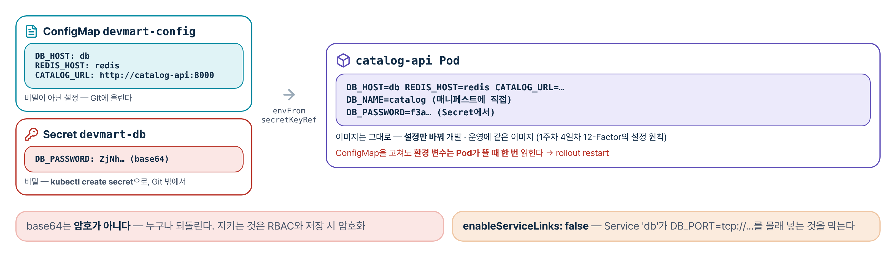

<sub>[🏠 과정 목차](../../README.md) › [3주차](../README.md) › [5일차](README.md) › 2/7교시</sub>

# 2교시 · ConfigMap과 Secret

> [!NOTE]
> **이번 시간에 할 일**
>
> - 비밀이 아닌 설정은 **ConfigMap**, 비밀번호는 **Secret**에 담아 Pod에 넣습니다.
> - Secret의 base64가 **암호가 아님**을 직접 확인합니다.
> - 파일을 ConfigMap으로 만들어 **PostgreSQL 초기화 SQL**로 씁니다. 디스크(PVC)를 붙인 DB를 띄웁니다.
> - catalog-api가 DB에 붙어 **상품 목록이 200**으로 나오게 합니다.
> - ConfigMap을 고쳐도 Pod의 환경 변수는 **바로 바뀌지 않음**을 확인합니다.

## 설정을 이미지 밖으로

1주차 4일차의 12-Factor는 "설정은 **환경**에 둔다"고 했습니다. 같은 이미지를 개발 · 운영에 쓰고, 설정만 바꿔 끼운다는 뜻입니다. 2주차 Compose에서는 `environment:`와 `.env`가 그 역할을 했습니다. Kubernetes에서는 두 리소스가 나눠 맡습니다.



| | ConfigMap | Secret |
|---|---|---|
| 담는 것 | DB 주소, 큐 이름, 타임아웃… | 비밀번호, 토큰, 인증서 |
| 저장 형태 | 평문 | **base64** (암호 아님!) + 권한으로 따로 관리 |
| Git에 | 올린다 | **올리지 않는다** |
| Compose에서 | `environment:`의 평범한 값 | `.env` 파일 |

## 실습 3 · ConfigMap

```bash
cd ~/devops-lab/k8s/day5
cat devmart/config.yaml
kubectl apply -f devmart/config.yaml
kubectl describe configmap devmart-config -n devmart
```

> **🟢 확인: 보이는 것 (describe)**
>
> ```text
> Name:         devmart-config
> Namespace:    devmart
> ...
> Data
> ====
> APP_ENV:
> ----
> kind
> CATALOG_TIMEOUT:
> ----
> 2
> CATALOG_URL:
> ----
> http://catalog-api:8000
> ...
> ```
> 2일차 `compose.yaml`의 `environment:`에서 **비밀번호만 뺀** 값들입니다. 주소가 `db` · `redis` · `catalog-api:8000` 그대로인 점을 봐 두세요 — 5교시에 Service 이름을 Compose 서비스 이름과 똑같이 짓는 이유입니다.

## 실습 4 · Secret

### 단계 1 — 손으로 만들기

```bash
kubectl create secret generic devmart-db -n devmart \
  --from-literal=DB_PASSWORD="$(openssl rand -hex 12)"
kubectl get secret -n devmart
```

- `generic` : 키-값 형태의 일반 Secret
- `--from-literal=키=값` : 값을 명령줄에서 바로 준다
- `openssl rand -hex 12` : 임의의 24자리 비밀번호를 만든다 — **나도 모르는 비밀번호**

> **🟢 확인: 보이는 것**
>
> ```text
> secret/devmart-db created
> NAME         TYPE     DATA   AGE
> devmart-db   Opaque   1      2s
> ```

> [!IMPORTANT]
> **왜 Secret만 파일이 아니라 명령으로?**
>
> 오늘 다른 모든 것은 `devmart/` 폴더의 YAML 파일로 만듭니다. Secret만 예외입니다. YAML로 만들면 비밀번호가 **파일에 남고**, 그 파일은 언젠가 Git에 올라갑니다(2주차 `.gitignore`를 떠올리세요). `devmart/kustomization.yaml`에도 Secret은 일부러 없습니다. 운영 환경에서는 Secret을 클라우드의 비밀 저장소에서 가져오는 도구를 씁니다(아래 트렌드).

### 단계 2 — base64는 암호가 아니다

```bash
kubectl get secret devmart-db -n devmart -o yaml | grep -A1 '^data:'
kubectl get secret devmart-db -n devmart -o jsonpath='{.data.DB_PASSWORD}' | base64 -d; echo
```

- `base64 -d` : base64를 원래대로 되돌린다

> **🟢 확인: 보이는 것**
>
> ```text
> data:
>   DB_PASSWORD: ZjNhOTJjMGI3ZDFlNDQ1YjhhMmM2ZjBk
> f3a92c0b7d1e445b8a2c6f0d
> ```
> **한 줄 명령으로 원래 값이 나옵니다.** base64는 바이너리도 YAML에 담을 수 있게 바꾸는 **인코딩**일 뿐, 열쇠가 필요한 **암호화**가 아닙니다.

> [!WARNING]
> **그러면 Secret은 무엇으로 지키나**
>
> - **권한(RBAC)** — Secret을 읽을 수 있는 사람과 프로그램을 최소로 둔다. kind에서 우리는 관리자라 다 보인다 (4주차 5일차).
> - **저장 시 암호화** — etcd에 쓸 때 암호화하게 설정한다 (3일차 2교시). EKS는 기본으로 켜져 있다.
> - **로그 · 화면에 찍지 않기** — 위 `base64 -d` 같은 명령을 운영 클러스터에서 화면 공유 중에 치지 않는다.

## 실습 5 · 파일을 ConfigMap으로 — DB 초기화 SQL

2일차 Compose는 `./db/init` 폴더를 DB 컨테이너의 `/docker-entrypoint-initdb.d`에 **바인드 마운트**해서 처음 뜰 때 SQL을 실행했습니다. Kubernetes 노드에는 내 노트북 폴더가 없습니다. 대신 **파일 내용을 ConfigMap에 담아** 마운트합니다.

```bash
ls devmart/files/initdb
kubectl create configmap db-init -n devmart --from-file=devmart/files/initdb/ --save-config
kubectl get configmap db-init -n devmart -o jsonpath='{.data}' | head -c 200; echo
```

- `--from-file=폴더/` : 폴더 안 파일마다 키 하나 (파일 이름 → 키, 내용 → 값)
- `--save-config` : 5교시에 `kubectl apply`로 같은 것을 다시 적용할 때 경고가 나지 않게 기록을 남긴다

> **🟢 확인: 보이는 것**
>
> ```text
> 01-catalog.sql  02-orders.sql
> configmap/db-init created
> {"01-catalog.sql":"-- catalog DB (POSTGRES_DB로 이미 만들어져 있다) — 상품 서비스의 데이터\nCREATE TABLE IF NOT EXISTS products (\n ...
> ```

## 실습 6 · DB 띄우기 — PVC와 함께

```bash
grep -B2 -A12 'kind: PersistentVolumeClaim' devmart/db.yaml | head -14
kubectl apply -f devmart/db.yaml
kubectl get pvc -n devmart
```

> **🟢 확인: 보이는 것**
>
> ```text
> persistentvolumeclaim/db-data created
> deployment.apps/db created
> service/db created
> NAME      STATUS    VOLUME   CAPACITY   ACCESS MODES   STORAGECLASS   AGE
> db-data   Pending                                      standard       1s
> ```

> **📖 용어 — PVC · PV · StorageClass**
>
> - **PersistentVolumeClaim(PVC)** — "1Gi짜리 디스크가 필요해"라는 **요청서**. 내가 쓴다.
> - **PersistentVolume(PV)** — 실제 디스크. **StorageClass**(디스크를 만들어 주는 방법)가 PVC를 보고 자동으로 만든다.
> - kind의 StorageClass `standard`는 노드 컨테이너 안의 폴더를 디스크로 씁니다(3일차 7교시 "Installing StorageClass"). EKS에서는 같은 PVC가 **AWS EBS 볼륨**이 됩니다(5주차).
>
> 2주차 Compose의 **이름 있는 볼륨**(`db-data:`)이 PVC 자리입니다.

`Pending`은 정상입니다. kind의 StorageClass는 **Pod가 노드에 배정된 뒤에** 그 노드에 디스크를 만듭니다. 잠시 뒤 다시 봅니다.

```bash
kubectl rollout status deployment/db -n devmart --timeout=180s
kubectl get pvc -n devmart
kubectl logs deployment/db -n devmart | grep -E 'initdb|ready to accept' | tail -3
```

> **🟢 확인: 보이는 것**
>
> ```text
> deployment "db" successfully rolled out
> NAME      STATUS   VOLUME                                     CAPACITY   ACCESS MODES   STORAGECLASS   AGE
> db-data   Bound    pvc-3f2a…                                  1Gi        RWO            standard       60s
> /usr/local/bin/docker-entrypoint.sh: running /docker-entrypoint-initdb.d/01-catalog.sql
> /usr/local/bin/docker-entrypoint.sh: running /docker-entrypoint-initdb.d/02-orders.sql
> ... LOG:  database system is ready to accept connections
> ```
> 2일차와 같은 초기화 로그입니다. postgres 이미지를 처음 받느라 1~2분 걸릴 수 있습니다.

> [!TIP]
> **db.yaml에서 봐 둘 두 줄**
>
> - `strategy: type: Recreate` — 4일차 롤링 업데이트는 새것을 먼저 띄웠습니다. 하지만 디스크(ReadWriteOnce)는 **한 Pod만** 붙일 수 있고, DB 두 개가 같은 데이터 폴더를 쓰면 망가집니다. 그래서 DB는 **옛것을 먼저 내리고** 새것을 띄웁니다. 잠깐 끊기는 대신 데이터를 지킵니다.
> - 운영 환경의 DB는 보통 **StatefulSet**(4일차 4교시 학술 노트)이나 클러스터 **밖**의 관리형 DB(5주차의 RDS)를 씁니다. 오늘은 구조를 보기 위해 가장 단순한 형태로 둡니다.

## 실습 7 · catalog-api를 DB에 붙이기

```bash
sed -n '/containers:/,/---/p' steps/catalog-v1.yaml
```

```yaml
      containers:
        - name: catalog-api
          image: ghcr.io/niceguy61/devmart-catalog-api:sha-7f3c2e1
          ports:
            - containerPort: 8000
          envFrom:
            - configMapRef: { name: devmart-config }    # ConfigMap의 모든 키를 환경 변수로
          env:
            - name: DB_NAME
              value: catalog                            # 이 서비스만의 값은 직접
            - name: DB_PASSWORD
              valueFrom:
                secretKeyRef: { name: devmart-db, key: DB_PASSWORD }   # Secret의 키 하나를
```

```bash
kubectl apply -f steps/catalog-v1.yaml
kubectl rollout status deployment/catalog-api -n devmart
kubectl port-forward -n devmart service/catalog-api 8000:8000
```

- `port-forward service/…` : 4일차에는 Pod에 붙었지만, Service에도 붙을 수 있다 (실제로는 Service 뒤의 Pod 하나로 연결)

```bash
# 다른 터미널
curl -s localhost:8000/api/products | head -c 160; echo
```

> **🟢 확인: 드디어 200**
>
> ```text
> {"items":[{"id":1,"name":"러닝화","price":59000,"stock":12},{"id":2,"name":"후드 집업","price":45000,"stock":8},…
> ```
> 어제 `KeyError`로 503이던 상품 목록이 나옵니다. port-forward는 Ctrl+C로 닫습니다.

### 단계 — 환경 변수 확인

```bash
kubectl exec -n devmart deployment/catalog-api -- env | grep -E '^(DB_|APP_ENV|REDIS_HOST)' | sort
```

> **🟢 확인: 보이는 것**
>
> ```text
> APP_ENV=kind
> DB_HOST=db
> DB_NAME=catalog
> DB_PASSWORD=f3a92c0b7d1e445b8a2c6f0d
> DB_USER=devmart
> REDIS_HOST=redis
> ```
> Pod 안에서는 비밀번호가 **평문 환경 변수**입니다. 앱이 읽어야 하니 당연합니다. 그래서 `kubectl exec` 권한도 Secret 읽기 권한만큼 조심해서 줍니다.

## 실습 8 · enableServiceLinks — 몰래 들어오는 환경 변수

매니페스트마다 `enableServiceLinks: false`가 있습니다. 이 줄이 없으면 어떻게 되는지, 임시 Pod로 봅니다.

```bash
kubectl run envtest -n devmart --rm -it --restart=Never --image=busybox:1.37 -- sh -c 'env | grep ^DB_ | sort'
```

> **🟢 확인: 보이는 것**
>
> ```text
> DB_PORT=tcp://10.96.201.14:5432
> DB_PORT_5432_TCP=tcp://10.96.201.14:5432
> DB_PORT_5432_TCP_ADDR=10.96.201.14
> DB_PORT_5432_TCP_PORT=5432
> DB_PORT_5432_TCP_PROTO=tcp
> DB_SERVICE_HOST=10.96.201.14
> DB_SERVICE_PORT=5432
> pod "envtest" deleted
> ```
> Kubernetes는 기본으로 **같은 네임스페이스의 모든 Service** 주소를 환경 변수로 Pod에 넣습니다(옛 Docker의 `--link` 방식을 흉내 낸 것). 그런데 Service 이름이 `db`라서 **`DB_PORT=tcp://10.96…:5432`** 가 생깁니다. catalog-api 코드는 `os.getenv('DB_PORT', '5432')`로 포트를 읽으니, 이 줄이 없었다면 포트 자리에 `tcp://…`가 들어가 **DB 연결이 깨집니다.** 요즘은 DNS로 찾으니 이 기능이 필요 없고, 끄는 편이 안전합니다.

> **📘 예시 — 실무에서 실제로 나는 사고**
>
> `REDIS_PORT`, `MYSQL_PORT`, `KAFKA_PORT` — 흔한 서비스 이름과 흔한 환경 변수 이름이 겹쳐 생기는 사고는 꽤 자주 보고됩니다. 증상은 "Compose에서는 되는데 Kubernetes에서만 안 된다"입니다. 앱 로그에 이상한 `tcp://` 주소가 보이면 이것을 의심합니다.

## 실습 9 · ConfigMap을 고치면

```bash
kubectl patch configmap devmart-config -n devmart -p '{"data":{"APP_ENV":"kind-v2"}}'
kubectl exec -n devmart deployment/catalog-api -- printenv APP_ENV
```

> **🟢 확인: 그대로다**
>
> ```text
> configmap/devmart-config patched
> kind
> ```
> ConfigMap은 바뀌었지만 Pod의 환경 변수는 **Pod가 뜰 때 한 번** 읽은 값입니다. 바꾸려면 Pod를 새로 띄웁니다.

```bash
kubectl rollout restart deployment/catalog-api -n devmart
kubectl rollout status deployment/catalog-api -n devmart
kubectl exec -n devmart deployment/catalog-api -- printenv APP_ENV
```

> **🟢 확인: 이제 바뀐다**
>
> ```text
> kind-v2
> ```

파일로 되돌립니다(파일이 원하는 상태입니다).

```bash
kubectl apply -f devmart/config.yaml
kubectl rollout restart deployment/catalog-api -n devmart
```

> [!TIP]
> **자동으로 다시 띄우게 하는 방법**
>
> - ConfigMap을 **파일로 마운트**하면(5교시 web의 nginx 설정처럼) 파일 내용은 1분 안쪽에 바뀝니다. 다만 앱이 파일을 다시 읽어야 의미가 있습니다.
> - Kustomize의 ConfigMap 생성기는 내용이 바뀌면 **이름 뒤에 새 해시**를 붙여, Deployment 템플릿이 바뀐 것으로 만들어 자동으로 롤링 업데이트가 일어나게 합니다. 오늘은 이해를 돕기 위해 해시를 껐습니다(`disableNameSuffixHash: true`).

> **🎓 학술 노트 — 비밀은 코드와 분리하라**
>
> GitHub에 실수로 올라간 비밀값을 조사한 연구(Meli, McNiece & Reaves, *How Bad Can It Git?*, NDSS 2019)는 공개 저장소에서 수십만 건의 API 키 · 비밀번호를 찾아냈고, 상당수가 올라간 지 **몇 분~몇 시간 안에** 수집될 수 있음을 보였습니다. 커밋을 지워도 Git 이력에는 남습니다. 2주차의 `.gitignore`, 오늘의 "Secret은 파일로 두지 않는다"는 이 연구가 보여 준 위험에 대한 가장 기본적인 대책입니다.

> **📈 트렌드 2026 — Secret을 클러스터 밖에서**
>
> 운영 환경에서는 Secret 값을 손으로 넣지 않습니다. **External Secrets Operator**가 AWS Secrets Manager · Vault 같은 비밀 저장소의 값을 읽어 Secret을 만들어 주고, 비밀번호를 바꾸면 따라 바꿉니다. Git에 꼭 넣어야 한다면 클러스터만 풀 수 있게 암호화하는 **Sealed Secrets**나 SOPS를 씁니다. 더 나아가, 비밀번호 자체를 없애고 Pod의 신원(ServiceAccount)으로 클라우드에 인증하는 방식(EKS Pod Identity, 5주차)이 표준이 되어 가고 있습니다.

> **✅ 확인 문제**
>
> 1. ConfigMap과 Secret 중 Git에 올리는 것은?
> 2. `ZjNh…`라는 Secret 값을 원래대로 바꾸는 명령은? 이것이 뜻하는 것은?
> 3. PVC가 `Pending`이었다가 `Bound`가 된 시점은 언제인가요?
> 4. DB Deployment에 `Recreate` 전략을 쓴 이유는?
> 5. Service 이름이 `db`일 때 `enableServiceLinks: false`가 없으면 무엇이 깨지나요?
> 6. ConfigMap을 고친 뒤 환경 변수를 반영하려면?
>
> <details><summary>정답</summary>
>
> 1. ConfigMap (Secret은 Git 밖에서)
> 2. `base64 -d` — base64는 암호가 아니라 인코딩일 뿐이다. 보호는 권한과 저장 시 암호화로 한다
> 3. db Pod가 노드에 배정된 뒤 (그 노드에 디스크를 만든다)
> 4. 디스크(ReadWriteOnce)는 한 Pod만 붙일 수 있고, DB 두 개가 같은 데이터를 쓰면 망가지므로 옛것을 먼저 내린다
> 5. Kubernetes가 넣는 `DB_PORT=tcp://…:5432`가 앱의 `DB_PORT` 읽기와 겹쳐 DB 연결 문자열이 깨진다
> 6. `kubectl rollout restart deployment/이름` (Pod를 새로 띄운다)
>
> </details>

## 참고 문헌

- Kubernetes Docs. *ConfigMaps* · *Secrets* · *Good practices for Kubernetes Secrets*. kubernetes.io/docs/concepts/configuration
- Kubernetes Docs. *Persistent Volumes* · *Storage Classes*. kubernetes.io/docs/concepts/storage
- Kubernetes Docs. *Accessing the Service — Environment variables*. kubernetes.io/docs/concepts/services-networking/service
- Meli, M., McNiece, M. R., & Reaves, B. (2019). How Bad Can It Git? Characterizing Secret Leakage in Public GitHub Repositories. *NDSS 2019*.
- The Twelve-Factor App. *III. Config*. 12factor.net

---

| 이전 | 목차 | 다음 |
|:--|:--:|--:|
| ⬅️ [1교시 · 4일차 요약 + Namespace](lesson-01.md) | [⬆️ 5일차 목차](README.md) | [3교시 · probe — 준비됐나, 살아 있나](lesson-03.md) ➡️ |
