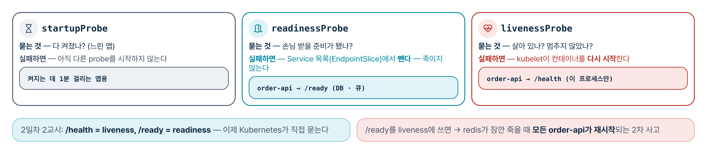

[🏠 과정 목차](../../README.md) › [3주차](../README.md) › [5일차](README.md)

# 3교시 · probe — 준비됐나, 살아 있나

> [!NOTE]
> **이번 시간에 할 일**
>
> - **readiness · liveness · startup probe**가 각각 무엇을 묻고, 실패하면 무엇을 하는지 구분합니다.
> - probe가 없을 때와 있을 때 롤링 업데이트 중 **실패한 요청 수**를 비교합니다 — 4일차 7교시의 FAIL을 없앱니다.
> - probe 경로를 일부러 틀리게 해서, readiness 실패와 liveness 실패의 **증상 차이**를 봅니다.

## Kubernetes가 직접 묻는다

2일차 2교시에 order-api에 `/health`(살아 있나)와 `/ready`(DB · 큐까지 준비됐나)를 만들고, Compose의 `healthcheck:`로 `/ready`를 물었습니다. 그때 Compose는 결과를 `(unhealthy)`로 **표시만** 했습니다. Kubernetes는 결과에 따라 **행동**합니다.



| probe | 묻는 것 | 실패하면 | 묻는 주체 |
|---|---|---|---|
| **readiness** | 지금 손님을 받아도 되나? | EndpointSlice에서 **뺀다** (죽이지 않는다). 다시 성공하면 넣는다 | kubelet → 결과를 apiserver에 |
| **liveness** | 살아 있나? 멈춰 버리지 않았나? | 컨테이너를 **다시 시작**한다 | kubelet |
| **startup** | 다 켜졌나? (켜지는 데 오래 걸리는 앱) | 성공할 때까지 위 둘을 **시작하지 않는다** | kubelet |

> **🧩 비유 — 가게의 영업중 팻말과 건강 검진**
>
> **readiness**는 문에 거는 **"영업중 / 준비중" 팻말**입니다. 재료가 떨어지면 팻말을 '준비중'으로 돌릴 뿐 가게를 부수지 않습니다. 재료가 오면 다시 '영업중'. **liveness**는 **"사장님 의식이 있나?"**입니다. 대답이 없으면 119를 부릅니다(재시작). 재료가 떨어졌다고 119를 부르면 안 됩니다 — 이것이 2일차 2교시의 "/ready를 liveness로 쓰면 2차 사고"입니다.

## 매니페스트 읽기

```bash
cd ~/devops-lab/k8s/day5
diff steps/catalog-v1.yaml steps/catalog-v2.yaml
```

> **🟢 확인: 보이는 것 (v2에 더해진 부분)**
>
> ```text
> >           readinessProbe:
> >             httpGet: { path: /health, port: 8000 }
> >             periodSeconds: 5
> >           livenessProbe:
> >             httpGet: { path: /health, port: 8000 }
> >             periodSeconds: 10
> >             failureThreshold: 3
> >           lifecycle:
> >             preStop:
> >               exec:
> >                 command: ["sleep", "5"]
> ```

| 칸 | 뜻 |
|---|---|
| `httpGet` | 이 경로로 HTTP 요청 — 200~399면 성공. 그 밖에 `exec`(명령 실행, DB에 씀), `tcpSocket`, `grpc` |
| `periodSeconds` | 몇 초마다 물을까 |
| `failureThreshold` | 몇 번 연속 실패해야 실패로 볼까 (기본 3) — 한 번 삐끗한 것으로 재시작하지 않게 |
| `timeoutSeconds` | 답을 몇 초 기다릴까 (기본 **1초**) — 느린 `/ready`라면 늘린다 (order-api는 6초, 5교시) |
| `preStop: sleep 5` | 종료 신호를 보내기 **전에** 5초 기다린다 — 아래 설명 |

> [!WARNING]
> **catalog-api의 readiness가 /health인 이유와 한계**
>
> catalog-api에는 `/ready`가 없습니다(2일차에 order-api에만 만들었다). 그래서 오늘은 readiness도 `/health`를 묻습니다. 이러면 "gunicorn이 포트를 열었나"까지만 확인되고, **DB가 죽어도 준비됨**으로 남습니다(6교시 장애 1에서 직접 봅니다). 실무라면 catalog-api에도 `/ready`를 만듭니다 — 이번 주 회고의 Try 후보입니다.

## 실습 10 · probe 전후의 FAIL 세기

### 단계 1 — 클러스터 안에서 계속 부르는 Pod

4일차에는 노트북에서 NodePort로 불렀습니다. 지금은 클러스터 안에 계속 부르는 Pod를 하나 둡니다.

```bash
kubectl run loop -n devmart --image=busybox:1.37 --restart=Never -- sh -c \
  'while true; do wget -qO- -T 1 http://catalog-api:8000/api/info >/dev/null && echo OK || echo FAIL; sleep 0.2; done'
sleep 5; kubectl logs loop -n devmart --tail=3
```

> **🟢 확인: 보이는 것**
>
> ```text
> pod/loop created
> OK
> OK
> OK
> ```

### 단계 2 — probe 없이 (v1) 재시작

지금 catalog-api는 2교시의 v1입니다. 모든 Pod를 새로 띄웁니다(4일차의 롤링 업데이트와 같은 과정).

```bash
kubectl rollout restart deployment/catalog-api -n devmart
kubectl rollout status deployment/catalog-api -n devmart
sleep 10; kubectl logs loop -n devmart --since=40s | sort | uniq -c
```

> **🟢 확인: 보이는 것 (숫자는 매번 다름)**
>
> ```text
>       3 FAIL
>     142 OK
> ```
> FAIL이 몇 개 섞입니다. 4일차 7교시와 같은 현상입니다.

### 단계 3 — probe와 함께 (v2)

```bash
kubectl apply -f steps/catalog-v2.yaml
kubectl rollout status deployment/catalog-api -n devmart
sleep 15
kubectl rollout restart deployment/catalog-api -n devmart
kubectl rollout status deployment/catalog-api -n devmart
sleep 10; kubectl logs loop -n devmart --since=40s | sort | uniq -c
```

> **🟢 확인: 보이는 것**
>
> ```text
>     150 OK
> ```
> **FAIL이 0**입니다. 롤링 업데이트가 조금 느려졌지만(probe가 성공할 때까지 기다리니까), 요청은 하나도 실패하지 않았습니다.

### 무엇이 FAIL을 없앴나 — 양쪽 끝

| 끝 | probe 없을 때 | 지금 |
|---|---|---|
| **새 Pod** | 컨테이너가 시작하자마자 '준비됨' → gunicorn이 포트를 열기 전에 손님이 온다 | readiness가 성공해야 EndpointSlice에 들어간다 |
| **옛 Pod** | 종료 신호(SIGTERM)를 받자마자 gunicorn이 새 연결을 거절 → 그런데 kube-proxy 규칙에서 빠지는 데 1~2초 걸려, 그 사이 요청이 거절당한다 | `preStop: sleep 5` — 종료 신호 전에 5초 기다리는 동안 목록에서 빠지고 남은 요청을 끝낸다 |

> [!IMPORTANT]
> **무중단 배포의 세 조각**
>
> **readiness probe**(들어올 때) + **종료 전 대기**(나갈 때) + **롤링 업데이트 규칙**(4일차: 하나 띄우고 하나 내리기). 셋 중 하나만 빠져도 FAIL이 생깁니다. 4일차의 "롤링 업데이트면 저절로 무중단이다"가 오해였던 이유입니다.

## 실습 11 · probe가 틀리면

probe 경로를 **일부러 틀리게** 고쳐, readiness 실패와 liveness 실패의 증상을 비교합니다. `kubectl patch`로 템플릿을 고치면 그것도 롤링 업데이트가 됩니다.

### 실험 A — readiness 경로 오타

```bash
kubectl patch deployment catalog-api -n devmart --type=json -p \
  '[{"op":"replace","path":"/spec/template/spec/containers/0/readinessProbe/httpGet/path","value":"/readyz"}]'
sleep 30
kubectl get pods -n devmart -l app=catalog-api
kubectl logs loop -n devmart --since=30s | sort | uniq -c
```

- `--type=json -p '[…]'` : 매니페스트의 한 칸을 경로로 짚어 바꾼다

> **🟢 확인: 보이는 것**
>
> ```text
> NAME                           READY   STATUS    RESTARTS   AGE
> catalog-api-58c7d9b6f4-2kq8x   0/1     Running   0          30s
> catalog-api-7fb4c8d5e9-hm2vd   1/1     Running   0          4m
> catalog-api-7fb4c8d5e9-xt6pw   1/1     Running   0          4m
>     140 OK
> ```
> - 새 Pod는 `Running`인데 **`0/1`** — 살아 있지만 준비되지 않음. 재시작하지 않습니다(RESTARTS 0).
> - 새 Pod가 준비되지 않으니 롤링 업데이트가 **멈췄고**, 옛 Pod 둘이 계속 일합니다. **FAIL 0** — 4일차 7교시의 '멈춘 배포'와 같습니다.

```bash
kubectl describe pod -n devmart -l app=catalog-api | grep -A1 'Readiness probe failed' | head -2
```

> **🟢 확인: 보이는 것**
>
> ```text
>   Warning  Unhealthy  5s (x6 over 30s)  kubelet  Readiness probe failed: HTTP probe failed with statuscode: 404
> ```

되돌립니다.

```bash
kubectl rollout undo deployment/catalog-api -n devmart
kubectl rollout status deployment/catalog-api -n devmart
```

### 실험 B — liveness 경로 오타

```bash
kubectl patch deployment catalog-api -n devmart --type=json -p \
  '[{"op":"replace","path":"/spec/template/spec/containers/0/livenessProbe/httpGet/path","value":"/healthz"}]'
sleep 90
kubectl get pods -n devmart -l app=catalog-api
```

> **🟢 확인: 보이는 것**
>
> ```text
> NAME                           READY   STATUS    RESTARTS      AGE
> catalog-api-6d4f8b7c9a-8wz5r   1/1     Running   2 (15s ago)   85s
> catalog-api-6d4f8b7c9a-q7m3n   1/1     Running   2 (5s ago)    80s
> ```
> readiness(`/health`)는 맞으니 새 Pod가 준비되어 **교체는 끝났습니다.** 그런데 RESTARTS가 계속 오릅니다. 약 30초(10초 × 3번)마다 liveness가 실패해 kubelet이 **죽이고 다시 띄웁니다.**

```bash
kubectl describe pod -n devmart -l app=catalog-api | grep -E 'Liveness probe failed|failed liveness' | head -2
kubectl logs loop -n devmart --since=60s | sort | uniq -c
```

> **🟢 확인: 보이는 것**
>
> ```text
>   Warning  Unhealthy  …  kubelet  Liveness probe failed: HTTP probe failed with statuscode: 404
>   Normal   Killing    …  kubelet  Container catalog-api failed liveness probe, will be restarted
>       4 FAIL
>     280 OK
> ```
> 다시 시작하는 순간마다 FAIL이 생깁니다. 시간이 지나면 재시작 사이 간격이 늘어나며 **CrashLoopBackOff**가 보이기도 합니다. 앱은 멀쩡한데 **probe 설정 하나가 앱을 계속 죽이는** 경우입니다.

| | readiness 오타 (실험 A) | liveness 오타 (실험 B) |
|---|---|---|
| Pod 상태 | `Running`, `0/1` | `Running`, `1/1`, RESTARTS 증가 |
| 결과 | 손님을 안 받을 뿐 — 롤링 업데이트가 멈춰 옛 Pod가 일한다 | 계속 죽였다 살림 — 그때마다 요청 실패 |
| 위험 | 낮음 (배포가 멈춘 것) | **높음** (배포는 '성공'인데 서비스가 흔들린다) |

되돌리고, 부르는 Pod를 지웁니다.

```bash
kubectl apply -f steps/catalog-v2.yaml
kubectl rollout status deployment/catalog-api -n devmart
kubectl delete pod loop -n devmart
```

> **❓ 오해 — liveness는 꼼꼼할수록 좋다**
>
> liveness가 DB · 큐 · 다른 서비스까지 확인하면, 그중 하나가 잠깐 아플 때 **멀쩡한 Pod가 전부 재시작**됩니다. 재시작해도 DB는 안 낫고, 재시작 동안 서비스만 더 끊깁니다. liveness는 **"이 프로세스가 멈췄나(교착 · 무한 루프)"**만 확인하는 가볍고 자기만 보는 검사여야 합니다. 의존 대상 확인은 readiness의 몫입니다. 확신이 없으면 liveness는 **아예 두지 않는 편**이 낫다는 실무 조언도 많습니다.

> **🎓 학술 노트 — 실패를 감지하는 일은 왜 어려운가**
>
> 분산 시스템에서 "저 서버가 죽었나, 느린가"를 완벽히 구분할 방법은 없습니다. Chandra & Toueg(1996, *Unreliable Failure Detectors for Reliable Distributed Systems*, JACM)는 고장 감지기가 **틀릴 수 있다**는 전제에서 시스템을 설계하는 이론을 세웠습니다. probe의 `failureThreshold` · `timeoutSeconds`가 그 틀림을 다루는 손잡이입니다. 너무 예민하면 멀쩡한 것을 죽이고(실험 B), 너무 둔하면 죽은 것에 손님을 보냅니다. 정답은 없고, **앱의 특성에 맞춘 선택**만 있습니다.

> **📈 트렌드 2026 — 종료 처리의 표준화**
>
> 오늘은 `preStop`에 `sleep` 명령을 썼습니다. 이 때문에 운영 이미지에 `sleep` 프로그램이 있어야 했습니다. Kubernetes는 이를 위해 `preStop: sleep: seconds: 5`처럼 **컨테이너 안 프로그램 없이** 기다리는 기능을 넣어 정식 기능으로 만들었습니다. 셸조차 없는 최소 이미지(distroless)가 늘면서 이런 '플랫폼이 대신해 주는' 기능이 계속 늘고 있습니다. 또 앱 쪽에서도 SIGTERM을 받으면 새 연결을 끊고 진행 중인 요청을 마무리하는 **우아한 종료**(graceful shutdown)를 기본으로 구현하는 추세입니다.

> **✅ 확인 문제**
>
> 1. readiness가 실패한 Pod는 어떻게 되나요? liveness가 실패하면?
> 2. probe 없이 롤링 업데이트할 때 FAIL이 생기는 두 시점은?
> 3. `preStop: sleep 5`는 무엇을 기다리는 시간인가요?
> 4. readiness 경로가 틀렸는데 사용자가 아무 문제를 못 느낀 이유는?
> 5. order-api의 liveness를 `/ready`로 하면 redis가 1분 죽었을 때 무슨 일이 생기나요?
>
> <details><summary>정답</summary>
>
> 1. readiness 실패 — Service 목록에서 빠진다(죽이지 않음). liveness 실패 — kubelet이 컨테이너를 다시 시작한다
> 2. 새 Pod가 포트를 열기 전에 손님을 받을 때, 옛 Pod가 종료 신호 뒤 목록에서 빠지기 전 요청을 거절할 때
> 3. 옛 Pod가 Service 목록(kube-proxy 규칙)에서 빠지고 진행 중인 요청이 끝나기를 기다리는 시간
> 4. 새 Pod가 준비되지 않아 롤링 업데이트가 멈췄고, 옛 Pod가 계속 손님을 받았기 때문
> 5. 모든 order-api가 liveness 실패로 재시작을 반복한다. 재시작해도 redis는 안 낫고, 주문 목록 조회처럼 redis와 무관한 기능까지 끊긴다
>
> </details>

## 참고 문헌

- Kubernetes Docs. *Liveness, Readiness, and Startup Probes* · *Configure Liveness, Readiness and Startup Probes*. kubernetes.io/docs
- Kubernetes Docs. *Pod Lifecycle — Termination of Pods* · *Container Lifecycle Hooks*. kubernetes.io/docs/concepts
- Chandra, T. D., & Toueg, S. (1996). Unreliable Failure Detectors for Reliable Distributed Systems. *Journal of the ACM*, 43(2).
- Burns, B. 외 (2016). Borg, Omega, and Kubernetes. *ACM Queue*, 14(1).

---

⬅️ 이전: [2교시 · ConfigMap과 Secret](lesson-02.md) &nbsp;|&nbsp; [⬆️ 5일차 목차](README.md) &nbsp;|&nbsp; 다음: [4교시 · requests와 limits](lesson-04.md) ➡️
