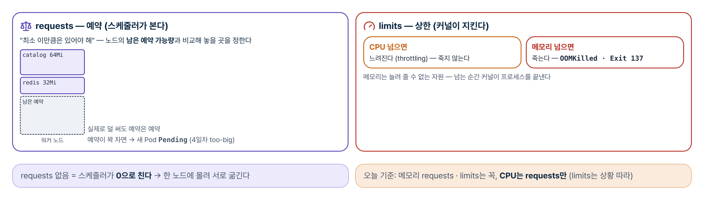

<sub>[🏠 과정 목차](../../README.md) › [3주차](../README.md) › [5일차](README.md) › 4/7교시</sub>

# 4교시 · requests와 limits

> [!NOTE]
> **이번 시간에 할 일**
>
> - **requests**(예약)와 **limits**(상한)가 누구에게 어떻게 쓰이는지 구분합니다.
> - CPU 단위(`m`)와 메모리 단위(`Mi`)를 읽습니다.
> - 노드의 **예약 현황**을 보고, kind 노드의 특이한 점을 이해합니다.
> - 메모리 상한을 넘은 Pod가 **OOMKilled**되는 것을 직접 봅니다.
> - QoS 등급이 무엇이고, 왜 requests 없는 Pod가 위험한지 압니다.

## 두 숫자, 두 주인

어제 3교시 `too-big`은 메모리 100Gi를 **요청**해서 놓일 곳이 없었습니다. 그 `requests`와 짝이 되는 것이 `limits`입니다.



| | requests | limits |
|---|---|---|
| 뜻 | "최소 이만큼은 **예약**해 줘" | "아무리 많아도 이만큼**까지만**" |
| 누가 쓰나 | **스케줄러** — 놓을 노드를 고를 때 | **리눅스 커널**(cgroup) — 실행 중에 |
| CPU를 넘으면 | (예약은 넘을 수 있다 — 노드에 여유가 있으면 더 쓴다) | **느려진다**(throttling). 죽지 않는다 |
| 메모리를 넘으면 | (마찬가지) | **죽는다** — OOMKilled, Exit Code 137 |

> **🧩 비유 — 식당 예약과 1인 주문 한도**
>
> **requests**는 **테이블 예약**입니다. 4인석을 예약하면 2명만 와도 4석은 내 몫이라, 식당(스케줄러)은 남은 자리만 보고 다음 손님을 받습니다. **limits**는 **1인 주문 한도**입니다. CPU는 "음식이 늦게 나올 뿐"이고, 메모리는 "넘으면 퇴장"입니다.

### 단위 읽기

| 표기 | 뜻 |
|---|---|
| `cpu: 1` | CPU 코어 1개 분량 |
| `cpu: 100m` | **밀리코어** — 1코어의 1000분의 100 = 0.1코어 |
| `memory: 64Mi` | 64 **메비바이트** (2의 거듭제곱, 64 × 1024 × 1024) |
| `memory: 64M` | 64 **메가바이트** (10의 거듭제곱) — `Mi`와 다르다. 실수하기 쉬우니 `Mi` · `Gi`를 쓴다 |

## 실습 12 · catalog-api에 자원 정하기

### 단계 1 — 최종본 적용

`devmart/catalog-api.yaml`은 v2에 `resources:`를 더한 **최종본**입니다.

```bash
cd ~/devops-lab/k8s/day5
grep -A3 'resources:' devmart/catalog-api.yaml
kubectl apply -f devmart/catalog-api.yaml
kubectl rollout status deployment/catalog-api -n devmart
```

> **🟢 확인: 보이는 것**
>
> ```text
>           resources:
>             requests: { cpu: 50m, memory: 64Mi }
>             limits: { memory: 256Mi }
> deployment.apps/catalog-api configured
> service/catalog-api unchanged
> deployment "catalog-api" successfully rolled out
> ```
> `replicas`도 2로 같고 probe도 그대로이니, 바뀐 것은 자원 설정뿐입니다. 그래도 **템플릿이 바뀌었으니** 롤링 업데이트가 일어났습니다. probe 덕분에 FAIL은 없습니다.

> [!IMPORTANT]
> **왜 이 숫자인가**
>
> - **메모리 requests 64Mi · limits 256Mi** — gunicorn + Flask 한 일꾼은 보통 50~80Mi를 씁니다. 평소 쓰는 양 근처를 예약하고, 상한은 넉넉히 둡니다.
> - **CPU는 requests만** — CPU limit을 두면 순간적으로 바쁠 때 느려지기만 하고 얻는 것이 적다는 의견이 많습니다(아래 학술 노트). 오늘은 CPU limit을 두지 않습니다.
> - 정답 숫자는 없습니다. **실제로 재 보고** 정합니다. 4주차 2일차에 Prometheus로 실제 사용량을 보고 다시 맞춥니다.

### 단계 2 — 노드의 예약 현황

```bash
kubectl describe node devmart-worker | sed -n '/^Allocatable/,/^System Info/p' | head -8
kubectl describe node devmart-worker | sed -n '/Allocated resources/,/Events/p' | head -8
```

> **🟢 확인: 보이는 것 (숫자는 노트북마다 다름)**
>
> ```text
> Allocatable:
>   cpu:                8
>   ephemeral-storage:  …
>   hugepages-1Gi:      0
>   hugepages-2Mi:      0
>   memory:             8029444Ki
>   pods:               110
> ```
> ```text
> Allocated resources:
>   (Total limits may be over 100 percent, i.e., overcommitted.)
>   Resource           Requests     Limits
>   --------           --------     ------
>   cpu                250m (3%)    100m (1%)
>   memory             306Mi (3%)   690Mi (8%)
> ```
> - **Allocatable** — 이 노드가 Pod에게 내줄 수 있는 양.
> - **Allocated resources** — 이미 이 노드에 놓인 Pod들의 requests · limits 합계. 스케줄러는 `Allocatable − Requests`가 새 Pod의 requests보다 커야 놓습니다.
> - Limits 합계는 100%를 넘을 수 있습니다(과다 할당, overcommit). "모두가 동시에 상한까지 쓰지는 않는다"는 가정입니다.

> [!WARNING]
> **kind 노드는 노트북 전체를 자기 것으로 안다**
>
> kind의 노드 세 대는 같은 노트북 위의 컨테이너라, **세 노드 모두 노트북 전체의 CPU · 메모리를 자기 것으로 보고합니다.** 그래서 kind에서는 예약 합계가 노트북 실제 메모리를 넘어도 스케줄러가 막지 않습니다. 진짜 서버라면 노드마다 자기 몫이 따로 있습니다. 5주차 EKS 노드에서 이 숫자를 다시 비교합니다.

### 단계 3 — QoS 등급

```bash
kubectl get pods -n devmart -o custom-columns=NAME:.metadata.name,QOS:.status.qosClass
```

> **🟢 확인: 보이는 것**
>
> ```text
> NAME                           QOS
> catalog-api-5c9b7d8f6e-4tq2k   Burstable
> catalog-api-5c9b7d8f6e-x9wzm   Burstable
> db-7b6d9c5f8-kp4vn             Burstable
> ```

| QoS 등급 | 조건 | 노드 메모리가 모자랄 때 |
|---|---|---|
| **Guaranteed** | 모든 컨테이너가 CPU · 메모리 requests = limits | 가장 나중에 쫓겨난다 |
| **Burstable** | requests가 있지만 limits와 다르다 (오늘의 모두) | 중간 |
| **BestEffort** | requests · limits가 **하나도 없다** (4일차의 catalog-api) | **가장 먼저** 쫓겨난다 |

> **❓ 오해 — requests를 안 쓰면 제한이 없으니 자유롭다**
>
> requests가 없으면 스케줄러는 그 Pod가 **자원을 0만큼 쓴다**고 칩니다. 그래서 한 노드에 그런 Pod가 잔뜩 몰려도 막지 않고, 실제로는 서로 메모리를 다투다 노드가 버티지 못하면 **BestEffort부터 쫓겨납니다**(eviction). '자유'가 아니라 '보호받지 못함'입니다. 그래서 운영 클러스터는 네임스페이스에 **LimitRange**(기본값 강제)나 정책(4주차 5일차 Kyverno: "requests 없으면 거절")을 둡니다.

## 실습 13 · 메모리 상한을 넘으면

```bash
cat steps/oom.yaml | sed -n '/command/,$p'
kubectl apply -f steps/oom.yaml
sleep 20
kubectl get pod oom-demo -n devmart
```

> **🟢 확인: 보이는 것**
>
> ```text
>       command: ["python", "-c", "import time; x = 'x' * (300 * 1024 * 1024); print('다 썼다'); time.sleep(60)"]
>       resources:
>         requests: { memory: 64Mi }
>         limits: { memory: 128Mi }
> pod/oom-demo created
> NAME       READY   STATUS      RESTARTS   AGE
> oom-demo   0/1     OOMKilled   0          20s
> ```
> 300MB를 한꺼번에 잡으려다 128Mi 상한에 걸려, **커널이 프로세스를 즉시 끝냈습니다.** `python:3.14-slim` 이미지를 처음 받느라 20초보다 오래 걸릴 수 있습니다.

```bash
kubectl describe pod oom-demo -n devmart | grep -A4 'State:'
kubectl logs oom-demo -n devmart
```

> **🟢 확인: 보이는 것**
>
> ```text
>     State:          Terminated
>       Reason:       OOMKilled
>       Exit Code:    137
>       Started:      …
>       Finished:     …
> ```
> 로그는 **비어 있습니다.** `print('다 썼다')`까지 가지 못했고, 커널의 강제 종료(SIGKILL)는 앱에게 마지막 말을 남길 기회를 주지 않습니다. 4일차 3교시의 "Exit Code 137 = 밖에서 강제로 죽임"을 직접 만들었습니다.

> **📘 예시 — 실무에서 OOMKilled를 만나면**
>
> | 상황 | 판단 |
> |---|---|
> | 늘 쓰는 양이 상한에 붙어 있다 | 상한이 너무 낮다 → limits를 올린다 |
> | 시간이 지날수록 메모리가 계속 는다 | **메모리 누수** — limits를 올려도 언젠가 또 죽는다. 앱을 고친다 |
> | 특정 요청(큰 파일 업로드 등) 때만 | 그 경로를 고치거나 요청 크기를 제한한다 |
>
> 재 보지 않고 상한만 올리는 것은 2일차의 "타임아웃을 넉넉하게"와 같은 함정입니다.

정리합니다.

```bash
kubectl delete -f steps/oom.yaml
```

> **🎓 학술 노트 — CPU limit 논쟁과 Borg의 교훈**
>
> Borg 논문(Verma 외, 2015)은 작업들이 **요청한 것보다 덜 쓴다**는 관찰에서 출발해, 남는 예약분을 다른 작업이 빌려 쓰게 하는 방식으로 서버를 크게 절약했다고 보고합니다. requests(예약)와 실제 사용을 나눈 Kubernetes 설계의 뿌리입니다. 한편 리눅스 CFS 스케줄러의 CPU 상한(quota)은 짧은 시간 단위(기본 100ms)로 잘라 적용되어, 평균 사용률은 낮아도 순간적으로 몰리는 요청에서 **지연이 튀는** 현상이 여러 회사의 엔지니어링 블로그로 보고되었습니다. 그래서 "CPU는 requests만, 메모리는 requests와 limits 모두"가 널리 쓰이는 출발점이 되었습니다 — 오늘의 선택입니다.

> **📈 트렌드 2026 — 재 보고 맞춰 주는 자동화**
>
> requests를 사람이 짐작으로 정하면 대부분 **너무 크게** 잡습니다(혹시 모르니까). 1주차의 FinOps 조사가 꼽은 클라우드 낭비의 큰 원인 중 하나입니다. 그래서 실제 사용량을 보고 requests를 추천하거나 바꿔 주는 **VerticalPodAutoscaler**, 그리고 v1.35에서 정식이 된 **실행 중 Pod 자원 변경**(3일차 3교시)을 묶어, 재시작 없이 requests를 맞춰 가는 방식이 확산되고 있습니다.

> **✅ 확인 문제**
>
> 1. 스케줄러가 노드를 고를 때 보는 것은 requests인가요, limits인가요?
> 2. CPU limit을 넘으면? 메모리 limit을 넘으면?
> 3. `250m`과 `64Mi`를 우리말로 읽으면?
> 4. requests · limits가 없는 Pod의 QoS 등급과 그 위험은?
> 5. OOMKilled된 Pod의 `kubectl logs`가 비어 있던 이유는?
>
> <details><summary>정답</summary>
>
> 1. requests
> 2. CPU — 느려진다(throttling), 메모리 — 죽는다(OOMKilled, Exit Code 137)
> 3. 0.25코어, 64메비바이트
> 4. BestEffort — 스케줄러가 0으로 쳐서 한 노드에 몰릴 수 있고, 노드 메모리가 모자라면 가장 먼저 쫓겨난다
> 5. 커널이 SIGKILL로 즉시 끝내서, 앱이 출력할 기회가 없었다
>
> </details>

## 참고 문헌

- Kubernetes Docs. *Resource Management for Pods and Containers* · *Pod Quality of Service Classes*. kubernetes.io/docs/concepts
- Kubernetes Docs. *Node-pressure Eviction* · *Limit Ranges*. kubernetes.io/docs/concepts
- Verma, A. 외 (2015). Large-scale cluster management at Google with Borg. *EuroSys '15*.
- Kubernetes Autoscaler. *Vertical Pod Autoscaler*. github.com/kubernetes/autoscaler

---

| 이전 | 목차 | 다음 |
|:--|:--:|--:|
| ⬅️ [3교시 · probe — 준비됐나, 살아 있나](lesson-03.md) | [⬆️ 5일차 목차](README.md) | [5교시 · DevMart MSA를 Kubernetes에](lesson-05.md) ➡️ |
