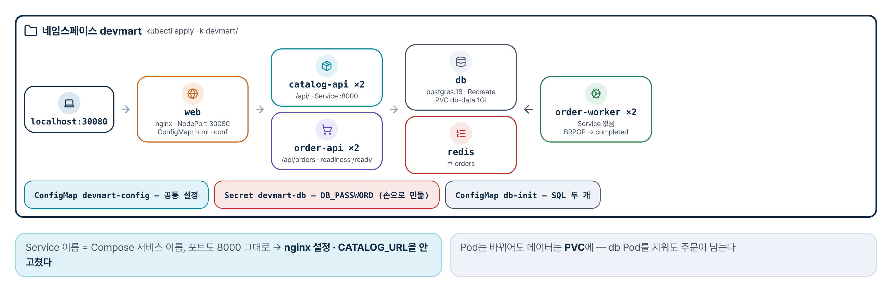

<sub>[🏠 과정 목차](../../README.md) › [3주차](../README.md) › [5일차](README.md) › 5/7교시</sub>

# 5교시 · DevMart MSA를 Kubernetes에

> [!NOTE]
> **이번 시간에 할 일**
>
> - **Kustomize**로 DevMart 여섯 서비스를 한 번에 배포합니다.
> - 브라우저 `localhost:30080`에서 상품을 보고 주문합니다.
> - 1일차 5교시처럼 **요청 ID 하나로** 여러 Pod의 로그를 이어 읽습니다.
> - 처리기를 늘려 일이 나뉘는 것을 보고, DB Pod를 지워도 **데이터가 남는 것**을 확인합니다.
> - Compose 파일과 Kubernetes 매니페스트를 한 줄씩 대응시킵니다.

## 전체 그림



1일차 3교시에 만든 서비스 목록표를 떠올립니다. 같은 여섯 서비스가 이번에는 이렇게 바뀝니다.

| 서비스 | Kubernetes 리소스 | 개수 | 1일차와 달라진 점 |
|---|---|---|---|
| web (nginx) | Deployment + **NodePort** Service | 1 | 정적 파일 · 설정을 ConfigMap으로 마운트 |
| catalog-api | Deployment + Service | **2** | probe · 자원 설정 (2~4교시) |
| order-api | Deployment + Service | **2** | readiness `/ready` · liveness `/health` |
| order-worker | Deployment (Service 없음) | **2** | 손님을 받지 않으니 Service도 없다 |
| redis | Deployment + Service | 1 | readiness로 `redis-cli ping` |
| db (postgres) | Deployment(Recreate) + Service + **PVC** | 1 | 2교시에 이미 띄움 |

## Kustomize — 여러 파일을 한 묶음으로

```bash
cd ~/devops-lab/k8s/day5
cat devmart/kustomization.yaml
```

```yaml
apiVersion: kustomize.config.k8s.io/v1beta1
kind: Kustomization
namespace: devmart          # 모든 리소스를 이 네임스페이스에
resources:                  # 이 파일들을 묶는다
  - namespace.yaml
  - config.yaml
  - db.yaml
  - redis.yaml
  - catalog-api.yaml
  - order-api.yaml
  - order-worker.yaml
  - web.yaml
configMapGenerator:         # 파일을 ConfigMap으로 만든다
  - name: db-init
    files: [ files/initdb/01-catalog.sql, files/initdb/02-orders.sql ]
  - name: web-html
    files: [ files/web/index.html, files/web/app.js, files/web/style.css ]
  - name: web-nginx
    files: [ files/nginx/default.conf ]
generatorOptions:
  disableNameSuffixHash: true
```

> **📖 용어 — Kustomize**
>
> kubectl에 들어 있는(3일차 6교시 `kubectl version`의 `Kustomize Version`) 매니페스트 **묶음 · 조립** 도구입니다. 여러 YAML을 한 번에 적용하고, 파일로 ConfigMap을 만들고, 개발 · 운영처럼 환경마다 일부만 바꾼 변형을 만듭니다. `kubectl apply -f 폴더`와 달리 **`-k`**를 씁니다. 4주차 1일차에 같은 일을 하는 다른 방식인 **Helm**과 비교합니다.

적용하기 전에, 실제로 무엇이 만들어질지 미리 봅니다.

```bash
kubectl kustomize devmart/ | grep '^kind:' | sort | uniq -c
```

> **🟢 확인: 보이는 것**
>
> ```text
>       4 kind: ConfigMap
>       6 kind: Deployment
>       1 kind: Namespace
>       1 kind: PersistentVolumeClaim
>       5 kind: Service
> ```
> ConfigMap 4개 = `devmart-config` + 생성기 3개. Service가 5개인 이유는 order-worker에 Service가 없어서입니다. **Secret은 0개** — 2교시에 손으로 만든 것을 씁니다.

## 실습 14 · 한 줄로 배포

### 단계 1 — 적용

```bash
kubectl apply -k devmart/
```

> **🟢 확인: 보이는 것**
>
> ```text
> namespace/devmart unchanged
> configmap/db-init unchanged
> configmap/devmart-config unchanged
> configmap/web-html created
> configmap/web-nginx created
> service/catalog-api unchanged
> service/db unchanged
> service/order-api created
> service/redis created
> service/web created
> persistentvolumeclaim/db-data unchanged
> deployment.apps/catalog-api unchanged
> deployment.apps/db unchanged
> deployment.apps/order-api created
> deployment.apps/order-worker created
> deployment.apps/redis created
> deployment.apps/web created
> ```
> 2~4교시에 하나씩 만든 것은 `unchanged`, 새로 생긴 것은 `created`. **선언형은 이미 있는 것을 다시 만들지 않습니다** — 3일차 4교시의 멱등.

### 단계 2 — 모두 준비될 때까지

```bash
kubectl wait deployment --all -n devmart --for=condition=Available --timeout=180s
kubectl get pods -n devmart -o wide
```

- `kubectl wait … --for=condition=Available` : 모든 Deployment가 준비될 때까지 기다린다

> **🟢 확인: 보이는 것 (칸 일부 생략)**
>
> ```text
> deployment.apps/catalog-api condition met
> ...
> deployment.apps/web condition met
> NAME                            READY   STATUS    RESTARTS   AGE   NODE
> catalog-api-5c9b7d8f6e-4tq2k    1/1     Running   0          20m   devmart-worker
> catalog-api-5c9b7d8f6e-x9wzm    1/1     Running   0          20m   devmart-worker2
> db-7b6d9c5f8-kp4vn              1/1     Running   0          50m   devmart-worker
> order-api-6f8c7b9d4-9hmcq       1/1     Running   0          60s   devmart-worker2
> order-api-6f8c7b9d4-rz2xn       1/1     Running   0          60s   devmart-worker
> order-worker-7d5b8c6f9-kx7tq    1/1     Running   0          60s   devmart-worker
> order-worker-7d5b8c6f9-wq4mz    1/1     Running   0          60s   devmart-worker2
> redis-5d7c9f8b6-vn8pl           1/1     Running   0          60s   devmart-worker2
> web-6c8f9d7b5-tz2hk             1/1     Running   0          60s   devmart-worker
> ```

> **🛠️ 막혔다면: 자주 만나는 문제**
>
> | 증상 | 원인 | 해결 |
> |---|---|---|
> | order-api가 오래 `0/1` | `/ready`가 redis · DB를 확인하는데 redis가 아직 이미지를 받는 중 | 기다린다. readiness가 순서 문제를 풀어 준다 (아래 '핵심') |
> | web이 `CrashLoopBackOff`, 로그에 `host not found in upstream "order-api"` | nginx는 **시작할 때** 주소를 찾는다. Service가 늦게 만들어졌다 | `kubectl rollout restart deployment/web -n devmart` |
> | `ImagePullBackOff` | 1교시 단계 3의 sed를 빠뜨렸다 (`YOUR_ID`가 남음) | `grep -r YOUR_ID devmart/` 확인 후 다시 apply |
> | order-worker `CrashLoopBackOff`, `invalid integer value` 같은 오류 | `enableServiceLinks: false`를 지웠다 (2교시 실습 8) | 줄을 되살린다 |

> [!IMPORTANT]
> **depends_on이 없는데 어떻게 순서가 맞나**
>
> Compose에는 `depends_on: condition: service_healthy`로 "DB가 준비된 뒤에 API를 띄워라"를 적었습니다. Kubernetes에는 그런 칸이 없습니다. 모두 **동시에** 뜨고, 순서는 두 가지가 맞춰 줍니다.
>
> - **readiness** — order-api는 DB · redis가 준비될 때까지 `0/1`로 손님을 받지 않는다.
> - **재시작** — 시작하자마자 DB에 붙어야 하는 앱이 실패해도 kubelet이 다시 띄우고, 결국 맞춰진다.
>
> "순서를 정하지 말고, **언제 시작해도 결국 맞춰지게** 만들어라" — 3일차의 reconcile과 4일차 학술 노트의 크래시 전용 소프트웨어가 같은 생각입니다.

### 단계 3 — 브라우저에서 주문

브라우저에서 **http://localhost:30080** 을 엽니다. 1일차와 같은 DevMart 화면이 나옵니다. 상품 하나를 주문하고, 아래 주문 목록에서 `pending`이 1초쯤 뒤 `completed`로 바뀌는 것을 봅니다.

**1일차 4교시와 같은 화면이 이제 Kubernetes 클러스터 위에서 돕니다.**

## 실습 15 · 요청 ID로 따라가기

```bash
curl -si -X POST localhost:30080/api/orders \
  -H 'Content-Type: application/json' -d '{"product_id": 2}' | grep -iE '^x-request-id|order_id'
```

> **🟢 확인: 보이는 것**
>
> ```text
> X-Request-ID: 7c1e9a40b3f24d6a8e5f2c9d1b0a6e37
> {"order_id":3,"request_id":"7c1e9a40b3f24d6a8e5f2c9d1b0a6e37","status":"pending","total_price":45000}
> ```

```bash
RID=7c1e9a40b3f24d6a8e5f2c9d1b0a6e37        # 내 값으로
kubectl logs -n devmart -l 'app in (order-api,catalog-api,order-worker)' \
  --prefix --timestamps --tail=-1 | grep $RID | sort -k2
kubectl logs -n devmart deployment/web | grep $RID
```

- `-l 'app in (…)'` : 라벨 값이 셋 중 하나인 모든 Pod
- `--prefix` : 줄 앞에 `[pod/이름/컨테이너]`를 붙인다
- `--tail=-1` : 처음부터 전부 (라벨로 고르면 기본은 Pod마다 마지막 10줄)
- `sort -k2` : 두 번째 칸(시각)으로 정렬

> **🟢 확인: 보이는 것 (줄여서)**
>
> ```text
> [pod/order-api-6f8c7b9d4-rz2xn/order-api] 2026-11-27T05:41:02.118Z {"service": "order-api", "event": "order_received", "request_id": "7c1e…", ...}
> [pod/catalog-api-5c9b7d8f6e-x9wzm/catalog-api] 2026-11-27T05:41:02.131Z {"service": "catalog-api", "event": "get_product", "request_id": "7c1e…", "product_id": 2}
> [pod/order-api-6f8c7b9d4-rz2xn/order-api] 2026-11-27T05:41:02.152Z {"service": "order-api", "event": "order_saved", ...}
> [pod/order-api-6f8c7b9d4-rz2xn/order-api] 2026-11-27T05:41:02.155Z {"service": "order-api", "event": "order_queued", ...}
> [pod/order-worker-7d5b8c6f9-wq4mz/order-worker] 2026-11-27T05:41:02.160Z {"service": "order-worker", ..., "event": "order_processing", ...}
> [pod/order-worker-7d5b8c6f9-wq4mz/order-worker] 2026-11-27T05:41:03.172Z {"service": "order-worker", ..., "event": "order_completed", ...}
> 10.244.0.1 [27/Nov/2026:05:41:02 +0000] "POST /api/orders HTTP/1.1" 202 rid=7c1e… upstream=10.96.88.120:8000 rt=0.041
> ```
> 1일차 5교시의 여행 기록과 **같은 이야기**가, 이번엔 **서로 다른 노드의 Pod 다섯 개**에 걸쳐 이어집니다. nginx 로그의 `upstream`은 Pod IP가 아니라 **order-api Service의 가상 IP**입니다(4일차 6교시).

> [!TIP]
> **Pod가 많아지면**
>
> 오늘은 Pod 7개라 `kubectl logs`로 모을 수 있었지만, 수백 개면 불가능합니다. 그래서 운영 환경은 로그를 한곳에 모으고(Loki 등) 요청 ID로 검색합니다. 4주차 2일차에 이 일을 도구로 합니다.

## 실습 16 · 처리기 늘리기

20개 주문을 한꺼번에 넣고, 어느 처리기가 처리했는지 봅니다.

```bash
for i in $(seq 1 20); do
  curl -s -o /dev/null -X POST localhost:30080/api/orders -H 'Content-Type: application/json' -d '{"product_id": 3}'
done
sleep 15
kubectl exec -n devmart deployment/db -- psql -U devmart -d orders -c \
  "SELECT processed_by, count(*) FROM orders WHERE status='completed' GROUP BY 1;"
```

> **🟢 확인: 보이는 것**
>
> ```text
>          processed_by          | count
> -------------------------------+-------
>  order-worker-7d5b8c6f9-kx7tq |    11
>  order-worker-7d5b8c6f9-wq4mz |    11
> (2 rows)
> ```
> 처리기 둘이 큐에서 번갈아 꺼냈습니다. `processed_by`가 **Pod 이름**입니다(4일차 2교시: 호스트 이름 = Pod 이름). 1일차 6교시의 `--scale order-worker=3`과 같은 실험입니다.

이번엔 파일로 늘립니다(4일차 4교시 원칙).

```bash
sed -i 's/replicas: 2/replicas: 4/' devmart/order-worker.yaml     # Mac: sed -i ''
kubectl apply -k devmart/
kubectl get pods -n devmart -l app=order-worker
```

> **🟢 확인: 보이는 것**
>
> ```text
> deployment.apps/order-worker configured
> ...
> NAME                           READY   STATUS    RESTARTS   AGE
> order-worker-7d5b8c6f9-kx7tq   1/1     Running   0          10m
> order-worker-7d5b8c6f9-wq4mz   1/1     Running   0          10m
> order-worker-7d5b8c6f9-b2nds   1/1     Running   0          3s
> order-worker-7d5b8c6f9-h8vjc   1/1     Running   0          3s
> ```
> 다시 20개를 넣어 보면 네 이름으로 나뉩니다. 확인했으면 파일을 `replicas: 2`로 되돌리고 다시 적용합니다.

## 실습 17 · DB Pod를 지워도

```bash
kubectl exec -n devmart deployment/db -- psql -U devmart -d orders -tc "SELECT count(*) FROM orders;"
kubectl delete pod -n devmart -l app=db
kubectl rollout status deployment/db -n devmart
kubectl exec -n devmart deployment/db -- psql -U devmart -d orders -tc "SELECT count(*) FROM orders;"
```

> **🟢 확인: 보이는 것**
>
> ```text
>     43
> pod "db-7b6d9c5f8-kp4vn" deleted
> deployment "db" successfully rolled out
>     43
> ```
> Pod는 새로 생겼지만(이름이 다르다) 주문 43건은 그대로입니다. 데이터는 Pod가 아니라 **PVC**에 있습니다. 2주차 2일차에 `docker compose down`을 해도 이름 있는 볼륨이 남던 것과 같습니다. 초기화 SQL도 다시 돌지 않았습니다 — 데이터 폴더가 이미 있으면 postgres 이미지가 건너뜁니다.

> [!WARNING]
> **DB가 다시 뜨는 동안**
>
> `Recreate` 전략이라 옛 Pod가 내려가고 새 Pod가 준비되기까지 **10~20초 DB가 없습니다.** 그동안 주문은 503(order-api가 DB에 못 붙음)이 나고, DB가 없는 시간이 길어지면 order-api가 readiness에 실패해 목록에서 빠지며 502(nginx가 보낼 곳이 없음)로 바뀝니다. DB 한 대짜리 구성의 한계입니다. 운영 환경은 복제본을 둔 관리형 DB(5주차 RDS의 다중 AZ)로 이 시간을 줄입니다.

## Compose ↔ Kubernetes 대응표

1일차의 `compose.yaml` 한 서비스가 Kubernetes에서 어디로 갔는지 정리합니다. 7교시 회고 양식에 이 표가 들어 있습니다.

| Compose | Kubernetes | 오늘 본 곳 |
|---|---|---|
| `services: order-api:` | Deployment + Service | 5교시 |
| `image:` | `containers[].image` (SHA 태그) | 4일차 1교시 |
| `environment:` (평범한 값) | ConfigMap + `envFrom` | 2교시 |
| `.env` 의 비밀번호 | Secret + `secretKeyRef` | 2교시 |
| `volumes: - ./db/init:…` (바인드) | ConfigMap 마운트 (configMapGenerator) | 2 · 5교시 |
| `volumes: - db-data:…` (이름 있는) | PersistentVolumeClaim | 2교시 |
| `healthcheck:` | readinessProbe · livenessProbe | 3교시 |
| `depends_on:` | (없음) readiness + 재시작으로 결국 맞춰진다 | 5교시 |
| `restart: unless-stopped` | kubelet 재시작 + ReplicaSet | 4일차 5교시 |
| `--scale` | `replicas:` | 5교시 |
| `ports: "8080:80"` | NodePort (4주차: Gateway API) | 4일차 6교시 |
| 서비스 이름으로 찾기 | Service + CoreDNS | 4일차 6교시 |
| (없음) | requests · limits | 4교시 |
| (없음) | 롤링 업데이트 · 되돌리기 | 4일차 7교시 |

> **🎓 학술 노트 — 같은 앱, 다른 운영 모델**
>
> 오늘 앱 코드는 **한 줄도 바꾸지 않았습니다.** 1일차에 Compose로 돌던 이미지가 그대로 Kubernetes에서 돕니다. 바뀐 것은 앱을 **둘러싼 운영 모델**뿐입니다. 이것이 가능했던 이유는 1주차 4일차의 12-Factor 원칙 — 설정은 환경 변수로, 상태는 밖(DB · 큐)에, 로그는 표준 출력으로, 언제 죽어도 다시 시작 가능하게 — 을 앱이 지켰기 때문입니다. Wiggins의 12-Factor(2011)는 Heroku라는 특정 플랫폼의 경험에서 나왔지만, 그 원칙을 지킨 앱은 Compose든 Kubernetes든 ECS든 **옮겨 다닐 수 있다**는 것을 오늘 직접 확인했습니다.

> **📈 트렌드 2026 — 매니페스트를 직접 쓰지 않는 개발자**
>
> 오늘 매니페스트는 여덟 파일, 300줄 가까이 됩니다. 서비스가 50개면? 그래서 많은 회사가 **Helm 차트**(4주차 1일차)나 사내 템플릿으로 매니페스트를 찍어 내고, 개발자는 "이미지 · 포트 · 개수"만 적는 **플랫폼 추상화**를 둡니다. 반대 방향으로, 개발자 노트북에서 Kubernetes 없이도 같은 앱 구성을 기술하려는 표준(Compose를 그대로 Kubernetes로 옮기는 Kompose, 클라우드 중립 앱 모델 등)도 꾸준히 시도됩니다. 어느 쪽이든, 그 아래에서 오늘 손으로 쓴 리소스들이 만들어집니다.

> **✅ 확인 문제**
>
> 1. `kubectl apply -k`에서 `unchanged`가 많이 나온 이유는?
> 2. Compose의 `depends_on`이 없는 Kubernetes에서, order-api가 DB보다 먼저 떠도 괜찮은 이유는?
> 3. nginx 로그의 `upstream=10.96.…`은 무엇의 주소인가요?
> 4. `processed_by`에 찍힌 값은 무엇인가요?
> 5. DB Pod를 지워도 주문이 남은 이유는? 그동안 주문은 왜 실패했나요?
>
> <details><summary>정답</summary>
>
> 1. 2~4교시에 같은 내용으로 이미 만들어 두었고, 선언형 적용은 이미 원하는 상태인 것을 다시 만들지 않는다
> 2. readiness가 DB · redis가 준비될 때까지 손님을 막고, 실패해도 kubelet이 재시작해 결국 맞춰지기 때문
> 3. order-api Service의 가상 IP (ClusterIP)
> 4. 주문을 처리한 order-worker Pod의 이름 (호스트 이름 = Pod 이름)
> 5. 데이터가 Pod가 아니라 PVC에 있기 때문. Recreate 전략이라 새 DB가 준비될 때까지 DB가 없었다 — order-api는 DB에 못 붙어 503을 내고, 길어지면 readiness에서 빠져 502가 된다
>
> </details>

## 참고 문헌

- Kubernetes Docs. *Declarative Management of Kubernetes Objects Using Kustomize*. kubernetes.io/docs/tasks/manage-kubernetes-objects
- Kubernetes Docs. *kubectl logs* · *kubectl wait*. kubernetes.io/docs/reference/kubectl
- Docker Hub. *postgres — Initialization scripts*. hub.docker.com/_/postgres
- Wiggins, A. (2011). *The Twelve-Factor App*. 12factor.net

---

| 이전 | 목차 | 다음 |
|:--|:--:|--:|
| ⬅️ [4교시 · requests와 limits](lesson-04.md) | [⬆️ 5일차 목차](README.md) | [6교시 · 장애 연습](lesson-06.md) ➡️ |
