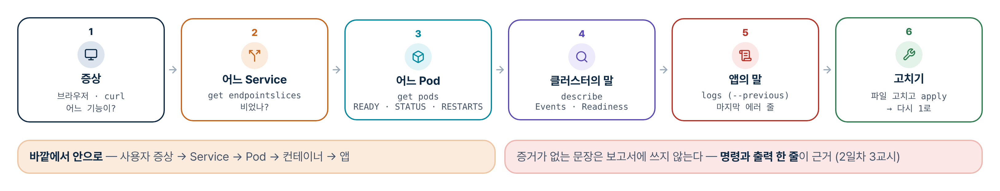

<sub>[🏠 과정 목차](../../README.md) › [3주차](../README.md) › [5일차](README.md) › 6/7교시</sub>

# 6교시 · 장애 연습

> [!NOTE]
> **이번 시간에 할 일**
>
> - 짝이 내 DevMart에 몰래 넣은 장애를 **바깥에서 안으로** 진단합니다.
> - 원인을 찾는 데 쓴 **명령과 출력 한 줄**을 근거로 장애 보고서를 씁니다.
> - 고친 뒤 원래대로 돌아왔는지 **사용자 쪽에서** 확인합니다.
> - `kubectl apply`로 되돌아오지 않는 변경이 있음을 압니다.

## 진단의 순서 — 바깥에서 안으로



| 단계 | 묻는 것 | 명령 |
|---|---|---|
| 1 증상 | 사용자에게 **무엇이** 안 되나? 상품 보기? 주문? 주문 처리? | 브라우저, `curl -i localhost:30080/api/…` |
| 2 Service | 그 기능을 맡은 Service 뒤에 **Pod가 있나**? | `kubectl get endpointslices -n devmart` |
| 3 Pod | READY · STATUS · RESTARTS 중 **이상한 칸**은? | `kubectl get pods -n devmart` |
| 4 클러스터의 말 | Events · probe 실패 · 이미지 · 스케줄링 | `kubectl describe pod …` |
| 5 앱의 말 | 마지막 에러 줄 | `kubectl logs … (--previous)` |
| 6 고치기 | **파일**을 고치고 apply — 안 되면 왜 안 되는지 | `kubectl apply -k devmart/` |

> [!IMPORTANT]
> **모든 Pod가 Running인데 고장일 수 있다**
>
> 오늘 장애 넷 중에는 `kubectl get pods`가 **전부 멀쩡해 보이는** 것이 있습니다. 1단계(사용자 증상)를 건너뛰고 3단계부터 보면 놓칩니다. 2일차 1교시의 교훈과 같습니다 — 죽은 것보다 **조용히 틀린 것**이 무섭습니다.

## 놀이 규칙

> **🧪 실습: 실습 목표**
>
> 짝과 노트북을 바꿔 가며 장애 넷을 진단하고, 각자 장애 보고서 하나 이상을 씁니다.

1. **두 명씩** 짝을 짓습니다. A와 B를 정합니다.
2. **1라운드** — A가 B의 노트북에서 `bash break.sh 1`을 실행합니다. B는 화면을 보지 않습니다. 동시에 B는 A의 노트북에서 `bash break.sh 2`.
3. 각자 **자기 노트북**으로 돌아와 진단을 시작합니다. 시간 제한 **15분**.
4. 고쳤으면 브라우저에서 주문까지 확인하고, `incident-report-template.md`를 채웁니다.
5. 15분 안에 못 찾으면 아래 **해설**을 엽니다 — 열기 전에 지금까지 찾은 것을 보고서에 먼저 적습니다.
6. **2라운드** — 장애 3과 4로 같은 과정을 반복합니다.
7. 끝나면 각자 `bash fix.sh`로 확실하게 원래대로 돌립니다.

> [!WARNING]
> **break.sh를 열어 보지 않는다**
>
> `break.sh`를 읽으면 답이 보입니다. 실무의 장애에는 "누가 무엇을 바꿨는지 적힌 파일"이 없습니다. 열어 보는 순간 연습이 아니라 정답 확인이 됩니다.

```bash
cd ~/devops-lab/k8s/day5
cp incident-report-template.md incident-1.md      # 라운드마다 새 파일
```

## 진단 도구 모음

```bash
# 1 증상
curl -s -o /dev/null -w '%{http_code}  상품\n' localhost:30080/api/products
curl -s -o /dev/null -w '%{http_code}  주문 목록\n' localhost:30080/api/orders
curl -s -X POST localhost:30080/api/orders -H 'Content-Type: application/json' -d '{"product_id": 1}'; echo
# 2 Service · 3 Pod
kubectl get endpointslices -n devmart
kubectl get pods -n devmart
kubectl get deployment -n devmart
# 4 클러스터의 말
kubectl describe pod -n devmart -l app=order-api | tail -15
kubectl get events -n devmart --sort-by=.lastTimestamp | tail -10
# 5 앱의 말
kubectl logs -n devmart -l app=order-api --prefix --tail=5
kubectl logs -n devmart -l app=order-worker --prefix --tail=5
# 설정 보기
kubectl get configmap devmart-config -n devmart -o yaml
kubectl exec -n devmart deployment/order-worker -- env | sort | grep -vE 'KUBERNETES|PATH|HOME'
# 큐와 DB 들여다보기 (2일차 3교시)
kubectl exec -n devmart deployment/redis -- redis-cli LLEN orders
kubectl exec -n devmart deployment/db -- psql -U devmart -d orders -tc "SELECT status, count(*) FROM orders GROUP BY 1;"
```

- `get events --sort-by=.lastTimestamp` : 네임스페이스 전체의 Events를 시간 순으로 — 무엇이 **최근에 바뀌었나**를 볼 때

## 해설

각 장애의 해설은 접혀 있습니다. **15분을 쓴 뒤에** 엽니다.

### 장애 1

<details><summary>해설 — 장애 1</summary>

**증상** — 상품 목록 **503**. 주문하기는 **202**인데 주문이 `completed`가 되지 않는다. 같은 원인인데 기능마다 증상이 다르다.

**진단 경로**
1. `get pods` → order-api가 **세 개**다. 둘은 `1/1`(오래된 것), 하나는 `0/1`(새것). catalog-api 둘과 order-worker 둘은 모두 `1/1`이고 AGE가 몇 분 전 — **방금 새로 떴다.**
2. `get events --sort-by=.lastTimestamp` → 같은 시각에 세 Deployment가 재시작됐다(`ScalingReplicaSet`). 세 Deployment의 공통점 = Secret `devmart-db`.
3. `logs -l app=catalog-api` → `{"event": "db_error", "error": "connection failed: … password authentication failed for user \"devmart\""}`
4. `logs -l app=order-worker` → 주문마다 `db_error`, 같은 비밀번호 오류.
5. `describe pod`(새 order-api) → `Readiness probe failed: HTTP probe failed with statuscode: 503`.

**원인** — Secret의 `DB_PASSWORD`가 DB의 실제 비밀번호와 다르다. **새로 뜬 Pod만** 틀린 비밀번호를 읽었다.

**왜 기능마다 증상이 달랐나 — probe가 갈랐다**

| 서비스 | readiness | 재시작 결과 | 사용자 증상 |
|---|---|---|---|
| catalog-api | `/health` (DB 확인 안 함) | 새 Pod가 '준비됨' → 교체 **완료** → 모두 틀린 비밀번호 | 상품 목록 503 |
| order-api | `/ready` (DB 확인) | 새 Pod가 준비 안 됨 → 교체 **멈춤** → 옛 Pod가 계속 일함 | 주문 받기는 정상 |
| order-worker | 없음 | 교체 **완료** → 모두 틀린 비밀번호 | 주문이 처리되지 않음 |

**고치기** — DB 쪽과 Secret 쪽을 같은 값으로 맞춘다.
```bash
# DB의 비밀번호를 새로 정하고 Secret도 같은 값으로 (DB Pod 안에서는 로컬 접속이라 비밀번호 없이 들어간다)
NEWPW=$(openssl rand -hex 12)
kubectl exec -n devmart deployment/db -- psql -U devmart -d catalog -c "ALTER USER devmart PASSWORD '$NEWPW';"
kubectl create secret generic devmart-db -n devmart --from-literal=DB_PASSWORD=$NEWPW --dry-run=client -o yaml | kubectl apply -f -
kubectl rollout restart deployment/catalog-api deployment/order-api deployment/order-worker -n devmart
```
- `--dry-run=client -o yaml | kubectl apply -f -` : Secret을 **파일 없이** 만들어 바로 적용하는 관용구 — 이미 있으면 바꾼다
- 처리 못 한 주문은 큐에서 이미 빠졌다(2일차 3교시 유실). `status='pending'`인 주문을 찾아 다시 넣는 복구도 보고서에 적는다

**배운 것** — **Secret을 바꿔도 DB 비밀번호는 안 바뀐다.** postgres 이미지는 처음 초기화할 때만 `POSTGRES_PASSWORD`를 읽는다. 그리고 readiness가 제대로 된 서비스(order-api)만 잘못된 배포를 **스스로 멈췄다.** 지금 멀쩡한 옛 order-api도 언젠가 재시작되면 틀린 비밀번호를 읽는다 — '멈춘 배포'는 미뤄진 장애다(4일차 7교시).

</details>

### 장애 2

<details><summary>해설 — 장애 2</summary>

**증상** — 상품 목록은 200, 주문 목록 · 주문하기 **502**.

**진단 경로**
1. `get pods` → **redis Pod가 없다**. order-api 둘이 `0/1`.
2. `get deployment` → `redis   0/0   0   0` — 죽은 게 아니라 **0개로 줄어 있다**.
3. `logs -l app=order-worker` → `{"event": "queue_error", "error": "Error 111 connecting to redis:6379. Connection refused."}`가 반복. 이름은 찾았는데(Service는 있다) 받는 Pod가 없다 — 4일차 6교시 실습 13의 그 증상.
4. `get events` → `Scaled down replica set redis-… to 0`.

**원인** — 누군가 redis를 0개로 줄였다 (`kubectl scale`).

**고치기**
```bash
kubectl apply -k devmart/          # 파일의 replicas: 1로 돌아간다
```

**배운 것** — order-api의 readiness가 `/ready`(큐 확인 포함)라서 order-api가 목록에서 빠졌고, 그래서 주문 목록처럼 **redis와 상관없는 기능까지** 502가 났다. readiness에 무엇을 넣을지는 '부분 장애를 어디까지 번지게 할지'의 선택이다. liveness가 `/health`였기 때문에 order-api가 재시작을 반복하지는 않았다(3교시). 명령형 변경(`scale`)은 **파일을 다시 적용하면** 되돌아온다.

</details>

### 장애 3

<details><summary>해설 — 장애 3</summary>

**증상** — 상품 목록 · 주문하기 모두 **정상(202)**. 그런데 주문이 계속 `pending`이다. **모든 Pod가 `1/1 Running`.**

**진단 경로**
1. 사용자 증상: 브라우저 주문 목록에서 `completed`가 안 된다.
2. 큐: `redis-cli LLEN orders` → 숫자가 주문할 때마다 **늘어난다**. 아무도 꺼내지 않는다.
3. 처리기 로그: `logs -l app=order-worker` → `{"event": "worker_started", "queue": "order", …}` — **`orders`가 아니라 `order`**.
4. 설정 비교: ConfigMap의 `QUEUE_NAME`은 `orders`. 그런데 `exec … env`로 보면 order-worker는 `QUEUE_NAME=order`.
5. `kubectl get deployment order-worker -n devmart -o yaml | grep -B1 -A1 QUEUE_NAME` → Deployment에 **직접** `env: QUEUE_NAME=order`가 들어가 있다. 직접 적은 `env`가 ConfigMap(`envFrom`)보다 우선한다.

**원인** — 1일차 7교시 장애 3과 같은 '큐 이름 불일치'. 이번엔 누군가 `kubectl set env`로 처리기에만 다른 값을 넣었다.

**고치기**
```bash
kubectl set env deployment/order-worker -n devmart QUEUE_NAME-     # 끝의 '-'는 '이 변수를 지워라'
kubectl rollout status deployment/order-worker -n devmart
kubectl exec -n devmart deployment/redis -- redis-cli LLEN orders  # 쌓였던 것이 줄어든다
```

**배운 것** — **`kubectl apply -k`로는 이 변경이 되돌아오지 않는다.** `apply`는 '지난번에 내가 적용한 것'과 비교해 바꾸는데, `set env`로 들어온 칸은 지난번 적용 기록에 없으니 '남의 것'으로 보고 건드리지 않는다. 명령형 변경이 파일과 어긋난 채 숨어 있는 **드리프트**의 진짜 모습이다. 4주차 3일차 Argo CD는 이런 어긋남을 화면에 '다르다(OutOfSync)'로 보여 준다. 또, 이 장애는 **probe가 잡지 못한다** — 처리기에는 손님용 probe가 없고, 틀린 큐를 열심히 기다리는 것은 '살아 있음'이다. 2일차 3교시의 "1분 넘은 pending 감시" 같은 **사용자 관점의 감시**가 필요하다.

</details>

### 장애 4

<details><summary>해설 — 장애 4</summary>

**증상** — 상품 목록 200, 주문 목록 200, **주문하기만 503** (`{"error":"catalog unavailable", …}`).

**진단 경로**
1. 주문하기만 안 된다 → 주문하기가 다른 기능과 다른 점은 **catalog-api를 부른다**는 것 (1일차 6교시: 동기 호출).
2. catalog-api는 `1/1`, 상품 목록도 200 → catalog-api 자체는 멀쩡하다. 문제는 **부르는 쪽의 주소**.
3. `logs -l app=order-api` → `{"event": "catalog_error", …, "error": "… timed out"}` (또는 `Connection refused`).
4. `get configmap devmart-config -o yaml` → `CATALOG_URL: http://catalog-api:8080`. Service의 포트는 `8000` (`get svc catalog-api`).

**원인** — ConfigMap의 주소가 틀렸다. 2일차의 `CATALOG_TIMEOUT: "2"` 덕분에 2초 만에 실패했다 — 타임아웃이 길었다면 2일차 1교시처럼 order-api 일꾼이 묶였을 것이다.

**고치기**
```bash
kubectl apply -k devmart/                                          # ConfigMap이 파일 내용으로 돌아간다
kubectl rollout restart deployment/order-api -n devmart           # 환경 변수는 Pod가 뜰 때 읽는다 (2교시)
```

**배운 것** — ConfigMap을 고친 뒤 **재시작을 빼먹으면** 고쳐지지 않는다. 반대로 이번 장애도 ConfigMap 수정 + 재시작으로 **들어왔다**. order-api의 `/ready`는 catalog-api를 확인하지 않아 '준비됨'이었다 — 다른 **서비스**까지 readiness에 넣으면 그 서비스 장애가 내 서비스로 번진다(2일차 1교시). 무엇을 readiness에 넣을지는 신중히.

</details>

## 정리

```bash
bash fix.sh
curl -s -o /dev/null -w '%{http_code}\n' localhost:30080/api/products
```

> **🟢 확인: 보이는 것**
>
> ```text
> ...
> deployment "order-api" successfully rolled out
> 원래대로 돌려놓았습니다.
> 200
> ```
> 브라우저에서 주문 하나가 `completed`가 되는 것까지 확인합니다.

> **🎓 학술 노트 — 비난 없는 사후 검토**
>
> 오늘 장애 넷은 모두 **사람의 변경**(Secret · scale · set env · ConfigMap)에서 왔습니다. 장애 보고서에 "짝이 장애를 넣었다"라고 쓰는 것은 아무 도움이 되지 않습니다. 구글 SRE 책(Beyer 외, 2016, 15장)과 Allspaw(2012, *Blameless PostMortems and a Just Culture*)가 말하는 **비난 없는 사후 검토**(blameless postmortem)는 "누가"가 아니라 "**왜 그 변경이 가능했고, 왜 바로 알아채지 못했나**"를 묻습니다. 오늘의 답은 이렇습니다 — 명령형 변경이 막혀 있지 않았다(→ 4주차 RBAC · GitOps), 사용자 관점의 감시가 없었다(→ 4주차 2일차 알림), readiness가 의존 대상을 제대로 반영하지 못했다(→ 앱 개선). 보고서의 '재발 방지' 칸에 이런 것을 적습니다.

> **📈 트렌드 2026 — 장애 대응 옆의 AI**
>
> 장애 중에 Events · 로그 · 최근 변경을 모아 "가장 그럴듯한 원인"을 요약해 주는 AI 도구가 흔해졌습니다. 오늘 같은 장애라면 꽤 잘 맞힐 것입니다. 하지만 장애 3처럼 **모든 것이 정상으로 보이는** 장애는, "주문이 왜 끝나지 않지?"라는 **사용자 관점의 질문**을 사람이 먼저 던져야 찾을 수 있습니다. 그리고 AI가 제안한 복구 명령이 무엇을 바꾸는지 판단하는 것도 사람의 몫입니다 — 장애 1의 "Secret만 바꾸면 고쳐지나?" 같은 판단이 그렇습니다.

> **✅ 확인 문제**
>
> 1. 장애 1에서 catalog-api가 `1/1`이었는데도 상품 목록이 503이었던 이유는? 같은 장애에서 주문 받기는 왜 정상이었나요?
> 2. 장애 2에서 redis와 상관없는 주문 목록 조회까지 502가 난 이유는?
> 3. 장애 3에서 `kubectl apply -k`로 고쳐지지 않은 이유는?
> 4. 장애 4에서 ConfigMap을 고친 뒤 꼭 해야 하는 일은?
> 5. 네 장애 중 `kubectl get pods`만으로는 이상을 볼 수 없던 것은?
>
> <details><summary>정답</summary>
>
> 1. catalog-api는 readiness가 `/health`(프로세스만 확인)라서, 틀린 비밀번호를 읽은 새 Pod도 '준비됨'이 되어 교체가 끝까지 진행됐다. order-api는 readiness `/ready`가 DB를 확인해 새 Pod가 준비되지 않았고, 롤링 업데이트가 멈춰 옛 Pod가 계속 일했다
> 2. order-api의 readiness `/ready`가 큐를 확인하므로, redis가 없으면 order-api 전체가 Service 목록에서 빠졌다
> 3. `set env`로 들어온 칸은 지난번 apply 기록에 없어서, apply가 '남의 것'으로 보고 지우지 않는다
> 4. `kubectl rollout restart` — 환경 변수는 Pod가 뜰 때 한 번 읽는다
> 5. 장애 3 (모든 Pod가 1/1 Running) — 장애 4도 Pod는 모두 정상으로 보인다
>
> </details>

## 참고 문헌

- Kubernetes Docs. *Debug Services* · *Debug Running Pods* · *Application Introspection and Debugging*. kubernetes.io/docs/tasks/debug
- Kubernetes Docs. *Declarative Management — How apply calculates differences and merges changes*. kubernetes.io/docs/tasks/manage-kubernetes-objects
- Beyer, B. 외 (2016). *Site Reliability Engineering*, Ch. 15 "Postmortem Culture: Learning from Failure". O'Reilly.
- Allspaw, J. (2012). *Blameless PostMortems and a Just Culture*. Etsy Code as Craft.

---

| 이전 | 목차 | 다음 |
|:--|:--:|--:|
| ⬅️ [5교시 · DevMart MSA를 Kubernetes에](lesson-05.md) | [⬆️ 5일차 목차](README.md) | [7교시 · 3주차 회고](lesson-07.md) ➡️ |
