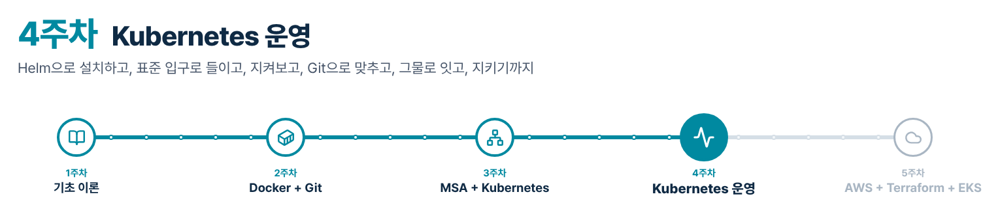

[🏠 과정 목차](../README.md)

# 4주차 · Kubernetes 운영

📕 4주차 이북 PDF: [보기](../downloads/pdf/week4.pdf) · [내려받기](https://github.com/niceguy61/kdt_devops_lecture_2026_rev2/raw/main/downloads/pdf/week4.pdf)

        

| 일차 | 주제 | 교시 | 슬라이드 |
|:--|:--|:--|:--|
| [**1일차**](day1/README.md) | Helm + Gateway API Helm 개념 · 설치 루프 · Ingress의 역사와 ingress-nginx 은퇴 · Gateway API 구조 · Envoy Gateway 설치 · HTTPRoute · 장애 분석 | [1](day1/lesson-01.md) [2](day1/lesson-02.md) [3](day1/lesson-03.md) [4](day1/lesson-04.md) [5](day1/lesson-05.md) [6](day1/lesson-06.md) [7](day1/lesson-07.md) | [📊 PPTX](https://github.com/niceguy61/kdt_devops_lecture_2026_rev2/raw/main/downloads/pptx/week4-day1.pptx) |
| [**2일차**](day2/README.md) | Observability 로그 · 메트릭 · 트레이스 · kube-prometheus-stack · 타깃과 PromQL · Grafana 대시보드 · k6 부하 테스트 · 알림 · 관찰 런북 | [1](day2/lesson-01.md) [2](day2/lesson-02.md) [3](day2/lesson-03.md) [4](day2/lesson-04.md) [5](day2/lesson-05.md) [6](day2/lesson-06.md) [7](day2/lesson-07.md) | [📊 PPTX](https://github.com/niceguy61/kdt_devops_lecture_2026_rev2/raw/main/downloads/pptx/week4-day2.pptx) |
| [**3일차**](day3/README.md) | GitOps push와 pull · 코드 저장소와 배포 저장소 · Argo CD 설치 · Application과 Sync · 어긋남(drift) · selfHeal과 prune · Actions → Argo CD 전체 파이프라인 | [1](day3/lesson-01.md) [2](day3/lesson-02.md) [3](day3/lesson-03.md) [4](day3/lesson-04.md) [5](day3/lesson-05.md) [6](day3/lesson-06.md) [7](day3/lesson-07.md) | [📊 PPTX](https://github.com/niceguy61/kdt_devops_lecture_2026_rev2/raw/main/downloads/pptx/week4-day3.pptx) |
| [**4일차**](day4/README.md) | Service Mesh 남북과 동서 · sidecar와 ambient · Istio 설치 · 메시 등록과 mTLS · Kiali · waypoint와 트래픽 나누기 · 장애 주입 · 타임아웃 · 호출 허가 | [1](day4/lesson-01.md) [2](day4/lesson-02.md) [3](day4/lesson-03.md) [4](day4/lesson-04.md) [5](day4/lesson-05.md) [6](day4/lesson-06.md) [7](day4/lesson-07.md) | [📊 PPTX](https://github.com/niceguy61/kdt_devops_lecture_2026_rev2/raw/main/downloads/pptx/week4-day4.pptx) |
| [**5일차**](day5/README.md) | Kubernetes 보안 인증 · 인가 · 입장 제어 · RBAC · ServiceAccount · 서비스 신원으로 허가 · Kyverno 정책 · 거절의 지도 · 4주차 종합 훈련 · 회고 | [1](day5/lesson-01.md) [2](day5/lesson-02.md) [3](day5/lesson-03.md) [4](day5/lesson-04.md) [5](day5/lesson-05.md) [6](day5/lesson-06.md) [7](day5/lesson-07.md) | [📊 PPTX](https://github.com/niceguy61/kdt_devops_lecture_2026_rev2/raw/main/downloads/pptx/week4-day5.pptx) |

교시 칸의 숫자는 교시 번호입니다. 처음이라면 1일차 목차부터 열고, 각 페이지 맨 아래의 <b>다음 ➡️</b>를 따라가세요.
