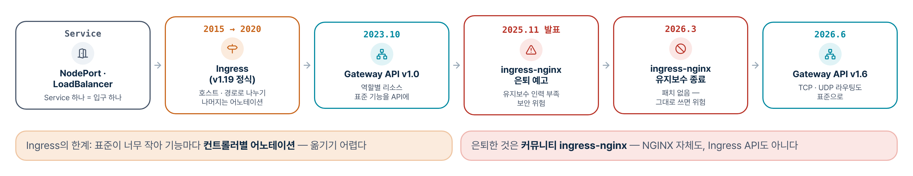

<sub>[🏠 과정 목차](../../README.md) › [4주차](../README.md) › [1일차](README.md) › 3/7교시</sub>

# 3교시 · Ingress의 역사와 ingress-nginx 은퇴

> [!NOTE]
> **이번 시간에 할 일**
>
> - 클러스터 바깥의 손님을 안으로 들이는 방법이 어떻게 바뀌어 왔는지 봅니다.
> - **Ingress**가 무엇을 풀었고, 왜 **어노테이션 지옥**에 빠졌는지 이해합니다.
> - **ingress-nginx 은퇴**가 정확히 무엇이 끝났다는 뜻인지, 무엇이 아닌지 구분합니다.
> - 내 클러스터에 Ingress 관련 리소스가 있는지 확인하는 법을 압니다.

## 입구의 역사



### 1단계 — Service로 직접 열기

3주차 4일차에 배운 두 가지입니다.

| 방식 | 문제 |
|---|---|
| **NodePort** | 포트 번호가 30000~32767이라 `:30080`을 붙여야 한다. 노드 IP가 바뀌면? |
| **LoadBalancer** | 클라우드가 로드 밸런서를 **Service 하나에 하나씩** 만든다. 서비스가 20개면 로드 밸런서 20개 — 그만큼 돈이 든다(5주차) |

그리고 둘 다 **L4**(IP · 포트)에서 동작해서, "`/api/orders`는 이쪽, `/`는 저쪽"처럼 **HTTP 경로나 도메인으로 나누지 못합니다.** DevMart가 nginx를 API 게이트웨이로 둔 이유가 이것입니다(3주차 1일차).

### 2단계 — Ingress (2015 베타 → 2020 정식)

Kubernetes는 "HTTP 요청을 **호스트 · 경로**로 나눠 Service로 보내라"는 규칙을 표준 리소스로 만들었습니다. 그것이 **Ingress**입니다. 규칙을 적은 Ingress와, 그 규칙대로 실제로 요청을 나누는 프로그램 **Ingress 컨트롤러**가 짝을 이룹니다(3주차 3일차 컨트롤러 패턴).

```yaml
# 읽기만 — DevMart를 Ingress로 적는다면
apiVersion: networking.k8s.io/v1
kind: Ingress
metadata:
  name: devmart
  annotations:
    nginx.ingress.kubernetes.io/proxy-read-timeout: "5"        # ← 어노테이션
    nginx.ingress.kubernetes.io/limit-rps: "20"                # ← 어노테이션
    nginx.ingress.kubernetes.io/canary: "true"                 # ← 어노테이션
spec:
  ingressClassName: nginx
  rules:
    - host: devmart.example.com
      http:
        paths:
          - path: /api/orders
            pathType: Prefix
            backend: { service: { name: order-api, port: { number: 8000 } } }
          - path: /
            pathType: Prefix
            backend: { service: { name: web, port: { number: 80 } } }
```

`spec:` 부분이 표준입니다. **호스트와 경로로 나누기, TLS 인증서** — 표준은 거의 이것이 전부였습니다. 그런데 실제 서비스에는 타임아웃(3주차 2일차!), 요청 수 제한, 카나리 배포, 헤더 바꾸기, 인증… 이 필요합니다. 표준에 없으니 컨트롤러마다 **어노테이션**으로 기능을 붙였습니다.

> **❓ 오해 — Ingress YAML은 어느 컨트롤러에서나 똑같이 동작한다**
>
> `spec:` 부분만 그렇습니다. 위 예의 어노테이션 세 줄은 **ingress-nginx만** 알아듣습니다. 다른 컨트롤러(Traefik, HAProxy, 클라우드 로드 밸런서 컨트롤러…)로 바꾸면 조용히 **무시**됩니다 — 타임아웃도 요청 수 제한도 사라진 채로 '정상'처럼 돕니다. 어노테이션은 문자열이라 오타가 나도 아무도 알려 주지 않습니다. 이렇게 기능이 표준 밖 어노테이션에 쌓인 상태를 흔히 **어노테이션 지옥**이라고 부릅니다.

### 3단계 — ingress-nginx의 은퇴

수많은 Ingress 컨트롤러 중 가장 널리 쓰인 것이 Kubernetes 프로젝트가 직접 관리하던 **ingress-nginx**(GitHub `kubernetes/ingress-nginx`)였습니다.

| 시점 | 일 |
|---|---|
| 오랫동안 | 클라우드 네이티브 환경의 약 절반이 의존. 그러나 실제 관리자는 **한두 명의 자원봉사자** |
| 2025년 3월 | 컨트롤러에서 원격 코드 실행까지 가능한 심각한 취약점 묶음(일명 *IngressNightmare*)이 공개되어 대규모 긴급 패치 |
| 2025년 11월 | Kubernetes SIG Network와 보안 대응 위원회가 **은퇴 예고** |
| 2026년 1월 | 운영 · 보안 위원회 공동 성명 — "그대로 남으면 공격에 노출된다. 바로 대체할 수 있는 것은 없다" |
| **2026년 3월** | 유지보수 종료. 이후 **새 릴리스 · 버그 수정 · 보안 패치 없음** |

> [!IMPORTANT]
> **무엇이 끝났고, 무엇이 끝나지 않았나**
>
> | 끝난 것 | 끝나지 않은 것 |
> |---|---|
> | 커뮤니티 **ingress-nginx 컨트롤러** (`kubernetes/ingress-nginx`)의 유지보수 | **NGINX** 웹 서버 자체 (2주차에 쓴 그 nginx) |
> | | F5가 만드는 별개의 **NGINX Ingress Controller** (이름이 비슷한 다른 프로젝트) |
> | | Kubernetes의 **Ingress API** 자체 — 리소스는 계속 있고, 다른 컨트롤러로 쓸 수 있다 |
> | | 이미 설치된 ingress-nginx — **계속 돌아간다.** 그래서 더 위험하다 |
>
> 마지막 줄이 핵심입니다. 은퇴한 소프트웨어는 멈추지 않습니다. **조용히 돌아가면서 새 취약점이 생겨도 고쳐지지 않는 상태**가 됩니다. 1주차 2일차에 배운 '지원 종료(EOL)된 OS'와 같은 위험입니다.

> **📘 예시 — 내 클러스터에 ingress-nginx가 있나**
>
> ```bash
> kubectl get pods -A -l app.kubernetes.io/name=ingress-nginx
> kubectl get ingressclass
> kubectl get ingress -A
> ```
> 오늘 우리 kind 클러스터에서는 셋 다 `No resources found`입니다(설치한 적이 없으니). 회사 클러스터라면 이 세 줄이 **은퇴 영향 조사의 첫 명령**입니다. Ingress 리소스가 있다면 어노테이션을 모아 "무엇을 옮겨야 하나" 목록을 만듭니다.

### 4단계 — Gateway API

Ingress의 한계를 처음부터 다시 설계한 것이 **Gateway API**입니다. 2023년 10월 v1.0으로 정식이 되었고, 2026년 6월 v1.6에서는 HTTP뿐 아니라 TCP · UDP 라우팅까지 표준(Standard)이 되었습니다.

| | Ingress | Gateway API |
|---|---|---|
| 리소스 | Ingress 하나에 모두 | **GatewayClass · Gateway · HTTPRoute …** 역할별로 (4교시) |
| 타임아웃 · 재시도 · 가중치 · 헤더 · 리다이렉트 | 컨트롤러별 **어노테이션** | **표준 필드** (구현이 지원하면 같은 YAML로) |
| 프로토콜 | HTTP(S) | HTTP · gRPC · TLS · TCP · UDP |
| 다른 네임스페이스 | 애매함 | **명시적 허락**(allowedRoutes, ReferenceGrant) |
| 상태 보고 | 거의 없음 | 리소스마다 `status.conditions` — "받아들였나, 연결됐나" (7교시) |
| 미래 | 기능 추가 **동결** | 계속 발전 (실험 채널 → 표준 채널) |

> **🧩 비유 — 건물 안내판**
>
> Ingress는 **건물 입구에 붙은 안내판 하나**입니다. "3층 — 영업부, 5층 — 개발부"까지는 표준 양식이 있지만, "점심시간엔 5층 출입 금지" 같은 규칙은 경비 회사마다 다른 **포스트잇**(어노테이션)으로 붙였습니다. 경비 회사를 바꾸면 포스트잇은 아무도 안 읽습니다. Gateway API는 **건물 관리 규정 자체를 다시 쓴 것**입니다 — 건물주(GatewayClass), 관리소(Gateway), 입주 회사(HTTPRoute)가 각자 자기 몫을 정해진 양식으로 적습니다.

## 실습 5 · 입구 방식 비교표

> **🧪 실습: 실습 목표**
>
> 지금까지 DevMart의 입구를 세 가지 방식으로 열어 봤습니다. 오늘 오후의 Gateway까지 넣어 비교표를 만듭니다. 마지막 열은 6교시가 끝난 뒤에 채웁니다.

| | NodePort 직접 (3주차 4일차 catalog-api) | nginx Pod + NodePort (3주차 5일차) | Ingress (만약 썼다면) | Gateway API (오늘) |
|---|---|---|---|---|
| 경로로 나누기 | | | | |
| 설정을 바꾸려면 | | | | |
| 다른 구현으로 바꾸려면 | | | | |
| 장애 상태를 어디서 보나 | | | | |

> **🟢 확인: 예시 답 (일부)**
>
> - nginx Pod: 경로로 나누기 **가능** — 하지만 설정이 `default.conf`라는 **nginx만의 문법**이고, ConfigMap을 고친 뒤 nginx를 다시 시작해야 한다(3주차 5일차 2교시).
> - Ingress: 경로로 나누기 **표준** — 타임아웃 같은 것은 **어노테이션**.
> - Gateway API: 경로 · 타임아웃 · 가중치 모두 **표준 필드**, 상태는 **status.conditions**.

> **🎓 학술 노트 — 오픈소스의 지속 가능성과 '공유지의 비극'**
>
> ingress-nginx는 수많은 회사의 운영 환경을 떠받쳤지만, 그 무게를 진 것은 소수의 자원봉사자였습니다. Nadia Eghbal의 *Roads and Bridges: The Unseen Labor Behind Our Digital Infrastructure*(Ford Foundation, 2016)와 *Working in Public*(2020)은 이런 **디지털 공공 기반 시설**이 사용량에 비해 유지보수 투자를 받지 못하는 구조를 분석했습니다. 2014년 OpenSSL의 Heartbleed, 2021년 Log4Shell, 2024년 xz 백도어가 같은 패턴입니다. 2026년의 ingress-nginx 은퇴는 그 구조가 보안 위험으로 드러났을 때 커뮤니티가 **"계속 위험하게 유지하는 것보다 공개적으로 은퇴시키는 것이 안전하다"**고 판단한 사례입니다. 우리가 쓰는 오픈소스의 **유지보수 상태**(최근 릴리스, 관리자 수, 보안 대응)를 확인하는 것도 인프라 엔지니어의 일입니다.

> **📈 트렌드 2026 — 옮기는 해**
>
> 2026년은 많은 팀에게 'Ingress에서 옮기는 해'가 되었습니다. 대체지는 크게 둘입니다 — **Gateway API로 옮기기**(Envoy Gateway, Cilium, Istio, NGINX Gateway Fabric, kgateway, Traefik 등 구현이 다양하다), 또는 **다른 Ingress 컨트롤러로 바꾸고 Gateway API는 나중에**. Ingress 리소스를 Gateway API 리소스로 바꿔 주는 공식 도구 **ingress2gateway**도 있지만, 어노테이션의 뜻까지 옮겨 주지는 못해 사람이 확인해야 합니다. 한 CNCF 회원사 사례 글은 2025년 말 기준 자기 회사 배포의 약 60%가 ingress-nginx에 기대고 있었다고 밝혔습니다.

> **✅ 확인 문제**
>
> 1. NodePort · LoadBalancer만으로 부족했던 이유 두 가지는?
> 2. Ingress에서 '어노테이션 지옥'이 생긴 원인은?
> 3. 2026년 3월에 끝난 것과 끝나지 않은 것을 하나씩 드세요.
> 4. 은퇴한 ingress-nginx가 '계속 돌아간다'는 것이 왜 더 위험한가요?
> 5. Gateway API가 Ingress보다 나은 점을 세 가지 드세요.
>
> <details><summary>정답</summary>
>
> 1. HTTP 경로 · 호스트로 나누지 못한다(L4), LoadBalancer는 Service마다 하나씩 생겨 비싸다
> 2. 표준(spec)이 호스트 · 경로 · TLS 정도로 작아서, 나머지 기능을 컨트롤러마다 다른 어노테이션으로 붙였기 때문
> 3. 끝난 것 — 커뮤니티 ingress-nginx 컨트롤러의 유지보수 · 보안 패치. 끝나지 않은 것 — NGINX 웹 서버, F5 NGINX Ingress Controller, Ingress API 자체 중 하나
> 4. 멈추지 않으니 영향받는 줄 모르고 계속 쓰게 되는데, 새 취약점이 생겨도 고쳐지지 않는다
> 5. 역할별 리소스, 표준 필드(타임아웃 · 가중치 등), 여러 프로토콜, 명시적인 네임스페이스 허락, status로 상태 보고 중 셋
>
> </details>

## 참고 문헌

- Kubernetes Blog (2025-11-11). *Ingress NGINX Retirement: What You Need to Know*. kubernetes.io/blog
- Kubernetes Blog (2026-01-29). *Ingress NGINX: Statement from the Kubernetes Steering and Security Response Committees*. kubernetes.io/blog
- Kubernetes Docs. *Ingress* · *Ingress Controllers*. kubernetes.io/docs/concepts/services-networking
- Gateway API. *Introduction* · *Migrating from Ingress*. gateway-api.sigs.k8s.io
- CNCF Blog (2026-04). *Ingress NGINX retirement: experience from end users*. cncf.io/blog
- Eghbal, N. (2016). *Roads and Bridges: The Unseen Labor Behind Our Digital Infrastructure*. Ford Foundation.

---

| 이전 | 목차 | 다음 |
|:--|:--:|--:|
| ⬅️ [2교시 · Helm 설치 루프](lesson-02.md) | [⬆️ 1일차 목차](README.md) | [4교시 · Gateway API 구조](lesson-04.md) ➡️ |
